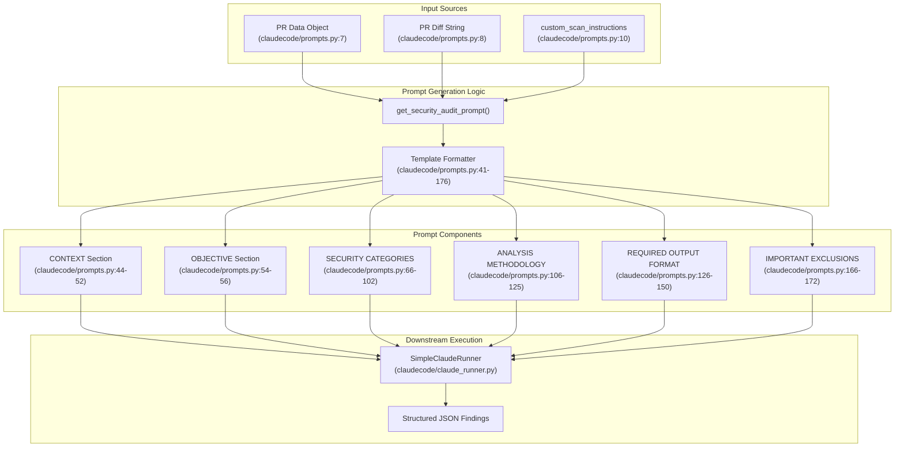
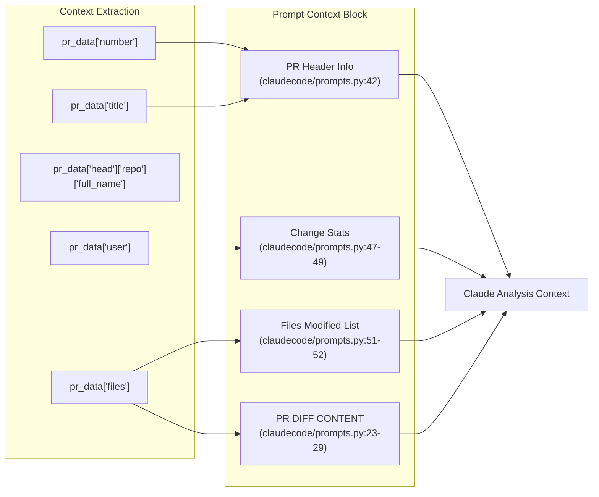

<!-- source: DeepWiki mcp.deepwiki.com · repo anthropics/claude-code-security-review · page 4.1 Prompt Engineering and Templates · fetched 2026-10-26 -->

# Prompt Engineering and Templates

<details>
<summary>Relevant source files</summary>

The following files were used as context for generating this wiki page:

- [claudecode/prompts.py](claudecode/prompts.py)
- [claudecode/test_prompts.py](claudecode/test_prompts.py)

</details>


## Purpose and Scope

This document details the prompt engineering system that drives the AI-powered security analysis in the Claude Code Security Review tool. It covers the prompt templates, vulnerability categories, analysis methodology, and output format specifications that guide Claude's security review process.

For information about how these prompts are executed via the Claude CLI, see [3.4 Claude CLI Runner](). For details on how findings are filtered after generation, see [4.3 False Positive Filtering System]().

## Overview

The system employs two related but distinct prompt sources:

1.  **Python Prompt Template** ([claudecode/prompts.py:1-176]()): Used by the GitHub Action and evaluation systems, generates structured JSON output.
2.  **Slash Command Template** (referenced in methodology): Used in Claude Code IDE for interactive security reviews, generates markdown output.

Both prompts share core security categories and methodology but differ in output format and execution context.

Sources: [claudecode/prompts.py:1-176]()

## Prompt Architecture



**Diagram: Prompt Generation Pipeline**

The `get_security_audit_prompt` function assembles a comprehensive prompt from multiple data sources, combining PR metadata with structured security analysis instructions.

Sources: [claudecode/prompts.py:3-176]()

## Prompt Generation Function

The core prompt generation is handled by `get_security_audit_prompt()` in [claudecode/prompts.py:3-14]():

```python
def get_security_audit_prompt(pr_data, pr_diff=None, include_diff=True, custom_scan_instructions=None):
```

### Parameters

| Parameter | Type | Purpose |
|-----------|------|---------|
| `pr_data` | `dict` | PR metadata from GitHub API (number, title, files, user, stats) [claudecode/prompts.py:7]() |
| `pr_diff` | `str` | Complete unified diff of PR changes (optional) [claudecode/prompts.py:8]() |
| `include_diff` | `bool` | Whether to include diff in prompt (default: `True`) [claudecode/prompts.py:9]() |
| `custom_scan_instructions` | `str` | Additional security categories to append (optional) [claudecode/prompts.py:10]() |

### Return Value

Returns a formatted string prompt containing all instructions and context for the security review [claudecode/prompts.py:13]().

Sources: [claudecode/prompts.py:3-41]()

## Context Section Structure

The prompt begins with structured context about the PR under review:



**Diagram: Context Data Flow**

The context section ([claudecode/prompts.py:42-52]()) provides Claude with essential information about what code to analyze:

*   PR number and title [claudecode/prompts.py:42]()
*   Repository full name [claudecode/prompts.py:45]()
*   Author information [claudecode/prompts.py:46]()
*   Change statistics (files changed, lines added/deleted) [claudecode/prompts.py:47-49]()
*   List of modified files [claudecode/prompts.py:51-52]()
*   Complete unified diff (if `include_diff=True`) [claudecode/prompts.py:20-29]()

When diffs are too large, the system can omit the diff content and instead instruct Claude to use file exploration tools ([claudecode/prompts.py:30-34]()).

Sources: [claudecode/prompts.py:18-34](), [claudecode/prompts.py:42-52]()

## Security Vulnerability Categories

The prompt defines five primary vulnerability categories with specific subcategories:

### Input Validation Vulnerabilities
[claudecode/prompts.py:68-74]()
*   SQL injection via unsanitized user input
*   Command injection in system calls or subprocesses
*   XXE injection in XML parsing
*   Template injection in templating engines
*   NoSQL injection in database queries
*   Path traversal in file operations

### Authentication & Authorization Issues
[claudecode/prompts.py:76-81]()
*   Authentication bypass logic
*   Privilege escalation paths
*   Session management flaws
*   JWT token vulnerabilities
*   Authorization logic bypasses

### Crypto & Secrets Management
[claudecode/prompts.py:83-88]()
*   Hardcoded API keys, passwords, or tokens
*   Weak cryptographic algorithms or implementations
*   Improper key storage or management
*   Cryptographic randomness issues
*   Certificate validation bypasses

### Injection & Code Execution
[claudecode/prompts.py:90-95]()
*   Remote code execution via deserialization
*   Pickle injection in Python
*   YAML deserialization vulnerabilities
*   Eval injection in dynamic code execution
*   XSS vulnerabilities (reflected, stored, DOM-based)

### Data Exposure
[claudecode/prompts.py:97-101]()
*   Sensitive data logging or storage
*   PII handling violations
*   API endpoint data leakage
*   Debug information exposure

Sources: [claudecode/prompts.py:66-102]()

## Three-Phase Analysis Methodology

The prompt prescribes a structured three-phase analysis approach [claudecode/prompts.py:106-125]():

### Phase 1: Repository Context Research
[claudecode/prompts.py:108-112]()
Uses Claude's file exploration tools to:
*   Identify existing security frameworks and libraries.
*   Look for established secure coding patterns.
*   Examine existing sanitization and validation patterns.
*   Understand the project's security and threat model.

### Phase 2: Comparative Analysis
[claudecode/prompts.py:114-118]()
Compares new changes against existing patterns:
*   Identify deviations from established secure practices.
*   Look for inconsistent security implementations.
*   Flag code that introduces new attack surfaces.

### Phase 3: Vulnerability Assessment
[claudecode/prompts.py:120-124]()
Performs detailed security analysis:
*   Examine each modified file for security implications.
*   Trace data flow from user inputs to sensitive operations.
*   Look for privilege boundaries being crossed unsafely.
*   Identify injection points and unsafe deserialization.

Sources: [claudecode/prompts.py:106-125]()

## Output Format Specification

The prompt ([claudecode/prompts.py:126-150]()) requires structured JSON output with a specific schema:

```json
{
  "findings": [
    {
      "file": "path/to/file.py",
      "line": 42,
      "severity": "HIGH",
      "category": "sql_injection",
      "description": "User input passed to SQL query without parameterization",
      "exploit_scenario": "Attacker could extract database contents...",
      "recommendation": "Replace string formatting with parameterized queries...",
      "confidence": 0.95
    }
  ],
  "analysis_summary": {
    "files_reviewed": 8,
    "high_severity": 1,
    "medium_severity": 0,
    "low_severity": 0,
    "review_completed": true
  }
}
```

### Field Specifications

| Field | Type | Purpose |
|-------|------|---------|
| `file` | `string` | Path to vulnerable file [claudecode/prompts.py:133]() |
| `line` | `integer` | Line number of vulnerability [claudecode/prompts.py:134]() |
| `severity` | `string` | HIGH, MEDIUM, or LOW [claudecode/prompts.py:135]() |
| `category` | `string` | Vulnerability type identifier [claudecode/prompts.py:136]() |
| `description` | `string` | Clear explanation of the issue [claudecode/prompts.py:137]() |
| `exploit_scenario` | `string` | Concrete attack demonstration [claudecode/prompts.py:138]() |
| `recommendation` | `string` | Specific remediation steps [claudecode/prompts.py:139]() |
| `confidence` | `float` | Confidence score 0.0-1.0 [claudecode/prompts.py:140]() |

Sources: [claudecode/prompts.py:126-150]()

## Severity and Confidence Guidelines

### Severity Levels
[claudecode/prompts.py:152-155]()
*   **HIGH**: Directly exploitable vulnerabilities leading to RCE, data breach, or authentication bypass.
*   **MEDIUM**: Vulnerabilities requiring specific conditions but with significant impact.
*   **LOW**: Defense-in-depth issues or lower-impact vulnerabilities.

### Confidence Scoring
[claudecode/prompts.py:157-161]()
*   **0.9-1.0**: Certain exploit path identified.
*   **0.8-0.9**: Clear vulnerability pattern with known exploitation methods.
*   **0.7-0.8**: Suspicious pattern requiring specific conditions to exploit.
*   **Below 0.7**: Don't report (too speculative).

The prompt explicitly instructs: "Better to miss some theoretical issues than flood the report with false positives" ([claudecode/prompts.py:163-164]()).

Sources: [claudecode/prompts.py:152-165]()

## Critical Instructions and Exclusions

### Core Principles
[claudecode/prompts.py:57-60]()
1.  **MINIMIZE FALSE POSITIVES**: Only flag issues where you're >80% confident of actual exploitability.
2.  **AVOID NOISE**: Skip theoretical issues, style concerns, or low-impact findings.
3.  **FOCUS ON IMPACT**: Prioritize vulnerabilities leading to unauthorized access or data breaches.

### Explicit Exclusions
The prompt explicitly excludes several issue types [claudecode/prompts.py:61-64, 166-172]():
*   Denial of Service (DOS) vulnerabilities or resource exhaustion attacks.
*   Secrets or sensitive data stored on disk (handled by other processes).
*   Rate limiting or resource exhaustion issues.
*   Memory consumption or CPU exhaustion issues.
*   Lack of input validation on non-security-critical fields.

Sources: [claudecode/prompts.py:57-65, 166-172]()

## Testing and Verification

The `claudecode/test_prompts.py` file contains comprehensive tests for the prompt generation logic:

*   **Basic Generation**: Verifies PR number, title, and author are included ([claudecode/test_prompts.py:9-54]()).
*   **Empty PR Body**: Ensures the system handles null PR descriptions gracefully ([claudecode/test_prompts.py:55-81]()).
*   **Multiple Files**: Checks that all modified, added, and deleted files are listed ([claudecode/test_prompts.py:82-141]()).
*   **Special Characters**: Validates that special characters in titles and filenames are preserved ([claudecode/test_prompts.py:142-181]()).

Sources: [claudecode/test_prompts.py:1-181]()

---

