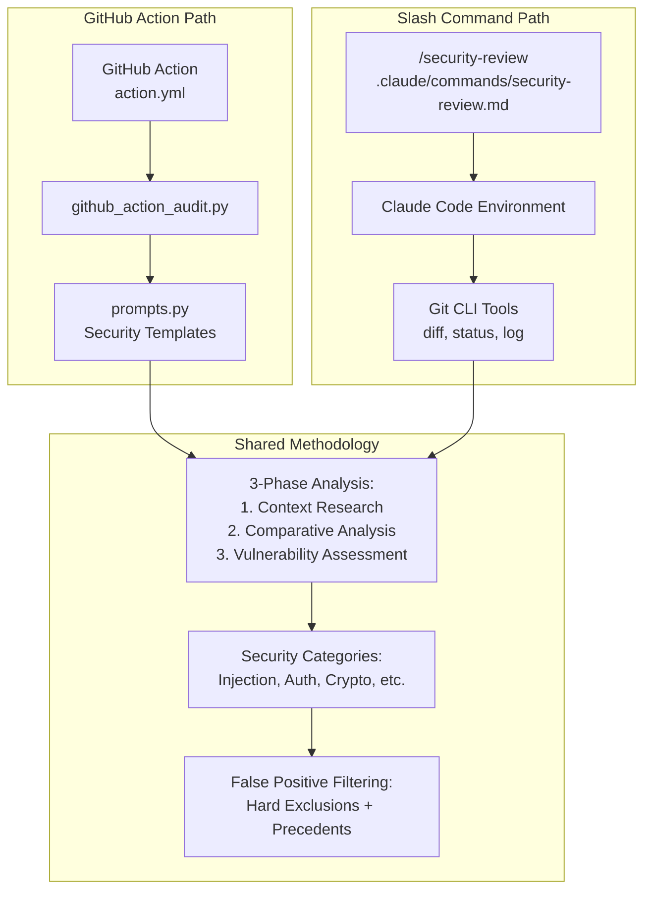
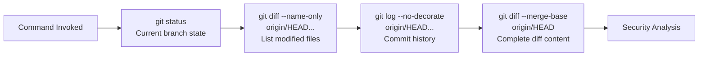
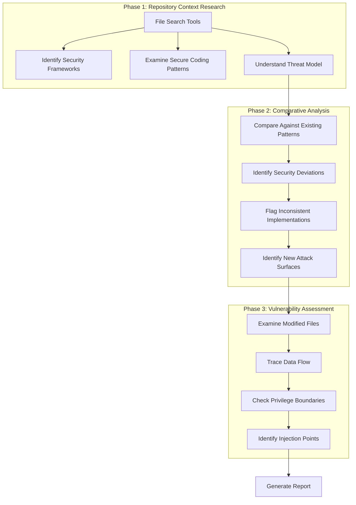
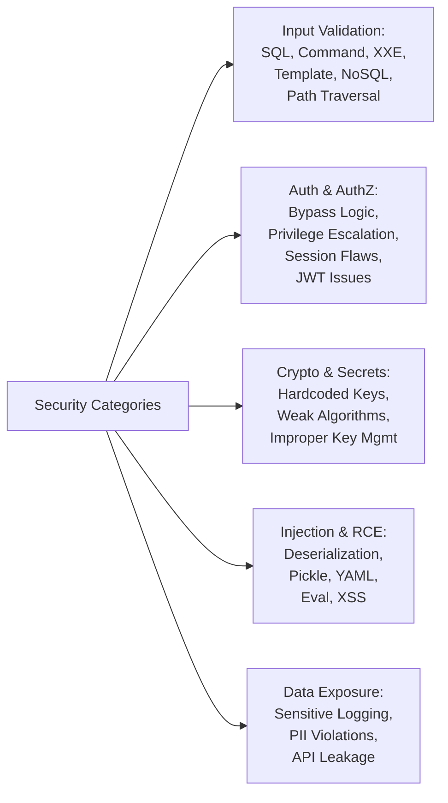
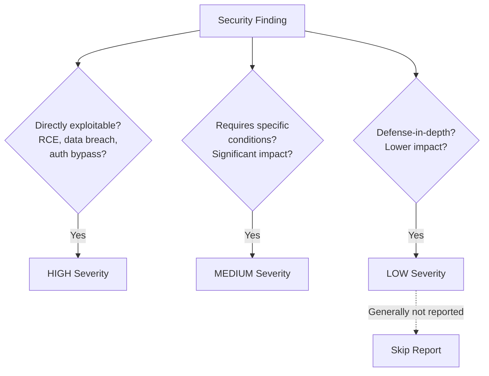
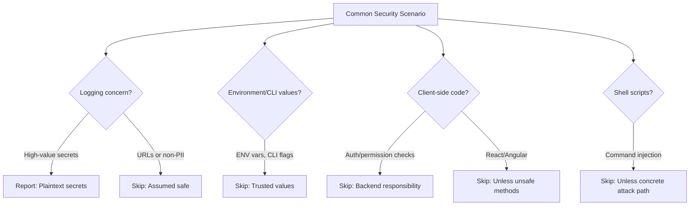
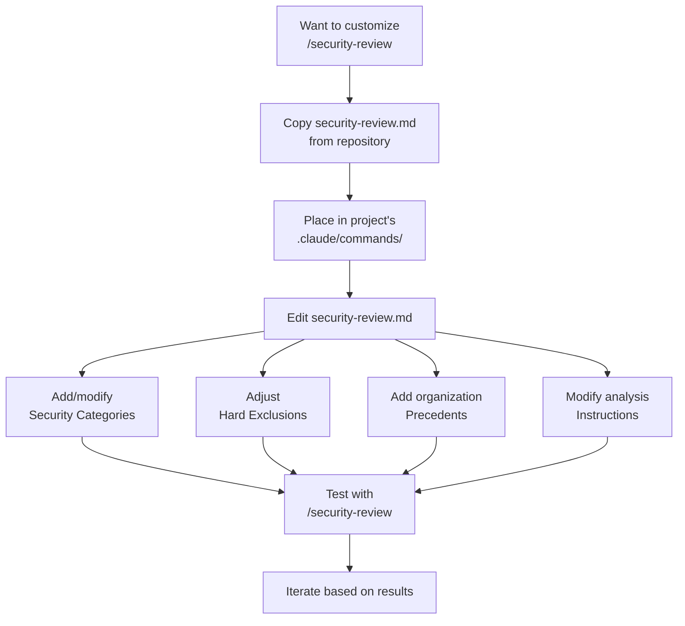
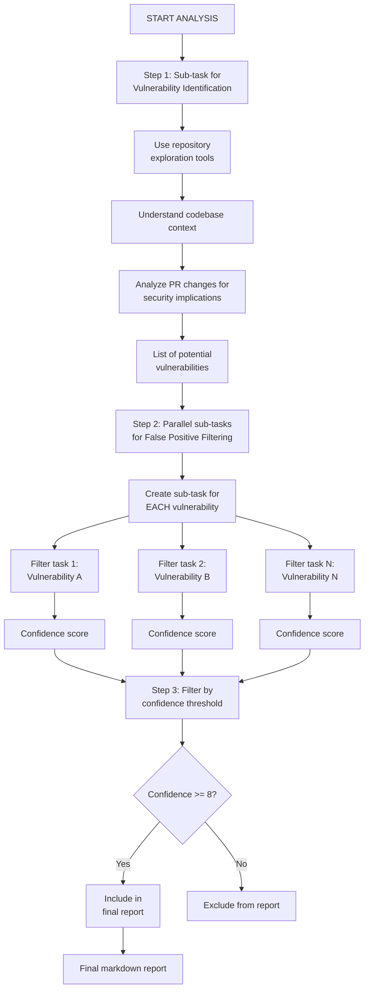

<!-- source: DeepWiki mcp.deepwiki.com · repo anthropics/claude-code-security-review · page 4.2 Security Review Process Definition · fetched 2026-10-26 -->

# Security Review Process Definition

<details>
<summary>Relevant source files</summary>

The following files were used as context for generating this wiki page:

- [.claude/commands/security-review.md](.claude/commands/security-review.md)

</details>


## Purpose and Scope

This document describes the `/security-review` slash command configuration that ships with Claude Code, defining the security review methodology and analysis process. This command provides an interactive interface to the same security analysis capabilities offered by the GitHub Action workflow. For information about the prompt templates used by the GitHub Action, see [Prompt Engineering and Templates](4.1). For details on false positive filtering implementation, see [False Positive Filtering System](4.3).

---

## Slash Command Overview

The `/security-review` command is a Claude Code slash command that enables on-demand security analysis directly within the Claude Code development environment. Unlike the automated GitHub Action workflow, this command is invoked interactively by developers when they want to review their current branch changes.

### Key Characteristics

| Aspect | Description |
|--------|-------------|
| **Location** | [.claude/commands/security-review.md:1-191]() |
| **Execution Context** | Claude Code IDE, interactive development environment |
| **Scope** | Analyzes all pending changes on current branch vs `origin/HEAD` [.claude/commands/security-review.md:17-32]() |
| **Integration Method** | Uses Claude's native tool execution capabilities (Bash, Read, Glob, etc.) [.claude/commands/security-review.md:2-2]() |
| **Shared Core** | Converges on same security analysis methodology as GitHub Action |

### Comparison to GitHub Action



**Sources:** [.claude/commands/security-review.md:1-191](), [README.md:133-148]()

---

## Command Configuration Structure

The slash command is defined using Claude Code's markdown-based command format with YAML frontmatter.

### Metadata Configuration

[.claude/commands/security-review.md:1-4]() defines the command metadata:

```yaml
---
allowed-tools: Bash(git diff:*), Bash(git status:*), Bash(git log:*), 
               Bash(git show:*), Bash(git remote show:*), Read, Glob, Grep, LS, Task
description: Complete a security review of the pending changes on the current branch
---
```

| Field | Purpose |
|-------|---------|
| `allowed-tools` | Restricts Claude to specific tool permissions, primarily git commands and file reading operations [.claude/commands/security-review.md:2-2]() |
| `description` | User-facing description shown in Claude Code UI [.claude/commands/security-review.md:3-3]() |

### Git Context Collection

The command begins by collecting git context via shell command interpolation [.claude/commands/security-review.md:8-30]():



This sequence provides Claude with:
1. Current working tree state [.claude/commands/security-review.md:11-11]()
2. List of modified files [.claude/commands/security-review.md:17-17]()
3. Commit history for context [.claude/commands/security-review.md:23-23]()
4. Complete unified diff of all changes [.claude/commands/security-review.md:29-29]()

**Sources:** [.claude/commands/security-review.md:8-30]()

---

## Security Review Methodology

The command defines a structured 3-phase analysis approach [.claude/commands/security-review.md:87-106]() that guides Claude through systematic security review.

### Three-Phase Analysis Process



| Phase | Objective | Key Activities |
|-------|-----------|----------------|
| **Phase 1: Context Research** | Understand project's existing security posture | Identify frameworks, secure patterns, validation methods, threat model [.claude/commands/security-review.md:89-93]() |
| **Phase 2: Comparative Analysis** | Detect deviations from established practices | Compare changes to patterns, flag inconsistencies, identify new attack surfaces [.claude/commands/security-review.md:95-99]() |
| **Phase 3: Vulnerability Assessment** | Find concrete security issues | Examine files, trace data flow, check privilege boundaries, find injection points [.claude/commands/security-review.md:101-105]() |

**Sources:** [.claude/commands/security-review.md:87-106]()

### Security Categories

The command explicitly enumerates security categories to examine [.claude/commands/security-review.md:47-83]():



**Sources:** [.claude/commands/security-review.md:47-83]()

---

## Output Format and Severity Guidelines

The command mandates a structured markdown output format [.claude/commands/security-review.md:107-119]() to ensure consistency and actionability.

### Required Output Structure

Each finding must include [.claude/commands/security-review.md:109-118]():

| Component | Description | Example |
|-----------|-------------|---------|
| **Title** | `# Vuln N: Category: file:line` | `# Vuln 1: XSS: foo.py:42` |
| **Severity** | HIGH, MEDIUM, or LOW | `* Severity: High` |
| **Description** | Concise explanation of the vulnerability | User input directly interpolated into HTML |
| **Exploit Scenario** | Concrete attack path demonstrating exploitability | Attacker crafts URL with `<script>` tag |
| **Recommendation** | Specific remediation guidance | Use Flask's `escape()` function |

### Severity Classification

[.claude/commands/security-review.md:120-123]() defines clear severity thresholds:



**Sources:** [.claude/commands/security-review.md:107-133]()

---

## False Positive Filtering Instructions

The command includes comprehensive false positive filtering guidance [.claude/commands/security-review.md:134-182]() to minimize noise and focus on high-confidence vulnerabilities.

### Hard Exclusions

The command defines 17 automatic exclusion patterns [.claude/commands/security-review.md:138-156]():

| Category | Exclusions | Rationale |
|----------|------------|-----------|
| **DOS/Resource** | DOS vulnerabilities, rate limiting, memory/CPU exhaustion [.claude/commands/security-review.md:139-142]() | Low priority for most threat models |
| **Configuration** | Secrets on disk (if secured), audit logs [.claude/commands/security-review.md:140-156]() | Managed by other processes |
| **Validation** | Input validation without proven impact, lack of hardening [.claude/commands/security-review.md:143-145]() | Must show concrete exploitability |
| **Workflow Security** | GitHub Actions vulnerabilities (unless clearly exploitable) [.claude/commands/security-review.md:144-144]() | Rarely exploitable in practice |
| **Theoretical Issues** | Race conditions without concrete impact, timing attacks [.claude/commands/security-review.md:146-146]() | Focus on practical issues |
| **Language-Specific** | Memory safety in Rust, XSS in React/Angular (unless unsafe methods) [.claude/commands/security-review.md:148-148]() | Framework protections sufficient |
| **Testing/Documentation** | Test files, markdown documentation [.claude/commands/security-review.md:149-155]() | Not production code |
| **Low-Impact Web** | Log spoofing, regex injection, SSRF (path-only), open redirects [.claude/commands/security-review.md:150-154]() | Minor security impact |

### Precedent Rules

[.claude/commands/security-review.md:158-171]() establishes precedents for common scenarios:



### Confidence Scoring System

[.claude/commands/security-review.md:125-130]() requires confidence assessment:

| Confidence Range | Criteria | Action |
|------------------|----------|--------|
| **0.9-1.0** | Certain exploit path identified, tested if possible [.claude/commands/security-review.md:126-126]() | Report with high priority |
| **0.8-0.9** | Clear vulnerability pattern with known exploitation [.claude/commands/security-review.md:127-127]() | Report |
| **0.7-0.8** | Suspicious pattern requiring specific conditions [.claude/commands/security-review.md:128-128]() | Report with caution |
| **Below 0.7** | Speculative or theoretical [.claude/commands/security-review.md:129-129]() | Do not report |

The command explicitly instructs to filter out findings with confidence < 8/10 [.claude/commands/security-review.md:189-189]().

**Sources:** [.claude/commands/security-review.md:134-182]()

---

## Customization Process

The command can be customized for organization-specific security requirements [README.md:140-145]().

### Customization Steps



### Common Customizations

| Customization Type | Location in File | Example Use Case |
|-------------------|------------------|------------------|
| **Add Security Categories** | [.claude/commands/security-review.md:47-83]() | Organization uses specific frameworks requiring unique checks |
| **Modify Hard Exclusions** | [.claude/commands/security-review.md:138-156]() | Adjust DOS reporting threshold for high-availability services |
| **Add Precedents** | [.claude/commands/security-review.md:158-171]() | Define organization-specific secure patterns |
| **Adjust Confidence Threshold** | [.claude/commands/security-review.md:189]() | Require higher confidence for sensitive codebases |
| **Custom Analysis Instructions** | [.claude/commands/security-review.md:87-106]() | Add industry-specific security considerations |

**Sources:** [README.md:140-148](), [.claude/commands/security-review.md:1-191]()

---

## Sub-Task Based Analysis

The command employs a sophisticated three-step sub-task approach [.claude/commands/security-review.md:185-190]() to ensure thorough analysis and filtering:

### Analysis Steps



This approach ensures:
- **Thorough initial detection**: First sub-task has complete context for vulnerability identification [.claude/commands/security-review.md:186-186]()
- **Parallel filtering**: Each vulnerability is independently validated via sub-tasks, improving accuracy [.claude/commands/security-review.md:187-187]()
- **Consistent thresholding**: Automatic confidence filtering at >= 8/10 [.claude/commands/security-review.md:189-189]()

**Sources:** [.claude/commands/security-review.md:185-191]()

---

