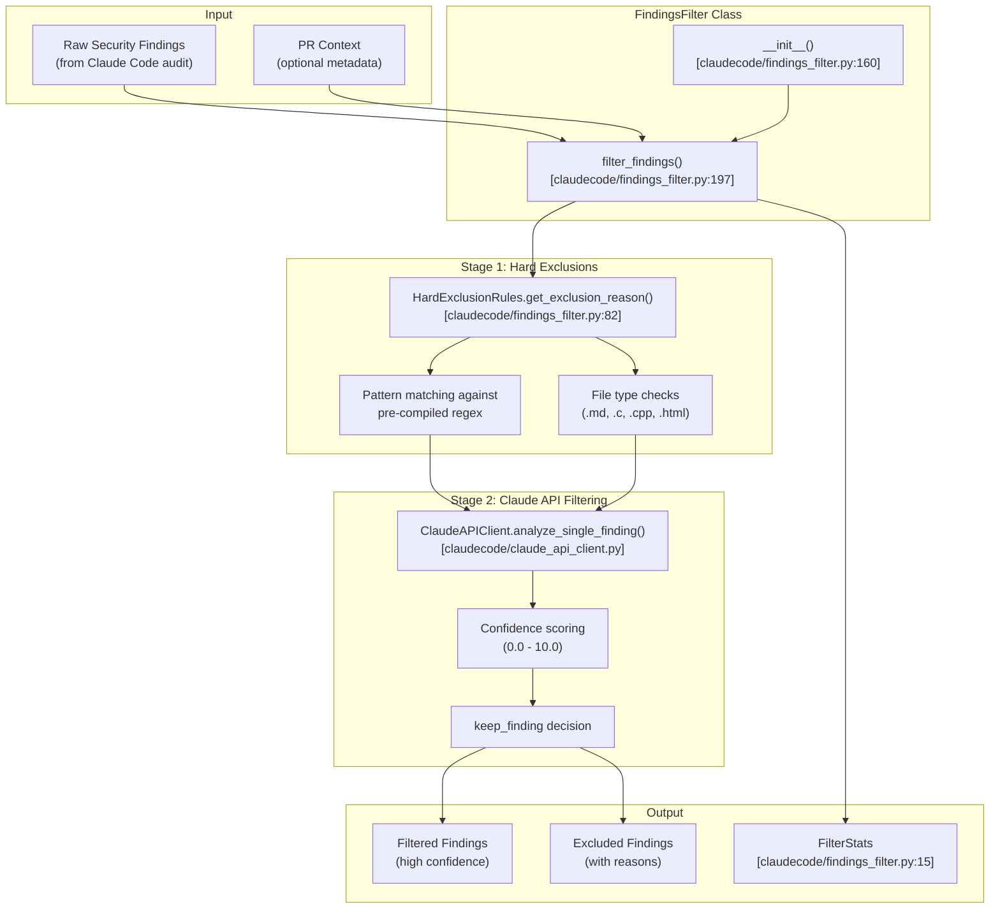
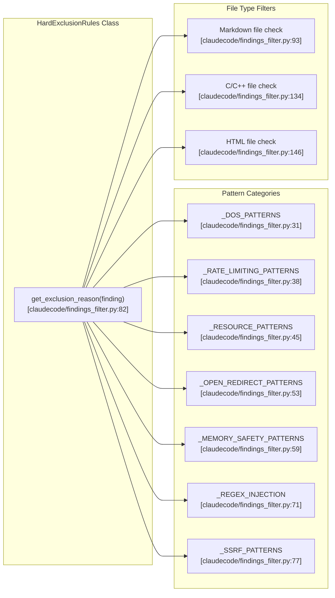
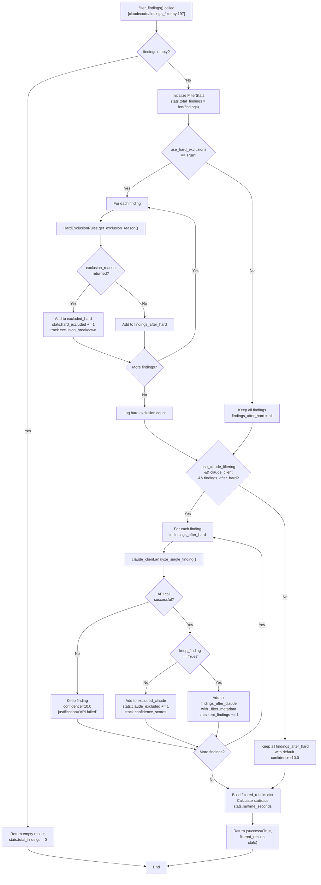
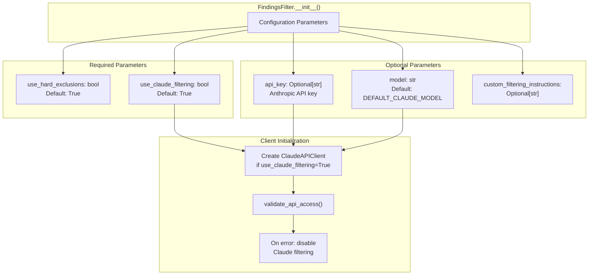
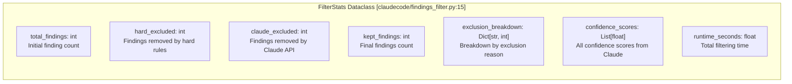
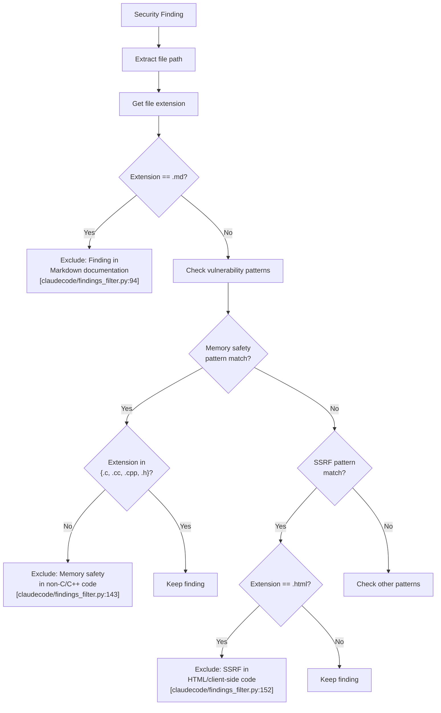

<!-- source: DeepWiki mcp.deepwiki.com · repo anthropics/claude-code-security-review · page 4.3 False Positive Filtering System · fetched 2026-10-26 -->

# False Positive Filtering System

<details>
<summary>Relevant source files</summary>

The following files were used as context for generating this wiki page:

- [claudecode/findings_filter.py](claudecode/findings_filter.py)
- [claudecode/test_findings_conversion.py](claudecode/test_findings_conversion.py)
- [claudecode/test_hard_exclusion_rules.py](claudecode/test_hard_exclusion_rules.py)

</details>


## Purpose and Scope

The False Positive Filtering System reduces noise in security audit results by removing findings that are unlikely to represent genuine vulnerabilities. This system implements a two-stage filtering pipeline: pattern-based hard exclusions followed by optional AI-powered validation.

This document covers the filtering architecture, hard exclusion rules, workflow orchestration, and configuration. For details on the Claude API client used in the second filtering stage, see [Claude API Client for Filtering](#4.4). For the overall audit orchestration that invokes this filter, see [Main Audit Orchestrator](#3.2).

**Sources:** [claudecode/findings_filter.py:1-12]()

## Architecture Overview

The filtering system is implemented in the `FindingsFilter` class, which coordinates two distinct filtering stages:



**Filtering Pipeline Architecture**

The `FindingsFilter` class ([claudecode/findings_filter.py:157-165]()) orchestrates the two-stage process. Each finding passes through hard exclusion rules first ([claudecode/findings_filter.py:229-253]()), then surviving findings are optionally analyzed by the Claude API for confidence scoring ([claudecode/findings_filter.py:255-316]()).

**Sources:** [claudecode/findings_filter.py:15-24](), [claudecode/findings_filter.py:157-343]()

## Hard Exclusion Rules

The `HardExclusionRules` class ([claudecode/findings_filter.py:27-154]()) implements pattern-based filtering using pre-compiled regular expressions. These rules remove common false positives that don't require AI analysis.

### Pattern Categories



**Hard Exclusion Pattern Categories**

**Sources:** [claudecode/findings_filter.py:27-154]()

### Pattern Details

| Category | Patterns | Exclusion Reason | File Type Logic |
|----------|----------|------------------|-----------------|
| **DOS** | `denial of service`, `resource exhaustion`, `infinite loop` | Generic DOS/resource exhaustion finding (low signal) | Always excluded |
| **Rate Limiting** | `missing rate limit`, `unlimited requests`, `implement rate limit` | Generic rate limiting recommendation | Always excluded |
| **Resource Management** | `resource leak`, `unclosed resource`, `memory leak`, `connection leak` | Resource management finding (not a security vulnerability) | Always excluded |
| **Open Redirect** | `open redirect`, `unvalidated redirect`, `malicious redirect` | Open redirect vulnerability (not high impact) | Always excluded |
| **Memory Safety** | `buffer overflow`, `out of bounds`, `use after free`, `null pointer dereference`, `integer overflow` | Memory safety finding in non-C/C++ code | Excluded ONLY in non-C/C++ files |
| **Regex Injection** | `regex injection`, `regex denial of service`, `regex flooding` | Regex injection finding (not applicable) | Always excluded |
| **SSRF** | `ssrf`, `server side request forgery` | SSRF finding in HTML file (not applicable to client-side code) | Excluded ONLY in HTML files |
| **Markdown Files** | Any finding | Finding in Markdown documentation file | Excluded for `.md` files |

**Sources:** [claudecode/findings_filter.py:31-79](), [claudecode/findings_filter.py:82-154]()

### Pattern Implementation

The patterns use pre-compiled regex for performance ([claudecode/findings_filter.py:30-35]()):

```python
_DOS_PATTERNS: List[Pattern] = [
    re.compile(r'\b(denial of service|dos attack|resource exhaustion)\b', re.IGNORECASE),
    re.compile(r'\b(exhaust|overwhelm|overload).*?(resource|memory|cpu)\b', re.IGNORECASE),
    re.compile(r'\b(infinite|unbounded).*?(loop|recursion)\b', re.IGNORECASE),
]
```

All patterns use word boundary matching (`\b`) and case-insensitive matching to avoid false positives from substring matches.

**Sources:** [claudecode/findings_filter.py:31-79]()

## Two-Stage Filtering Workflow



**Complete Filtering Workflow in FindingsFilter.filter_findings()**

**Sources:** [claudecode/findings_filter.py:197-343]()

### Key Workflow Steps

1. **Initialization** ([claudecode/findings_filter.py:209-227]()): Check for empty input, initialize `FilterStats` object to track metrics.

2. **Hard Exclusion Stage** ([claudecode/findings_filter.py:229-253]()): 
   - Loop through each finding.
   - Call `HardExclusionRules.get_exclusion_reason(finding)`.
   - If exclusion reason returned, add to `excluded_hard` list with metadata.
   - Otherwise, add to `findings_after_hard` for next stage.

3. **Claude API Stage** ([claudecode/findings_filter.py:255-316]()): 
   - Process each finding individually through `ClaudeAPIClient.analyze_single_finding()`.
   - Extract `confidence_score`, `keep_finding`, and `justification` from response.
   - If `keep_finding == False`, add to `excluded_claude` list.
   - If `keep_finding == True`, enrich finding with `_filter_metadata` and keep.
   - On API failure, keep finding with default confidence (fail-open strategy).

4. **Results Assembly** ([claudecode/findings_filter.py:318-343]()): Build output dictionary with filtered findings, excluded findings, and comprehensive statistics.

**Sources:** [claudecode/findings_filter.py:197-343]()

## Filter Configuration



**FindingsFilter Initialization and Configuration**

**Sources:** [claudecode/findings_filter.py:160-195]()

### Configuration Parameters

| Parameter | Type | Default | Description |
|-----------|------|---------|-------------|
| `use_hard_exclusions` | `bool` | `True` | Enable pattern-based hard exclusion rules |
| `use_claude_filtering` | `bool` | `True` | Enable Claude API-based filtering |
| `api_key` | `Optional[str]` | `None` | Anthropic API key (required if `use_claude_filtering=True`) |
| `model` | `str` | `DEFAULT_CLAUDE_MODEL` | Claude model to use for filtering |
| `custom_filtering_instructions` | `Optional[str]` | `None` | Additional instructions for Claude API filtering |

**Sources:** [claudecode/findings_filter.py:160-177]()

### Initialization Behavior

The filter initializes with fail-safe defaults:

1. If `use_claude_filtering=True`, attempts to create `ClaudeAPIClient` ([claudecode/findings_filter.py:181-186]()).
2. Validates API access with `validate_api_access()` ([claudecode/findings_filter.py:188-191]()).
3. On validation failure or exception, disables Claude filtering and logs warning ([claudecode/findings_filter.py:189-195]()).
4. Hard exclusions remain active even if Claude filtering fails.

This ensures the filter can operate in degraded mode (hard exclusions only) if the Claude API is unavailable.

**Sources:** [claudecode/findings_filter.py:178-195]()

## Filter Statistics and Metrics

The `FilterStats` dataclass ([claudecode/findings_filter.py:15-24]()) tracks comprehensive metrics about the filtering process:



**FilterStats Tracking Structure**

**Sources:** [claudecode/findings_filter.py:15-24]()

### Output Structure

The `filter_findings()` method returns a tuple: `(success, filtered_results, stats)` ([claudecode/findings_filter.py:343]()).

The `filtered_results` dictionary contains:
- `filtered_findings`: Findings that passed both filters, enriched with `_filter_metadata` ([claudecode/findings_filter.py:325-326]()).
- `excluded_findings`: Findings that were filtered out with reasons and stage info ([claudecode/findings_filter.py:327-328]()).
- `analysis_summary`: Summary metrics including average confidence and runtime ([claudecode/findings_filter.py:329-341]()).

**Sources:** [claudecode/findings_filter.py:324-343]()

## File Type Filtering Logic

The hard exclusion rules include file-type-aware filtering to prevent false positives from language-specific vulnerabilities:



**File Type Filtering Decision Tree**

**Sources:** [claudecode/findings_filter.py:91-153]()

### File Type Rules

1. **Markdown Files** ([claudecode/findings_filter.py:92-94]()): All findings in `.md` files are excluded (documentation files).

2. **Memory Safety in C/C++** ([claudecode/findings_filter.py:133-143]()):
   - Memory safety findings (buffer overflow, use-after-free, etc.) are only kept for C/C++ files.
   - Extensions checked: `.c`, `.cc`, `.cpp`, `.h`.
   - Excluded for all other languages where memory safety is managed by runtime.

3. **SSRF in HTML** ([claudecode/findings_filter.py:146-152]()):
   - SSRF findings in `.html` files are excluded.
   - Client-side HTML cannot perform server-side request forgery.

**Sources:** [claudecode/findings_filter.py:82-154]()

## Testing and Edge Cases

The filtering system includes comprehensive tests for edge cases in `claudecode/test_findings_conversion.py`.

### Tested Edge Cases

| Category | Test Cases | Lines |
|----------|------------|-------|
| **Empty/Invalid Input** | Empty list, None input | [claudecode/test_findings_conversion.py:36-49]() |
| **Malformed Findings** | Missing fields, extra fields, nested structures | [claudecode/test_findings_conversion.py:51-87]() |
| **Character Encoding** | Unicode (Chinese, Cyrillic, German) | [claudecode/test_findings_conversion.py:88-105]() |
| **Description Edge Cases** | Very long descriptions (10k+ chars), special regex characters | [claudecode/test_findings_conversion.py:106-138]() |
| **Pattern Matching** | Word boundary matching, case sensitivity | [claudecode/test_findings_conversion.py:139-155]() |
| **Severity Formats** | Various case formats (high, HIGH, High) and unknown severities | [claudecode/test_findings_conversion.py:156-173]() |
| **Injection Safety** | JSON injection attempts in finding descriptions | [claudecode/test_findings_conversion.py:174-190]() |

**Sources:** [claudecode/test_findings_conversion.py:33-190](), [claudecode/test_hard_exclusion_rules.py:1-200]()

### Key Testing Patterns

The test suite uses a `create_simple_filter()` helper that disables Claude API filtering to test hard exclusions in isolation ([claudecode/test_findings_conversion.py:13-15]()):

```python
def create_simple_filter():
    """Create a filter that only uses hard exclusions."""
    return FindingsFilter(use_hard_exclusions=True, use_claude_filtering=False)
```

This allows testing of pattern matching without external API dependencies. Unit tests in `claudecode/test_hard_exclusion_rules.py` verify specific exclusions like DOS patterns ([claudecode/test_hard_exclusion_rules.py:9-34]()) and rate limiting ([claudecode/test_hard_exclusion_rules.py:144-169]()).

**Sources:** [claudecode/test_findings_conversion.py:13-15](), [claudecode/test_hard_exclusion_rules.py:1-200]()

## Performance Characteristics

The filtering system is optimized for performance:

1. **Pre-compiled Regex**: All patterns are pre-compiled at class definition time ([claudecode/findings_filter.py:30-79]()) to avoid repeated compilation overhead.

2. **Individual Finding Processing**: Claude API calls process one finding at a time ([claudecode/findings_filter.py:260-307]()), allowing for fail-open behavior (if one API call fails, others continue).

3. **Short-Circuit Evaluation**: Hard exclusions run first, reducing the number of expensive Claude API calls ([claudecode/findings_filter.py:229-253]()).

4. **Runtime Tracking**: The `FilterStats.runtime_seconds` field tracks total filtering time for monitoring ([claudecode/findings_filter.py:322]()).

**Sources:** [claudecode/findings_filter.py:31-79](), [claudecode/findings_filter.py:197-343]()

---

