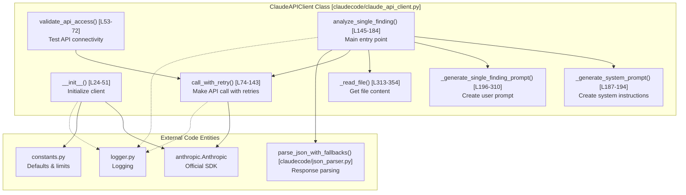
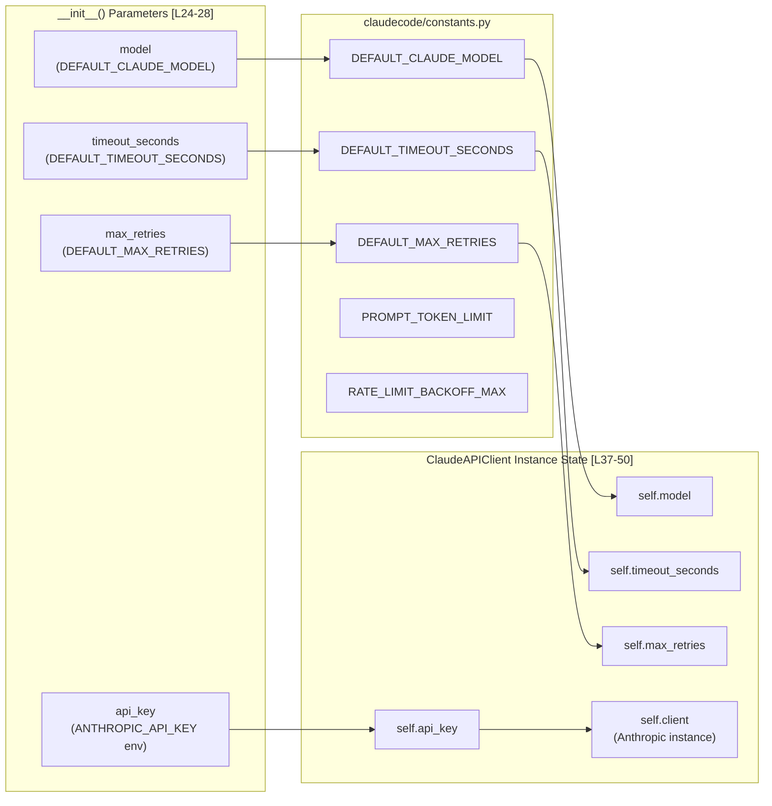
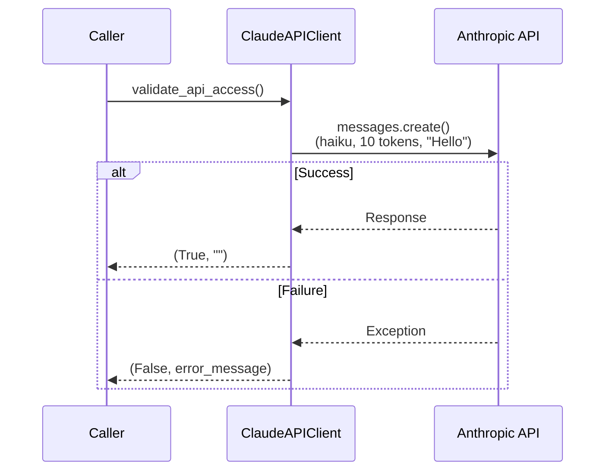
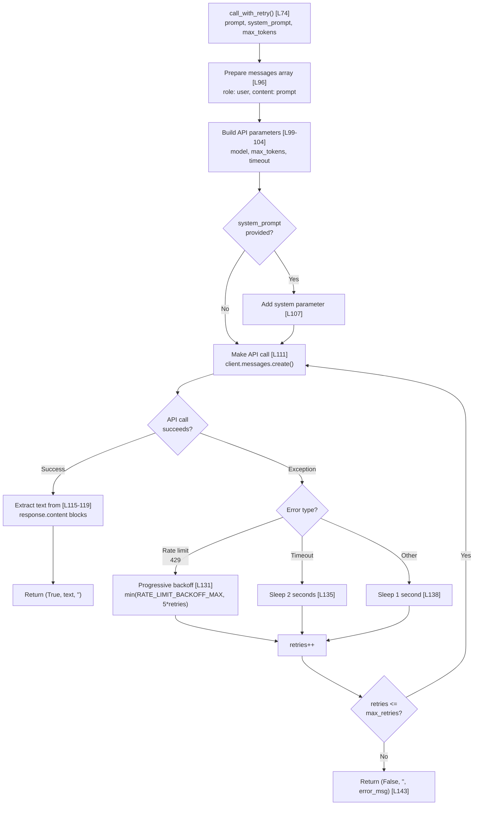
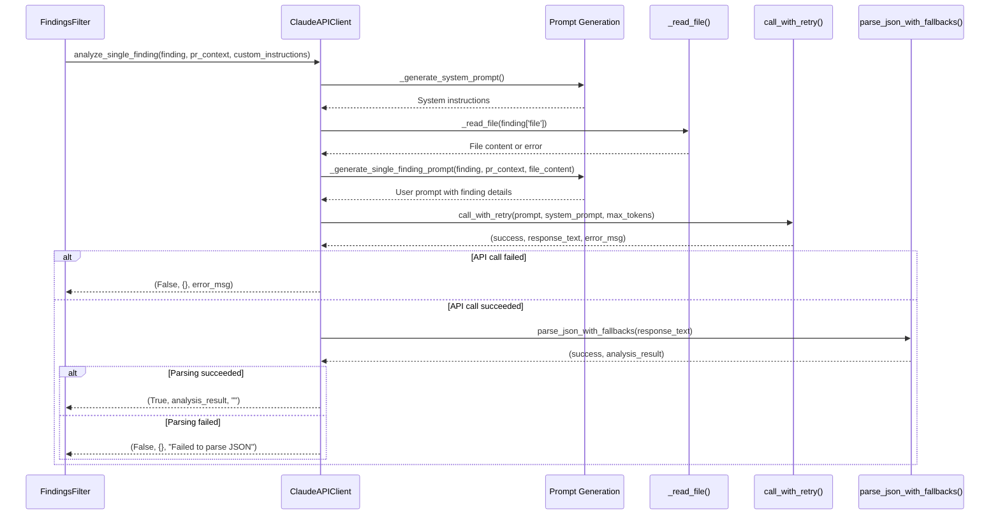
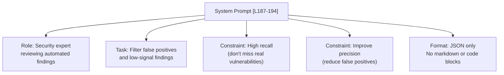
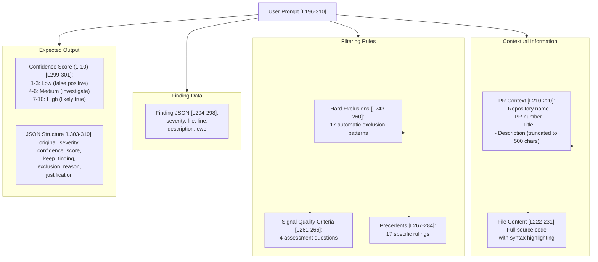
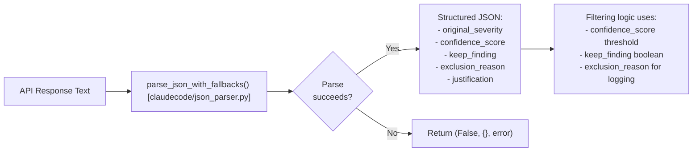
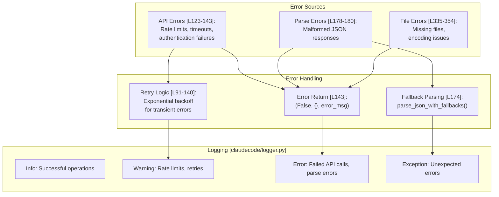

<!-- source: DeepWiki mcp.deepwiki.com · repo anthropics/claude-code-security-review · page 4.4 Claude API Client for Filtering · fetched 2026-10-26 -->

# Claude API Client for Filtering

<details>
<summary>Relevant source files</summary>

The following files were used as context for generating this wiki page:

- [claudecode/claude_api_client.py](claudecode/claude_api_client.py)

</details>


## Purpose and Scope

This document describes the `ClaudeAPIClient` class, which provides direct integration with the Anthropic Claude API for advanced false positive filtering in the security analysis pipeline. This client is used as the second stage of the filtering system to apply AI-based validation to security findings that pass initial hard exclusion rules.

For information about the overall filtering architecture and hard exclusion rules, see [False Positive Filtering System](#4.3). For information about the primary security analysis using the Claude CLI tool, see [Claude CLI Runner](#3.4).

**Sources:** [claudecode/claude_api_client.py:1-377]()

---

## Client Architecture

The `ClaudeAPIClient` class is implemented in [claudecode/claude_api_client.py:21-354]() and provides a Python interface to the Anthropic Messages API. Unlike the `SimpleClaudeRunner` which executes the `@anthropic-ai/claude-code` CLI tool, this client makes direct API calls using the `anthropic` Python SDK.

### System to Code Entity Mapping

The following diagram maps high-level filtering concepts to specific implementation methods in `ClaudeAPIClient`.



**Key Design Decisions:**

| Aspect | Implementation | Rationale |
|--------|---------------|-----------|
| API Library | `anthropic` Python SDK | Official support, type safety, automatic retries [claudecode/claude_api_client.py:9-50]() |
| Direct API vs CLI | Direct API calls | More control, better error handling, faster execution [claudecode/claude_api_client.py:109-111]() |
| Synchronous calls | Blocking API requests | Simpler implementation, sequential processing [claudecode/claude_api_client.py:111]() |
| File reading | Local filesystem access | Provides full file context for analysis [claudecode/claude_api_client.py:313-354]() |

**Sources:** [claudecode/claude_api_client.py:9-51](), [claudecode/claude_api_client.py:109-111](), [claudecode/claude_api_client.py:313-354]()

---

## Initialization and Configuration

The `ClaudeAPIClient` constructor accepts four optional parameters, all with sensible defaults from [claudecode/constants.py]():



### Configuration Parameters

| Parameter | Default | Environment Variable | Purpose |
|-----------|---------|---------------------|---------|
| `model` | `DEFAULT_CLAUDE_MODEL` | None | Claude model identifier (e.g., `claude-3-5-sonnet-20241022`) [claudecode/claude_api_client.py:37]() |
| `api_key` | None | `ANTHROPIC_API_KEY` | Anthropic API authentication key (required) [claudecode/claude_api_client.py:42]() |
| `timeout_seconds` | `DEFAULT_TIMEOUT_SECONDS` | None | Per-request timeout in seconds [claudecode/claude_api_client.py:38]() |
| `max_retries` | `DEFAULT_MAX_RETRIES` | None | Maximum retry attempts for failed API calls [claudecode/claude_api_client.py:39]() |

### API Key Resolution

The client resolves the API key using the following precedence [claudecode/claude_api_client.py:41-47]():

1. `api_key` parameter passed to constructor
2. `ANTHROPIC_API_KEY` environment variable
3. If neither is available, raises `ValueError`

### Validation

The `validate_api_access()` method performs a minimal API call to verify connectivity [claudecode/claude_api_client.py:53-72]():



This lightweight test uses the `claude-3-5-haiku-20241022` model with only 10 max tokens to minimize cost while confirming API access [claudecode/claude_api_client.py:61-66]().

**Sources:** [claudecode/claude_api_client.py:24-51](), [claudecode/claude_api_client.py:53-72]()

---

## API Call Flow with Retry Logic

The `call_with_retry()` method implements robust retry logic with exponential backoff for rate limiting [claudecode/claude_api_client.py:74-143]():



### Backoff Strategy

The retry logic implements three different backoff strategies based on error type [claudecode/claude_api_client.py:129-139]():

| Error Type | Detection | Backoff Duration | Rationale |
|------------|-----------|------------------|-----------|
| Rate limit | `"rate limit"` or `"429"` in error | `min(RATE_LIMIT_BACKOFF_MAX, 5 * (retries + 1))` | Progressive backoff to avoid repeated 429s |
| Timeout | `"timeout"` in error | 2 seconds | Fixed delay for transient issues |
| Other | All other exceptions | 1 second | Minimal delay for retryable errors |

### Response Processing

The method extracts text from the response by iterating over content blocks [claudecode/claude_api_client.py:115-119]():

```python
response_text = ""
for content_block in response.content:
    if hasattr(content_block, 'text'):
        response_text += content_block.text
```

This handles responses that may contain multiple text blocks or mixed content types.

**Sources:** [claudecode/claude_api_client.py:74-143]()

---

## Finding Analysis Process

The `analyze_single_finding()` method orchestrates the complete analysis of a security finding [claudecode/claude_api_client.py:145-184]():



### Method Signature

```python
def analyze_single_finding(
    self,
    finding: Dict[str, Any],
    pr_context: Optional[Dict[str, Any]] = None,
    custom_filtering_instructions: Optional[str] = None
) -> Tuple[bool, Dict[str, Any], str]
```

### Input Parameters

| Parameter | Type | Purpose |
|-----------|------|---------|
| `finding` | `Dict[str, Any]` | Single security finding from initial scan (must include `'file'` key) [claudecode/claude_api_client.py:152]() |
| `pr_context` | `Optional[Dict[str, Any]]` | PR metadata (`repo_name`, `pr_number`, `title`, `description`) [claudecode/claude_api_client.py:153]() |
| `custom_filtering_instructions` | `Optional[str]` | Custom filtering rules to override defaults [claudecode/claude_api_client.py:148]() |

### Return Value

Tuple of three elements [claudecode/claude_api_client.py:156]():
- `success` (bool): Whether analysis completed successfully
- `analysis_result` (dict): Parsed JSON response with `confidence_score`, `keep_finding`, etc.
- `error_message` (str): Error description if `success` is False

**Sources:** [claudecode/claude_api_client.py:145-184]()

---

## Prompt Engineering for Filtering

The client constructs two prompts for the API call: a system prompt and a user prompt.

### System Prompt

The system prompt [claudecode/claude_api_client.py:187-194]() establishes the AI's role and output format:



The system prompt emphasizes maintaining high recall while improving precision, which is critical for security tooling where missing true vulnerabilities is more costly than including some false positives [claudecode/claude_api_client.py:188-192]().

### User Prompt Structure

The user prompt [claudecode/claude_api_client.py:196-310]() combines multiple information sources:



### Hard Exclusion Rules

The prompt includes 17 hard exclusion patterns [claudecode/claude_api_client.py:243-260]():

| Category | Examples |
|----------|----------|
| Resource exhaustion | DOS, rate limiting, memory/CPU consumption |
| Non-exploitable issues | Theoretical race conditions, missing hardening |
| Out of scope | Secrets on disk, outdated libraries, test files |
| Language-specific | Memory safety in Rust, XSS in React (except unsafe methods) |
| Context-dependent | Environment variables (trusted), UUIDs (unguessable) |

### Signal Quality Criteria

Four questions guide the assessment [claudecode/claude_api_client.py:261-266]():

1. Is there a concrete, exploitable vulnerability with a clear attack path?
2. Does this represent a real security risk vs theoretical best practice?
3. Are there specific code locations and reproduction steps?
4. Would this finding be actionable for a security team?

### Custom Filtering Instructions

If `custom_filtering_instructions` is provided, it completely replaces the default hard exclusions, signal criteria, and precedents [claudecode/claude_api_client.py:239-285](). This allows organizations to customize filtering logic without modifying code.

**Sources:** [claudecode/claude_api_client.py:187-310]()

---

## File Content Integration

The `_read_file()` method provides full file context for analysis [claudecode/claude_api_client.py:313-354]():

```mermaid
graph TB
    Start["_read_file(file_path) [L313]"] --> CheckRepoPath{REPO_PATH<br/>env var set? [L323]}
    
    CheckRepoPath -->|Yes| CheckAbsolute{file_path<br/>is absolute? [L324]}
    CheckRepoPath -->|No| UsePath["Use file_path as-is"]
    
    CheckAbsolute -->|No| MakeRelative["Combine REPO_PATH<br/>with file_path [L325]"]
    CheckAbsolute -->|Yes| UsePath
    
    MakeRelative --> CheckExists
    UsePath --> CheckExists
    
    CheckExists{Path exists? [L335]} -->|No| ReturnError1["Return (False, '', 'File not found')"]
    CheckExists -->|Yes| CheckFile{Is file? [L338]}
    
    CheckFile -->|No| ReturnError2["Return (False, '', 'Not a file')"]
    CheckFile -->|Yes| ReadUTF8["Open with UTF-8 encoding [L341]"]
    
    ReadUTF8 --> ReadSuccess{Read<br/>succeeds?}
    ReadSuccess -->|Yes| ReturnContent["Return (True, content, '')"]
    ReadSuccess -->|No: UnicodeDecodeError| ReadLatin1["Retry with latin-1 encoding [L346]"]
    
    ReadLatin1 --> ReadSuccess2{Read<br/>succeeds?}
    ReadSuccess2 -->|Yes| ReturnContent
    ReadSuccess2 -->|No| ReturnError3["Return (False, '', error_msg)"]
```

### Path Resolution Logic

The method handles multiple path scenarios [claudecode/claude_api_client.py:323-333]():

| Scenario | REPO_PATH Set? | file_path Type | Resolution |
|----------|----------------|----------------|------------|
| 1 | Yes | Relative | `REPO_PATH / file_path` |
| 2 | Yes | Absolute | Use `file_path` as-is |
| 3 | No | Any | Use `file_path` as-is |

This allows the client to work both in GitHub Actions (where `REPO_PATH` is set) and in local evaluation contexts (where it may not be).

### Encoding Fallback

The method attempts UTF-8 encoding first, then falls back to latin-1 [claudecode/claude_api_client.py:341-347]():

```python
try:
    with open(path, 'r', encoding='utf-8') as f:
        content = f.read()
except UnicodeDecodeError:
    # Try with latin-1 encoding as fallback
    with open(path, 'r', encoding='latin-1') as f:
        content = f.read()
```

This ensures robustness when handling files with non-UTF-8 content.

**Sources:** [claudecode/claude_api_client.py:313-354]()

---

## Response Parsing and Output Format

After receiving the API response, the client uses `parse_json_with_fallbacks()` to extract structured data [claudecode/claude_api_client.py:173-180]():



### Expected Response Schema

The prompt specifies the exact JSON structure [claudecode/claude_api_client.py:303-310]():

```json
{
  "original_severity": "HIGH|MEDIUM|LOW",
  "confidence_score": 1-10,
  "keep_finding": true|false,
  "exclusion_reason": "string or null",
  "justification": "detailed reasoning"
}
```

### Field Semantics

| Field | Type | Purpose |
|-------|------|---------|
| `original_severity` | String | Original severity from initial scan [claudecode/claude_api_client.py:305]() |
| `confidence_score` | Integer (1-10) | AI's confidence in finding validity [claudecode/claude_api_client.py:306]() |
| `keep_finding` | Boolean | Whether to include in final results [claudecode/claude_api_client.py:307]() |
| `exclusion_reason` | String or null | Reason for exclusion if `keep_finding` is false [claudecode/claude_api_client.py:308]() |
| `justification` | String | Detailed explanation of the decision [claudecode/claude_api_client.py:309]() |

The `FindingsFilter` class (see [False Positive Filtering System](#4.3)) uses these fields to make final filtering decisions, typically keeping findings with `keep_finding=true` and `confidence_score >= 7`.

**Sources:** [claudecode/claude_api_client.py:173-180](), [claudecode/claude_api_client.py:303-310]()

---

## Error Handling and Logging

The client implements comprehensive error handling at multiple levels:



### Logging Patterns

The client uses structured logging throughout [claudecode/claude_api_client.py:18]():

| Event | Log Level | Message Pattern | Location |
|-------|-----------|-----------------|----------|
| Client init | INFO | "Claude API client initialized successfully" | [L51]() |
| API validation | INFO | "Claude API access validated successfully" | [L67]() |
| API validation failure | ERROR | "Claude API validation failed: {error}" | [L71]() |
| API call attempt | INFO | "Claude API call attempt {n}/{max}" | [L93]() |
| API call success | INFO | "Claude API call successful in {duration}s" | [L120]() |
| API call failure | ERROR | "Claude API call failed: {error}" | [L126]() |
| Rate limit | WARNING | "Rate limit detected, increasing backoff" | [L130]() |
| File read error | ERROR | "Error reading file {path}: {error}" | [L353]() |

**Sources:** [claudecode/claude_api_client.py:16-18](), [claudecode/claude_api_client.py:51](), [claudecode/claude_api_client.py:67-72](), [claudecode/claude_api_client.py:93](), [claudecode/claude_api_client.py:120](), [claudecode/claude_api_client.py:126](), [claudecode/claude_api_client.py:130](), [claudecode/claude_api_client.py:353]()

---

## Configuration Constants

The client imports and uses several constants from [claudecode/constants.py]():

| Constant | Purpose | Source |
|----------|---------|--------|
| `DEFAULT_CLAUDE_MODEL` | Default model identifier | [claudecode/claude_api_client.py:37]() |
| `DEFAULT_TIMEOUT_SECONDS` | API call timeout | [claudecode/claude_api_client.py:38]() |
| `DEFAULT_MAX_RETRIES` | Maximum retry attempts | [claudecode/claude_api_client.py:39]() |
| `RATE_LIMIT_BACKOFF_MAX` | Maximum backoff time | [claudecode/claude_api_client.py:131]() |
| `PROMPT_TOKEN_LIMIT` | Maximum tokens in response | [claudecode/claude_api_client.py:77]() |

**Sources:** [claudecode/claude_api_client.py:11-14](), [claudecode/constants.py]()

---

