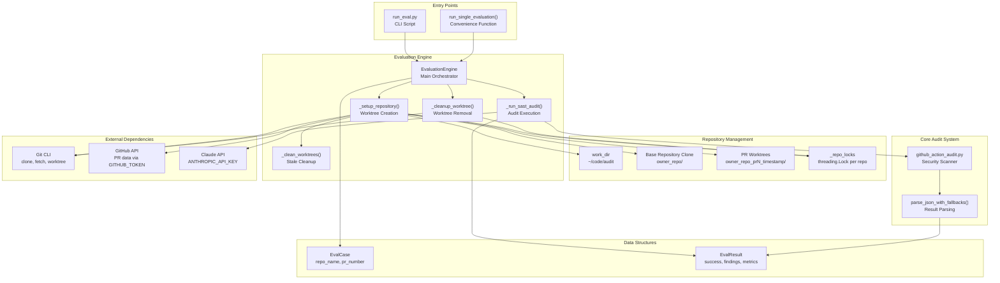
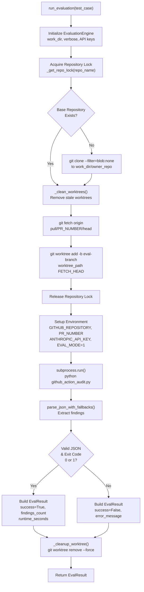

<!-- source: DeepWiki mcp.deepwiki.com · repo anthropics/claude-code-security-review · page 5 Evaluation and Testing System · fetched 2026-10-26 -->

# Evaluation and Testing System

<details>
<summary>Relevant source files</summary>

The following files were used as context for generating this wiki page:

- [claudecode/evals/README.md](claudecode/evals/README.md)
- [claudecode/evals/eval_engine.py](claudecode/evals/eval_engine.py)
- [claudecode/evals/run_eval.py](claudecode/evals/run_eval.py)

</details>


## Purpose and Scope

The Evaluation and Testing System provides infrastructure for running the security scanner against arbitrary GitHub pull requests for testing, validation, and development purposes. This system enables developers to evaluate the scanner's performance on specific PRs, debug security analysis issues, and validate changes to the scanning logic.

This page covers the evaluation framework and test infrastructure. For information about the core security analysis logic that evaluations invoke, see [Security Analysis Pipeline](#4). For the GitHub Action integration that runs in CI/CD, see [GitHub Action Integration](#2).

## System Overview

The evaluation system is an alternative execution path that bypasses the GitHub Action wrapper and directly invokes the core Python audit logic. It manages git repositories using worktrees, allowing efficient testing against multiple PRs without repeated full clones.

**Primary Components:**

| Component | File Path | Purpose |
|-----------|-----------|---------|
| `EvaluationEngine` | [claudecode/evals/eval_engine.py:56-57]() | Orchestrates PR evaluations using git worktrees |
| `run_eval.py` | [claudecode/evals/run_eval.py:1-175]() | CLI entry point for running evaluations |
| `EvalCase` | [claudecode/evals/eval_engine.py:25-30]() | Test case specification (repo + PR) |
| `EvalResult` | [claudecode/evals/eval_engine.py:33-53]() | Evaluation results with metrics |

The system provides three key capabilities:
1. **Isolated Testing**: Evaluate the scanner on any GitHub PR without affecting the repository.
2. **Performance Metrics**: Capture runtime, findings count, and success/failure status.
3. **Worktree Efficiency**: Reuse base repository clones across multiple evaluations.

**Sources:** [claudecode/evals/README.md:1-54](), [claudecode/evals/eval_engine.py:1-14]()

## Architecture

### System Component Diagram



**Sources:** [claudecode/evals/eval_engine.py:56-114](), [claudecode/evals/eval_engine.py:317-465]()

### Execution Flow



**Sources:** [claudecode/evals/eval_engine.py:317-394](), [claudecode/evals/eval_engine.py:396-465]()

## Evaluation Engine and Worktree Management

The `EvaluationEngine` class is the central orchestrator for running security evaluations. It manages the complete lifecycle from repository setup through cleanup, utilizing git worktrees for efficient concurrent testing.

For details, see [Evaluation Engine and Worktree Management](#5.1).

**Key Responsibilities:**
- **Worktree Management**: Creating lightweight PR checkouts using `git worktree add` ([claudecode/evals/eval_engine.py:212-284]()).
- **Thread Safety**: Managing concurrent access to repositories via `_repo_locks` ([claudecode/evals/eval_engine.py:78-80]()).
- **Cleanup**: Pruning stale worktrees and branches with `_clean_worktrees` ([claudecode/evals/eval_engine.py:116-196]()).

**Sources:** [claudecode/evals/eval_engine.py:56-114]()

## Running Evaluations

The evaluation system provides a CLI interface via `run_eval.py` to execute scans against specific PRs. It automatically sets `EVAL_MODE=1` to signal the context to the underlying audit script ([claudecode/evals/run_eval.py:83-83]()).

For details, see [Running Evaluations](#5.2).

**Usage Example:**
```bash
python -m claudecode.evals.run_eval owner/repo#123 --verbose
```

**Key Features:**
- **Input Parsing**: Validates PR specifications in `owner/repo#number` format ([claudecode/evals/run_eval.py:93-106]()).
- **Output Generation**: Saves detailed `EvalResult` data to JSON files in the `--output-dir` ([claudecode/evals/run_eval.py:161-168]()).
- **Environment Validation**: Ensures `ANTHROPIC_API_KEY` is present before execution ([claudecode/evals/run_eval.py:86-89]()).

**Sources:** [claudecode/evals/run_eval.py:46-171]()

## Test Infrastructure

The codebase includes a comprehensive test suite to ensure the reliability of the security scanner and the evaluation engine.

For details, see [Test Infrastructure](#5.3).

**Components:**
- **Unit Tests**: Testing individual components like the `JSONParser` and `FindingsFilter`.
- **Integration Tests**: Validating the end-to-end flow of the `EvaluationEngine`.
- **CI Workflows**: Automated testing on pull requests to maintain code quality.

**Sources:** [claudecode/evals/eval_engine.py:1-23](), [claudecode/evals/README.md:1-54]()

## Timeout Configuration

The evaluation system defines specific timeout constants to prevent indefinite hangs during external calls ([claudecode/evals/eval_engine.py:15-22]()):

| Constant | Value (seconds) | Operation |
|----------|-----------------|-----------|
| `TIMEOUT_GIT_OPERATION` | 60 | Standard git commands |
| `TIMEOUT_FETCH` | 600 | Fetching PR from remote |
| `TIMEOUT_CLONE` | 300 | Initial repository clone |
| `TIMEOUT_WORKTREE_CREATE` | 1200 | Worktree creation and setup |
| `TIMEOUT_CLAUDECODE` | 1800 | Full security audit execution |

**Sources:** [claudecode/evals/eval_engine.py:15-22]()

---

