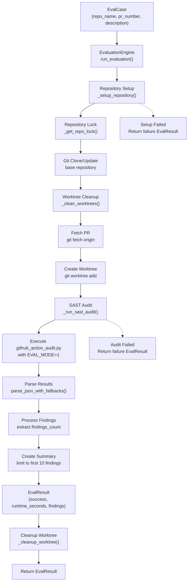
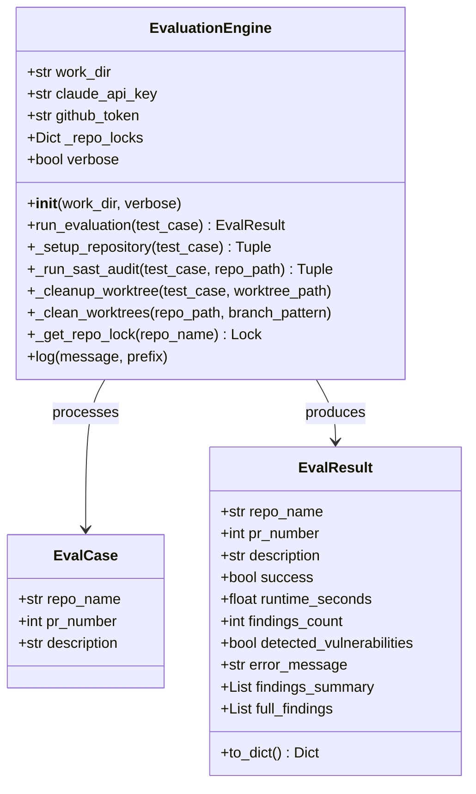
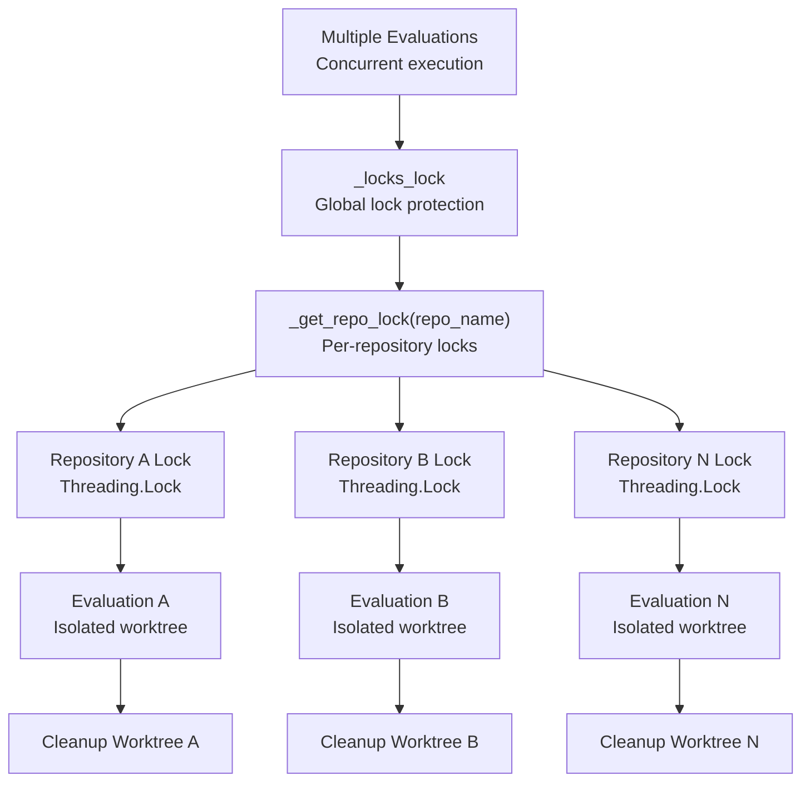
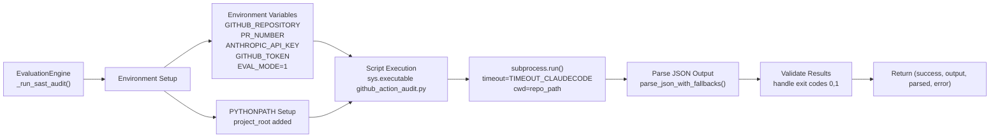
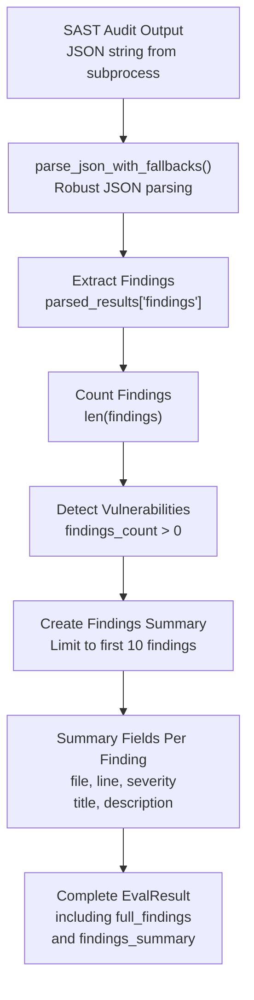
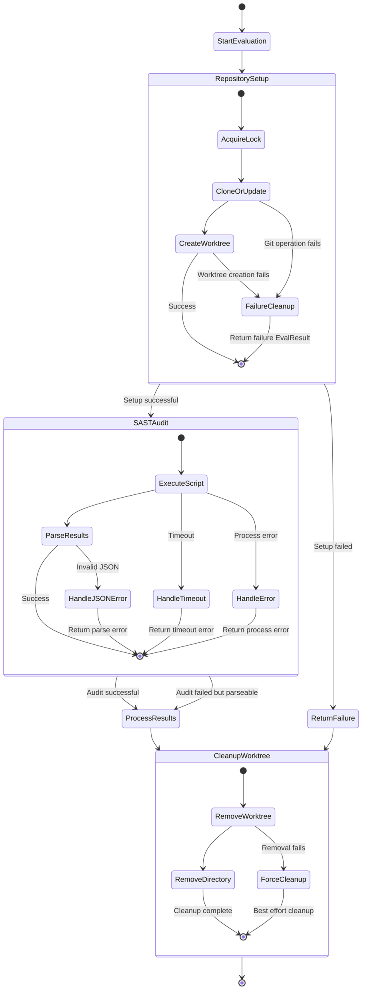

<!-- source: DeepWiki mcp.deepwiki.com · repo anthropics/claude-code-security-review · page 5.1 Evaluation Engine and Worktree Management · fetched 2026-10-26 -->

# Evaluation Engine and Worktree Management

<details>
<summary>Relevant source files</summary>

The following files were used as context for generating this wiki page:

- [claudecode/evals/__init__.py](claudecode/evals/__init__.py)
- [claudecode/evals/eval_engine.py](claudecode/evals/eval_engine.py)
- [claudecode/test_eval_engine.py](claudecode/test_eval_engine.py)

</details>


The Evaluation Engine is a sophisticated system for testing and validating the Claude Code Security Review system's SAST (Static Application Security Testing) capabilities on real GitHub repositories and pull requests. It manages the complete lifecycle of evaluation runs, including repository setup, worktree management, audit execution, and result processing.

This document covers the core evaluation engine implementation and its architecture. For information about running evaluations from the command line, see [Evaluation CLI and Workflow](5.2). For broader testing infrastructure including unit tests and integration testing, see [Testing Infrastructure](5.3).

## System Architecture

The Evaluation Engine follows a multi-stage pipeline architecture that isolates each evaluation in its own Git worktree while providing thread-safe concurrent execution capabilities.

### Evaluation Pipeline Architecture

The pipeline transitions from a high-level definition (`EvalCase`) to a concrete execution environment, finally producing a structured `EvalResult`.



Sources: [claudecode/evals/eval_engine.py:317-394](), [claudecode/evals/eval_engine.py:212-284](), [claudecode/evals/eval_engine.py:396-465]()

### Core Components and Data Structures

The engine operates with three primary data structures that define the evaluation lifecycle:

| Component | Purpose | Key Fields |
|-----------|---------|------------|
| `EvalCase` | Test case definition | `repo_name`, `pr_number`, `description` |
| `EvalResult` | Evaluation outcome | `success`, `runtime_seconds`, `findings_count`, `detected_vulnerabilities` |
| `EvaluationEngine` | Main orchestrator | `work_dir`, `claude_api_key`, `github_token`, `_repo_locks` |



Sources: [claudecode/evals/eval_engine.py:25-54](), [claudecode/evals/eval_engine.py:56-94]()

## Repository Management and Worktree Lifecycle

The evaluation engine implements a sophisticated Git worktree management system that enables isolated, concurrent evaluations of different repositories and pull requests.

### Worktree Management Architecture

The engine uses `git worktree` to allow multiple branches of the same repository to be checked out simultaneously in different directories.

```mermaid
stateDiagram-v2
    [*] --> Initialize: "EvaluationEngine.__init__()"
    Initialize --> GetLock: "_get_repo_lock(repo_name)"
    
    state "Repository Setup" as Setup {
        GetLock --> CheckExists: "Check base_repo_path exists"
        CheckExists --> Clone: "Repository not found"
        CheckExists --> Update: "Repository exists"
        Clone --> CleanStale: "git clone --filter=blob:none"
        Update --> CleanStale: "Repository ready"
        CleanStale --> FetchPR: "_clean_worktrees()"
        FetchPR --> CreateWorktree: "git fetch origin pull/N/head"
        CreateWorktree --> WorktreeReady: "git worktree add -b branch"
    }
    
    WorktreeReady --> RunAudit: "Execute SAST audit"
    RunAudit --> ProcessResults: "Parse audit output"
    ProcessResults --> Cleanup: "Generate EvalResult"
    
    state "Cleanup Phase" as Cleanup {
        Cleanup --> RemoveWorktree: "_cleanup_worktree()"
        RemoveWorktree --> RemoveDirectory: "git worktree remove --force"
        RemoveDirectory --> CleanupComplete: "shutil.rmtree()"
    }
    
    CleanupComplete --> [*]
    
    Setup --> [*]: "Setup failure"
    RunAudit --> Cleanup: "Audit failure"
```

The engine maintains a default work directory at `~/code/audit` and creates repository-specific subdirectories with safe naming conventions [claudecode/evals/eval_engine.py:68-70](). Each evaluation gets its own timestamped worktree to prevent conflicts [claudecode/evals/eval_engine.py:198-210]().

Sources: [claudecode/evals/eval_engine.py:59-94](), [claudecode/evals/eval_engine.py:212-284](), [claudecode/evals/eval_engine.py:286-315]()

### Concurrency Control and Resource Management

The engine implements thread-safe repository access through a locking mechanism to prevent multiple threads from performing git operations on the same base repository simultaneously.



The system uses several timeout constants to prevent hanging operations:

| Timeout | Duration | Purpose |
|---------|----------|---------|
| `TIMEOUT_SHORT` | 10s | Quick git operations |
| `TIMEOUT_GIT_OPERATION` | 60s | Standard git commands |
| `TIMEOUT_FETCH` | 600s | PR fetch operations |
| `TIMEOUT_CLONE` | 300s | Repository cloning |
| `TIMEOUT_WORKTREE_CREATE` | 1200s | Worktree creation |
| `TIMEOUT_CLAUDECODE` | 1800s | SAST audit execution |

Sources: [claudecode/evals/eval_engine.py:15-22](), [claudecode/evals/eval_engine.py:78-114](), [claudecode/evals/eval_engine.py:102-114]()

## SAST Audit Execution Integration

The evaluation engine integrates with the core Claude Code Security Review system by executing the main audit script in evaluation mode.

### Audit Execution Environment



The `_run_sast_audit` method executes the main `github_action_audit.py` script with special evaluation mode configuration [claudecode/evals/eval_engine.py:396-465]():

- **EVAL_MODE=1**: Enables evaluation-specific behavior in the audit script [claudecode/evals/eval_engine.py:421]().
- **Dynamic PYTHONPATH**: Ensures the `claudecode` module can be imported by adding the project root to `sys.path` [claudecode/evals/eval_engine.py:414-417]().
- **Timeout Handling**: 30-minute timeout (`TIMEOUT_CLAUDECODE`) with proper cleanup on timeout [claudecode/evals/eval_engine.py:440]().
- **Exit Code Logic**: Accepts exit codes 0 (clean) and 1 (findings detected) as success [claudecode/evals/eval_engine.py:448-450]().

Sources: [claudecode/evals/eval_engine.py:396-465](), [claudecode/evals/eval_engine.py:406-424](), [claudecode/evals/eval_engine.py:439-457]()

## Results Processing and Summary Generation

The engine processes SAST audit results and creates structured summaries for evaluation analysis. It uses `parse_json_with_fallbacks` to handle potentially malformed output from the LLM-driven process [claudecode/evals/eval_engine.py:13]().

### Results Processing Pipeline



Each finding in the summary contains normalized fields to ensure consistency across different versions of the scanner [claudecode/evals/eval_engine.py:369-378]():

| Field | Source Priority | Description |
|-------|----------------|-------------|
| `file` | `finding.file` → `finding.path` → `"unknown"` | File path |
| `line` | `finding.line` → `finding.start.line` → `0` | Line number |
| `severity` | `finding.severity` → `"UNKNOWN"` | Severity level |
| `title` | `finding.check_id` → `finding.category` → `"Unknown"` | Finding title |
| `description` | `finding.description` → `finding.message` → `"Unknown"` | Finding description |

Sources: [claudecode/evals/eval_engine.py:360-390](), [claudecode/evals/eval_engine.py:369-378]()

## Error Handling and Cleanup

The evaluation engine implements comprehensive error handling and resource cleanup to ensure system stability.

### Error Recovery Architecture



The engine ensures cleanup occurs regardless of success or failure through `try-finally` blocks and defensive programming practices [claudecode/evals/eval_engine.py:392-394](). Failed worktrees are force-removed and directories are cleaned up with `shutil.rmtree(ignore_errors=True)` to prevent cascading failures [claudecode/evals/eval_engine.py:174]().

Sources: [claudecode/evals/eval_engine.py:317-394](), [claudecode/evals/eval_engine.py:460-465](), [claudecode/evals/eval_engine.py:286-315]()

---

