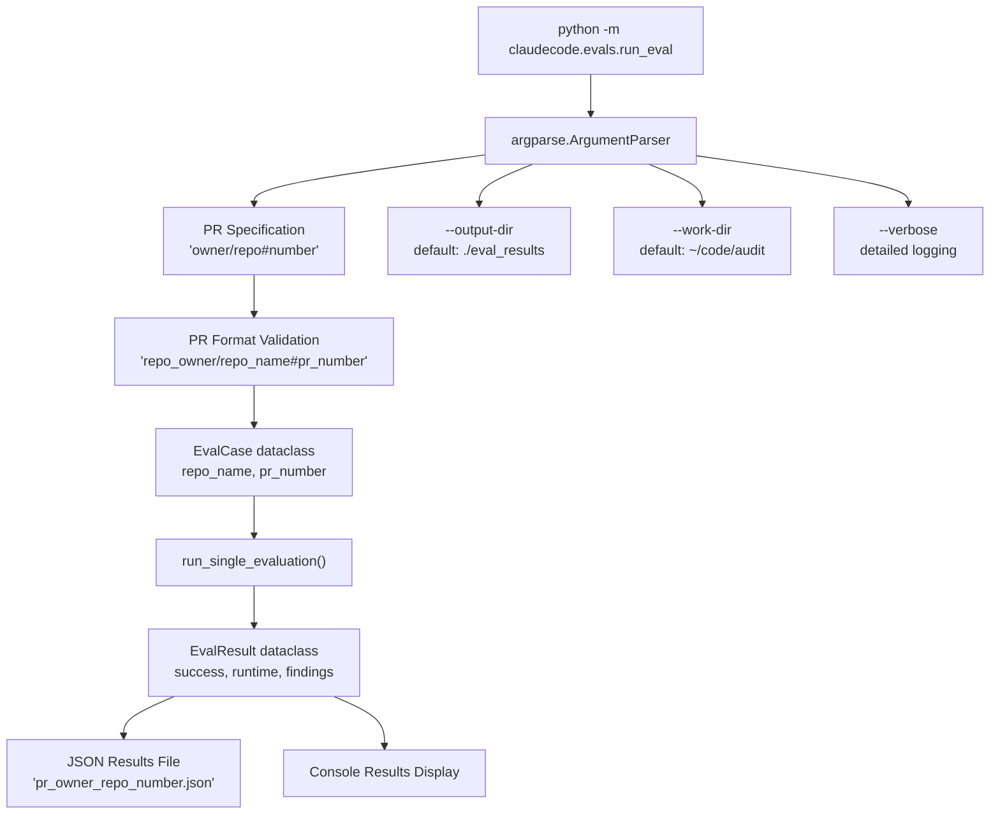
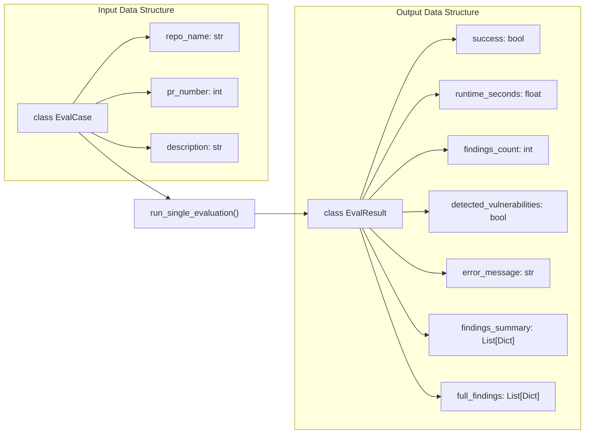
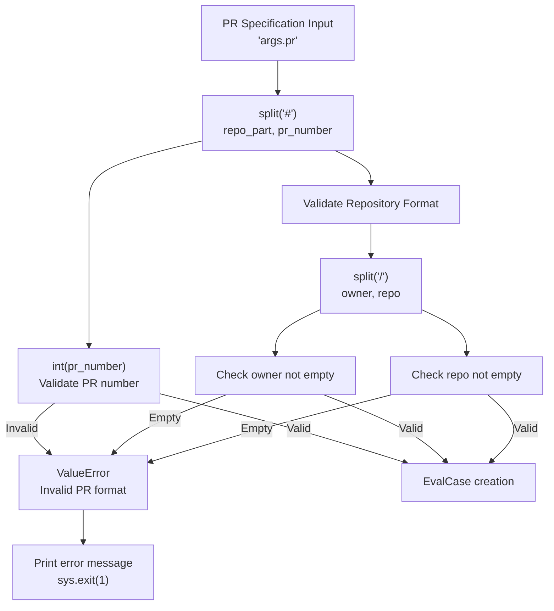
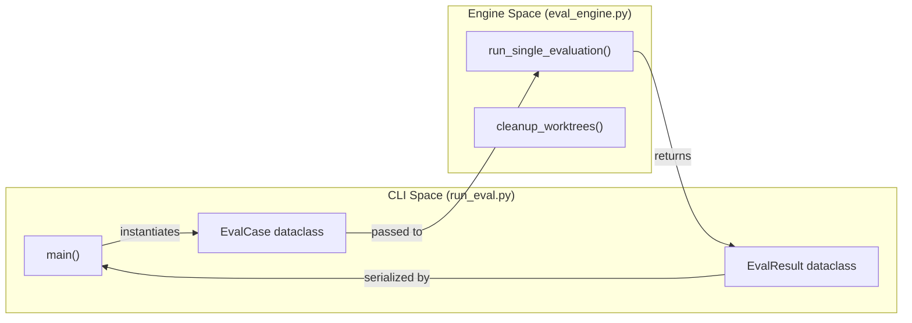

<!-- source: DeepWiki mcp.deepwiki.com · repo anthropics/claude-code-security-review · page 5.2 Running Evaluations · fetched 2026-10-26 -->

# Running Evaluations

<details>
<summary>Relevant source files</summary>

The following files were used as context for generating this wiki page:

- [claudecode/evals/README.md](claudecode/evals/README.md)
- [claudecode/evals/run_eval.py](claudecode/evals/run_eval.py)

</details>


This page documents the command-line interface and workflow for running SAST evaluations on individual GitHub pull requests. The evaluation CLI provides a standalone tool for testing the Claude Code Security Review system against specific PRs, enabling performance analysis, debugging, and accuracy assessment without requiring a full GitHub Action trigger.

For details about the underlying evaluation engine that handles repository management and SAST execution, see **5.1 Evaluation Engine and Worktree Management**.

## CLI Interface Overview

The evaluation system provides a Python module-based CLI entry point (`claudecode.evals.run_eval`) that enables running security analysis on any GitHub PR. The interface is designed for both manual testing and automated evaluation scenarios.

### CLI Entry Point and Command Structure



Sources: [claudecode/evals/run_eval.py:46-80](), [claudecode/evals/run_eval.py:92-106]()

### Data Structures and Flow

The CLI workflow centers around two main dataclasses that structure evaluation requests and results:



Sources: [claudecode/evals/run_eval.py:15-43]()

## Command Usage and Options

### Basic Command Structure

The evaluation CLI follows a straightforward command pattern using the `python -m` syntax:

```bash
python -m claudecode.evals.run_eval owner/repo#123 [options]
```

### Command-Line Arguments

| Argument | Type | Default | Description |
|----------|------|---------|-------------|
| `pr` | Positional | Required | PR specification in format `owner/repo#pr_number` (e.g., `example/repo#123`) |
| `--output-dir` | String | `./eval_results` | Directory where JSON result files will be saved |
| `--work-dir` | String | `None` (defaults to `~/code/audit`) | Root directory where git repositories will be cloned and worktrees managed |
| `--verbose` | Flag | `False` | Enable detailed logging to see progress and CLI output |

Sources: [claudecode/evals/run_eval.py:53-77](), [claudecode/evals/README.md:29-35]()

### Environment Requirements

The CLI automatically validates required environment variables before execution:

*   **`ANTHROPIC_API_KEY`**: Required for Claude API access to perform the security analysis.
*   **`GITHUB_TOKEN`**: Recommended for GitHub API access (cloning and metadata fetching) to avoid rate limits.
*   **`EVAL_MODE`**: Automatically set to `1` by `run_eval.py` to trigger evaluation-specific logic in the core engine.

Sources: [claudecode/evals/run_eval.py:82-90](), [claudecode/evals/README.md:17-19]()

## Evaluation Workflow Process

### PR Specification Parsing and Validation

The CLI performs validation of the PR specification string to ensure it matches the `owner/repo#number` pattern before initiating the heavy evaluation engine.



Sources: [claudecode/evals/run_eval.py:93-106]()

### Execution and Reporting

Once validated, the `main()` function invokes `run_single_evaluation()` and processes the resulting `EvalResult` object.

1.  **Engine Invocation**: Calls `run_single_evaluation(test_case, verbose, work_dir)` from the `eval_engine` module.
2.  **Console Reporting**: Prints a summary of results including success status, runtime, and total findings.
3.  **Findings Detail**: Iterates through `result.full_findings` to print detailed vulnerability information (Severity, File, Line, Category, Description, Exploit Scenario, Recommendation, and Confidence).
4.  **Persistence**: Serializes the `EvalResult` to a JSON file in the `--output-dir`.

Sources: [claudecode/evals/run_eval.py:119-168]()

## Output and Results Management

### JSON Results Structure

The evaluation results are saved in a structured JSON format (e.g., `pr_owner_repo_123.json`) for programmatic analysis.

| Field | Type | Description |
|-------|------|-------------|
| `repo_name` | String | Repository name in `owner/repo` format |
| `pr_number` | Integer | Pull request number |
| `success` | Boolean | Whether the evaluation completed without fatal errors |
| `runtime_seconds` | Float | Total execution time in seconds |
| `findings_count` | Integer | Number of security findings identified |
| `detected_vulnerabilities` | Boolean | Boolean flag indicating if any vulnerabilities were found |
| `error_message` | String | Contains exception details if `success` is `False` |
| `full_findings` | List[Dict] | Complete list of findings with metadata (severity, file, line, etc.) |

Sources: [claudecode/evals/run_eval.py:24-43](), [claudecode/evals/run_eval.py:161-167]()

### Implementation Bridge: CLI to Engine

The following diagram illustrates how the CLI (`run_eval.py`) bridges the user's natural language request (PR string) to the code entities that perform the work.



Sources: [claudecode/evals/run_eval.py:112-122](), [claudecode/evals/run_eval.py:165-166]()

---

