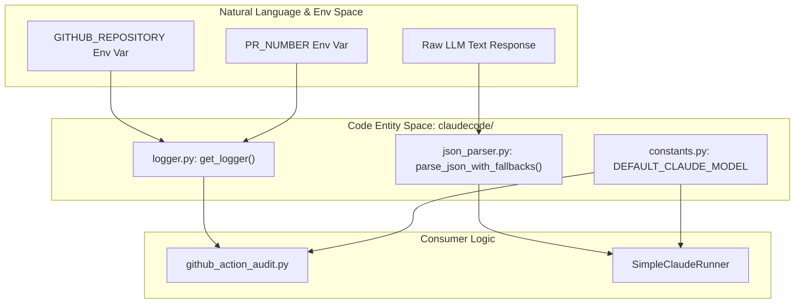
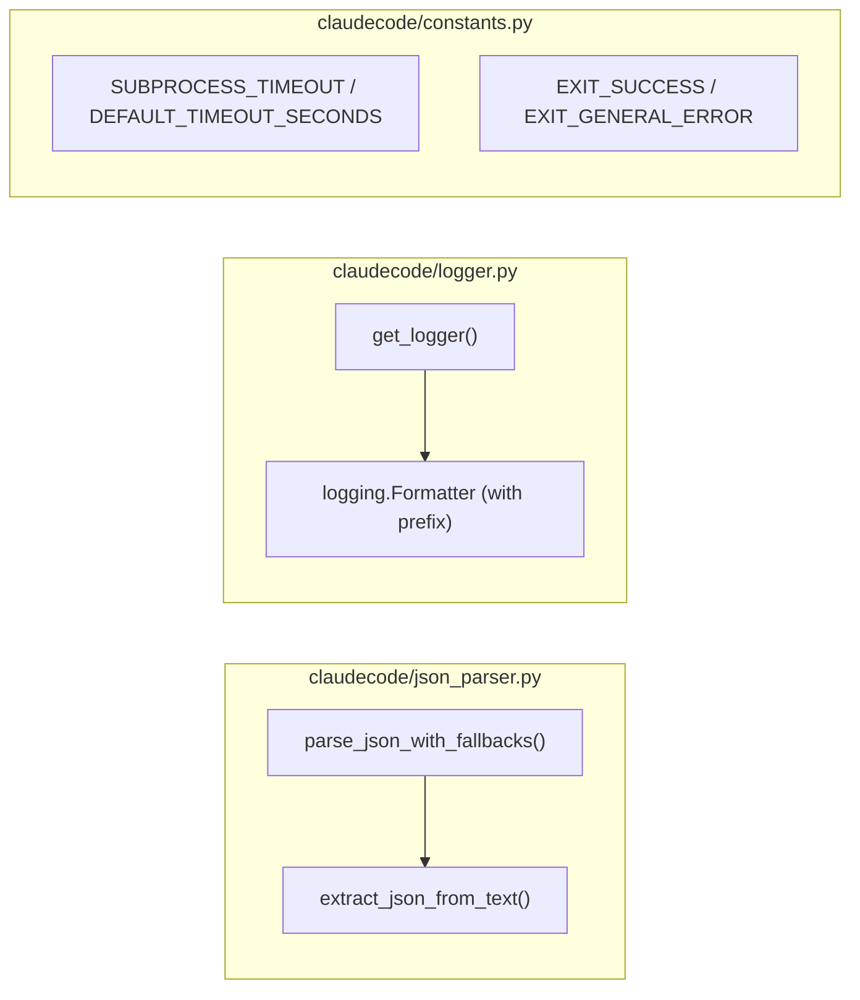

<!-- source: DeepWiki mcp.deepwiki.com · repo anthropics/claude-code-security-review · page 6 Utilities and Infrastructure · fetched 2026-10-26 -->

# Utilities and Infrastructure

<details>
<summary>Relevant source files</summary>

The following files were used as context for generating this wiki page:

- [claudecode/constants.py](claudecode/constants.py)
- [claudecode/json_parser.py](claudecode/json_parser.py)
- [claudecode/logger.py](claudecode/logger.py)

</details>


This page documents the supporting utilities and infrastructure components that enable the core ClaudeCode security review functionality. These utilities provide robust JSON parsing, contextual logging, and centralized configuration management to support the main audit engine and API integrations.

## 6.1 JSON Parsing Utilities

The system employs a robust JSON extraction and parsing system designed to handle the non-deterministic nature of LLM outputs. While Claude is instructed to provide JSON, it may occasionally wrap responses in conversational text or markdown blocks.

### Extraction Strategies
The `extract_json_from_text` function implements multiple recovery strategies:
1. **Markdown Extraction**: Searches for ` ```json ` or generic ` ``` ` code blocks using regular expressions [claudecode/json_parser.py:24-34]().
2. **Brace Balancing**: If no markdown blocks are found, it scans the raw text to find balanced curly braces `{}` to isolate potential JSON objects [claudecode/json_parser.py:38-54]().

### Fallback Mechanism
The `parse_json_with_fallbacks` function serves as the primary entry point, first attempting a standard `json.loads()` before falling back to the extraction logic [claudecode/json_parser.py:73-81](). If all attempts fail, it logs the raw output and returns a structured error object [claudecode/json_parser.py:84-89]().

For details, see [JSON Parsing Utilities](#6.1).

**Sources:** [claudecode/json_parser.py:12-89]()

## 6.2 Logging System

The logging infrastructure provides contextual awareness by integrating GitHub Actions metadata into every log line, facilitating easier debugging across multiple concurrent PR scans.

### Contextual Metadata
The `get_logger()` function automatically detects the execution environment by inspecting `GITHUB_REPOSITORY` and `PR_NUMBER` environment variables [claudecode/logger.py:24-25](). It constructs a prefix (e.g., `[owner/repo#123]`) that is prepended to all log messages [claudecode/logger.py:28-41]().

### Configuration Details
- **Output**: All logs are directed to `sys.stderr` to avoid interfering with standard output that might be captured by other tools [claudecode/logger.py:21]().
- **Level**: Default logging is set to `INFO` [claudecode/logger.py:46]().
- **Singleton Pattern**: The utility ensures handlers are only added once per logger name to prevent duplicate log entries [claudecode/logger.py:20]().

For details, see [Logging System](#6.2).

**Sources:** [claudecode/logger.py:8-48]()

## 6.3 Configuration Constants

The system uses a centralized `constants.py` module to manage timeouts, model versions, and resource limits. This ensures consistency across the `claudecode` package.

### Key Parameters
- **Model Selection**: Defaults to `claude-opus-4-1-20250805`, overridable via the `CLAUDE_MODEL` environment variable [claudecode/constants.py:8]().
- **Timeouts**: Distinguishes between standard API timeouts (180s) and long-running subprocess timeouts (1200s) for the Claude Code CLI [claudecode/constants.py:9,22]().
- **Token Limits**: Hard-coded `PROMPT_TOKEN_LIMIT` of 16,384 to ensure compatibility with the Opus model context window [claudecode/constants.py:14]().

For details, see [Configuration Constants](#6.3).

**Sources:** [claudecode/constants.py:1-24]()

## Infrastructure Architecture

The following diagram illustrates how utility components bridge the gap between the execution environment (GitHub Actions) and the internal logic of the security scanner.

### Infrastructure Mapping: Environment to Code Entities

**Sources:** [claudecode/logger.py:24-35](), [claudecode/json_parser.py:61-89](), [claudecode/constants.py:8-22]()

### Utility Integration Flow

**Sources:** [claudecode/json_parser.py:12-89](), [claudecode/logger.py:8-48](), [claudecode/constants.py:1-24]()

## Error Handling and Configuration Patterns

The infrastructure implements several patterns for robust operation:

1.  **Environment Variable Resolution**: Constants use `os.environ.get()` with logical OR fallbacks to allow flexible configuration without code changes [claudecode/constants.py:8]().
2.  **Graceful Degradation**: The JSON parser attempts three different methods (direct, markdown, brace-counting) before reporting a failure, increasing the reliability of LLM interactions [claudecode/json_parser.py:22-56]().
3.  **Standardized Exit Strategy**: The system uses defined exit codes (`EXIT_SUCCESS`, `EXIT_CONFIGURATION_ERROR`) to communicate state back to the GitHub Actions runner [claudecode/constants.py:17-19]().

**Sources:** [claudecode/constants.py:8-22](), [claudecode/json_parser.py:12-89]()

---

