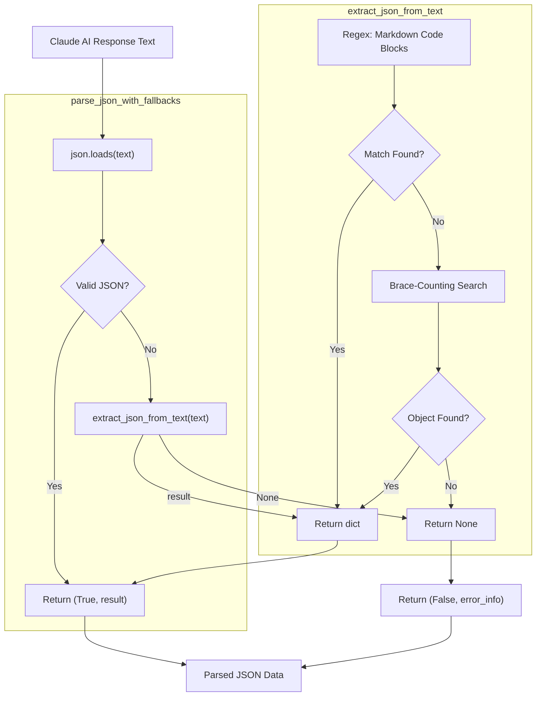
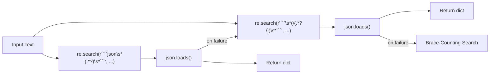
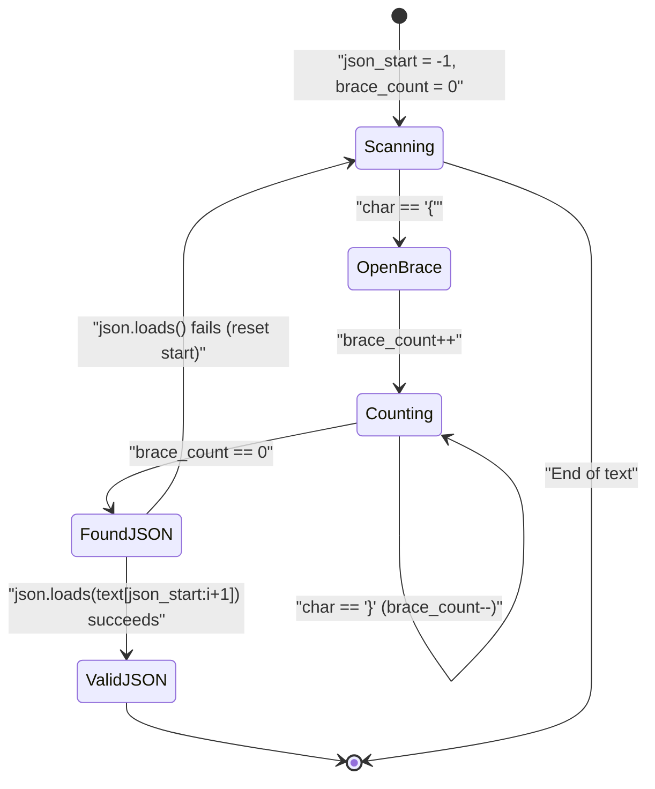

<!-- source: DeepWiki mcp.deepwiki.com · repo anthropics/claude-code-security-review · page 6.1 JSON Parsing Utilities · fetched 2026-10-26 -->

# JSON Parsing Utilities

<details>
<summary>Relevant source files</summary>

The following files were used as context for generating this wiki page:

- [claudecode/json_parser.py](claudecode/json_parser.py)
- [claudecode/test_json_parser.py](claudecode/test_json_parser.py)

</details>


## Purpose and Scope

This document covers the JSON parsing utilities that handle Claude AI responses in the security analysis pipeline. The JSON parser is responsible for extracting structured security findings from Claude's text responses, which may contain JSON in various formats including markdown code blocks, plain JSON, or embedded within explanatory text.

The utilities are defined in `claudecode/json_parser.py` [claudecode/json_parser.py:1-89]() and validated by a comprehensive test suite in `claudecode/test_json_parser.py` [claudecode/test_json_parser.py:1-239]().

## Core JSON Parsing Architecture

The JSON parsing system provides robust extraction and parsing capabilities designed to handle the variability of AI-generated responses. The primary components are the `extract_json_from_text` [claudecode/json_parser.py:12-58]() and `parse_json_with_fallbacks` [claudecode/json_parser.py:61-89]() functions.

### JSON Parsing Flow

The following diagram illustrates the logical flow within the `json_parser` module when processing a string.

**Diagram: JSON Parsing Logic Flow**


Sources: [claudecode/json_parser.py:12-89]()

### Extraction Strategies

The JSON parser implements multiple extraction strategies to handle different response formats from Claude AI:

| Strategy | Description | Implementation |
|----------|-------------|---------|
| **Direct Parsing** | Standard JSON parsing on the entire input string | `json.loads(text)` [claudecode/json_parser.py:74-74]() |
| **Markdown Code Blocks** | Extracts content from ` ```json ` or generic ` ``` ` blocks | `re.search` with `re.DOTALL` [claudecode/json_parser.py:24-35]() |
| **Brace-Counting Search** | Manually iterates through text to find the first balanced `{}` pair | Linear scan with `brace_count` [claudecode/json_parser.py:38-54]() |

Sources: [claudecode/json_parser.py:23-54](), [claudecode/json_parser.py:73-81]()

## JSON Extraction Implementation

### Markdown Code Block Extraction

The parser first attempts to extract JSON from markdown code blocks, supporting both language-tagged (`json`) and generic code blocks. It iterates through potential matches and attempts to load them using the standard `json` library [claudecode/json_parser.py:24-35]().

**Diagram: Markdown Extraction Logic**


Sources: [claudecode/json_parser.py:24-35]()

### Brace-Counting Text Search

When JSON isn't found in code blocks, the parser uses a brace-counting algorithm to locate JSON objects within free text. This allows the system to ignore conversational "chatter" surrounding the actual data [claudecode/json_parser.py:38-54]().

**Diagram: Brace-Counting State Machine**


Sources: [claudecode/json_parser.py:38-54]()

## Error Handling and Robustness

### Error Response Structure

When JSON parsing fails completely, `parse_json_with_fallbacks` returns a tuple `(False, result)` where `result` is a dictionary containing an error message and the raw input for debugging [claudecode/json_parser.py:84-89]().

| Field | Type | Description |
|-------|------|-------------|
| `success` | boolean | The first element of the return tuple; `False` on failure [claudecode/json_parser.py:89-89]() |
| `result["error"]` | string | Error message containing the raw output string [claudecode/json_parser.py:89-89]() |

The function also logs the failure to the module-level `logger` [claudecode/json_parser.py:88-88]().

## Integration and Testing

### Supported JSON Structures

The parser is tested against various structures commonly returned by AI models:

| Structure Type | Example Use Case | Test Method |
|----------------|------------------|---------------|
| **Valid JSON** | Standard API response | `test_parse_valid_json` [claudecode/test_json_parser.py:11-17]() |
| **Empty Objects** | No findings identified | `test_parse_empty_json_object` [claudecode/test_json_parser.py:27-31]() |
| **Nested Objects** | Detailed vulnerability metadata | `test_parse_nested_json` [claudecode/test_json_parser.py:39-56]() |
| **Unicode Content** | Non-ASCII characters in code/comments | `test_parse_json_with_unicode` [claudecode/test_json_parser.py:58-65]() |
| **Escaped Chars** | Windows paths or quoted strings | `test_parse_json_with_escaped_characters` [claudecode/test_json_parser.py:67-74]() |
| **Large Structures**| Multiple findings in one PR | `test_large_json_parsing` [claudecode/test_json_parser.py:184-205]() |

Sources: [claudecode/test_json_parser.py:11-205]()

### Robustness Features

The parser includes several robustness features designed for production use:

- **Multiple Fallback Strategies**: If direct parsing fails, it attempts markdown extraction, then brace-counting [claudecode/json_parser.py:73-81]().
- **Exception Safety**: The `extract_json_from_text` function is wrapped in a broad `try...except` block to ensure it returns `None` rather than crashing on unexpected string patterns [claudecode/json_parser.py:55-58]().
- **Whitespace Tolerance**: Handles leading/trailing whitespace and newlines [claudecode/test_json_parser.py:19-25]().
- **Text Extraction**: Successfully isolates valid JSON even when surrounded by broken code or syntax errors in the surrounding text [claudecode/test_json_parser.py:170-182]().

Sources: [claudecode/json_parser.py:55-89](), [claudecode/test_json_parser.py:19-182]()

---

