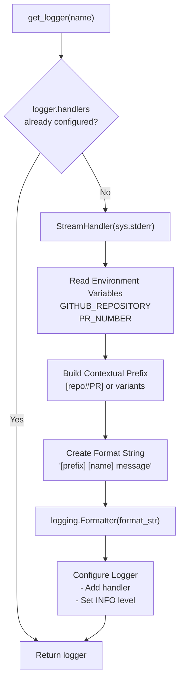
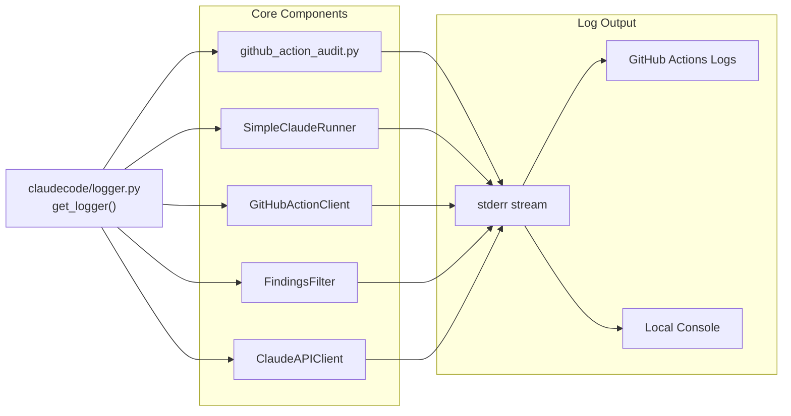

<!-- source: DeepWiki mcp.deepwiki.com · repo anthropics/claude-code-security-review · page 6.2 Logging System · fetched 2026-10-26 -->

# Logging System

<details>
<summary>Relevant source files</summary>

The following files were used as context for generating this wiki page:

- [claudecode/logger.py](claudecode/logger.py)

</details>


## Purpose and Scope

The logging system provides a standardized, contextual logging utility for all components in the Claude Code Security Review system. It wraps Python's standard `logging` module with automatic context injection based on GitHub environment variables. This page documents the single-file logging utility and its configuration.

For information about other utilities, see [JSON Parsing Utilities](6.1) and [Configuration Constants](6.3). For the core components that use this logging system, see [Core Python Engine](3).

## Logger Architecture

The logging system is implemented in a single module that provides a factory function for creating configured logger instances.

### Logger Factory Function

The system provides one primary function: `get_logger(name)` in [claudecode/logger.py:8-48]().

```python
def get_logger(name: str) -> logging.Logger:
```

This function returns a configured `logging.Logger` instance that:
- Outputs to `stderr` via `StreamHandler` [claudecode/logger.py:21]()
- Includes contextual prefixes from environment variables [claudecode/logger.py:24-35]()
- Uses `INFO` level by default [claudecode/logger.py:46]()
- Configures handlers only once per logger name [claudecode/logger.py:20]()

**Sources:** [claudecode/logger.py:8-48]()

### Component Structure



**Diagram: Logger Creation and Configuration Flow**

The factory function checks if handlers are already configured to avoid duplicate configuration, then builds a contextual prefix from environment variables and creates a formatter.

**Sources:** [claudecode/logger.py:8-48]()

## Contextual Prefix System

The logging system automatically injects contextual information based on GitHub environment variables, making it easy to identify which repository and pull request a log message relates to.

### Environment Variable Sources

The prefix is built from two environment variables:

| Environment Variable | Description | Set By |
|---------------------|-------------|--------|
| `GITHUB_REPOSITORY` | Repository name (e.g., `owner/repo`) | GitHub Actions or evaluation system |
| `PR_NUMBER` | Pull request number | GitHub Actions or evaluation system |

**Sources:** [claudecode/logger.py:24-25]()

### Prefix Format Variants

The system generates different prefix formats based on which environment variables are available:

| Available Variables | Prefix Format | Example |
|--------------------|---------------|---------|
| Both repo and PR | `[repo#PR]` | `[anthropics/app#123]` |
| Repository only | `[repo]` | `[anthropics/app]` |
| PR only | `[PR#PR]` | `[PR#123]` |
| Neither | *(empty)* | *(no prefix)* |

The prefix logic is implemented in [claudecode/logger.py:28-35]():

```python
if repo_name and pr_number:
    prefix = f"[{repo_name}#{pr_number}]"
elif repo_name:
    prefix = f"[{repo_name}]"
elif pr_number:
    prefix = f"[PR#{pr_number}]"
else:
    prefix = ""
```

**Sources:** [claudecode/logger.py:23-35]()

### Message Format

The final log message format includes the prefix, logger name, and message:

| With Prefix | `[repo#PR] [module_name] message` |
|-------------|-----------------------------------|
| Without Prefix | `[module_name] message` |

The format string construction is at [claudecode/logger.py:38-41]():

```python
if prefix:
    format_str = f'{prefix} [%(name)s] %(message)s'
else:
    format_str = '[%(name)s] %(message)s'
```

**Sources:** [claudecode/logger.py:38-44]()

## Configuration Details

### Stream Handler Configuration

The logger uses a `StreamHandler` that outputs to `sys.stderr` rather than `stdout` [claudecode/logger.py:21](). This ensures log messages:
- Don't interfere with structured output (JSON results) on `stdout`.
- Are captured separately in GitHub Actions logs.
- Follow standard practices for diagnostic output.

**Configuration at:** [claudecode/logger.py:21]()

### Log Level

The default log level is set to `INFO` at [claudecode/logger.py:46]():

```python
logger.setLevel(logging.INFO)
```

This level is appropriate for operational logging without excessive verbosity.

**Sources:** [claudecode/logger.py:46]()

### Handler Deduplication

The function checks if handlers are already configured to prevent duplicate log output:

```python
if not logger.handlers:
    # ... configure handler
```

This check at [claudecode/logger.py:20]() ensures that calling `get_logger` multiple times with the same name doesn't create multiple handlers.

**Sources:** [claudecode/logger.py:20]()

## Usage Patterns in the Codebase

The logging system is used throughout the Python codebase to provide diagnostic output during security scans.

### Logger Instantiation Pattern

Components typically instantiate a logger at the module level:

```python
from claudecode.logger import get_logger

logger = get_logger(__name__)
```

This pattern ensures each module gets a logger named after the module path, making it easy to identify the source of log messages.

### Integration with Core Components



**Diagram: Logger Usage Across Components**

The logger module is imported by core components throughout the system, providing consistent logging output that flows to `stderr` and eventually to GitHub Actions logs or the local console.

**Sources:** [claudecode/logger.py:1-48]()

### Example Log Messages

Based on the configuration, log messages appear in different formats depending on context:

**In GitHub Actions (with full context):**
```
[anthropics/app#123] [claudecode.github_action_audit] Starting security audit
[anthropics/app#123] [claudecode.claude_runner] Executing Claude CLI
```

**In Local Evaluation (with repo context):**
```
[anthropics/app] [claudecode.evals.evaluation_engine] Setting up worktree
```

**Without Context:**
```
[claudecode.github_action_audit] Configuration loaded
```

## Implementation Notes

### Thread Safety

Python's `logging` module is thread-safe by design. The handler deduplication check at [claudecode/logger.py:20]() ensures that even if multiple threads call `get_logger` with the same name simultaneously, only one set of handlers will be configured due to the atomic nature of Python's logging module internals.

**Sources:** [claudecode/logger.py:20]()

### Performance Characteristics

- **Logger Creation:** O(1) - Returns cached logger if already exists.
- **Handler Configuration:** One-time cost per logger name.
- **Message Formatting:** Minimal overhead - simple string interpolation.
- **Environment Variable Reads:** One-time per logger creation [claudecode/logger.py:24-25]().

The system is designed for minimal overhead since environment variables are read only once during logger creation.

**Sources:** [claudecode/logger.py:24-25]()

### Design Decisions

| Decision | Rationale |
|----------|-----------|
| Output to `stderr` | Separates logs from structured `stdout` output |
| Module-level logger naming | Easy identification of message source |
| Contextual prefixes | Helps correlate logs with specific PRs/repos |
| Handler deduplication | Prevents duplicate log messages |
| `INFO` level default | Balance between verbosity and diagnostics |

**Sources:** [claudecode/logger.py:1-48]()

---

