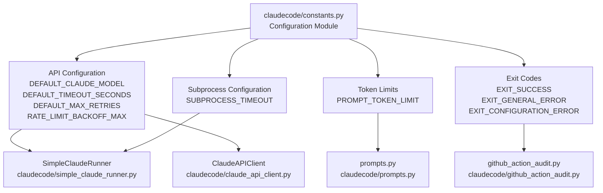
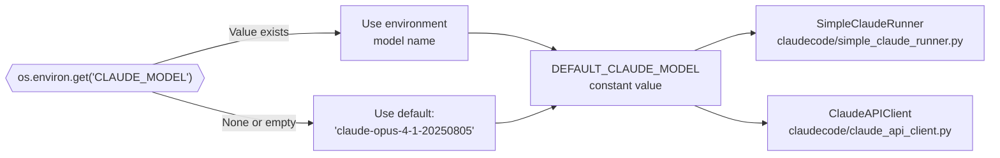
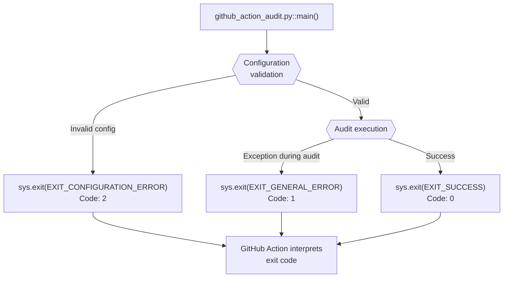

<!-- source: DeepWiki mcp.deepwiki.com · repo anthropics/claude-code-security-review · page 6.3 Configuration Constants · fetched 2026-10-26 -->

# Configuration Constants

Relevant source files

The following files were used as context for generating this wiki page:

- [claudecode/constants.py](claudecode/constants.py)

This page documents the system-wide constants defined in `claudecode/constants.py` that control operational parameters throughout the Claude Code Security Review system. These constants define default values for API configuration, timeouts, token limits, exit codes, and subprocess execution parameters.

For information about runtime configuration through environment variables, see [Environment Variables and Secrets](#7.2). For customization of security scanning behavior, see [Customization Options](#7.3).

## Purpose and Scope

The `constants.py` module provides centralized configuration values used across the entire `claudecode` package. These constants establish defaults for Claude API interactions, execution timeouts, resource limits, and error codes. While some constants can be overridden through environment variables at runtime, others define hard limits based on Claude API capabilities.

Sources: [claudecode/constants.py:1-24]()

## Constant Categories Overview

The configuration constants are organized into four functional categories, each serving a distinct aspect of system operation:

**Diagram: Constant Categories and Their Consumers**

Sources: [claudecode/constants.py:1-24]()

## API Configuration Constants

These constants control interactions with the Anthropic Claude API, including model selection, timeout behavior, and retry logic.

| Constant | Default Value | Override | Description |
|----------|--------------|----------|-------------|
| `DEFAULT_CLAUDE_MODEL` | `'claude-opus-4-1-20250805'` | `CLAUDE_MODEL` env var | Claude model identifier for security analysis |
| `DEFAULT_TIMEOUT_SECONDS` | `180` (3 minutes) | N/A | Default timeout for API requests |
| `DEFAULT_MAX_RETRIES` | `3` | N/A | Maximum retry attempts for failed API calls |
| `RATE_LIMIT_BACKOFF_MAX` | `30` seconds | N/A | Maximum backoff time when rate limited |

The `DEFAULT_CLAUDE_MODEL` is unique among these constants as it can be overridden at runtime via the `CLAUDE_MODEL` environment variable [claudecode/constants.py:8](). This allows users to specify alternative Claude models without code modifications.

Sources: [claudecode/constants.py:7-11]()

### Model Selection Strategy

**Diagram: DEFAULT_CLAUDE_MODEL Resolution Logic**

Sources: [claudecode/constants.py:8]()

## Token Limits

The token limit constant defines maximum input size constraints based on Claude API capabilities.

| Constant | Value | Purpose |
|----------|-------|---------|
| `PROMPT_TOKEN_LIMIT` | `16384` (16k tokens) | Maximum prompt size for claude-opus-4 model |

This limit is documented as being specific to the `claude-opus-4` model family [claudecode/constants.py:14](). The system uses this constant to validate prompt sizes before API submission and potentially truncate inputs that exceed the limit.

**Usage Context**: The prompt generation system in `claudecode/prompts.py` uses this limit to ensure security audit prompts containing PR diffs and metadata remain within API constraints.

Sources: [claudecode/constants.py:13-14]()

## Exit Codes

Standardized exit codes enable consistent error reporting across the system and facilitate proper error handling in CI/CD environments.

| Constant | Value | Meaning |
|----------|-------|---------|
| `EXIT_SUCCESS` | `0` | Operation completed successfully |
| `EXIT_GENERAL_ERROR` | `1` | Generic error occurred |
| `EXIT_CONFIGURATION_ERROR` | `2` | Configuration or setup error |

These exit codes follow Unix conventions where `0` indicates success and non-zero values indicate different failure modes [claudecode/constants.py:16-19](). The differentiation between general errors (1) and configuration errors (2) allows calling scripts to implement appropriate error handling strategies.

Sources: [claudecode/constants.py:16-19]()

### Exit Code Usage Pattern

**Diagram: Exit Code Flow from Python to GitHub Actions**

Sources: [claudecode/constants.py:16-19]()

## Subprocess Configuration

This constant defines the maximum execution time for subprocess operations, specifically the Claude CLI execution.

| Constant | Value | Purpose |
|----------|-------|---------|
| `SUBPROCESS_TIMEOUT` | `1200` seconds (20 minutes) | Timeout for `@anthropic-ai/claude-code` CLI execution |

The 20-minute timeout [claudecode/constants.py:22]() accommodates the Claude CLI's analysis of large pull requests. This value is significantly longer than the `DEFAULT_TIMEOUT_SECONDS` for API calls because the CLI tool performs multi-step analysis including file reading, context gathering, and iterative reasoning.

Sources: [claudecode/constants.py:21-22]()

## Constants Usage Across Components

The following diagram maps how constants are consumed by different system components:

```mermaid
graph TB
    subgraph "claudecode/constants.py"
        Model["DEFAULT_CLAUDE_MODEL"]
        APITimeout["DEFAULT_TIMEOUT_SECONDS"]
        Retries["DEFAULT_MAX_RETRIES"]
        RateBackoff["RATE_LIMIT_BACKOFF_MAX"]
        TokenLimit["PROMPT_TOKEN_LIMIT"]
        ExitSuccess["EXIT_SUCCESS"]
        ExitGeneral["EXIT_GENERAL_ERROR"]
        ExitConfig["EXIT_CONFIGURATION_ERROR"]
        SubprocessTimeout["SUBPROCESS_TIMEOUT"]
    end
    
    subgraph "claudecode/simple_claude_runner.py"
        Runner["SimpleClaudeRunner"]
        RunAudit["run_security_audit()"]
    end
    
    subgraph "claudecode/claude_api_client.py"
        APIClient["ClaudeAPIClient"]
        InitClient["__init__()"]
    end
    
    subgraph "claudecode/prompts.py"
        PromptGen["get_security_audit_prompt()"]
    end
    
    subgraph "claudecode/github_action_audit.py"
        MainFunc["main()"]
    end
    
    Model --> Runner
    Model --> APIClient
    SubprocessTimeout --> RunAudit
    
    APITimeout --> InitClient
    Retries --> InitClient
    RateBackoff --> APIClient
    
    TokenLimit --> PromptGen
    
    ExitSuccess --> MainFunc
    ExitGeneral --> MainFunc
    ExitConfig --> MainFunc
```

**Diagram: Constant Usage by Component**

Sources: [claudecode/constants.py:1-24]()

## Constant Values Summary

| Category | Constant Name | Value | Overridable | Primary Consumer |
|----------|--------------|-------|-------------|------------------|
| API Config | `DEFAULT_CLAUDE_MODEL` | `claude-opus-4-1-20250805` | Yes (via `CLAUDE_MODEL` env) | `SimpleClaudeRunner`, `ClaudeAPIClient` |
| API Config | `DEFAULT_TIMEOUT_SECONDS` | `180` | No | `ClaudeAPIClient` |
| API Config | `DEFAULT_MAX_RETRIES` | `3` | No | `ClaudeAPIClient` |
| API Config | `RATE_LIMIT_BACKOFF_MAX` | `30` | No | `ClaudeAPIClient` |
| Token Limits | `PROMPT_TOKEN_LIMIT` | `16384` | No | `claudecode/prompts.py` |
| Exit Codes | `EXIT_SUCCESS` | `0` | No | `claudecode/github_action_audit.py` |
| Exit Codes | `EXIT_GENERAL_ERROR` | `1` | No | `claudecode/github_action_audit.py` |
| Exit Codes | `EXIT_CONFIGURATION_ERROR` | `2` | No | `claudecode/github_action_audit.py` |
| Subprocess | `SUBPROCESS_TIMEOUT` | `1200` | No | `SimpleClaudeRunner` |

Sources: [claudecode/constants.py:1-24]()

---

