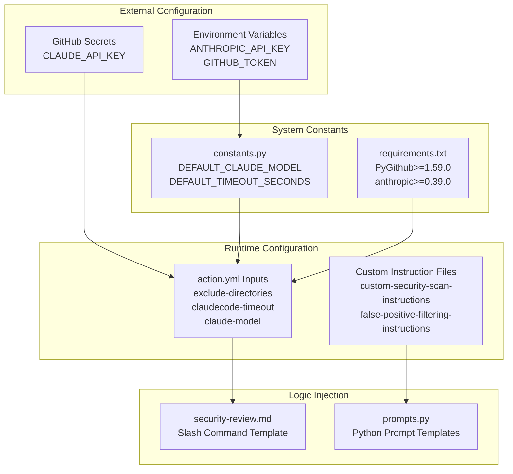
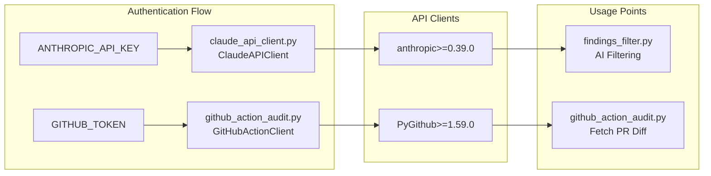
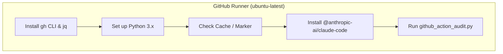

<!-- source: DeepWiki mcp.deepwiki.com · repo anthropics/claude-code-security-review · page 7 Configuration and Deployment · fetched 2026-10-26 -->

# Configuration and Deployment

Relevant source files

The following files were used as context for generating this wiki page:

- [README.md](README.md)
- [action.yml](action.yml)
- [docs/custom-filtering-instructions.md](docs/custom-filtering-instructions.md)
- [docs/custom-security-scan-instructions.md](docs/custom-security-scan-instructions.md)

This document provides a guide for configuring, customizing, and deploying the Claude Code Security Review system. It covers environment setup, deployment options, system configuration, and customization approaches.

For detailed GitHub Action integration specifics, see [Action Configuration and Inputs](#2.1). For information about the core system architecture, see [Core Python Engine](#3). For security analysis pipeline configuration, see [Security Analysis Pipeline](#4).

## Configuration Architecture Overview

The system supports multiple deployment models and configuration approaches, primarily driven by the GitHub Action `action.yml` and the core Python constants.

### Configuration Layers

Sources: [claudecode/constants.py:1-24](), [action.yml:5-50](), [claudecode/requirements.txt:1-18]()

## Environment Setup and Authentication

### Required Environment Variables and Secrets

The system requires several keys for proper authentication and operation. In the context of the GitHub Action, these are mapped from inputs to environment variables.

| Variable | Purpose | Source (Action Input) | Required |
|----------|---------|-----------------------|----------|
| `ANTHROPIC_API_KEY` | Claude AI API authentication | `claude-api-key` | Yes |
| `GITHUB_TOKEN` | GitHub API access for PRs | `github.token` (Automatic) | Yes |
| `CLAUDE_MODEL` | Override default Claude model | `claude-model` | Optional |

### API Key Configuration

The `claude-api-key` must be enabled for both the standard Claude API (used for filtering) and Claude Code usage (used for the initial scan) [README.md:53-53]().

Sources: [claudecode/constants.py:8](), [claudecode/requirements.txt:5,15](), [action.yml:181-184]()

## Deployment Models

### GitHub Action Deployment (Recommended)

The primary deployment method integrates directly with GitHub Actions. It handles the installation of Python dependencies and the `@anthropic-ai/claude-code` Node.js package automatically [action.yml:170-171]().

For details, see [Dependencies and Installation](#7.1).

Sources: [action.yml:63-185](), [README.md:18-41]()

### Local Development and Evaluation

For testing the scanner against arbitrary PRs without deploying the action, the `EvaluationEngine` can be used locally.

For details, see [Evaluation Engine and Worktree Management](#5.1).

Sources: [README.md:133-135]()

## System Configuration Parameters

### Model and Timeout Configuration

The system's core behavior can be tuned via `action.yml` inputs which override `constants.py` defaults.

| Input | Default | Description |
|-------|---------|-------------|
| `claude-model` | `claude-opus-4-1-20250805` | The specific Claude model used for analysis [README.md:57-57](). |
| `claudecode-timeout` | `20` (minutes) | Maximum time allowed for the Claude Code CLI to complete [action.yml:21-24](). |
| `run-every-commit` | `false` | If true, skips the `.claudecode-marker` cache check [action.yml:36-39](). |

Sources: [claudecode/constants.py:8-23](), [action.yml:5-50]()

## Customization and Extension Options

### Custom Instructions

The system allows users to provide custom text files to modify the analysis logic without changing the codebase.

1.  **Security Scan Instructions**: Append organization-specific vulnerability categories (e.g., GDPR, industry-specific flaws) to the audit prompt [docs/custom-security-scan-instructions.md:3-13]().
2.  **False Positive Filtering**: Provide custom "Hard Exclusions" or "Signal Quality Criteria" to reduce noise for specific tech stacks [docs/custom-filtering-instructions.md:20-32]().

For details, see [Customization Options](#7.3).

### Dependency Management

The system requires specific versions of key dependencies:

| Package | Version Requirement | Purpose |
|---------|-------------------|---------|
| `PyGithub` | `>=1.59.0` | GitHub API client for PR data |
| `anthropic` | `>=0.39.0` | Claude API SDK for AI filtering |
| `@anthropic-ai/claude-code` | `latest` | The core CLI tool performing the audit |

Sources: [claudecode/requirements.txt:5,15](), [action.yml:171-171]()

---

