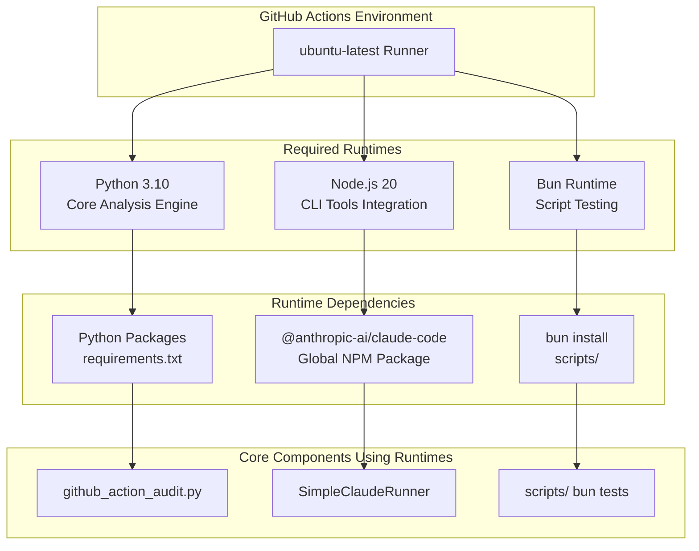
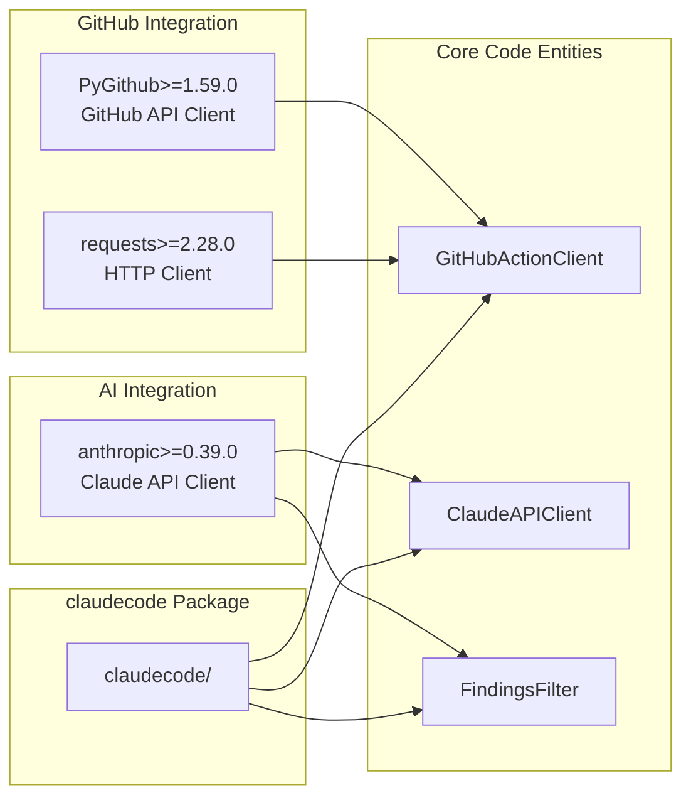
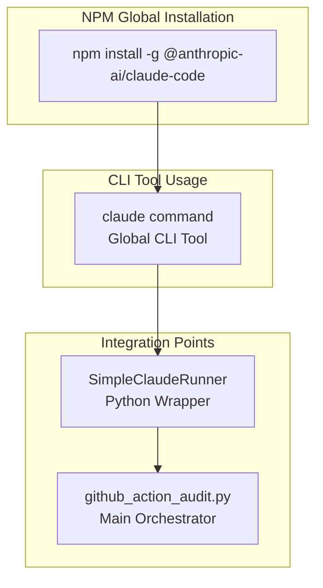
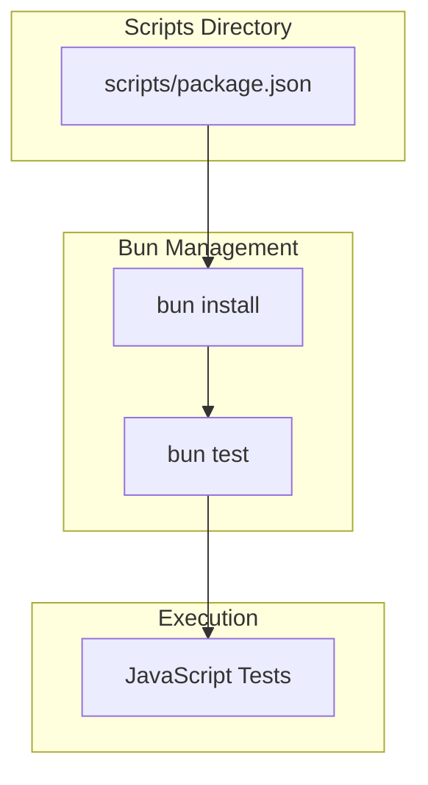

<!-- source: DeepWiki mcp.deepwiki.com · repo anthropics/claude-code-security-review · page 7.1 Dependencies and Installation · fetched 2026-10-26 -->

# Dependencies and Installation

Relevant source files

The following files were used as context for generating this wiki page:

- [.github/workflows/test-claudecode.yml](.github/workflows/test-claudecode.yml)
- [claudecode/requirements.txt](claudecode/requirements.txt)

This document details all system dependencies required for the Claude Code Security Review system, including Python packages, external command-line tools, and runtime environments. This covers both production dependencies for running security analyses and development dependencies for testing and evaluation.

## Runtime Environment Requirements

The Claude Code Security Review system requires multiple runtime environments to support its polyglot architecture, combining Python for orchestration, Node.js for the Claude CLI, and Bun for auxiliary script testing.

### Multi-Runtime Architecture

**Sources:** [.github/workflows/test-claudecode.yml:18-60]()

The system requires three distinct runtime environments:

- **Python 3.10**: Primary runtime for the core `claudecode` package. Defined in CI via `actions/setup-python@v4` [[.github/workflows/test-claudecode.yml:23-26]()].
- **Node.js 20**: Required for the Claude CLI integration. Defined in CI via `actions/setup-node@v4` [[.github/workflows/test-claudecode.yml:28-31]()].
- **Bun**: Used for testing JavaScript/TypeScript scripts in the `scripts/` directory. Defined in CI via `oven-sh/setup-bun@v2` [[.github/workflows/test-claudecode.yml:47-50]()].

### GitHub Actions Runtime Setup

The system is designed to run primarily in GitHub Actions with specific setup requirements:

| Runtime | Setup Action | Version Requirement |
|---------|-------------|-------------------|
| Python | `actions/setup-python@v4` | `3.10` |
| Node.js | `actions/setup-node@v4` | `20` |
| Bun | `oven-sh/setup-bun@v2` | `latest` |

**Sources:** [.github/workflows/test-claudecode.yml:23-50]()

## Python Dependencies

### Core Production Dependencies

The Python dependencies are defined in `claudecode/requirements.txt` [[claudecode/requirements.txt:1-18]()] and support the core logic of the security review engine.

**Sources:** [claudecode/requirements.txt:5-15]()

#### GitHub API Integration
- **PyGithub>=1.59.0**: Primary GitHub API client used for pull request data retrieval and comment management [[claudecode/requirements.txt:5-5]()].
- **requests>=2.28.0**: HTTP client library supporting direct GitHub API interactions [[claudecode/requirements.txt:8-8]()].

#### AI Integration
- **anthropic>=0.39.0**: Anthropic SDK for Claude API integration, used for direct API access and AI-powered false positive filtering [[claudecode/requirements.txt:15-15]()].

#### Standard Library Dependencies
Several core modules rely solely on the Python standard library to minimize the dependency footprint:
- **JSON Parsing**: `json_parser.py` uses the built-in `json` module [[claudecode/requirements.txt:10-10]()].
- **Prompts**: `prompts.py` uses built-in string formatting [[claudecode/requirements.txt:11-11]()].
- **Filtering**: `findings_filter.py` uses the built-in `re` module for initial regex-based exclusions [[claudecode/requirements.txt:12-12]()].

### Development and Testing Dependencies

Additional dependencies are required for development and testing workflows as seen in the CI configuration [[.github/workflows/test-claudecode.yml:37-40]()]:

- **pytest**: Primary testing framework for unit tests.
- **pytest-cov**: Code coverage analysis with terminal reporting.

The test suite is executed by setting the `PYTHONPATH` and running `pytest claudecode` [[.github/workflows/test-claudecode.yml:44-45]()].

## External Tool Dependencies

### Claude CLI Integration

The system depends on the `@anthropic-ai/claude-code` CLI tool for core security analysis functionality. This tool is executed by the `SimpleClaudeRunner` [[claudecode/requirements.txt:17-18]()].

**Sources:** [.github/workflows/test-claudecode.yml:33-35](), [claudecode/requirements.txt:17-18]()

Key characteristics:
- **Installation**: `npm install -g @anthropic-ai/claude-code` [[.github/workflows/test-claudecode.yml:35-35]()].
- **Requirement**: The `claude` command-line tool must be installed separately and available in the system PATH for security analysis [[claudecode/requirements.txt:17-18]()].

## Script Dependencies

### Bun Runtime Dependencies

The `scripts/` directory contains JavaScript/TypeScript code for PR comment management, which uses its own dependency management system [[.github/workflows/test-claudecode.yml:52-56]()].

**Sources:** [.github/workflows/test-claudecode.yml:52-60]()

- **Installation**: Executed via `cd scripts && bun install` [[.github/workflows/test-claudecode.yml:54-55]()].
- **Testing**: Script tests are run via `bun test` [[.github/workflows/test-claudecode.yml:60-60]()].

## Dependency Installation Workflow

### Complete Installation Sequence

The following sequence represents the automated setup performed in the GitHub Action environment:

1.  **Runtime Setup**: Initialize Python 3.10, Node.js 20, and Bun [[.github/workflows/test-claudecode.yml:23-50]()].
2.  **Claude CLI**: Install the global npm package `@anthropic-ai/claude-code` [[.github/workflows/test-claudecode.yml:33-35]()].
3.  **Python Packages**: Install core requirements and testing tools via `pip` [[.github/workflows/test-claudecode.yml:37-40]()].
4.  **Script Dependencies**: Install Bun-specific packages in the `scripts/` directory [[.github/workflows/test-claudecode.yml:52-55]()].

**Sources:** [.github/workflows/test-claudecode.yml:20-60]()

## Version Constraints and Compatibility

### Minimum Version Requirements

| Dependency | Minimum Version | Rationale |
| :--- | :--- | :--- |
| **PyGithub** | `1.59.0` | GitHub API compatibility [[claudecode/requirements.txt:5-5]()] |
| **requests** | `2.28.0` | Secure HTTP client [[claudecode/requirements.txt:8-8]()] |
| **anthropic** | `0.39.0` | Claude API features and filtering [[claudecode/requirements.txt:15-15]()] |
| **Python** | `3.10` | Language feature support [[.github/workflows/test-claudecode.yml:26-26]()] |
| **Node.js** | `20` | Support for Claude CLI [[.github/workflows/test-claudecode.yml:31-31]()] |

**Sources:** [claudecode/requirements.txt:1-18](), [.github/workflows/test-claudecode.yml:23-31]()

---

