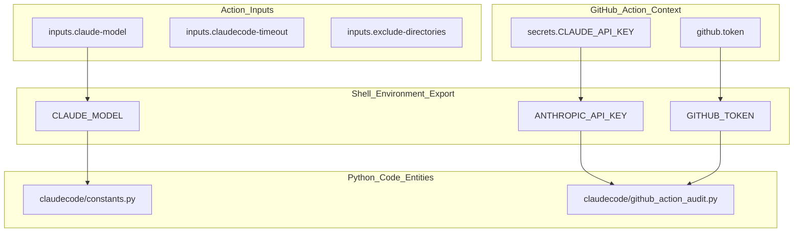
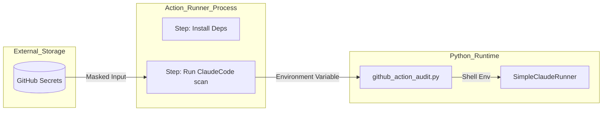

<!-- source: DeepWiki mcp.deepwiki.com · repo anthropics/claude-code-security-review · page 7.2 Environment Variables and Secrets · fetched 2026-10-26 -->

# Environment Variables and Secrets

Relevant source files

The following files were used as context for generating this wiki page:

- [.github/workflows/sast.yml](.github/workflows/sast.yml)
- [action.yml](action.yml)
- [claudecode/constants.py](claudecode/constants.py)

This document provides a complete reference for all environment variables and secrets used by the Claude Code Security Review system. It covers required API credentials, optional configuration parameters, and internal system variables used during execution.

## Required Secrets and API Keys

The system requires specific API credentials to function properly. These must be configured as GitHub repository secrets for security and passed as inputs to the GitHub Action.

### Anthropic Claude API Key

| Variable | Required | Source | Purpose |
|----------|----------|---------|---------|
| `ANTHROPIC_API_KEY` | Yes | Action input `claude-api-key` | Authenticates with Anthropic's Claude API for security analysis and false positive filtering |

The Claude API key must be:
- A valid Anthropic API key with sufficient credits.
- Stored as a GitHub repository secret (e.g., `CLAUDE_API_KEY`). [github/workflows/sast.yml:24-24]()
- Passed to the action via the `claude-api-key` input parameter. [action.yml:26-29]()

### GitHub Authentication

| Variable | Required | Source | Purpose |
|----------|----------|---------|---------|
| `GITHUB_TOKEN` | Yes | Automatic (`${{ github.token }}`) | Accesses GitHub API for PR data, comments, and artifact management |

The GitHub token is automatically provided by the GitHub Actions runtime. It provides the necessary permissions to read pull request data and post findings as comments. [action.yml:181-181]()

Sources: [action.yml:26-29](), [action.yml:181-184](), [.github/workflows/sast.yml:24-24]()

## Configuration Environment Variables

These variables control the behavior and execution parameters of the security analysis system.

### Claude AI Configuration

| Variable | Default | Source | Purpose |
|----------|---------|---------|---------|
| `CLAUDE_MODEL` | `claude-opus-4-1-20250805` | Action input or `os.environ` | Specifies which Claude model to use for analysis and filtering |
| `CLAUDECODE_TIMEOUT` | `20` (minutes) | Action input `claudecode-timeout` | Sets maximum time limit for the `@anthropic-ai/claude-code` CLI execution |

The model selection affects analysis quality and cost. If not provided via the `claude-model` input, the system defaults to a hardcoded version in the constants file. [claudecode/constants.py:8-8]()

### Scan Customization Variables

| Variable | Default | Source | Purpose |
|----------|---------|---------|---------|
| `EXCLUDE_DIRECTORIES` | Empty | Action input `exclude-directories` | Comma-separated list of directories to skip during the scan |
| `CUSTOM_SECURITY_SCAN_INSTRUCTIONS` | Empty | Action input file path | Path to a text file containing additional security audit instructions |
| `FALSE_POSITIVE_FILTERING_INSTRUCTIONS` | Empty | Action input file path | Path to a text file containing custom rules for the filtering stage |

Sources: [action.yml:16-49](), [claudecode/constants.py:8-23]()

## System Environment Variable Flow

The following diagram illustrates how inputs and secrets are mapped to environment variables consumed by the Python engine and external CLI tools.

### Data Flow: Inputs to Code Entities

Sources: [action.yml:180-195](), [claudecode/constants.py:8-8]()

## Internal System Variables

These variables are used internally for coordination between action steps and the analysis engine.

### Execution Context and Control

| Variable | Purpose | Source |
|----------|---------|---------|
| `PR_NUMBER` | Pull request number for API calls | `${{ github.event.pull_request.number }}` |
| `RUN_EVERY_COMMIT` | Forces scan even if cache exists | `${{ inputs.run-every-commit }}` |
| `ENABLE_CLAUDECODE` | Boolean flag to skip/run the scan step | Determined in `claudecode-check` step |
| `REPOSITORY_ID` | Used for generating unique cache keys | `${{ github.repository_id }}` |

The `ENABLE_CLAUDECODE` variable is calculated by checking the presence of a `.claudecode-marker/marker.json` file in the GitHub Actions cache to prevent redundant runs on the same commit SHA. [action.yml:94-114]()

### Subprocess Configuration
The Python engine uses constants to define hard limits for subprocess execution:
- `SUBPROCESS_TIMEOUT`: Set to 1200 seconds (20 minutes) for the Claude Code CLI. [claudecode/constants.py:22-22]()
- `PROMPT_TOKEN_LIMIT`: Capped at 16,384 tokens for model interactions. [claudecode/constants.py:14-14]()

Sources: [action.yml:86-115](), [claudecode/constants.py:14-23]()

## Environment Variable Security Model

The system implements a strict isolation model to ensure secrets like the `ANTHROPIC_API_KEY` are only exposed to the necessary processes.

### Secret Exposure Mapping

### Security Best Practices Implementation
1. **Masking**: The `ANTHROPIC_API_KEY` is passed as an input and automatically masked in GitHub Action logs. [action.yml:26-29]()
2. **Ephemeral Access**: The `GITHUB_TOKEN` is generated per-run and expires after the workflow completes. [action.yml:181-181]()
3. **Cache Integrity**: The system uses a `repository_id` and `sha` in the cache key to ensure markers cannot be poisoned across different repositories or commits. [action.yml:82-82]()

Sources: [action.yml:26-29](), [action.yml:82-82](), [action.yml:181-181]()

---

