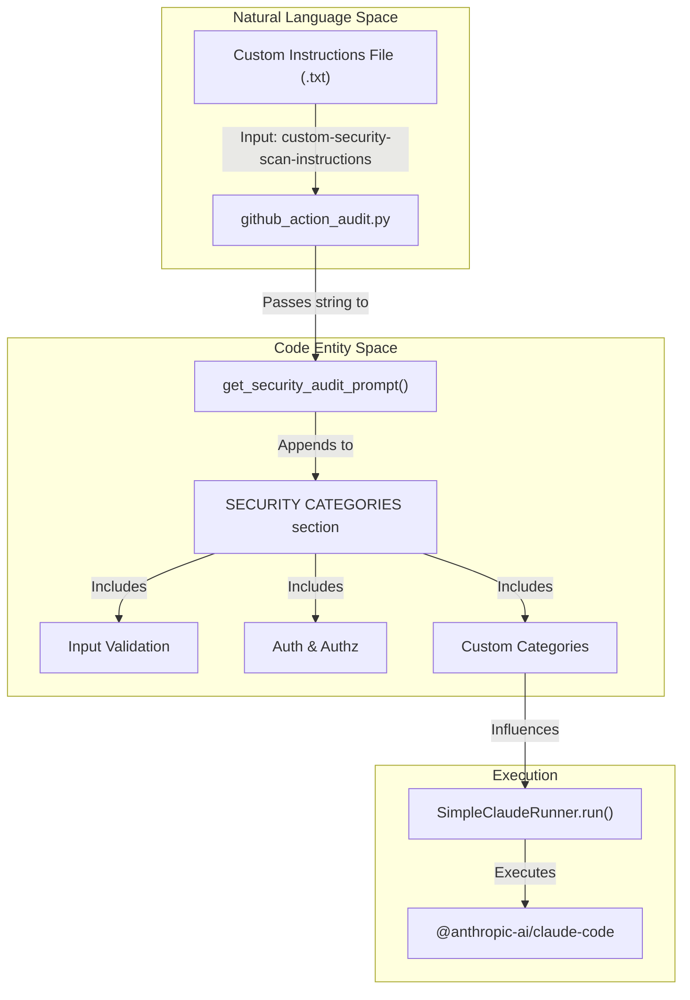
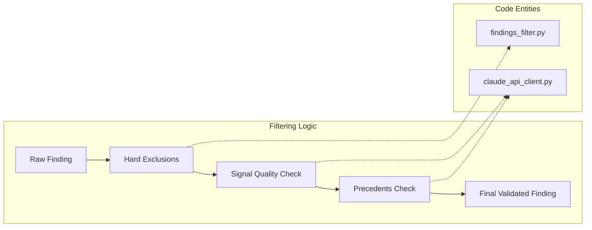

<!-- source: DeepWiki mcp.deepwiki.com · repo anthropics/claude-code-security-review · page 7.3 Customization Options · fetched 2026-10-26 -->

# Customization Options

<details>
<summary>Relevant source files</summary>

The following files were used as context for generating this wiki page:

- [docs/custom-filtering-instructions.md](docs/custom-filtering-instructions.md)
- [docs/custom-security-scan-instructions.md](docs/custom-security-scan-instructions.md)
- [examples/custom-false-positive-filtering.txt](examples/custom-false-positive-filtering.txt)
- [examples/custom-security-scan-instructions.txt](examples/custom-security-scan-instructions.txt)

</details>


This document explains how to customize the security scan instructions and filtering rules of the Claude Code Security Review system. These customizations allow organizations to tailor the AI's analysis to specific technology stacks, compliance requirements, and internal security policies.

## Overview of Customization Mechanisms

The system provides two primary injection points for customization via GitHub Action inputs:
1.  **Custom Security Scan Instructions**: Appends organization-specific vulnerability categories to the audit prompt.
2.  **Custom False Positive Filtering**: Provides tailored criteria for the AI-powered filtering stage to reduce noise based on the environment's security context.

| Input Parameter | Purpose | Implementation File |
| :--- | :--- | :--- |
| `custom-security-scan-instructions` | Add new vulnerability categories | [docs/custom-security-scan-instructions.md:1-13]() |
| `false-positive-filtering-instructions` | Tailor noise reduction logic | [docs/custom-filtering-instructions.md:1-8]() |

## Custom Security Scan Instructions

The default security scan covers standard categories such as SQL injection, XSS, and secrets management. Users can extend this by providing a text file containing additional categories.

### Implementation and Data Flow

When a custom instructions file is provided, the content is appended to the security audit prompt. This happens after the default "Data Exposure" category but before the methodology section.



Sources: [docs/custom-security-scan-instructions.md:53-59](), [claudecode/prompts.py:36-40](), [claudecode/github_action_audit.py:1-20]()

### Formatting Custom Categories
To ensure the AI parses the instructions correctly, the file should follow a specific structure:
*   **Header**: Bold category name (e.g., `**GraphQL Security:**`).
*   **Body**: Bulleted list of specific patterns or vulnerabilities to identify.

Example for Financial Services:
```text
**Financial Services Security:**
- Transaction replay attacks in payment processing
- Double-spending vulnerabilities in ledger systems
- Interest calculation manipulation through timing attacks
```
Sources: [docs/custom-security-scan-instructions.md:26-43](), [examples/custom-security-scan-instructions.txt:8-14]()

## Custom False Positive Filtering

The system uses a two-stage filtering process: hard exclusions and AI-validated filtering. Custom instructions allow users to override or supplement the default criteria used during the AI validation stage.

### Filtering Logic Components

Custom filtering instructions are typically divided into three functional sections:

1.  **HARD EXCLUSIONS**: Patterns that should be automatically ignored (e.g., test files, internal documentation).
2.  **SIGNAL QUALITY CRITERIA**: Specific questions the AI should ask to determine if a finding is exploitable.
3.  **PRECEDENTS**: Documentation of existing security controls (e.g., "We use AWS Cognito for all auth") that render certain findings invalid.



Sources: [docs/custom-filtering-instructions.md:20-32](), [examples/custom-false-positive-filtering.txt:1-33]()

### Example: Cloud-Native Environment
For an application running in Kubernetes with an API Gateway, custom instructions might include:
*   **Exclusion**: Ignore DOS findings because K8s resource limits are in place.
*   **Precedent**: Ignore missing CSRF protection because the app uses stateless JWTs.
*   **Signal Quality**: "Can an unauthenticated external attacker exploit this?"

Sources: [examples/custom-false-positive-filtering.txt:1-20](), [docs/custom-filtering-instructions.md:41-54]()

## Integration in GitHub Actions

To apply these customizations, reference the local file paths in the workflow YAML file.

```yaml
- uses: anthropics/claude-code-security-review@main
  with:
    # Path to custom scan categories
    custom-security-scan-instructions: .github/security/custom-categories.txt
    
    # Path to custom filtering rules
    false-positive-filtering-instructions: .github/security/filter-rules.txt
```

Sources: [docs/custom-security-scan-instructions.md:15-24](), [docs/custom-filtering-instructions.md:9-18]()

## Summary of Customization Points

| Feature | Customization Method | Default Behavior |
| :--- | :--- | :--- |
| **Vulnerability Scope** | Append text via `custom-security-scan-instructions` | Covers SQLi, XSS, Auth, Crypto, Data Exposure |
| **Noise Reduction** | Define rules via `false-positive-filtering-instructions` | Uses standard exclusions (Test files, DOS, etc.) |
| **Severity Logic** | Defined in prompt template | HIGH/MEDIUM/LOW based on impact/exploitability |
| **Analysis Methodology** | Defined in `.claude/commands/security-review.md` | 3-Phase approach: Research, Compare, Assess |

Sources: [docs/custom-security-scan-instructions.md:68-77](), [docs/custom-filtering-instructions.md:37-40](), [.claude/commands/security-review.md:87-125]()

---

