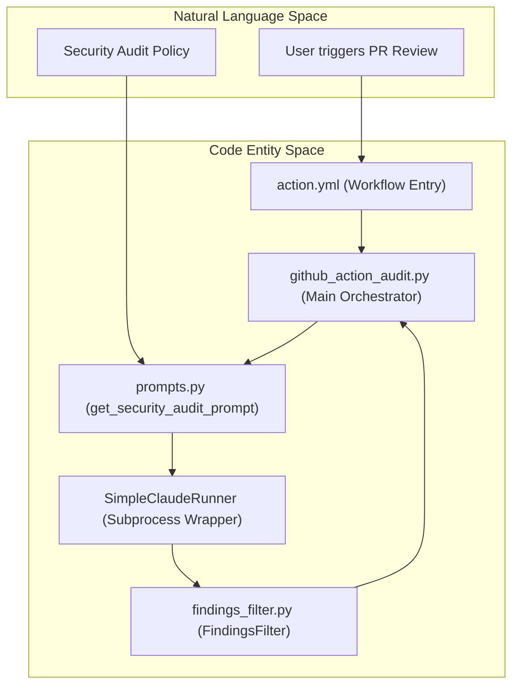
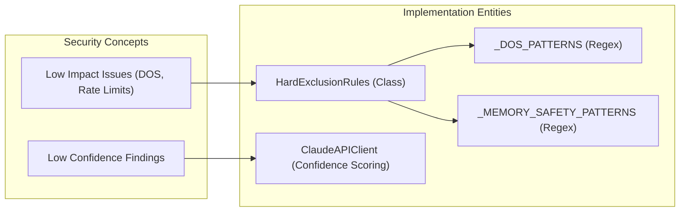

<!-- source: DeepWiki mcp.deepwiki.com · repo anthropics/claude-code-security-review · page 8 Glossary · fetched 2026-10-26 -->

# Glossary

Relevant source files

The following files were used as context for generating this wiki page:

- [.claude/commands/security-review.md](.claude/commands/security-review.md)
- [README.md](README.md)
- [action.yml](action.yml)
- [claudecode/constants.py](claudecode/constants.py)
- [claudecode/findings_filter.py](claudecode/findings_filter.py)
- [claudecode/github_action_audit.py](claudecode/github_action_audit.py)

This page provides definitions for codebase-specific terms, jargon, and architectural concepts used within the Claude Code Security Review system. It serves as a reference for onboarding engineers to understand the mapping between high-level security concepts and their technical implementations.

## Core System Terms

### Claude Code (CLI)
The underlying agentic security tool developed by Anthropic (`@anthropic-ai/claude-code`). It is executed as a subprocess to perform the actual semantic analysis of the codebase.
*   **Implementation**: Wrapped by the `SimpleClaudeRunner` class [claudecode/github_action_audit.py:189-191]().
*   **Execution**: Invoked using `subprocess.Popen` with a specific security audit prompt [claudecode/github_action_audit.py:246-260]().

### Security Audit Prompt
A specialized set of instructions provided to Claude to guide its security analysis. It defines the personas, objective, and specific vulnerability categories to investigate.
*   **Implementation**: Generated by `get_security_audit_prompt()` [claudecode/prompts.py:18]().
*   **Slash Command**: A version of this prompt is also implemented as a Claude Code slash command [ .claude/commands/security-review.md:1-6]().

### Marker File / Reservation Marker
A JSON file (`.claudecode-marker/marker.json`) used to track the execution state of the action on a specific PR and commit SHA. It prevents race conditions and redundant billing/processing.
*   **Data Flow**: Created during the "Reserve ClaudeCode slot" step in the GitHub Action [action.yml:123-149]().
*   **Caching**: Stored in the GitHub Actions cache to persist across workflow runs [action.yml:150-156]().

---

## Technical Concepts & Components

### Findings Filter
A two-stage system designed to minimize "noise" (false positives) before findings are reported to the user.
1.  **Hard Exclusions**: Regex-based filtering of low-impact issues (e.g., DOS, rate limiting).
2.  **Claude API Validation**: A secondary LLM pass that scores the confidence of a finding.
*   **Class**: `FindingsFilter` [claudecode/findings_filter.py:157-165]().
*   **Logic**: Uses `HardExclusionRules` to identify patterns like `_DOS_PATTERNS` or `_MEMORY_SAFETY_PATTERNS` [claudecode/findings_filter.py:27-70]().

### Evaluation Engine (Eval)
An internal framework used to test the security scanner's performance against historical PRs or synthetic test cases.
*   **Location**: Located in the `claudecode/evals/` directory [README.md:83]().
*   **Purpose**: Allows developers to measure the impact of prompt changes on precision and recall.

### JSON Fallback Parsing
A robust parsing utility that handles cases where the LLM output might contain conversational text surrounding the JSON or malformed syntax.
*   **Function**: `parse_json_with_fallbacks` [claudecode/json_parser.py:20]().
*   **Usage**: Crucial for extracting structured findings from the raw stdout of the Claude Code CLI [claudecode/github_action_audit.py:20]().

---

## Architecture Diagrams

### Natural Language to Code Entity Mapping: Audit Flow
The following diagram bridges the conceptual "Security Review" request to the specific code entities that handle the data flow.

"Audit Execution Flow"

**Sources**: [action.yml:1-50](), [claudecode/github_action_audit.py:1-40](), [claudecode/prompts.py:1-20](), [claudecode/findings_filter.py:157-170]()

### Logic Mapping: False Positive Filtering
This diagram maps the conceptual "Hard Exclusions" and "Confidence Validation" to the internal classes and patterns.

"Filtering Logic Mapping"

**Sources**: [claudecode/findings_filter.py:27-80](), [claudecode/findings_filter.py:157-165](), [claudecode/claude_api_client.py:1-20]()

---

## Common Abbreviations

| Abbreviation | Full Term | Context in Codebase |
| :--- | :--- | :--- |
| **CC** | Claude Code | Refers to the Anthropic CLI tool [README.md:135](). |
| **FP** | False Positive | The primary target of the `FindingsFilter` [claudecode/findings_filter.py:1](). |
| **SAST** | Static Application Security Testing | Used in documentation to compare Claude's semantic analysis to traditional tools [README.md:120](). |
| **RCE** | Remote Code Execution | A high-severity vulnerability category defined in prompts [ .claude/commands/security-review.md:121](). |
| **SHA** | Secure Hash Algorithm | Specifically the Git commit hash used for caching markers [action.yml:82](). |

**Sources**: [README.md:1-140](), [claudecode/findings_filter.py:1-20](), [action.yml:76-85](), [ .claude/commands/security-review.md:120-130]()