# Page: Overview

# Overview

<details>
<summary>Relevant source files</summary>

The following files were used as context for generating this wiki page:

- [LICENSE](LICENSE)
- [README.md](README.md)
- [action.yml](action.yml)

</details>


The Claude Code Security Review system is an AI-powered GitHub Action that performs automated security analysis on pull requests. This page introduces the system's purpose, architecture, and core workflow at a high level.

For detailed information about specific subsystems, see GitHub Action Integration (page 2), Core Python Engine (page 3), Security Analysis Pipeline (page 4), Evaluation and Testing System (page 5), Utilities and Infrastructure (page 6), and Configuration and Deployment (page 7).

## System Purpose

The Claude Code Security Review system is a static application security testing (SAST) tool that identifies security vulnerabilities in code changes. It integrates with GitHub as a composite action ([action.yml:1-3]()) and uses Anthropic's Claude AI to perform semantic code analysis.

**Key Capabilities:**
- **AI-Powered Analysis**: Uses Claude's advanced reasoning to detect security vulnerabilities with deep semantic understanding [README.md:7-7]().
- **Diff-Aware Scanning**: For PRs, only analyzes changed files [README.md:8-8]().
- **PR Comments**: Automatically comments on PRs with security findings [README.md:9-9]().
- **Language Agnostic**: Works with any programming language [README.md:11-11]().
- **False Positive Filtering**: Advanced filtering to reduce noise and focus on real vulnerabilities [README.md:12-12]().

Sources: [README.md:1-13](), [action.yml:1-3]()

## System Architecture

The system consists of three primary layers: the GitHub Action Integration layer, the Core Python Engine, and External Services.

### Overall System Architecture

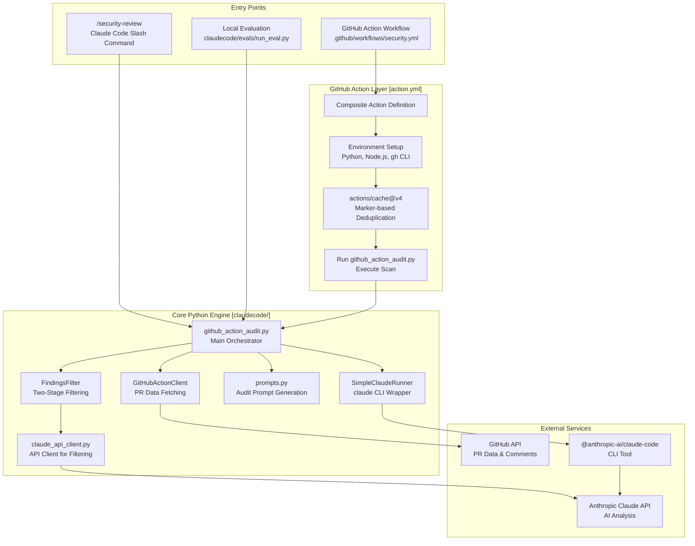

The `action.yml` composite action serves as the primary integration point, coordinating environment setup, dependency installation, and execution of `github_action_audit.py` [action.yml:60-185](). The Python core engine handles data collection, AI analysis, and filtering [README.md:75-84]().

Sources: [action.yml:60-185](), [README.md:72-84]()

### Alternative Execution Paths

The system can be invoked through three different entry points, all converging on the same core analysis logic:

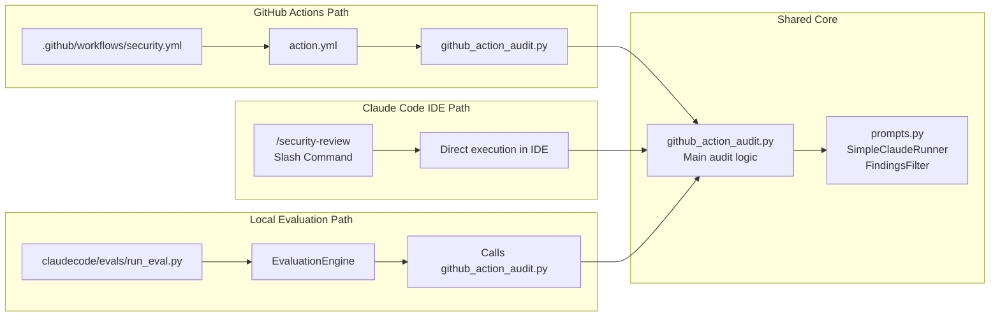

The GitHub Actions path provides automated CI/CD integration via `action.yml` [action.yml:1-3](). The Claude Code slash command enables on-demand analysis within the developer's environment [README.md:139-141](). The local evaluation path (`claudecode/evals/run_eval.py`) supports testing against arbitrary PRs [README.md:133-135]().

Sources: [action.yml:1-185](), [README.md:133-141]()

## Core Workflow

The system transforms pull request data through a multi-stage pipeline from raw input to filtered security findings.

### Data Flow and Transformation Pipeline

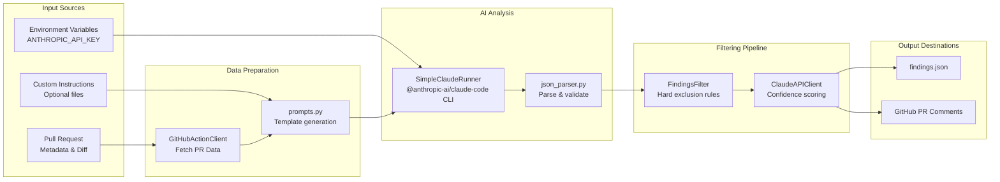

The workflow consists of five stages:
1. **PR Analysis**: Claude analyzes the diff to understand what changed [README.md:88-88]().
2. **Contextual Review**: Claude examines the code changes in context [README.md:89-89]().
3. **Finding Generation**: Security issues are identified with explanations and severity [README.md:90-90]().
4. **False Positive Filtering**: Advanced filtering removes low-impact findings [README.md:91-91]().
5. **PR Comments**: Findings are posted as review comments on specific lines [README.md:92-92]().

Sources: [README.md:86-92]()

## Key Components

The system is organized into several subsystems:

| Component | Primary Files | Purpose |
|-----------|--------------|---------|
| **GitHub Action** | `action.yml` | Orchestrates the CI/CD pipeline and environment setup [action.yml:1-61](). |
| **Audit Orchestrator** | `github_action_audit.py` | Main script coordinating the audit for GitHub Actions [README.md:76-76](). |
| **Prompt Engine** | `prompts.py` | Security audit prompt templates and logic [README.md:77-77](). |
| **Filtering System** | `findings_filter.py` | False positive filtering logic [README.md:78-78](). |
| **Claude API Client** | `claude_api_client.py` | Client for false positive filtering via API [README.md:79-79](). |
| **CLI Runner** | `claude_runner.py` | Wrapper for executing the Claude Code CLI tool. |
| **JSON Parser** | `json_parser.py` | Robust JSON parsing utilities for AI output [README.md:80-80](). |
| **Eval Tooling** | `evals/` | Tooling to test Claude Code on arbitrary PRs [README.md:83-83](). |

Sources: [README.md:72-84](), [action.yml:1-61]()

## Security Analysis Capabilities

The tool detects a wide range of vulnerabilities, including:
- **Injection Attacks**: SQL, command, LDAP, XXE, etc. [README.md:98-98]().
- **Auth & Authz**: Broken authentication, privilege escalation, IDOR [README.md:99-99]().
- **Data Exposure**: Hardcoded secrets, PII handling violations [README.md:100-100]().
- **Cryptographic Issues**: Weak algorithms, improper key management [README.md:101-101]().
- **Code Execution**: RCE via deserialization, eval injection [README.md:106-106]().

### False Positive Filtering
To reduce noise, the tool automatically excludes low-impact findings such as:
- Denial of Service (DoS) [README.md:112-112]().
- Rate limiting concerns [README.md:113-113]().
- Memory/CPU exhaustion [README.md:114-114]().
- Open redirect vulnerabilities [README.md:116-116]().

Sources: [README.md:96-118]()

---

# Page: GitHub Action Integration

# GitHub Action Integration

<details>
<summary>Relevant source files</summary>

The following files were used as context for generating this wiki page:

- [.github/workflows/sast.yml](.github/workflows/sast.yml)
- [action.yml](action.yml)

</details>


## Purpose and Scope

This document describes the GitHub Action that serves as the primary interface to the Claude Code Security Review system. The action orchestrates security analysis by coordinating dependency installation, cache management, scan execution, and result reporting within GitHub's CI/CD environment.

For detailed information about:
- Configuration inputs and outputs, see [Action Configuration and Inputs](#2.1)
- The sequential execution flow, see [Execution Pipeline and Steps](#2.2)
- The caching mechanism, see [Caching and Run Deduplication](#2.3)
- Example workflows, see [CI/CD Workflow Integration](#2.4)
- The underlying Python security analysis engine, see [Core Python Engine](#3)

## Action Overview

The security reviewer is implemented as a GitHub composite action defined in `action.yml`. It wraps the Python-based security analysis engine (`claudecode` package) and provides a declarative interface for integrating AI-powered security reviews into GitHub workflows.

The action operates exclusively on pull request events, analyzing code changes using Claude AI to identify potential security vulnerabilities. It manages its own execution state through a marker-based caching system to prevent redundant scans and reduce false positives from repeated analysis.

**Action Type:** Composite Action  
**Primary Entry Point:** [action.yml:1-334]()  
**Core Execution Module:** [claudecode/github_action_audit.py]()

Sources: [action.yml:1-10]()

## Action Architecture

The composite action is structured around several key phases that execute sequentially:

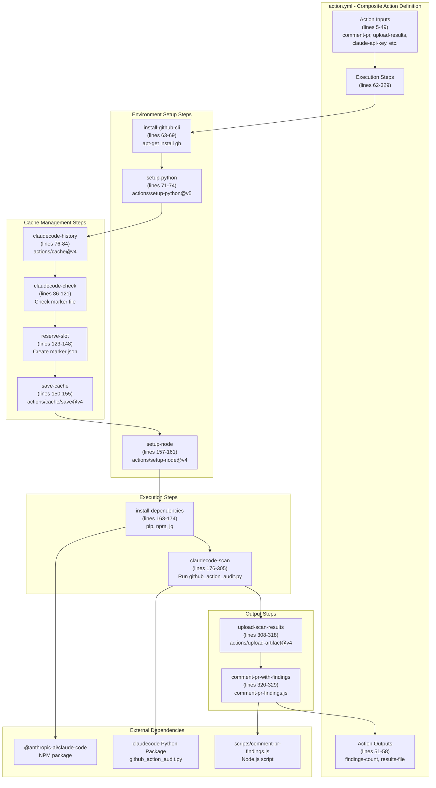

**Key Architectural Characteristics:**

| Aspect | Implementation |
|--------|---------------|
| Action Type | Composite (`runs.using: 'composite'`) |
| Step Execution | Sequential shell scripts (`shell: bash`) |
| Conditional Logic | Step-level `if` conditions based on previous step outputs |
| State Management | GitHub Actions cache with marker files |
| Language Integration | Multi-language (Bash, Python, Node.js) |
| External Dependencies | GitHub CLI, Python packages, NPM packages |

The architecture uses step outputs (e.g., `steps.claudecode-check.outputs.enable_claudecode`) to control conditional execution throughout the pipeline. This allows downstream steps to skip execution when the scan is disabled by cache checks or configuration.

Sources: [action.yml:60-334]()

## Integration with GitHub Workflows

The action integrates into GitHub workflows as a standard action step. It requires specific GitHub context and triggers to function correctly:

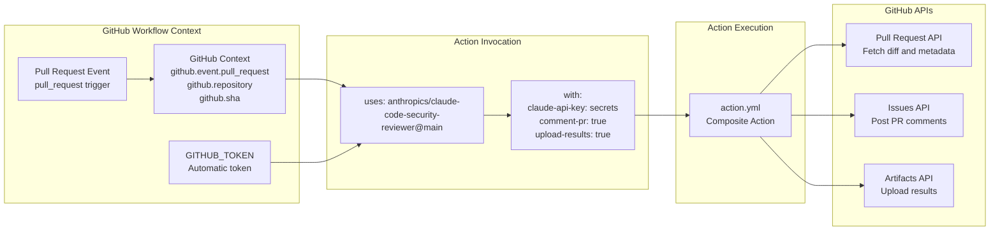

**Required GitHub Context:**

- **Event Type:** Must be `pull_request` event ([action.yml:78](), [action.yml:201-204]())
- **GitHub Token:** Automatically provided via `github.token` ([action.yml:181](), [action.yml:324]())
- **PR Context:** Requires `github.event.pull_request.number` ([action.yml:90](), [action.yml:183]())
- **Repository Context:** Uses `github.repository` and `github.repository_id` ([action.yml:82](), [action.yml:182]())

**GitHub API Interactions:**

The action interacts with GitHub through multiple mechanisms:

| Mechanism | Purpose | Implementation |
|-----------|---------|---------------|
| GitHub CLI (`gh`) | PR operations and API calls | Installed via apt-get ([action.yml:68]()) |
| GitHub Token | Authentication for API requests | Passed as `GITHUB_TOKEN` env var ([action.yml:181]()) |
| Actions Cache API | Store and retrieve scan markers | `actions/cache@v4` ([action.yml:79]()) |
| Artifacts API | Upload scan results | `actions/upload-artifact@v4` ([action.yml:310]()) |

Sources: [action.yml:78-84](), [action.yml:181-184](), [action.yml:201-204](), [action.yml:324]()

## Core Step Identifiers and Responsibilities

The action defines specific step IDs that control execution flow and produce outputs:

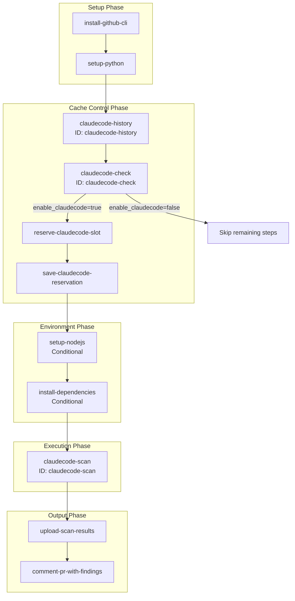

**Critical Step Outputs:**

| Step ID | Output Variables | Purpose |
|---------|-----------------|---------|
| `claudecode-history` | `cache-hit` | Indicates if cache was restored ([action.yml:77]()) |
| `claudecode-check` | `enable_claudecode` | Controls whether scan executes ([action.yml:114]()) |
| `claudecode-check` | `silence_claudecode_comments` | Controls comment behavior ([action.yml:115]()) |
| `claudecode-scan` | `findings_count` | Number of security findings ([action.yml:54](), [action.yml:277]()) |
| `claudecode-scan` | `results_file` | Path to results JSON ([action.yml:57](), [action.yml:198]()) |

These outputs are referenced throughout the action using the syntax `${{ steps.<step-id>.outputs.<output-name> }}`.

Sources: [action.yml:76-121](), [action.yml:176-305]()

## Data Flow Through the Action

The action processes data through a well-defined pipeline from inputs to outputs:

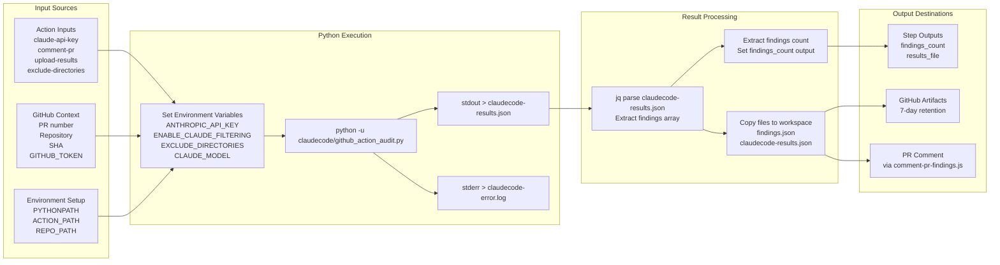

**Environment Variable Mapping:**

The action transforms user inputs into environment variables consumed by the Python module:

| Action Input | Environment Variable | Consumed By |
|--------------|---------------------|-------------|
| `claude-api-key` | `ANTHROPIC_API_KEY` | `github_action_audit.py` ([action.yml:184]()) |
| `exclude-directories` | `EXCLUDE_DIRECTORIES` | `github_action_audit.py` ([action.yml:186]()) |
| `claude-model` | `CLAUDE_MODEL` | `github_action_audit.py` ([action.yml:189]()) |
| `claudecode-timeout` | `CLAUDECODE_TIMEOUT` → `CLAUDE_TIMEOUT` | `github_action_audit.py` ([action.yml:190](), [action.yml:217]()) |
| `false-positive-filtering-instructions` | `FALSE_POSITIVE_FILTERING_INSTRUCTIONS` | `github_action_audit.py` ([action.yml:187]()) |
| `custom-security-scan-instructions` | `CUSTOM_SECURITY_SCAN_INSTRUCTIONS` | `github_action_audit.py` ([action.yml:188]()) |
| (hardcoded) | `ENABLE_CLAUDE_FILTERING=true` | `github_action_audit.py` ([action.yml:185]()) |

**Result File Processing:**

The action produces multiple result files with distinct purposes:

| File | Format | Purpose | Created At |
|------|--------|---------|-----------|
| `claudecode-results.json` | JSON | Complete scan output with metadata | Line 242 (Python stdout) |
| `findings.json` | JSON Array | Extracted findings for PR comment | Line 281 (jq extraction) |
| `claudecode-error.log` | Text | Error messages from Python execution | Line 242 (Python stderr) |

Sources: [action.yml:176-305]()

## Execution Control Mechanisms

The action implements several mechanisms to control when and how scans execute:

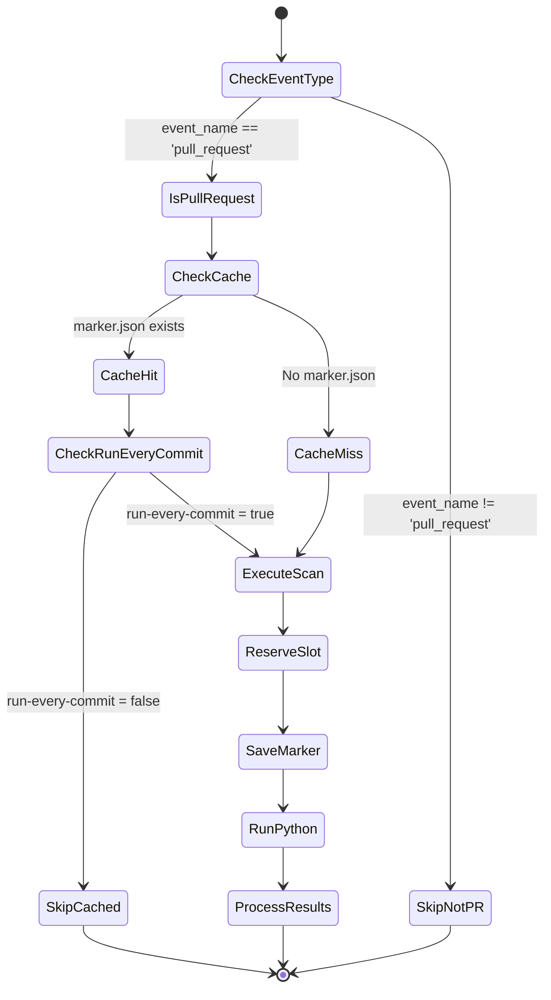

**Cache Key Structure:**

The cache key follows a hierarchical pattern to enable precise cache management:

```
claudecode-{repository_id}-pr-{pr_number}-{sha}
```

Components:
- `repository_id`: GitHub repository ID for uniqueness across forks ([action.yml:82]())
- `pr_number`: Pull request number for per-PR tracking ([action.yml:82]())
- `sha`: Commit SHA for per-commit granularity ([action.yml:82]())

**Restore Keys:**

The action uses a restore key prefix to find markers from earlier commits in the same PR:

```
claudecode-{repository_id}-pr-{pr_number}-
```

This allows the cache system to restore the most recent marker from any commit in the PR ([action.yml:83-84]()).

**Marker File Format:**

When execution proceeds, the action creates a marker file at `.claudecode-marker/marker.json`:

```json
{
  "timestamp": "ISO-8601 timestamp",
  "repository_id": "GitHub repository ID",
  "repository": "owner/repo",
  "pr_number": 123,
  "sha": "commit SHA",
  "status": "reserved",
  "run_id": "GitHub Actions run ID",
  "run_number": "GitHub Actions run number"
}
```

This marker serves multiple purposes:
- **Race condition prevention:** Multiple concurrent runs on the same PR check for existing markers ([action.yml:104]())
- **Audit trail:** Records which run created the marker ([action.yml:136-147]())
- **Cache invalidation:** SHA-specific keys prevent stale cache hits

Sources: [action.yml:76-156]()

## Python Module Invocation

The core security analysis is performed by executing the Python module:

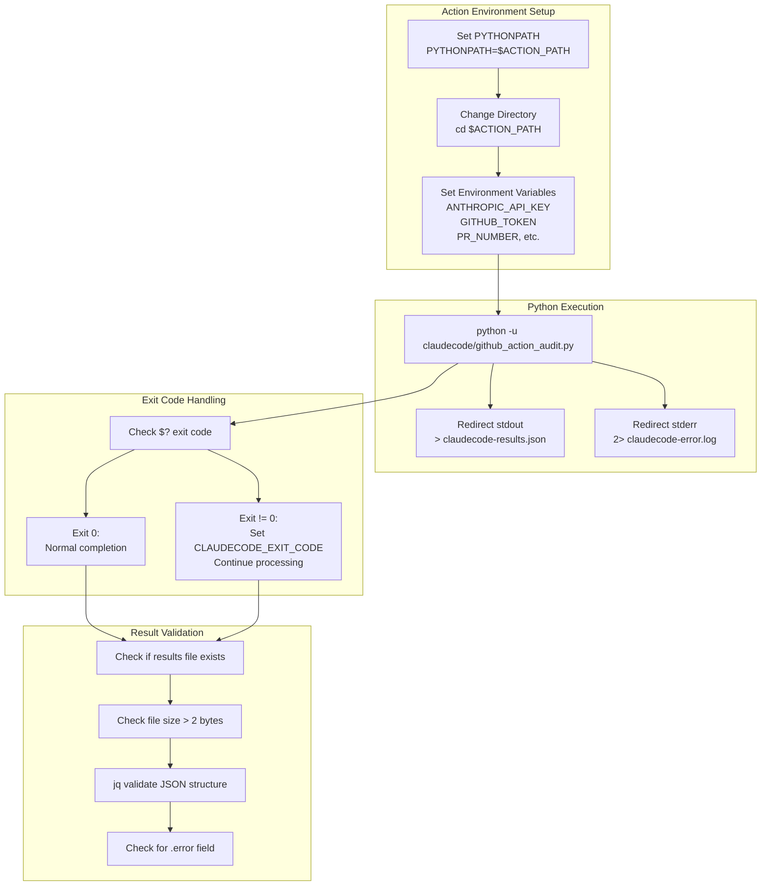

**Invocation Details:**

| Aspect | Implementation |
|--------|---------------|
| Working Directory | Changes to `$ACTION_PATH` before execution ([action.yml:221]()) |
| Python Path | Sets `PYTHONPATH` to include action root ([action.yml:238-239]()) |
| Python Flags | Uses `-u` for unbuffered output ([action.yml:242]()) |
| Output Redirection | stdout → `claudecode-results.json`, stderr → `claudecode-error.log` ([action.yml:242]()) |
| Exit Code Handling | Captures exit code but continues processing ([action.yml:242-248]()) |

**Error Handling Strategy:**

The action implements graceful degradation when Python execution encounters errors:

1. **Non-zero exit code:** Captured as warning but doesn't fail the action ([action.yml:244-246]())
2. **Empty results file:** Warns and sets findings count to 0 ([action.yml:256-263]())
3. **JSON error field:** Extracts error message and sets findings count to 0 ([action.yml:269-272]())
4. **Missing results file:** Warns, displays error log, sets findings count to 0 ([action.yml:284-290]())

This approach ensures the GitHub Actions workflow continues even if the scan encounters issues, preventing blocking of PR merges due to transient failures.

Sources: [action.yml:192-305]()

## Output Artifact Management

The action produces artifacts that are uploaded to GitHub and made available for inspection:

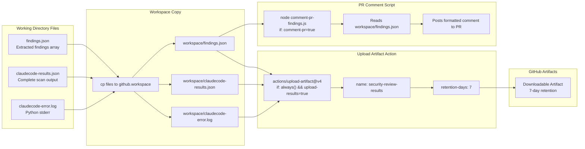

**Upload Configuration:**

| Setting | Value | Location |
|---------|-------|----------|
| Upload Step | `upload-scan-results` | [action.yml:308]() |
| Condition | `always() && inputs.upload-results == 'true'` | [action.yml:309]() |
| Artifact Name | `security-review-results` | [action.yml:312]() |
| Retention | 7 days | [action.yml:317]() |
| Missing Files | Ignored (`if-no-files-found: ignore`) | [action.yml:318]() |

The `always()` condition ensures artifacts are uploaded even if previous steps failed, enabling debugging of scan failures.

**File Path Management:**

Files are copied from the action's working directory to the workspace root to ensure downstream steps can locate them:

```bash
# Copy occurs after Python execution completes
cp findings.json ${{ github.workspace }}/findings.json
cp claudecode/claudecode-results.json ${{ github.workspace }}/claudecode-results.json
cp claudecode/claudecode-error.log ${{ github.workspace }}/claudecode-error.log
```

This copying happens at [action.yml:295-303]() with error suppression (`|| true`) to prevent failures if files don't exist.

Sources: [action.yml:295-318]()

## PR Comment Generation

The final step posts scan results as a PR comment using a Node.js script:

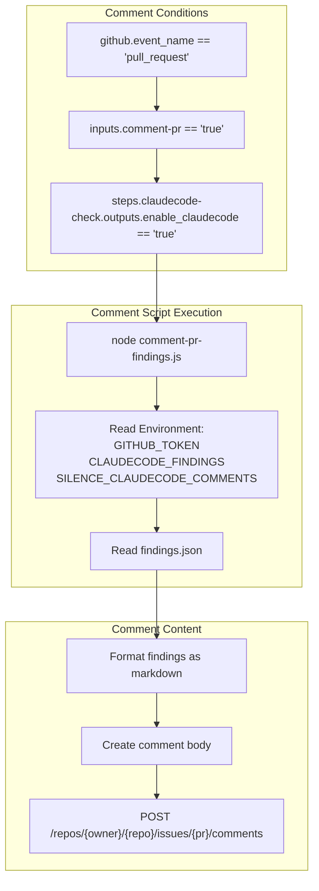

**Comment Step Configuration:**

| Aspect | Value |
|--------|-------|
| Step Name | `comment-pr-with-findings` ([action.yml:320]()) |
| Condition | Must be PR event, comment-pr enabled, and scan enabled ([action.yml:321]()) |
| Script Path | `$ACTION_PATH/scripts/comment-pr-findings.js` ([action.yml:329]()) |
| Environment | `GITHUB_TOKEN`, `CLAUDECODE_FINDINGS`, `SILENCE_CLAUDECODE_COMMENTS` ([action.yml:324-326]()) |

The script reads `findings.json` from the workspace and formats it as a markdown comment posted to the PR using GitHub's API.

Sources: [action.yml:320-329]()

## Configuration Interface Summary

The action exposes a comprehensive configuration interface through its inputs:

| Input Category | Inputs | Purpose |
|----------------|--------|---------|
| **Outputs** | `comment-pr`, `upload-results` | Control what artifacts are produced |
| **API Credentials** | `claude-api-key` | Required for Claude API access |
| **Scan Configuration** | `exclude-directories`, `custom-security-scan-instructions` | Customize what and how to scan |
| **Execution Control** | `claudecode-timeout`, `run-every-commit` | Control scan behavior |
| **Filtering** | `false-positive-filtering-instructions` | Customize false positive filtering |
| **Model Selection** | `claude-model` | Choose specific Claude model version |

For detailed documentation of each input parameter and output value, see [Action Configuration and Inputs](#2.1).

For information about the step-by-step execution sequence, see [Execution Pipeline and Steps](#2.2).

For details on the caching mechanism, see [Caching and Run Deduplication](#2.3).

For example workflow configurations, see [CI/CD Workflow Integration](#2.4).

Sources: [action.yml:5-58]()

---

# Page: Action Configuration and Inputs

# Action Configuration and Inputs

<details>
<summary>Relevant source files</summary>

The following files were used as context for generating this wiki page:

- [README.md](README.md)
- [action.yml](action.yml)

</details>


This page documents the `action.yml` configuration interface for the Claude Code Security Review GitHub Action. It details all available inputs, outputs, and how user-provided configuration flows through the system to control security analysis behavior.

For information about the execution pipeline and step sequencing, see page 2.2. For caching mechanisms, see page 2.3. For the core security analysis logic, see page 3.

## Action Metadata

The GitHub Action is defined in `action.yml` with the following metadata:

| Property | Value |
|----------|-------|
| `name` | Claude Code Security Reviewer |
| `description` | AI-powered security review GitHub Action using Claude to analyze code changes for security vulnerabilities |
| `author` | Anthropic |

Sources: [action.yml:1-3]()

## Input Configuration Options

The action defines several inputs in `action.yml` that control security analysis behavior. These inputs are categorized into three groups: behavior controls, analysis configuration, and customization options.

### Behavior Control Inputs

These inputs control how the action operates and reports results:

| Input | Type | Required | Default | Description |
|-------|------|----------|---------|-------------|
| `comment-pr` | boolean | No | `'true'` | Whether to post PR comments with security findings |
| `upload-results` | boolean | No | `'true'` | Whether to upload results as GitHub artifacts |
| `run-every-commit` | boolean | No | `'false'` | Run on every commit, skipping cache check. Warning: may increase false positives on multi-commit PRs |

Sources: [action.yml:6-9](), [action.yml:11-14](), [action.yml:36-39]()

### Analysis Configuration Inputs

These inputs configure the Claude API and analysis parameters:

| Input | Type | Required | Default | Description |
|-------|------|----------|---------|-------------|
| `claude-api-key` | string | Yes | `''` | Anthropic Claude API key for security analysis (used for both Claude CLI and API) |
| `claude-model` | string | No | `''` | Claude model name (e.g., `claude-sonnet-4-20250514`). Empty string uses system default |
| `claudecode-timeout` | string | No | `'20'` | Timeout for ClaudeCode analysis in minutes |
| `exclude-directories` | string | No | `''` | Comma-separated list of directories to exclude from scanning |

Sources: [action.yml:26-29](), [action.yml:31-34](), [action.yml:21-24](), [action.yml:16-19]()

### Customization Inputs

These inputs allow users to provide custom instructions for security scanning and filtering:

| Input | Type | Required | Default | Description |
|-------|------|----------|---------|-------------|
| `custom-security-scan-instructions` | string | No | `''` | Path to text file with custom security scan instructions appended to the audit prompt |
| `false-positive-filtering-instructions` | string | No | `''` | Path to text file with custom false positive filtering instructions |

Sources: [action.yml:46-49](), [action.yml:41-44]()

### Input to Environment Variable Mapping

The following diagram shows how action inputs are mapped to environment variables consumed by the core engine:

**Input Data Flow Diagram**

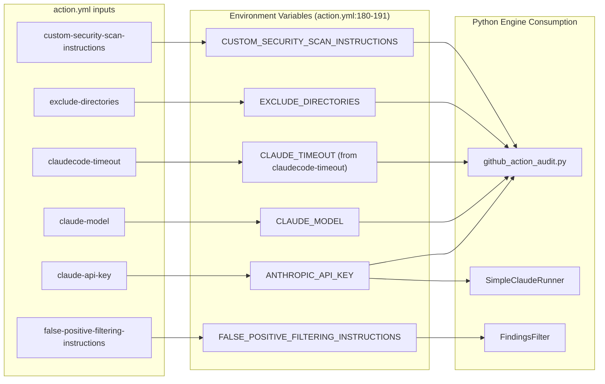

Sources: [action.yml:180-191]()

## Output Specifications

The action exposes two outputs that downstream workflow steps can consume:

| Output | Type | Description | Value Mapping |
|--------|------|-------------|---------------|
| `findings-count` | number | Total number of security findings identified | `${{ steps.claudecode-scan.outputs.findings_count }}` |
| `results-file` | string | Path to the generated results JSON file | `${{ steps.claudecode-scan.outputs.results_file }}` |

Sources: [action.yml:51-58]()

### Output Generation Flow

The `claudecode-scan` step executes the Python orchestrator and then processes the resulting JSON to set step outputs.

**Output Processing Diagram**

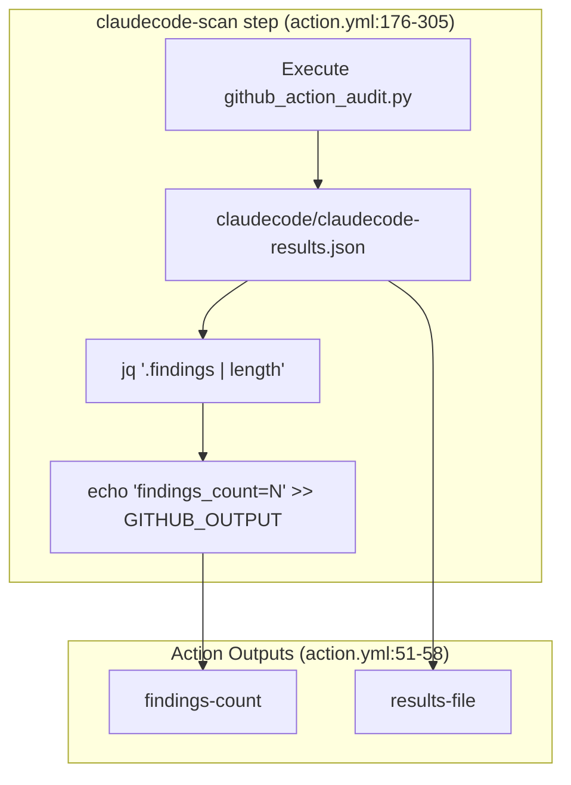

Sources: [action.yml:51-58](), [action.yml:275-278]()

## Configuration Usage Patterns

### Basic Usage Example

The minimal configuration requires only the `claude-api-key`:

```yaml
- uses: anthropics/claude-code-security-review@main
  with:
    claude-api-key: ${{ secrets.CLAUDE_API_KEY }}
```

Sources: [README.md:37-40]()

### Advanced Configuration Example

A fully customized configuration with all inputs:

```yaml
- uses: anthropics/claude-code-security-review@main
  with:
    claude-api-key: ${{ secrets.CLAUDE_API_KEY }}
    claude-model: 'claude-3-5-sonnet-20241022'
    claudecode-timeout: '30'
    comment-pr: true
    upload-results: true
    run-every-commit: false
    exclude-directories: 'vendor,node_modules,dist'
    custom-security-scan-instructions: '.github/security-scan-instructions.txt'
    false-positive-filtering-instructions: '.github/fp-filter-instructions.txt'
```

Sources: [action.yml:5-49]()

## Environment Variables Set by Action

The action sets multiple environment variables for the `github_action_audit.py` execution and downstream scripts:

### GitHub Context Variables

| Variable | Source | Purpose |
|----------|--------|---------|
| `GITHUB_TOKEN` | `${{ github.token }}` | Authentication for GitHub API operations |
| `GITHUB_REPOSITORY` | `${{ github.repository }}` | Target repository for analysis |
| `PR_NUMBER` | `${{ github.event.pull_request.number }}` | Current Pull Request identifier |

Sources: [action.yml:181-183]()

### Analysis Customization Variables

| Variable | Source | Purpose |
|----------|--------|---------|
| `EXCLUDE_DIRECTORIES` | `inputs.exclude-directories` | Filters files before analysis |
| `CUSTOM_SECURITY_SCAN_INSTRUCTIONS` | `inputs.custom-security-scan-instructions` | Appends custom rules to the Claude prompt |
| `FALSE_POSITIVE_FILTERING_INSTRUCTIONS` | `inputs.false-positive-filtering-instructions` | Guides the AI during the filtering phase |

Sources: [action.yml:186-188]()

## File Outputs and Artifacts

The action produces several output files during execution that are uploaded as artifacts or used by downstream steps.

### Generated Files

| File | Location | Purpose |
|------|----------|---------|
| `claudecode-results.json` | `claudecode/` | Complete analysis results including metadata |
| `findings.json` | Workspace root | Extracted findings array for PR commenting |
| `claudecode-error.log` | `claudecode/` | Error and debug logs from the Python engine |
| `marker.json` | `.claudecode-marker/` | Cache marker for run deduplication |

Sources: [action.yml:136-147](), [action.yml:275-282](), [action.yml:295-303]()

### Artifact Upload Configuration

When `upload-results` is `true`, the action uploads artifacts with a 7-day retention period.

**Artifact Flow Diagram**

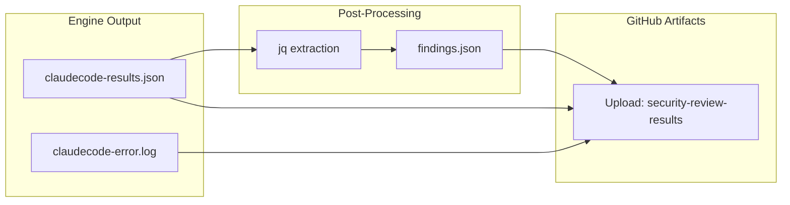

Sources: [action.yml:11-14](), [action.yml:275-282](), [action.yml:308-318]()

---

# Page: Execution Pipeline and Steps

# Execution Pipeline and Steps

<details>
<summary>Relevant source files</summary>

The following files were used as context for generating this wiki page:

- [action.yml](action.yml)
- [scripts/comment-pr-findings.bun.test.js](scripts/comment-pr-findings.bun.test.js)
- [scripts/comment-pr-findings.js](scripts/comment-pr-findings.js)
- [scripts/package.json](scripts/package.json)

</details>


## Purpose and Scope

This document details the sequential execution flow of the GitHub Action from trigger to completion. It explains each step in the action's composite run configuration, the decision points that control execution, and how data flows through the pipeline.

## Execution Overview

The GitHub Action executes as a composite action with 11 distinct steps, orchestrated by `action.yml`. The pipeline follows a linear flow with conditional branching based on cache status and configuration. The action can exit early if a scan has already been performed for the current PR and commit, preventing redundant analysis.

### System Flow Diagram
The following diagram maps the execution stages to the specific code entities responsible for each phase.

```mermaid
flowchart TD
    Start(["Workflow Trigger"]) --> InstallGH["Step 1: Install GitHub CLI<br/>action.yml:63-69"]
    InstallGH --> SetupPy["Step 2: Set up Python<br/>action.yml:71-74"]
    SetupPy --> CheckCache["Step 3: Check History<br/>actions/cache@v4<br/>action.yml:76-84"]
    
    CheckCache --> DetermineEnable["Step 4: Determine Enablement<br/>action.yml:86-121"]
    
    DetermineEnable --> EnableCheck{"`enable_claudecode == 'true'?`"}
    
    EnableCheck -->|No| SkipToUpload["Skip to Upload Results"]
    EnableCheck -->|Yes| ReserveSlot["Step 5: Reserve Slot<br/>.claudecode-marker/marker.json<br/>action.yml:123-148"]
    
    ReserveSlot --> SaveCache["Step 6: Save reservation<br/>actions/cache/save@v4<br/>action.yml:150-155"]
    SaveCache --> SetupNode["Step 7: Set up Node.js<br/>action.yml:157-161"]
    SetupNode --> InstallDeps["Step 8: Install dependencies<br/>pip & npm install<br/>action.yml:163-174"]
    
    InstallDeps --> RunScan["Step 9: Run ClaudeCode scan<br/>github_action_audit.py<br/>action.yml:176-305"]
    
    RunScan --> SkipToUpload
    SkipToUpload --> UploadResults["Step 10: Upload results<br/>actions/upload-artifact@v4<br/>action.yml:308-318"]
    
    UploadResults --> CommentCheck{"`comment-pr == 'true'?`"}
    CommentCheck -->|Yes| CommentPR["Step 11: Comment PR<br/>comment-pr-findings.js<br/>action.yml:320-329"]
    CommentCheck -->|No| End
    CommentPR --> End(["Workflow Complete"])
```

**Sources:** [action.yml:60-329]()

---

## Step-by-Step Execution

### Step 1-2: Environment Preparation
The action begins by ensuring the runner has the necessary binaries:
- **GitHub CLI (`gh`)**: Required for interacting with PR metadata and posting comments [action.yml:63-69]().
- **Python 3.x**: Required to run the core audit engine [action.yml:71-74]().

### Step 3-4: Cache Check and Enablement Logic
The system uses a marker-based caching system to prevent duplicate scans on the same commit SHA.

1. **Check History**: Attempts to restore a cache keyed by `claudecode-${{ github.repository_id }}-pr-${{ github.event.pull_request.number }}-${{ github.sha }}` [action.yml:76-82]().
2. **Determine Enablement**: A bash script checks if `.claudecode-marker/marker.json` exists. If it exists and `run-every-commit` is false, the scan is disabled [action.yml:104-106]().

### Step 5-6: Concurrency Reservation
To prevent race conditions where multiple workflow runs might target the same PR simultaneously, the action "reserves" a slot.
- It creates a `marker.json` containing the `run_id` and `timestamp` [action.yml:136-147]().
- It immediately saves this marker to the GitHub cache [action.yml:152-156]().

### Step 7-8: Dependency Installation
If enabled, the action installs:
- **Python Dependencies**: `pip install -r claudecode/requirements.txt` [action.yml:170]().
- **Claude CLI**: `npm install -g @anthropic-ai/claude-code` [action.yml:171]().
- **Utility**: `jq` for JSON processing [action.yml:173]().

### Step 9: Core Scan Execution
This step invokes the Python orchestrator.

**Data Flow in Scan Step:**
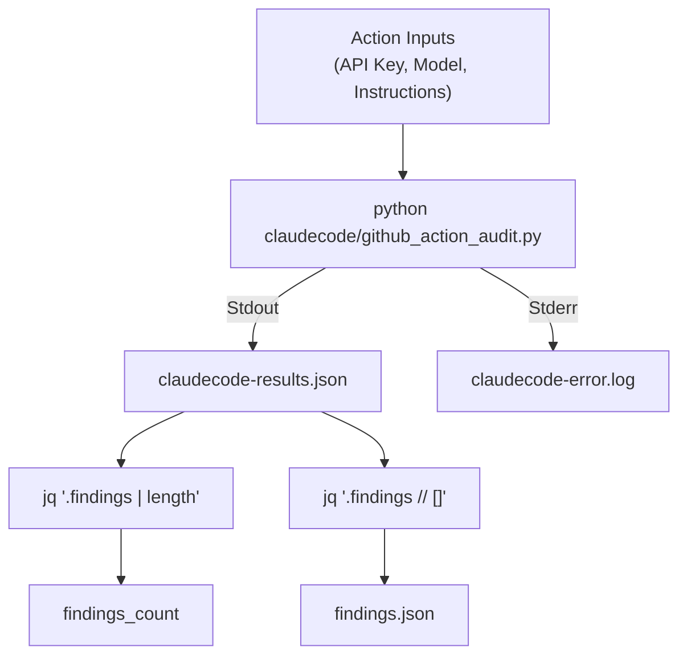

**Key Implementation Details:**
- The script is executed with the `-u` flag for unbuffered output [action.yml:236]().
- Results are piped to `claudecode-results.json` [action.yml:237]().
- The step uses `jq` to extract the `findings_count` for the Action's output variables [action.yml:263-271]().

**Sources:** [action.yml:176-305]()

### Step 10: Artifact Upload
The action uploads three key files as artifacts named `security-review-results` [action.yml:308-318]():
1. `findings.json`: The filtered list of vulnerabilities.
2. `claudecode-results.json`: The raw output from the Python engine.
3. `claudecode-error.log`: Any stderr output captured during the scan.

### Step 11: PR Reporting
If `comment-pr` is enabled, the action executes `scripts/comment-pr-findings.js` using Node.js [action.yml:320-329]().

**Reporting Logic (`comment-pr-findings.js`):**
- **Context Parsing**: Reads `GITHUB_EVENT_PATH` to identify the PR number and head SHA [scripts/comment-pr-findings.js:11-22]().
- **Finding Processing**: Iterates through `findings.json`. It maps file paths to the PR diff using the `gh api .../pulls/{id}/files` endpoint [scripts/comment-pr-findings.js:108-114]().
- **Comment Creation**: Generates a formatted markdown body for each finding, including Severity, Category, Exploit Scenario, and Recommendation [scripts/comment-pr-findings.js:143-158]().
- **Review Submission**: Bundles all comments into a single PR Review with the event type `COMMENT` [scripts/comment-pr-findings.js:192-198]().

**Sources:** [scripts/comment-pr-findings.js:91-205]()

---

## Error Handling and Exit States

The pipeline is designed to be resilient to partial failures:

| Failure Scenario | System Behavior |
|:---|:---|
| **Missing API Key** | Script logs an error and exits with code 1 [action.yml:206-214](). |
| **Python Crash** | The `CLAUDECODE_EXIT_CODE` is captured, but the workflow continues to allow artifact upload for debugging [action.yml:242-248](). |
| **Malformed JSON** | `jq` processing includes fallbacks (e.g., `|| echo "0"`) to ensure the action doesn't crash during output variable assignment [action.yml:265](). |
| **Empty Findings** | If `findings.json` is empty or missing, the reporting script exits silently without posting a comment [scripts/comment-pr-findings.js:103-105](). |

**Sources:** [action.yml:251-291](), [scripts/comment-pr-findings.js:98-101]()

---

# Page: Caching and Run Deduplication

# Caching and Run Deduplication

<details>
<summary>Relevant source files</summary>

The following files were used as context for generating this wiki page:

- [action.yml](action.yml)

</details>


## Purpose and Scope

This document describes the marker-based caching system that prevents redundant security scans on the same code. The system addresses a critical problem: when a PR receives multiple commits, running the security analysis on every commit can lead to false positives because the AI analyzes the same code multiple times and may produce different findings each time.

The caching mechanism uses GitHub Actions cache to store a marker file that indicates whether a security scan has already been performed for a specific PR and commit combination. For information about the overall GitHub Action execution flow, see [Execution Pipeline and Steps](). For details on action configuration options, see [Action Configuration and Inputs]().

**Sources:** [action.yml:36-39](), [action.yml:76-155]()

## Overview of the Caching Strategy

The caching system operates on a **per-PR, per-commit basis** with an optional override mechanism. The core principle is: once a scan has been performed for a specific commit on a PR, subsequent workflow runs for that same commit should skip the scan unless explicitly configured otherwise.

The system uses two complementary mechanisms:
1. **GitHub Actions cache** - Provides distributed storage and retrieval of marker files across workflow runs [action.yml:76-84]().
2. **Marker file validation** - Ensures cache hits are legitimate by verifying the existence of the marker file content [action.yml:104-111]().

This dual approach prevents race conditions and ensures that only one scan executes for each commit, even when multiple workflow runs occur simultaneously.

**Sources:** [action.yml:76-121]()

## Cache Key Structure

### Cache Key Hierarchy

The cache system uses a hierarchical key structure that enables both exact matches and partial restoration:

```
Primary Key:
claudecode-${{ github.repository_id }}-pr-${{ github.event.pull_request.number }}-${{ github.sha }}

Restore Keys:
claudecode-${{ github.repository_id }}-pr-${{ github.event.pull_request.number }}-
```

The primary key uniquely identifies a specific commit on a specific PR in a specific repository. The restore key allows the action to find markers from previous commits on the same PR.

**Sources:** [action.yml:82-84]()

### Cache Key Components

| Component | Source | Purpose |
|-----------|--------|---------|
| `repository_id` | `github.repository_id` context | Ensures isolation between repositories [action.yml:82]() |
| `pr_number` | `github.event.pull_request.number` | Groups caches by pull request [action.yml:82]() |
| `commit_sha` | `github.sha` context | Identifies specific commits [action.yml:82]() |

The repository ID (rather than repository name) is used to avoid cache collisions if a repository is renamed. The PR number provides a logical grouping, while the commit SHA ensures precision.

**Sources:** [action.yml:82-84]()

### Cache Key Resolution Diagram

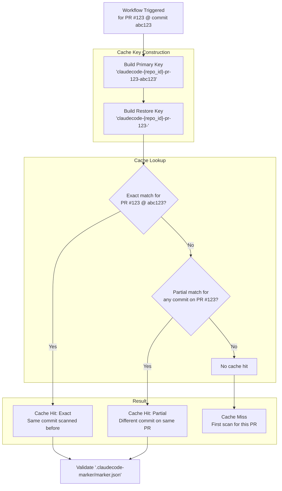

**Sources:** [action.yml:76-84]()

## Marker File System

### Marker File Structure

The marker file is a JSON document stored at `.claudecode-marker/marker.json` that records metadata about the scan reservation:

```json
{
  "timestamp": "2024-01-15T10:30:45Z",
  "repository_id": "123456789",
  "repository": "owner/repo",
  "pr_number": 123,
  "sha": "abc123def456",
  "status": "reserved",
  "run_id": "1234567890",
  "run_number": 42
}
```

The `status` field is set to `"reserved"` when the scan slot is claimed, indicating that this workflow run has reserved the right to perform the scan.

**Sources:** [action.yml:135-147]()

### Marker File Lifecycle

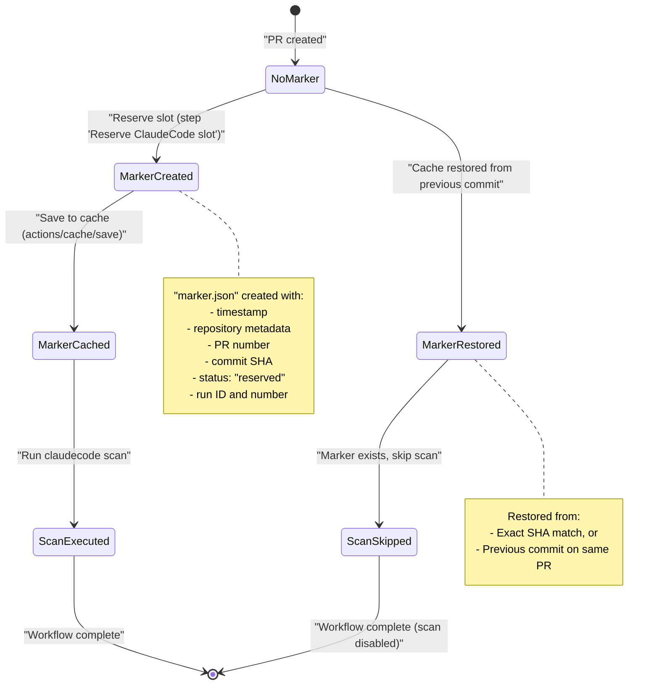

**Sources:** [action.yml:123-155]()

### Marker Creation Process

The marker file is created in the "Reserve ClaudeCode slot to prevent race conditions" step. This step only executes when:
1. `enable_claudecode == 'true'` (scan is enabled) [action.yml:124]()
2. `github.event_name == 'pull_request'` (event is a PR) [action.yml:124]()

The creation process:
1. Creates the `.claudecode-marker` directory [action.yml:135]()
2. Writes `marker.json` with metadata from GitHub context variables [action.yml:136-147]()
3. Saves the marker directory to GitHub Actions cache [action.yml:150-155]()

**Sources:** [action.yml:123-155]()

## Run Deduplication Logic

### Decision Flow

The deduplication logic is implemented in the "Determine ClaudeCode enablement" step, which sets the `enable_claudecode` output variable that controls whether subsequent steps execute.

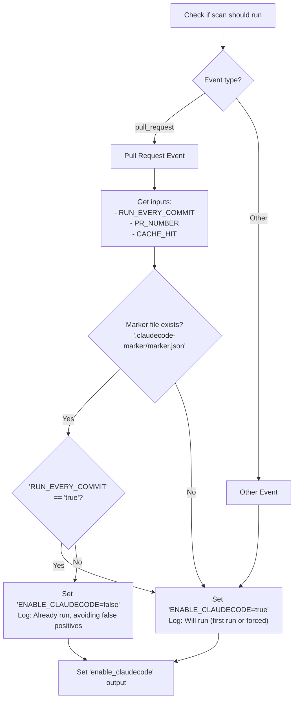

**Sources:** [action.yml:86-121]()

### Code Implementation

The deduplication check is implemented in bash at [action.yml:92-121]():

| Line Range | Logic | Purpose |
|------------|-------|---------|
| [94]() | Initialize `ENABLE_CLAUDECODE="true"` | Default to enabled |
| [98-112]() | PR-specific deduplication logic | Apply caching rules |
| [104-106]() | Check `RUN_EVERY_COMMIT != "true" && marker exists` | Skip if already run |
| [107-108]() | Check `RUN_EVERY_COMMIT == "true" && marker exists` | Allow re-run if forced |
| [109-111]() | Check `marker does not exist` | Run first scan |
| [114]() | Set output variables | Control downstream steps |

**Sources:** [action.yml:86-121]()

### Skip Condition Output

When a scan is skipped, the following log message is produced:

```
ClaudeCode has already run on PR #123 (found marker file), forcing disable to avoid false positives
```

This message clarifies that the skip is intentional and motivated by false positive reduction.

**Sources:** [action.yml:105-106]()

## Override Mechanism: run-every-commit

### Configuration

The `run-every-commit` input parameter provides an escape hatch from the deduplication system:

```yaml
inputs:
  run-every-commit:
    description: 'Run ClaudeCode on every commit (skips cache check). Warning: This may lead to more false positives on PRs with many commits as the AI analyzes the same code multiple times.'
    required: false
    default: 'false'
```

**Warning:** The input description explicitly warns users that enabling this option may increase false positives [action.yml:37]().

**Sources:** [action.yml:36-39]()

### When to Use run-every-commit

| Scenario | Recommended Setting | Rationale |
|----------|---------------------|-----------|
| Standard PR workflow | `false` (default) | Prevents duplicate scans and false positives |
| Single-commit PRs | `false` (default) | No benefit from override |
| Multi-commit PRs | `false` (default) | Deduplication prevents AI inconsistency |
| Debugging scan behavior | `true` | Forces scan on every commit for testing |
| Force rescan after config change | `true` | Ensures new config is applied |

**Sources:** [action.yml:36-39]()

### Override Behavior

When `run-every-commit: 'true'`:
1. The marker file check is still performed [action.yml:107]().
2. If marker exists, log message: `"ClaudeCode has already run on PR #$PR_NUMBER but run-every-commit is enabled, running again"` [action.yml:108]().
3. `ENABLE_CLAUDECODE` remains `"true"` [action.yml:94]().
4. Scan executes normally.
5. New marker created with current commit SHA [action.yml:136-147]().
6. New cache entry saved (potentially overwriting previous) [action.yml:150-155]().

**Sources:** [action.yml:107-108](), [action.yml:136-155]()

## Race Condition Prevention

### Problem Statement

When multiple workflow runs are triggered simultaneously (e.g., rapid commits or workflow reruns), there's a risk of race conditions where:
1. Multiple runs check the cache simultaneously (all see no marker).
2. Multiple runs decide to execute the scan.
3. Multiple scans run in parallel, wasting resources and potentially causing conflicts.

### Solution: Immediate Marker Reservation

The system prevents races by creating and caching the marker **before** executing the scan:

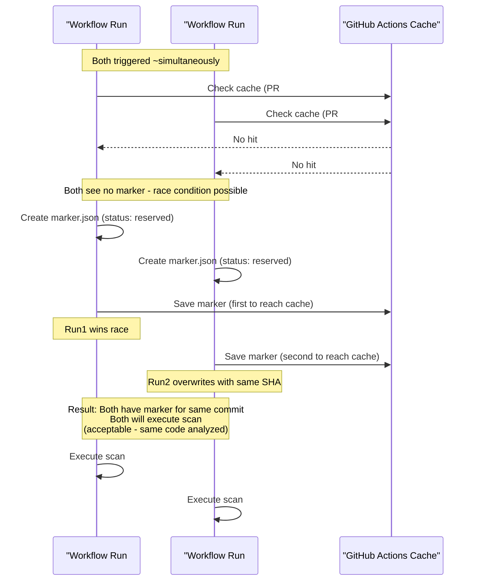

### Race Condition Analysis

The current implementation has an acceptable race condition window:

1. **Before marker creation** ([action.yml:76-121]()): Multiple runs may all decide to execute.
2. **After marker creation** ([action.yml:123-155]()): Subsequent runs will see the marker and skip.

The race condition is acceptable because:
- It only affects simultaneous runs for the **same commit SHA**.
- Multiple scans of the same code produce consistent results.
- The alternative (distributed locking) adds complexity without significant benefit.
- The common case (sequential commits) is fully protected.

**Sources:** [action.yml:76-155]()

## Integration with Action Steps

### Conditional Step Execution

The `enable_claudecode` output controls execution of downstream steps using GitHub Actions `if` conditionals:

```yaml
if: steps.claudecode-check.outputs.enable_claudecode == 'true'
```

The following steps are conditionally executed:

| Step Name | Condition | Purpose |
|-----------|-----------|---------|
| "Reserve ClaudeCode slot" | `enable_claudecode == 'true' && event == 'pull_request'` | Create marker [action.yml:124]() |
| "Save ClaudeCode reservation" | `enable_claudecode == 'true' && event == 'pull_request'` | Cache marker [action.yml:151]() |
| "Set up Node.js" | `enable_claudecode == 'true'` | Install runtime [action.yml:158]() |
| "Install dependencies" | Checks flag inline | Install packages [action.yml:169]() |
| "Run ClaudeCode scan" | `enable_claudecode == 'true'` | Execute scan [action.yml:178]() |

When `enable_claudecode == 'false'`, these steps are skipped, and the workflow completes quickly without performing a scan.

**Sources:** [action.yml:124](), [action.yml:151](), [action.yml:158](), [action.yml:169](), [action.yml:178]()

### Dependency Installation Optimization

The dependency installation step also checks the flag to avoid unnecessary installations:

```bash
if [ "${{ steps.claudecode-check.outputs.enable_claudecode }}" == "true" ]; then
  pip install -r "$ACTION_PATH/claudecode/requirements.txt"
  npm install -g @anthropic-ai/claude-code
fi
```

This optimization saves time when scans are skipped.

**Sources:** [action.yml:169-172]()

## Cache Storage Location

### GitHub Actions Cache Path

The cache stores the `.claudecode-marker` directory:

```yaml
with:
  path: .claudecode-marker
```

This directory contains a single file: `marker.json`. The directory-based approach (rather than caching a single file) allows for potential future expansion to include additional metadata files.

**Sources:** [action.yml:81](), [action.yml:154]()

### Cache Restoration

Cache restoration happens automatically via the `actions/cache` action in "restore" mode:

```yaml
- name: Check ClaudeCode run history
  id: claudecode-history
  if: github.event_name == 'pull_request'
  uses: actions/cache@0057852bfaa89a56745cba8c7296529d2fc39830
  with:
    path: .claudecode-marker
    key: claudecode-${{ github.repository_id }}-pr-${{ github.event.pull_request.number }}-${{ github.sha }}
    restore-keys: |
      claudecode-${{ github.repository_id }}-pr-${{ github.event.pull_request.number }}-
```

The `restore-keys` allows the action to find markers from previous commits on the same PR, which is why the subsequent marker existence check is necessary.

**Sources:** [action.yml:76-84]()

### Cache Persistence

Cache saving happens explicitly via `actions/cache/save`:

```yaml
- name: Save ClaudeCode reservation to cache
  if: steps.claudecode-check.outputs.enable_claudecode == 'true' && github.event_name == 'pull_request'
  uses: actions/cache/save@0057852bfaa89a56745cba8c7296529d2fc39830
  with:
    path: .claudecode-marker
    key: claudecode-${{ github.repository_id }}-pr-${{ github.event.pull_request.number }}-${{ github.sha }}
```

This explicit save ensures the marker is persisted immediately after reservation, before the scan executes.

**Sources:** [action.yml:150-155]()

## Cache Behavior Summary

### Complete Flow with Code References

```mermaid
flowchart TD
    Trigger["PR Event Triggered<br/>'github.event.pull_request'"]
    
    subgraph "Cache Restoration [76-84]"
        CacheRestore["'actions/cache' (restore mode)<br/>Restore '.claudecode-marker'"]
        CacheOutput["Set 'cache-hit' output"]
    end
    
    subgraph "Deduplication Check [86-121]"
        CheckMarker{"'marker.json' exists?<br/>'test -f .claudecode-marker/marker.json'"}
        CheckOverride{"'RUN_EVERY_COMMIT' == 'true'?"}
        SetEnable["Set 'enable_claudecode' output<br/>'echo enable_claudecode=$VAL >> $GITHUB_OUTPUT'"]
    end
    
    subgraph "Conditional Execution [123-155]"
        Reserve["Create 'marker.json' [135-147]<br/>'mkdir -p .claudecode-marker'"]
        SaveCache["'actions/cache/save' [150-155]<br/>Save with exact commit SHA key"]
    end
    
    subgraph "Scan Execution [176-305]"
        Setup["Install deps (conditional) [164-174]<br/>'pip install', 'npm install'"]
        RunScan["Execute scan [176-305]<br/>'python claudecode/github_action_audit.py'"]
    end
    
    Trigger --> CacheRestore
    CacheRestore --> CacheOutput
    CacheOutput --> CheckMarker
    
    CheckMarker -->|"No"| SetEnable
    CheckMarker -->|"Yes"| CheckOverride
    CheckOverride -->|"No"| SetEnable
    CheckOverride -->|"Yes"| SetEnable
    
    SetEnable -->|"enable_claudecode=true"| Reserve
    SetEnable -->|"enable_claudecode=false"| End["Skip scan<br/>Workflow completes"]
    
    Reserve --> SaveCache
    SaveCache --> Setup
    Setup --> RunScan
    RunScan --> End
```

**Sources:** [action.yml:76-305]()

---

# Page: CI/CD Workflow Integration

# CI/CD Workflow Integration

<details>
<summary>Relevant source files</summary>

The following files were used as context for generating this wiki page:

- [.github/workflows/sast.yml](.github/workflows/sast.yml)
- [.github/workflows/test-claudecode.yml](.github/workflows/test-claudecode.yml)

</details>


This page documents how the Claude Code Security Review system is integrated into CI/CD pipelines. It covers two primary aspects: the self-testing pipeline that validates the codebase itself, and the Static Application Security Testing (SAST) workflow used to perform security audits on pull requests.

## SAST Workflow Integration

The primary integration pattern for using this system as a security scanner is the SAST workflow. This workflow demonstrates how to invoke the GitHub Action to perform automated security reviews.

### Implementation and Data Flow

The SAST workflow is defined in [.github/workflows/sast.yml:1-26](). It orchestrates the security review process by triggering the local action on pull requests and pushes to the main branch.

```mermaid
graph TD
    subgraph "Trigger Event"
        PR["Pull Request"]
        Push["Push to Main"]
        Manual["workflow_dispatch"]
    end

    subgraph "GitHub Runner (ubuntu-24.04)"
        Checkout["actions/checkout@v4"]
        Action["Claude Code Security Review Action"]
    end

    subgraph "External Services"
        ClaudeAPI["Anthropic Claude API"]
        GH_API["GitHub API (Comments/Checks)"]
    end

    PR --> Checkout
    Push --> Checkout
    Manual --> Checkout

    Checkout --> Action

    subgraph "Action Logic (action.yml)"
        direction TB
        Config["Load Inputs:<br/>exclude-directories<br/>run-every-commit"]
        Audit["github_action_audit.py"]
        Filter["Claude API Filter"]
    end

    Action --> Config
    Config --> Audit
    Audit <--> ClaudeAPI
    Audit --> Filter
    Filter --> GH_API
```

### Configuration Parameters
The workflow utilizes several key inputs to control the audit behavior:
*   `comment-pr: true`: Enables posting findings directly as PR comments [.github/workflows/sast.yml:21]().
*   `upload-results: true`: Archives the scan results as workflow artifacts [.github/workflows/sast.yml:22]().
*   `exclude-directories`: Specifies paths to ignore, such as known vulnerable test suites [.github/workflows/sast.yml:23]().
*   `run-every-commit: true`: Ensures every push to a PR is analyzed, rather than just the final state [.github/workflows/sast.yml:25]().

Sources: [.github/workflows/sast.yml:1-26]()

## Internal CI/CD Pipeline

The system maintains its own quality through the `test-claudecode` workflow. This pipeline ensures the reliability of the core Python engine and supporting scripts.

### Multi-Runtime Environment
The testing pipeline establishes three distinct runtime environments to validate all components of the system:

```mermaid
graph TB
    subgraph "CI Environment: ubuntu-latest"
        "actions/checkout"["actions/checkout@v4"]
        
        subgraph "Python Runtime (3.10)"
            "setup-python"["actions/setup-python@v4"]
            "pip_install"["pip install pytest pytest-cov -r claudecode/requirements.txt"]
        end
        
        subgraph "Node.js Runtime (20)"
            "setup-node"["actions/setup-node@v4"]
            "npm_install"["npm install -g @anthropic-ai/claude-code"]
        end
        
        subgraph "Bun Runtime"
            "setup-bun"["oven-sh/setup-bun@v2"]
            "bun_install"["bun install in scripts/"]
        end
    end
    
    "actions/checkout" --> "setup-python"
    "actions/checkout" --> "setup-node"  
    "actions/checkout" --> "setup-bun"
    
    "setup-python" --> "pip_install"
    "setup-node" --> "npm_install"
    "setup-bun" --> "bun_install"
```

**Environment Roles:**
*   **Python 3.10**: Used for executing the `claudecode` package unit tests and the `github_action_audit.py` logic [.github/workflows/test-claudecode.yml:23-26]().
*   **Node.js 20**: Required to install and provide the `@anthropic-ai/claude-code` CLI, which the Python engine wraps [.github/workflows/test-claudecode.yml:28-35]().
*   **Bun**: Used for executing high-performance TypeScript/JavaScript tests for the PR commenting scripts [.github/workflows/test-claudecode.yml:47-55]().

Sources: [.github/workflows/test-claudecode.yml:17-55]()

### Testing Stages and Execution

The pipeline executes two primary testing stages that validate different layers of the system architecture:

| Stage | Command | Purpose |
| :--- | :--- | :--- |
| **Python Unit Tests** | `pytest claudecode -v --cov=claudecode` | Validates the core logic in `github_action_audit.py`, `SimpleClaudeRunner`, and `GitHubActionClient` [.github/workflows/test-claudecode.yml:45](). |
| **Script Tests** | `bun test` (in `scripts/`) | Validates the JavaScript-based utilities used for GitHub PR interactions [.github/workflows/test-claudecode.yml:59-60](). |

```mermaid
graph LR
    subgraph "Testing Flow"
        "Start"["Trigger: push/PR"] --> "PyTest"["Run pytest (Python)"]
        "PyTest" --> "Coverage"["Generate Coverage Report"]
        "Coverage" --> "BunTest"["Run bun test (TS/JS)"]
        "BunTest" --> "End"["Complete"]
    end
```

The Python testing stage explicitly sets the `PYTHONPATH` to the current working directory to ensure that the `claudecode` module is correctly discoverable by `pytest` [.github/workflows/test-claudecode.yml:44]().

Sources: [.github/workflows/test-claudecode.yml:1-61]()

---

# Page: Core Python Engine

# Core Python Engine

<details>
<summary>Relevant source files</summary>

The following files were used as context for generating this wiki page:

- [claudecode/__init__.py](claudecode/__init__.py)
- [claudecode/audit.py](claudecode/audit.py)
- [claudecode/github_action_audit.py](claudecode/github_action_audit.py)
- [claudecode/requirements.txt](claudecode/requirements.txt)

</details>


## Purpose and Scope

The Core Python Engine constitutes the main Python package (`claudecode`) that orchestrates AI-powered security analysis of GitHub pull requests. This system serves as the central coordination layer between GitHub API integration, Claude AI execution via the CLI, and the security analysis pipeline.

This page covers the core Python package architecture, main execution orchestration, and the primary classes that drive the security audit process.

- For details on package organization, see [Package Structure and Entry Points](#3.1).
- For details on the main orchestration logic, see [Main Audit Orchestrator](#3.2).
- For details on GitHub communication, see [GitHub API Client](#3.3).
- For details on Claude CLI execution, see [Claude CLI Runner](#3.4).

## Package Architecture Overview

The `claudecode` package follows a modular architecture with clear separation of concerns between GitHub integration, AI processing, and audit orchestration. It leverages several internal utility modules for prompting, filtering, and parsing.

### Code Entity Relationship Diagram
This diagram bridges the system concepts to the specific Python classes and functions defined in the codebase.

```mermaid
graph TB
    subgraph "claudecode Package [claudecode/__init__.py]"
        Init["__init__.py<br/>Package Entry Point"]
        MainAudit["github_action_audit.py<br/>Main Orchestrator"]
        
        subgraph "Core Classes [claudecode/github_action_audit.py]"
            GHClient["GitHubActionClient<br/>GitHub API Integration"]
            ClaudeRunner["SimpleClaudeRunner<br/>Claude AI Execution"]
            ConfigError["ConfigurationError<br/>Exception Handling"]
            AuditError["AuditError<br/>Exception Handling"]
        end
        
        subgraph "Supporting Modules"
            Prompts["prompts.py<br/>get_security_audit_prompt"]
            Filter["findings_filter.py<br/>FindingsFilter"]
            JSONParser["json_parser.py<br/>parse_json_with_fallbacks"]
            Constants["constants.py<br/>EXIT_*, DEFAULT_CLAUDE_MODEL"]
            Logger["logger.py<br/>get_logger"]
        end
        
        subgraph "Main Functions [claudecode/github_action_audit.py]"
            MainFunc["main()<br/>Entry Point"]
            GetConfig["get_environment_config()"]
            InitClients["initialize_clients()"]
            RunAudit["run_security_audit()"]
            ApplyFilter["apply_findings_filter()"]
        end
    end
    
    Init --> GHClient
    Init --> ClaudeRunner
    Init --> MainFunc
    
    MainAudit --> GHClient
    MainAudit --> ClaudeRunner
    MainAudit --> Prompts
    MainAudit --> Filter
    MainAudit --> JSONParser
    MainAudit --> Constants
    MainAudit --> Logger
    
    MainFunc --> GetConfig
    MainFunc --> InitClients
    MainFunc --> RunAudit
    MainFunc --> ApplyFilter
```
**Sources:** [claudecode/__init__.py:1-22](), [claudecode/github_action_audit.py:1-50]()

## Core Component Classes

### GitHubActionClient
The `GitHubActionClient` class provides GitHub API integration optimized for the GitHub Actions environment. It handles PR metadata retrieval, automated file filtering (excluding generated code), and diff processing.

**Key responsibilities include:**
- **Authentication**: Uses `GITHUB_TOKEN` from the environment [claudecode/github_action_audit.py:45-53]().
- **Data Retrieval**: Fetches PR details and file lists with pagination support [claudecode/github_action_audit.py:61-117]().
- **Noise Reduction**: Filters out files based on `EXCLUDE_DIRECTORIES` and detects `@generated` code markers [claudecode/github_action_audit.py:138-186]().

For details, see [GitHub API Client](#3.3).

### SimpleClaudeRunner
The `SimpleClaudeRunner` class manages the execution of the `@anthropic-ai/claude-code` CLI tool. It encapsulates the complexities of subprocess management, input/output piping, and error recovery.

**Key features include:**
- **Subprocess Management**: Executes the `claude` command with configurable timeouts [claudecode/github_action_audit.py:192-201]().
- **Resilience**: Implements a retry loop (up to 3 attempts) for transient execution failures [claudecode/github_action_audit.py:231-251]().
- **Prompt Optimization**: Detects "Prompt is too long" errors and allows the orchestrator to fallback to metadata-only scans [claudecode/github_action_audit.py:257-270]().

For details, see [Claude CLI Runner](#3.4).

## Main Execution Flow

The `main()` function in `github_action_audit.py` serves as the primary entry point, orchestrating the sequence from environment validation to the final security report.

### Logic Flow: Natural Language to Code Space
This diagram maps the logical steps of an audit to the specific function calls in the Python engine.

```mermaid
flowchart TD
    Start["main() Entry Point"] --> GetEnvConfig["get_environment_config()<br/>Validates GITHUB_REPOSITORY"]
    
    GetEnvConfig --> InitComponents["initialize_clients()<br/>Instantiates GitHubActionClient"]
    
    InitComponents --> ValidateClaude["validate_claude_available()<br/>Checks 'claude' CLI binary"]
    
    ValidateClaude --> FetchPRData["GitHubActionClient.get_pr_data()<br/>GitHubActionClient.get_pr_diff()"]
    
    FetchPRData --> GeneratePrompt["get_security_audit_prompt()<br/>Constructs XML instructions"]
    
    GeneratePrompt --> RunClaudeAudit["SimpleClaudeRunner.run_security_audit()<br/>Executes CLI Subprocess"]
    
    RunClaudeAudit --> CheckPromptTooLong{"`Prompt Too Long?`"}
    CheckPromptTooLong -->|Yes| RetryWithoutDiff["Retry run_security_audit<br/>with include_diff=False"]
    CheckPromptTooLong -->|No| ApplyFiltering["apply_findings_filter()<br/>Invokes FindingsFilter"]
    
    RetryWithoutDiff --> ApplyFiltering
    
    ApplyFiltering --> OutputJSON["print(json.dumps(output))<br/>Writes to stdout for Action"]
    
    OutputJSON --> ExitCode["Exit Code Logic<br/>EXIT_SUCCESS or EXIT_GENERAL_ERROR"]
```
**Sources:** [claudecode/github_action_audit.py:520-644]()

## Configuration and Error Handling

The system implements strict configuration validation to ensure the GitHub Action environment is correctly set up before attempting expensive AI operations.

| Component | Purpose | Related Symbols |
|----------|---------|----------------|
| **Environment Validation** | Ensures required secrets and context are present | `get_environment_config()` [claudecode/github_action_audit.py:348-386]() |
| **Exception Hierarchy** | Distinguishes between setup issues and runtime failures | `ConfigurationError`, `AuditError` [claudecode/github_action_audit.py:32-38]() |
| **Exit Strategy** | Signals the GitHub Action runner whether to fail the build | `EXIT_CONFIGURATION_ERROR`, `EXIT_GENERAL_ERROR` [claudecode/github_action_audit.py:21-27]() |

**Sources:** [claudecode/github_action_audit.py:32-38](), [claudecode/github_action_audit.py:348-429]()

## Integration Points

The core system provides clean integration points with other ClaudeCode subsystems:

- **Prompts**: Uses `claudecode.prompts` to generate the security context [claudecode/github_action_audit.py:18]().
- **Filtering**: Uses `claudecode.findings_filter` to post-process AI output [claudecode/github_action_audit.py:19]().
- **Parsing**: Uses `claudecode.json_parser` to handle the semi-structured output from the Claude CLI [claudecode/github_action_audit.py:20]().

The package exposes its main components through the `__init__.py` module for external access, including the `main` entry point and the primary client classes.

**Sources:** [claudecode/__init__.py:11-21](), [claudecode/github_action_audit.py:17-28]()

---

# Page: Package Structure and Entry Points

# Package Structure and Entry Points

<details>
<summary>Relevant source files</summary>

The following files were used as context for generating this wiki page:

- [__init__.py](__init__.py)
- [claudecode/__init__.py](claudecode/__init__.py)
- [claudecode/audit.py](claudecode/audit.py)
- [claudecode/requirements.txt](claudecode/requirements.txt)

</details>


This document explains the structure of the `claudecode` Python package, its main entry points, and the module relationships. This covers how the package is organized and how the core components interact to perform security audits.

## Package Overview

The `claudecode` package is the core Python engine for the security review system. It is structured to provide a clear public API while encapsulating complex orchestration logic for GitHub and Claude interactions.

The package is identified as version `1.0.0` and is authored by the `Anthropic Security Team` [claudecode/__init__.py:8-9](). It is described as a standalone security audit tool that uses Claude Code for comprehensive security analysis of GitHub pull requests [claudecode/__init__.py:4-5]().

Sources: [claudecode/__init__.py:1-9]()

## Public API and Main Components

The package exposes its primary functionality through `claudecode/__init__.py`. The public API surface is defined by the `__all__` list, ensuring a clean interface for consumers [claudecode/__init__.py:18-22]().

| Component | Code Entity | Purpose |
|-----------|-------------|---------|
| **GitHub Client** | `GitHubActionClient` | Manages interactions with the GitHub API, including fetching PR metadata and posting comments [claudecode/__init__.py:13](). |
| **Claude Runner** | `SimpleClaudeRunner` | Executes the `@anthropic-ai/claude-code` CLI tool to perform the actual security analysis [claudecode/__init__.py:14](). |
| **Main Orchestrator** | `main` | The top-level function that coordinates the entire audit lifecycle [claudecode/__init__.py:15](). |

Sources: [claudecode/__init__.py:11-22]()

## Entry Points Architecture

The system provides two primary ways to invoke the audit engine: through the `claudecode.audit` module or via direct function calls.

### 1. Command Line Interface (CLI)
The `claudecode/audit.py` file serves as a clean entry point for running the tool as a script [claudecode/audit.py:1-5](). It simply imports and executes the `main` function when run directly [claudecode/audit.py:7-10]().

### 2. Programmatic Entry
The `main()` function in `claudecode/github_action_audit.py` is the central hub. It handles environment variable parsing, initializes the GitHub client, and triggers the audit process.

### Data Flow and Entry Point Mapping
The following diagram bridges the "Natural Language" intent of running an audit to the specific "Code Entities" that handle the request.

**Diagram: Entry Point Execution Flow**
```mermaid
graph TD
    subgraph "Execution Contexts"
        CLI["Command Line: python -m claudecode.audit"]
        Package["Package Import: from claudecode import main"]
    end

    subgraph "Entry Point Entities"
        AuditModule["claudecode/audit.py"]
        MainFunc["claudecode/github_action_audit.py: main()"]
    end

    subgraph "Core Logic Entities"
        Client["claudecode/github_action_audit.py: GitHubActionClient"]
        Runner["claudecode/github_action_audit.py: SimpleClaudeRunner"]
    end

    CLI --> AuditModule
    AuditModule -- "calls" --> MainFunc
    Package --> MainFunc
    
    MainFunc -- "instantiates" --> Client
    MainFunc -- "instantiates" --> Runner
```
Sources: [claudecode/audit.py:7-10](), [claudecode/github_action_audit.py:12-16](), [claudecode/__init__.py:12-16]()

## Package Structure and Module Relationships

The package follows a modular design where the orchestration logic is separated from specific service implementations (GitHub, Claude API, Filtering).

**Diagram: Module Relationship and Dependency Graph**
```mermaid
graph TB
    subgraph "Entry Layer"
        Init["claudecode/__init__.py"]
        Audit["claudecode/audit.py"]
    end

    subgraph "Orchestration Layer"
        GHAudit["claudecode/github_action_audit.py"]
    end

    subgraph "Implementation Modules"
        ClaudeAPI["claudecode/claude_api_client.py"]
        Filter["claudecode/findings_filter.py"]
        Prompts["claudecode/prompts.py"]
        Utils["claudecode/utils.py"]
    end

    subgraph "External Dependencies"
        ClaudeCLI["@anthropic-ai/claude-code CLI"]
        GitHubAPI["PyGithub / GitHub REST API"]
    end

    Init --> GHAudit
    Audit --> GHAudit
    
    GHAudit -- "uses" --> ClaudeAPI
    GHAudit -- "uses" --> Filter
    GHAudit -- "uses" --> Prompts
    GHAudit -- "uses" --> Utils
    
    GHAudit -- "executes" --> ClaudeCLI
    GHAudit -- "calls" --> GitHubAPI
```

### Dependency Details
The package relies on several external libraries to function, as defined in the requirements:
*   **`PyGithub` & `requests`**: Used by `GitHubActionClient` for API communication [claudecode/requirements.txt:5-8]().
*   **`anthropic`**: Used for the secondary Claude API-based false positive filtering [claudecode/requirements.txt:15]().
*   **Claude CLI**: The `SimpleClaudeRunner` requires the `@anthropic-ai/claude-code` tool to be pre-installed in the environment [claudecode/requirements.txt:17-18]().

Sources: [claudecode/requirements.txt:1-18](), [claudecode/__init__.py:12-16](), [claudecode/audit.py:7-10]()

---

# Page: Main Audit Orchestrator

# Main Audit Orchestrator

<details>
<summary>Relevant source files</summary>

The following files were used as context for generating this wiki page:

- [claudecode/github_action_audit.py](claudecode/github_action_audit.py)
- [claudecode/test_github_action_audit.py](claudecode/test_github_action_audit.py)
- [claudecode/test_main_function.py](claudecode/test_main_function.py)

</details>


## Purpose and Scope

The Main Audit Orchestrator is implemented in [claudecode/github_action_audit.py](). This module serves as the central coordinator for the entire security audit workflow, orchestrating all major operations from environment configuration through final output generation. It bridges the GitHub Action wrapper with the core Python components.

The orchestrator is responsible for:
- Validating and loading environment configuration [claudecode/github_action_audit.py:348-371]()
- Initializing GitHub and Claude clients [claudecode/github_action_audit.py:374-393]()
- Fetching PR data and diffs from GitHub API [claudecode/github_action_audit.py:61-136]()
- Generating and executing security audit prompts [claudecode/github_action_audit.py:581-598]()
- Filtering findings to reduce false positives [claudecode/github_action_audit.py:456-501]()
- Outputting structured JSON results [claudecode/github_action_audit.py:617-636]()

**Sources:** [claudecode/github_action_audit.py:1-10](), [claudecode/github_action_audit.py:348-636]()

## Architecture Overview

The orchestrator follows a modular design with clear separation of concerns:

### System Architecture and Code Entities
The following diagram maps high-level system components to their corresponding code entities within the `claudecode` package.

```mermaid
graph TB
    subgraph "Entry Point"
        main["main() in github_action_audit.py"]
    end
    
    subgraph "Configuration Layer"
        getEnvConfig["get_environment_config()"]
        initClients["initialize_clients()"]
        initFilter["initialize_findings_filter()"]
        loadCustomFiles["os.path.exists() checks for custom instructions"]
    end
    
    subgraph "Client Components"
        GHClient["GitHubActionClient class"]
        ClaudeRunner["SimpleClaudeRunner class"]
        FindingsFilter["FindingsFilter class in findings_filter.py"]
    end
    
    subgraph "Orchestration Functions"
        runAudit["SimpleClaudeRunner.run_security_audit()"]
        applyFilter["apply_findings_filter() function"]
        validateClaude["SimpleClaudeRunner.validate_claude_available()"]
    end
    
    subgraph "External Dependencies"
        prompts["get_security_audit_prompt() in prompts.py"]
        jsonParser["parse_json_with_fallbacks() in json_parser.py"]
        logger["get_logger() in logger.py"]
    end
    
    subgraph "Output"
        jsonOutput["sys.stdout.write(json.dumps())"]
        exitCode["sys.exit(EXIT_SUCCESS/EXIT_GENERAL_ERROR)"]
    end
    
    main --> getEnvConfig
    main --> loadCustomFiles
    main --> initClients
    main --> initFilter
    
    initClients --> GHClient
    initClients --> ClaudeRunner
    initFilter --> FindingsFilter
    
    main --> validateClaude
    main --> runAudit
    main --> applyFilter
    
    GHClient --> prompts
    ClaudeRunner --> jsonParser
    main --> logger
    
    applyFilter --> jsonOutput
    jsonOutput --> exitCode
```

**Key Classes and Functions:**

| Component | Type | Purpose | Lines |
|-----------|------|---------|-------|
| `main()` | Function | Primary entry point, orchestrates entire workflow | [claudecode/github_action_audit.py:520-641]() |
| `GitHubActionClient` | Class | Fetches PR data and diffs from GitHub API | [claudecode/github_action_audit.py:40-187]() |
| `SimpleClaudeRunner` | Class | Executes Claude Code CLI and parses output | [claudecode/github_action_audit.py:189-344]() |
| `get_environment_config()` | Function | Validates required environment variables | [claudecode/github_action_audit.py:348-371]() |
| `initialize_clients()` | Function | Creates GitHub and Claude client instances | [claudecode/github_action_audit.py:374-393]() |
| `initialize_findings_filter()` | Function | Sets up findings filter based on configuration | [claudecode/github_action_audit.py:396-428]() |
| `run_security_audit()` | Method | Executes security audit with retry logic (in `SimpleClaudeRunner`) | [claudecode/github_action_audit.py:203-286]() |
| `apply_findings_filter()` | Function | Applies multi-stage filtering to findings | [claudecode/github_action_audit.py:456-501]() |

**Sources:** [claudecode/github_action_audit.py:1-645]()

## Main Execution Flow

The `main()` function implements a sequential workflow with comprehensive error handling:

```mermaid
flowchart TD
    Start(["main() invoked"]) --> LoadEnvConfig["get_environment_config()
    Extract GITHUB_REPOSITORY, PR_NUMBER"]
    
    LoadEnvConfig --> LoadCustomFiles["Load Custom Instructions
    FALSE_POSITIVE_FILTERING_INSTRUCTIONS
    CUSTOM_SECURITY_SCAN_INSTRUCTIONS"]
    
    LoadCustomFiles --> InitComponents["initialize_clients()
    initialize_findings_filter()"]
    
    InitComponents --> ValidateClaude{"validate_claude_available()
    Check CLI & API key"}
    
    ValidateClaude -->|"Fail"| ErrorExit1["Output error JSON
    Exit: EXIT_GENERAL_ERROR"]
    
    ValidateClaude -->|"Success"| FetchPRData["github_client.get_pr_data()
    github_client.get_pr_diff()"]
    
    FetchPRData --> GeneratePrompt["get_security_audit_prompt()
    Combine PR metadata + diff"]
    
    GeneratePrompt --> RunAudit["claude_runner.run_security_audit()
    Execute Claude Code CLI"]
    
    RunAudit --> CheckPromptSize{"error_msg ==
    'PROMPT_TOO_LONG'?"}
    
    CheckPromptSize -->|"Yes"| RetryNoDiff["get_security_audit_prompt()
    include_diff=False
    Retry audit"]
    
    CheckPromptSize -->|"No"| CheckSuccess{"success?"}
    
    RetryNoDiff --> CheckSuccess
    
    CheckSuccess -->|"Fail"| ErrorExit2["Output error JSON
    Exit: EXIT_GENERAL_ERROR"]
    
    CheckSuccess -->|"Success"| ApplyFilter["apply_findings_filter()
    Hard rules + Claude API
    + Directory exclusions"]
    
    ApplyFilter --> BuildOutput["Construct output JSON
    findings, filtering_summary,
    analysis_summary"]
    
    BuildOutput --> OutputJSON["print(json.dumps(output))
    Output to stdout"]
    
    OutputJSON --> CountHighSev{"Count HIGH
    severity findings"}
    
    CountHighSev -->|"> 0"| ExitError["Exit: EXIT_GENERAL_ERROR"]
    CountHighSev -->|"= 0"| ExitSuccess["Exit: EXIT_SUCCESS"]
```

**Execution Phases:**

1. **Configuration Phase** ([claudecode/github_action_audit.py:520-565]()): Load environment variables, read custom instruction files, initialize clients.
2. **Validation Phase** ([claudecode/github_action_audit.py:567-570]()): Verify Claude Code CLI is available and API key is configured.
3. **Data Acquisition Phase** ([claudecode/github_action_audit.py:573-578]()): Fetch PR metadata and diff from GitHub API.
4. **Prompt Generation Phase** ([claudecode/github_action_audit.py:581]()): Create security audit prompt with PR context.
5. **Audit Execution Phase** ([claudecode/github_action_audit.py:584-598]()): Run Claude Code CLI, with automatic retry if prompt is too long.
6. **Filtering Phase** ([claudecode/github_action_audit.py:600-614]()): Apply multi-stage filtering to reduce false positives.
7. **Output Phase** ([claudecode/github_action_audit.py:617-636]()): Generate structured JSON output and exit with appropriate code.

**Error Handling Strategy:**

The orchestrator uses specific exception types and exit codes:
- `ConfigurationError`: Raised for missing/invalid configuration [claudecode/github_action_audit.py:32-34]() → `EXIT_CONFIGURATION_ERROR` (2).
- `AuditError`: Defined for security audit failures [claudecode/github_action_audit.py:36-38]() → `EXIT_GENERAL_ERROR` (1).
- High severity findings found → `EXIT_GENERAL_ERROR` (non-zero exit) [claudecode/github_action_audit.py:635-636]().
- Successful scan with no high severity findings → `EXIT_SUCCESS` (0) [claudecode/github_action_audit.py:636]().

**Sources:** [claudecode/github_action_audit.py:520-641](), [claudecode/constants.py]()

## Configuration Management

The orchestrator loads configuration from multiple sources in a specific precedence order:

```mermaid
graph LR
    subgraph "Environment Variables"
        GITHUB_REPOSITORY["GITHUB_REPOSITORY"]
        PR_NUMBER["PR_NUMBER"]
        GITHUB_TOKEN["GITHUB_TOKEN"]
        ANTHROPIC_API_KEY["ANTHROPIC_API_KEY"]
        REPO_PATH["REPO_PATH"]
        EXCLUDE_DIRECTORIES["EXCLUDE_DIRECTORIES"]
        ENABLE_CLAUDE_FILTERING["ENABLE_CLAUDE_FILTERING"]
    end
    
    subgraph "Custom Instruction Files"
        FilteringFile["FALSE_POSITIVE_FILTERING_INSTRUCTIONS
        Path to markdown file"]
        ScanFile["CUSTOM_SECURITY_SCAN_INSTRUCTIONS
        Path to markdown file"]
    end
    
    subgraph "Configuration Functions"
        getEnvConfig["get_environment_config()"]
        initClients["initialize_clients()"]
        initFilter["initialize_findings_filter()"]
    end
    
    subgraph "Client Initialization"
        GHClient["GitHubActionClient
        Uses GITHUB_TOKEN, EXCLUDE_DIRECTORIES"]
        ClaudeRunner["SimpleClaudeRunner
        Uses ANTHROPIC_API_KEY, timeout"]
        Filter["FindingsFilter
        Uses ENABLE_CLAUDE_FILTERING"]
    end
    
    GITHUB_REPOSITORY --> getEnvConfig
    PR_NUMBER --> getEnvConfig
    GITHUB_TOKEN --> initClients
    ANTHROPIC_API_KEY --> initClients
    
    getEnvConfig --> GHClient
    initClients --> GHClient
    initClients --> ClaudeRunner
    
    FilteringFile --> initFilter
    ENABLE_CLAUDE_FILTERING --> initFilter
    initFilter --> Filter
    
    EXCLUDE_DIRECTORIES --> GHClient
    REPO_PATH --> ClaudeRunner
    ScanFile --> getEnvConfig
```

### get_environment_config()

This function validates required environment variables and returns core configuration:

```python
# Returns: (repo_name, pr_number)
# Raises: ConfigurationError if GITHUB_REPOSITORY or PR_NUMBER missing/invalid
```

**Validation Rules:**
- `GITHUB_REPOSITORY` must be present (format: "owner/repo") [claudecode/github_action_audit.py:354-357]().
- `PR_NUMBER` must be present and convertible to integer [claudecode/github_action_audit.py:359-369]().
- Raises `ConfigurationError` with descriptive message on failure [claudecode/github_action_audit.py:357, 363, 369]().

**Sources:** [claudecode/github_action_audit.py:348-371]()

### initialize_clients()

This function creates and validates GitHub and Claude clients:

```python
# Returns: (GitHubActionClient, SimpleClaudeRunner)
# Raises: ConfigurationError if client initialization fails
```

**GitHubActionClient Requirements:**
- `GITHUB_TOKEN` environment variable for API authentication [claudecode/github_action_audit.py:45-47]().
- Optional `EXCLUDE_DIRECTORIES` for filtering file paths [claudecode/github_action_audit.py:56-59]().

**SimpleClaudeRunner Requirements:**
- `ANTHROPIC_API_KEY` for Claude API access [claudecode/github_action_audit.py:196-197]().
- Optional timeout configuration from `SUBPROCESS_TIMEOUT` constant [claudecode/github_action_audit.py:200-201]().

**Sources:** [claudecode/github_action_audit.py:374-393](), [claudecode/github_action_audit.py:40-60](), [claudecode/github_action_audit.py:189-201]()

### initialize_findings_filter()

This function configures the findings filter based on environment and custom instructions:

```python
# Args: custom_filtering_instructions (Optional[str])
# Returns: FindingsFilter
# Raises: ConfigurationError if filter initialization fails
```

**Filtering Configuration Logic:**

| Condition | Result |
|-----------|--------|
| `ENABLE_CLAUDE_FILTERING=true` AND `ANTHROPIC_API_KEY` set | Full filtering: hard rules + Claude API [claudecode/github_action_audit.py:408-417]() |
| Otherwise | Hard rules only [claudecode/github_action_audit.py:419-424]() |

If `FALSE_POSITIVE_FILTERING_INSTRUCTIONS` points to a readable file, its contents are passed to the filter for custom filtering logic [claudecode/github_action_audit.py:531-540]().

**Sources:** [claudecode/github_action_audit.py:396-428](), [claudecode/github_action_audit.py:531-540]()

## Client Components

### GitHubActionClient

The `GitHubActionClient` class encapsulates all GitHub API interactions:

```mermaid
classDiagram
    class GitHubActionClient {
        -github_token: str
        -headers: Dict
        -excluded_dirs: List[str]
        +__init__()
        +get_pr_data(repo_name, pr_number) Dict
        +get_pr_diff(repo_name, pr_number) str
        -_is_excluded(filepath) bool
        -_filter_generated_files(diff_text) str
    }
    
    class Configuration {
        GITHUB_TOKEN
        EXCLUDE_DIRECTORIES
    }
    
    class GitHubAPI {
        /repos/{owner}/{repo}/pulls/{number}
        Accept: application/vnd.github.diff
    }
    
    Configuration --> GitHubActionClient : configures
    GitHubActionClient --> GitHubAPI : calls
```

**Key Methods:**

| Method | Purpose | Returns |
|--------|---------|---------|
| `__init__()` | Initialize with token and exclusion patterns | None [claudecode/github_action_audit.py:43-60]() |
| `get_pr_data(repo_name, pr_number)` | Fetch PR metadata and file list | Dict with PR details [claudecode/github_action_audit.py:61-117]() |
| `get_pr_diff(repo_name, pr_number)` | Fetch unified diff, filtered | Diff string [claudecode/github_action_audit.py:119-136]() |
| `_is_excluded(filepath)` | Check if file matches exclusion patterns | Boolean [claudecode/github_action_audit.py:138-157]() |
| `_filter_generated_files(diff_text)` | Remove generated files from diff | Filtered diff string [claudecode/github_action_audit.py:159-186]() |

**File Exclusion Logic:**

The client implements sophisticated exclusion logic in `_is_excluded()` ([claudecode/github_action_audit.py:138-157]()):
1. Normalizes excluded directory patterns (removes leading `./`).
2. Checks if file path starts with excluded directory.
3. Checks if excluded directory appears anywhere in path.
4. Applied to both file lists [claudecode/github_action_audit.py:112]() and diff content [claudecode/github_action_audit.py:180]().

**Generated File Detection:**

The `_filter_generated_files()` method ([claudecode/github_action_audit.py:159-186]()) removes:
- Files with `@generated by` or `@generated` markers [claudecode/github_action_audit.py:170-171]().
- OpenAPI Generator output [claudecode/github_action_audit.py:172]().
- Protocol Buffer generated code [claudecode/github_action_audit.py:173]().

**Sources:** [claudecode/github_action_audit.py:40-187]()

### SimpleClaudeRunner

The `SimpleClaudeRunner` class manages Claude Code CLI execution:

```mermaid
classDiagram
    class SimpleClaudeRunner {
        -timeout_seconds: int
        +__init__(timeout_minutes)
        +run_security_audit(repo_dir, prompt) Tuple
        +validate_claude_available() Tuple
        -_extract_security_findings(claude_output) Dict
    }
    
    class SubprocessExecution {
        claude CLI
        --output-format json
    }
    
    class RetryLogic {
        NUM_RETRIES = 3
        5 second delay
    }
    
    class JSONParsing {
        parse_json_with_fallbacks()
        _extract_security_findings()
    }
    
    SimpleClaudeRunner --> SubprocessExecution : executes
    SimpleClaudeRunner --> RetryLogic : implements
    SimpleClaudeRunner --> JSONParsing : uses
```

**Execution Flow:**

The `run_security_audit()` method ([claudecode/github_action_audit.py:203-286]()) implements a robust execution pattern:

1. **Validation**: Check repo directory exists [claudecode/github_action_audit.py:214-216]().
2. **Size Warning**: Log warning if prompt > 1MB [claudecode/github_action_audit.py:219-220]().
3. **Command Construction**: Build `claude` CLI command with JSON output format and model [claudecode/github_action_audit.py:223-228]().
4. **Retry Loop** (up to 3 attempts):
   - Execute subprocess with prompt via stdin [claudecode/github_action_audit.py:236-241]().
   - Parse JSON output using fallback parser [claudecode/github_action_audit.py:245]().
   - Handle special error conditions: `PROMPT_TOO_LONG` [claudecode/github_action_audit.py:258-263]().
   - Apply delay between retries [claudecode/github_action_audit.py:249-251]().
5. **Timeout Handling**: Catch `subprocess.TimeoutExpired` and return descriptive error [claudecode/github_action_audit.py:283-284]().

**Output Parsing:**

The `_extract_security_findings()` method ([claudecode/github_action_audit.py:288-311]()) expects Claude Code's wrapped output format where the inner result is a JSON string.

**Sources:** [claudecode/github_action_audit.py:189-344]()

## Audit Execution Workflow

The orchestrator implements a two-stage audit execution pattern with automatic prompt size handling:

```mermaid
sequenceDiagram
    participant Main as main()
    participant GH as GitHubActionClient
    participant Prompts as get_security_audit_prompt()
    participant Runner as SimpleClaudeRunner
    
    Main->>GH: get_pr_data()
    GH-->>Main: PR metadata
    
    Main->>GH: get_pr_diff()
    GH-->>Main: Filtered diff
    
    Main->>Prompts: get_security_audit_prompt(with diff)
    Prompts-->>Main: Full prompt
    
    Main->>Runner: run_security_audit(full prompt)
    
    alt Prompt Too Long Error
        Runner-->>Main: "PROMPT_TOO_LONG"
        Main->>Prompts: get_security_audit_prompt(include_diff=False)
        Prompts-->>Main: Shorter prompt
        Main->>Runner: run_security_audit(shorter prompt)
    end
    
    Runner-->>Main: Findings JSON
```

**Prompt Size Fallback:**

The orchestrator implements automatic prompt size handling ([claudecode/github_action_audit.py:589-594]()):
1. First attempt includes full diff in prompt.
2. If Claude returns `"Prompt is too long"` error:
   - Regenerate prompt with `include_diff=False` [claudecode/github_action_audit.py:591]().
   - Retry audit with shorter prompt [claudecode/github_action_audit.py:592]().

**Sources:** [claudecode/github_action_audit.py:584-598](), [claudecode/github_action_audit.py:203-286]()

## Findings Filtering Pipeline

After audit completion, the orchestrator applies a multi-stage filtering process:

### apply_findings_filter()

This function ([claudecode/github_action_audit.py:456-501]()) orchestrates the complete filtering pipeline:

**Stage 1: FindingsFilter Processing**
- Applies hard exclusion rules (pattern-based).
- Optionally applies Claude API filtering (confidence scoring).
- Returns kept findings, excluded findings, and analysis summary [claudecode/github_action_audit.py:470-474]().

**Stage 2: Directory Exclusion**
- For each kept finding, check if file path matches `EXCLUDE_DIRECTORIES` [claudecode/github_action_audit.py:480-488]().
- Uses `_is_finding_in_excluded_directory()` helper ([claudecode/github_action_audit.py:503-517]()).

**Stage 3: Summary Generation**
- Combines all excluded findings into a single list [claudecode/github_action_audit.py:491-494]().
- Updates analysis summary with directory exclusion count [claudecode/github_action_audit.py:497]().

**Sources:** [claudecode/github_action_audit.py:456-517](), [claudecode/github_action_audit.py:617-629]()

## Error Handling and Exit Codes

The orchestrator implements comprehensive error handling with specific exit codes defined in [claudecode/constants.py]().

| Exit Code | Constant | Conditions | Lines |
|-----------|----------|------------|-------|
| 0 | `EXIT_SUCCESS` | Successful scan, no high severity findings | [claudecode/github_action_audit.py:636]() |
| 1 | `EXIT_GENERAL_ERROR` | High severity findings found OR audit failed | [claudecode/github_action_audit.py:636, 570, 598]() |
| 2 | `EXIT_CONFIGURATION_ERROR` | Missing/invalid environment variables or config | [claudecode/github_action_audit.py:528, 557, 564, 640]() |

**High Severity Detection:**

The final exit code logic ([claudecode/github_action_audit.py:635-636]()):
```python
high_severity_count = len([f for f in kept_findings if f.get('severity', '').upper() == 'HIGH'])
sys.exit(EXIT_GENERAL_ERROR if high_severity_count > 0 else EXIT_SUCCESS)
```

**Sources:** [claudecode/github_action_audit.py:520-641](), [claudecode/constants.py]()

## Integration Points

**Internal Dependencies:**

| Module | Purpose | Usage |
|--------|---------|-------|
| `claudecode.prompts` | Security audit prompt templates | `get_security_audit_prompt()` [claudecode/github_action_audit.py:18]() |
| `claudecode.findings_filter` | False positive filtering | `FindingsFilter` class [claudecode/github_action_audit.py:19]() |
| `claudecode.json_parser` | Robust JSON parsing | `parse_json_with_fallbacks()` [claudecode/github_action_audit.py:20]() |
| `claudecode.constants` | Configuration constants | Exit codes, timeouts [claudecode/github_action_audit.py:21-27]() |
| `claudecode.logger` | Contextual logging | `get_logger()` [claudecode/github_action_audit.py:28]() |

**Sources:** [claudecode/github_action_audit.py:17-30]()

---

# Page: GitHub API Client

# GitHub API Client

<details>
<summary>Relevant source files</summary>

The following files were used as context for generating this wiki page:

- [claudecode/github_action_audit.py](claudecode/github_action_audit.py)
- [claudecode/test_github_client.py](claudecode/test_github_client.py)

</details>


The `GitHubActionClient` class provides the interface for fetching pull request data from the GitHub REST API. This client is responsible for retrieving PR metadata, changed files, diffs, and applying preprocessing filters to exclude generated content and specified directories.

For information about how this client is used in the audit orchestrator, see [Main Audit Orchestrator](3.2). For details about the broader GitHub Action execution environment, see [GitHub Action Integration](2).

## GitHubActionClient Overview

The `GitHubActionClient` class is defined in [claudecode/github_action_audit.py:40-186]() and serves as the primary interface between the security review system and GitHub's REST API. The client handles authentication via environment variables, fetches PR data and diffs, and applies filtering logic to exclude generated files and specific directories from analysis.

### Class Structure

The following diagram maps the code entities within `GitHubActionClient` to their functional roles in the API interaction process.

**Code Entity to System Component Mapping**
```mermaid
classDiagram
    class GitHubActionClient {
        +github_token: str [os.environ.get('GITHUB_TOKEN')]
        +headers: dict [Authorization, Accept, X-GitHub-Api-Version]
        +excluded_dirs: list [os.environ.get('EXCLUDE_DIRECTORIES')]
        +__init__()
        +get_pr_data(repo_name, pr_number) dict
        +get_pr_diff(repo_name, pr_number) str
        +_is_excluded(filepath) bool
        +_filter_generated_files(diff_text) str
    }
    
    class GitHub_REST_API {
        <<external>>
        +GET /repos/{repo}/pulls/{number}
        +GET /repos/{repo}/pulls/{number}/files
        +Accept: application/vnd.github.diff
    }
    
    class github_action_audit_py {
        +main()
    }
    
    github_action_audit_py ..> GitHubActionClient : "instantiates at line 551"
    GitHubActionClient --> GitHub_REST_API : "requests.get() calls"
```

**Key Components:**

| Component | Type | Purpose |
|-----------|------|---------|
| `github_token` | str | GitHub API authentication token from environment [claudecode/github_action_audit.py:45]() |
| `headers` | dict | HTTP headers including API version `2022-11-28` [claudecode/github_action_audit.py:49-53]() |
| `excluded_dirs` | list | Directories to exclude, parsed from `EXCLUDE_DIRECTORIES` [claudecode/github_action_audit.py:56-57]() |
| `get_pr_data()` | method | Fetches PR metadata and file list with pagination [claudecode/github_action_audit.py:61-117]() |
| `get_pr_diff()` | method | Retrieves unified diff content using specialized headers [claudecode/github_action_audit.py:119-136]() |
| `_is_excluded()` | method | Checks if file path matches exclusion patterns [claudecode/github_action_audit.py:138-157]() |
| `_filter_generated_files()` | method | Removes generated code sections from diff using regex [claudecode/github_action_audit.py:159-186]() |

Sources: [claudecode/github_action_audit.py:40-186]()

## Initialization and Configuration

The `GitHubActionClient.__init__()` method reads configuration from environment variables and sets up the API client for GitHub interactions.

### Initialization Flow

```mermaid
flowchart TD
    Init["GitHubActionClient.__init__()"] --> GetToken["Read GITHUB_TOKEN"]
    GetToken --> ValidateToken{"Token present?"}
    ValidateToken -->|"No"| RaiseError["ValueError: GITHUB_TOKEN required"]
    ValidateToken -->|"Yes"| SetupHeaders["Configure self.headers"]
    
    SetupHeaders --> AuthHeader["'Authorization': 'Bearer {token}'"]
    SetupHeaders --> AcceptHeader["'Accept': 'application/vnd.github.v3+json'"]
    SetupHeaders --> VersionHeader["'X-GitHub-Api-Version': '2022-11-28'"]
    
    AuthHeader --> GetExclusions["Read EXCLUDE_DIRECTORIES"]
    
    GetExclusions --> ParseExclusions["Split by comma, strip whitespace"]
    ParseExclusions --> StoreExclusions["self.excluded_dirs = list"]
    StoreExclusions --> Ready["Client Ready"]
```

### Configuration Parameters

| Parameter | Source | Type | Purpose |
|-----------|--------|------|---------|
| `GITHUB_TOKEN` | Environment | Required | GitHub API authentication [claudecode/github_action_audit.py:45-47]() |
| `EXCLUDE_DIRECTORIES` | Environment | Optional | Comma-separated list of directories to exclude [claudecode/github_action_audit.py:56-57]() |

**Implementation Details:**

The initialization at [claudecode/github_action_audit.py:43-59]() performs these steps:

1. **Token Validation**: Reads `GITHUB_TOKEN` from `os.environ` and raises `ValueError` if not present [claudecode/github_action_audit.py:45-47]().
2. **Header Configuration**: Sets up HTTP headers with Bearer token authentication and specific GitHub API version [claudecode/github_action_audit.py:49-53]().
3. **Exclusion Setup**: Parses `EXCLUDE_DIRECTORIES` environment variable into a list of directory patterns, handling whitespace and empty strings [claudecode/github_action_audit.py:56-57]().
4. **Debug Logging**: Prints excluded directories to stderr if configured for visibility in Action logs [claudecode/github_action_audit.py:59]().

Sources: [claudecode/github_action_audit.py:43-59]()

## Pull Request Data Retrieval

The `get_pr_data()` method at [claudecode/github_action_audit.py:61-117]() fetches comprehensive pull request information through two GitHub API calls: one for PR metadata and one for the list of changed files.

### PR Data Collection Flow

```mermaid
sequenceDiagram
    participant Caller as "github_action_audit.main()"
    participant Client as "GitHubActionClient"
    participant GitHub as "GitHub REST API"
    
    Caller->>Client: get_pr_data(repo_name, pr_number)
    
    Client->>GitHub: GET /repos/{repo_name}/pulls/{pr_number}
    GitHub-->>Client: PR metadata (JSON)
    
    Client->>GitHub: GET /repos/{repo_name}/pulls/{pr_number}/files?per_page=100
    GitHub-->>Client: List of changed files (JSON)
    
    loop For each file in files_data
        Client->>Client: _is_excluded(f['filename'])
        alt File is excluded
            Client->>Client: Skip file
        else File is included
            Client->>Client: Add to 'files' list
        end
    end
    
    Client-->>Caller: Normalized dictionary
```

### Returned Data Structure

The method returns a dictionary with the following structure, specifically handling deleted forks by falling back to the base repository name [claudecode/github_action_audit.py:95]():

```python
{
    'number': pr_data['number'],
    'title': pr_data['title'],
    'body': pr_data.get('body', ''),
    'user': pr_data['user']['login'],
    'head': {
        'ref': pr_data['head']['ref'],
        'sha': pr_data['head']['sha'],
        'repo': {
            'full_name': pr_data['head']['repo']['full_name'] # or repo_name
        }
    },
    'files': [
        {
            'filename': f['filename'],
            'status': f['status'],
            'patch': f.get('patch', '')
        }
        # ... filtered by _is_excluded
    ],
    # ... additional metadata
}
```

### File Filtering During Retrieval

The method applies directory exclusion filtering while building the files list at [claudecode/github_action_audit.py:102-113](). For each file returned by the GitHub API, it calls `self._is_excluded(f['filename'])`. This ensures that downstream security analysis never receives data from directories explicitly marked for exclusion.

**Edge Case Handling:**

| Scenario | Handling | Location |
|----------|----------|----------|
| Missing PR body | Defaults to empty string via `.get()` | [claudecode/github_action_audit.py:86]() |
| Deleted fork | `pr_data['head']['repo']` is None; uses `repo_name` | [claudecode/github_action_audit.py:95]() |
| Missing patch | Defaults to empty string via `.get()` | [claudecode/github_action_audit.py:109]() |

Sources: [claudecode/github_action_audit.py:61-117](), [claudecode/test_github_client.py:113-151]()

## Directory Exclusion System

The `GitHubActionClient` implements a directory exclusion system that filters out files from specified directories during both PR data retrieval and diff processing.

### Exclusion Pattern Matching

The `_is_excluded()` method at [claudecode/github_action_audit.py:138-157]() checks if a file path matches any configured exclusion patterns.

**Matching Rules Implementation:**

1. **Direct prefix match**: Checks if `filepath.startswith(excluded_dir + '/')` [claudecode/github_action_audit.py:148]().
2. **Normalized prefix match**: Removes leading `./` and checks `filepath.startswith(normalized_excluded + '/')` [claudecode/github_action_audit.py:150]().
3. **Substring match**: Checks if `'/' + normalized_excluded + '/'` appears anywhere in the path [claudecode/github_action_audit.py:154]().

This logic allows flexible patterns like `vendor`, `./node_modules`, or `internal/generated` to correctly match files nested within those structures.

Sources: [claudecode/github_action_audit.py:138-157]()

## Diff Retrieval and Filtering

The `get_pr_diff()` method at [claudecode/github_action_audit.py:119-136]() retrieves the complete unified diff for a pull request and applies multi-stage filtering.

### Diff Processing Pipeline

**Natural Language to Code Entity Mapping**
```mermaid
flowchart TD
    Start["Fetch Diff Content"] --> API["GitHub REST API (vnd.github.diff)"]
    API --> RawDiff["Raw Diff String"]
    RawDiff --> FilterFunc["_filter_generated_files()"]
    
    subgraph "_filter_generated_files() logic"
        Split["re.split(r'(?=^diff --git)')"]
        CheckMarkers["Check for @generated markers"]
        ExtractPath["Extract filename from diff header"]
        ExcludePath["_is_excluded(filename)"]
    end
    
    FilterFunc --> FinalDiff["Filtered Diff String"]
```

### Generated File Detection

The `_filter_generated_files()` method at [claudecode/github_action_audit.py:159-186]() removes diff sections containing specific markers. It uses regex splitting to isolate individual file diffs [claudecode/github_action_audit.py:162]().

| Marker Pattern | Detection Logic |
|----------------|----------|
| `@generated by` | `if '@generated by' in section` |
| `@generated` | `if '@generated' in section` |
| `OpenAPI Generator` | `if 'Code generated by OpenAPI Generator' in section` |
| `protoc-gen-go` | `if 'Code generated by protoc-gen-go' in section` |

**Implementation Details:**

- **Filename Extraction**: Uses regex `r'^diff --git a/(.*?) b/'` to find the path in the unified diff header [claudecode/github_action_audit.py:177]().
- **Integration with Exclusions**: If a filename is extracted, it is passed to `_is_excluded()` for secondary filtering [claudecode/github_action_audit.py:180]().
- **Logging**: Prints `[Debug] Filtering out excluded file: {filename}` to stderr when a file is removed [claudecode/github_action_audit.py:181]().

Sources: [claudecode/github_action_audit.py:119-136](), [claudecode/github_action_audit.py:159-186](), [claudecode/test_github_client.py:199-231]()

## Error Handling

The `GitHubActionClient` relies on the `requests` library's `raise_for_status()` to handle API errors.

| Operation | Method | Error Handling |
|-----------|--------|----------------|
| Fetch PR Metadata | `requests.get(pr_url)` | `response.raise_for_status()` [claudecode/github_action_audit.py:74]() |
| Fetch PR Files | `requests.get(files_url)` | `response.raise_for_status()` [claudecode/github_action_audit.py:80]() |
| Fetch PR Diff | `requests.get(url)` | `response.raise_for_status()` [claudecode/github_action_audit.py:134]() |

If an error occurs, the exception propagates to the orchestrator in `github_action_audit.py`, which catches it in the main try-except block and exits with `EXIT_GENERAL_ERROR` [claudecode/github_action_audit.py:573-578]().

Sources: [claudecode/github_action_audit.py:73-81](), [claudecode/github_action_audit.py:133-134](), [claudecode/github_action_audit.py:573-578]()

---

# Page: Claude CLI Runner

# Claude CLI Runner

<details>
<summary>Relevant source files</summary>

The following files were used as context for generating this wiki page:

- [claudecode/github_action_audit.py](claudecode/github_action_audit.py)
- [claudecode/test_claude_runner.py](claudecode/test_claude_runner.py)

</details>


## Purpose and Scope

This document describes the `SimpleClaudeRunner` class, which provides a Python wrapper for executing the `@anthropic-ai/claude-code` CLI tool as a subprocess. The runner manages the complete lifecycle of invoking Claude for security analysis: validation, execution, timeout management, retry logic, and response parsing.

For information about how the runner is orchestrated within the broader audit workflow, see [Main Audit Orchestrator](#3.2). For details on prompt construction passed to the runner, see [Prompt Engineering and Templates](#4.1).

---

## Class Structure and Initialization

The `SimpleClaudeRunner` class is defined in [claudecode/github_action_audit.py:189-343]() and serves as a lightweight wrapper around the Claude CLI tool.

### Initialization Parameters

The runner accepts a single optional parameter during initialization:

| Parameter | Type | Default | Description |
|-----------|------|---------|-------------|
| `timeout_minutes` | `Optional[int]` | `None` | Execution timeout in minutes, converted to seconds internally |

When `timeout_minutes` is `None`, the runner uses the system default `SUBPROCESS_TIMEOUT` constant (20 minutes) [claudecode/github_action_audit.py:198-201]().

**Sources:** [claudecode/github_action_audit.py:189-201]()

---

## Core Architecture

The following diagram shows the `SimpleClaudeRunner` class structure and its relationship to external dependencies:

```mermaid
graph TB
    subgraph SimpleClaudeRunner["SimpleClaudeRunner Class [claudecode/github_action_audit.py:189]"]
        init["__init__(timeout_minutes)"]
        validate["validate_claude_available()"]
        runAudit["run_security_audit(repo_dir, prompt)"]
        extract["_extract_security_findings(claude_output)"]
    end
    
    subgraph "External Dependencies"
        claudeCLI["claude CLI<br/>(subprocess)"]
        anthAPI["ANTHROPIC_API_KEY<br/>(environment)"]
        jsonParser["parse_json_with_fallbacks() [claudecode/json_parser.py]"]
        constants["SUBPROCESS_TIMEOUT<br/>DEFAULT_CLAUDE_MODEL [claudecode/constants.py]"]
    end
    
    init -->|"stores timeout_seconds"| runAudit
    validate -->|"checks"| claudeCLI
    validate -->|"validates"| anthAPI
    runAudit -->|"executes"| claudeCLI
    runAudit -->|"uses"| constants
    runAudit -->|"parses with"| jsonParser
    runAudit -->|"calls"| extract
    extract -->|"parses with"| jsonParser
```

**Sources:** [claudecode/github_action_audit.py:189-343](), [claudecode/json_parser.py:1-20](), [claudecode/constants.py:1-26]()

---

## CLI Validation

Before executing security audits, the runner validates that the Claude CLI is available and properly configured through the `validate_claude_available()` method [claudecode/github_action_audit.py:314-343]().

### Validation Process

```mermaid
flowchart TD
    start["validate_claude_available()"] --> execVersion["Execute: claude --version"]
    execVersion --> checkReturn{"returncode == 0?"}
    
    checkReturn -->|"No"| errReturn["Return (False, error_msg)"]
    checkReturn -->|"Yes"| checkAPI{"ANTHROPIC_API_KEY<br/>environment<br/>variable set?"}
    
    checkAPI -->|"No"| errAPI["Return (False,<br/>'API key not set')"]
    checkAPI -->|"Yes"| success["Return (True, '')"]
    
    execVersion -.->|"FileNotFoundError"| errNotFound["Return (False,<br/>'not installed')"]
    execVersion -.->|"TimeoutExpired"| errTimeout["Return (False,<br/>'timed out')"]
```

### Validation Return Values

The method returns a tuple `(success: bool, error_message: str)`:

| Scenario | Success | Error Message |
|----------|---------|---------------|
| CLI works + API key present | `True` | `""` |
| CLI not installed | `False` | `"Claude Code is not installed or not in PATH"` |
| CLI execution fails | `False` | `"Claude Code returned exit code X"` |
| No API key | `False` | `"ANTHROPIC_API_KEY environment variable is not set"` |
| Timeout | `False` | `"Claude Code command timed out"` |

**Sources:** [claudecode/github_action_audit.py:314-343](), [claudecode/test_claude_runner.py:27-105]()

---

## Security Audit Execution

The `run_security_audit()` method orchestrates the complete execution of Claude CLI for security analysis [claudecode/github_action_audit.py:203-286]().

### Method Signature

```python
run_security_audit(repo_dir: Path, prompt: str) -> Tuple[bool, str, Dict[str, Any]]
```

Returns:
- `bool`: Success status
- `str`: Error message (empty if successful)
- `Dict[str, Any]`: Parsed security findings

### Execution Flow

```mermaid
flowchart TD
    start["run_security_audit(repo_dir, prompt)"] --> checkDir{"repo_dir.exists()?"}
    checkDir -->|"No"| errDir["Return (False,<br/>'directory not exist', {})"]
    checkDir -->|"Yes"| checkSize["Check prompt size"]
    
    checkSize -->|"> 1MB"| warnSize["Log warning"]
    checkSize -->|"<= 1MB"| buildCmd
    warnSize --> buildCmd["Build command:<br/>['claude', '--output-format', 'json',<br/>'--model', DEFAULT_CLAUDE_MODEL,<br/>'--disallowed-tools', 'Bash(ps:*)']"]
    
    buildCmd --> retry["Retry Loop<br/>(3 attempts)"]
    
    retry --> execute["subprocess.run(cmd,<br/>input=prompt,<br/>cwd=repo_dir,<br/>timeout=timeout_seconds)"]
    
    execute -->|"TimeoutExpired"| errTimeout["Return (False,<br/>'timed out', {})"]
    execute -->|"Exception"| errException["Return (False,<br/>'error: str(e)', {})"]
    execute -->|"Success"| checkReturn{"returncode == 0?"}
    
    checkReturn -->|"No"| checkRetry{"attempt <<br/>NUM_RETRIES?"}
    checkRetry -->|"Yes"| waitRetry["time.sleep(5*attempt)"]
    waitRetry --> retry
    checkRetry -->|"No"| errFailed["Return (False,<br/>'execution failed', {})"]
    
    checkReturn -->|"Yes"| parseJSON["parse_json_with_fallbacks(stdout)"]
    parseJSON --> checkParsed{"parsed<br/>successfully?"}
    
    checkParsed -->|"No"| checkRetry2{"attempt == 0?"}
    checkRetry2 -->|"Yes"| retry
    checkRetry2 -->|"No"| errParse["Return (False,<br/>'parse failed', {})"]
    
    checkParsed -->|"Yes"| checkPromptTooLong{"is 'Prompt is<br/>too long' error?"}
    checkPromptTooLong -->|"Yes"| errPrompt["Return (False,<br/>'PROMPT_TOO_LONG', {})"]
    
    checkPromptTooLong -->|"No"| checkExecError{"is 'error_during_<br/>execution' && attempt==0?"}
    checkExecError -->|"Yes"| retry
    checkExecError -->|"No"| extractFindings["_extract_security_findings(parsed)"]
    
    extractFindings --> returnSuccess["Return (True, '', findings)"]
```

**Sources:** [claudecode/github_action_audit.py:203-286](), [claudecode/test_claude_runner.py:119-288]()

---

## CLI Command Construction

The runner constructs the Claude CLI command with specific parameters to ensure structured output and security constraints:

```python
cmd = [
    'claude',
    '--output-format', 'json',
    '--model', DEFAULT_CLAUDE_MODEL,
    '--disallowed-tools', 'Bash(ps:*)'
]
```

### Key Design Decisions

| Aspect | Implementation | Rationale |
|--------|----------------|-----------|
| Prompt delivery | Via `stdin` (not CLI arg) | Avoid "argument list too long" error for large prompts [claudecode/github_action_audit.py:237]() |
| Output format | `--output-format json` | Enable structured parsing [claudecode/github_action_audit.py:224]() |
| Model selection | From `DEFAULT_CLAUDE_MODEL` constant | Centralized configuration [claudecode/github_action_audit.py:225]() |
| Tool Restrictions | `--disallowed-tools 'Bash(ps:*)'` | Security hardening to prevent process listing [claudecode/github_action_audit.py:226]() |
| Working directory | Set to `repo_dir` via `cwd` parameter | Ensure Claude has access to repository files [claudecode/github_action_audit.py:238]() |

**Sources:** [claudecode/github_action_audit.py:222-239]()

---

## Retry Logic and Error Recovery

The runner implements sophisticated retry logic to handle transient failures [claudecode/github_action_audit.py:232-281]():

### Retry Strategy

```mermaid
graph TB
    subgraph "Retry Conditions"
        cond1["returncode != 0"]
        cond2["JSON parse failure<br/>(attempt == 0 only)"]
        cond3["error_during_execution<br/>(attempt == 0 only)"]
    end
    
    subgraph "Retry Behavior"
        max["Max 3 attempts (NUM_RETRIES)"]
        backoff["Wait: 5 * attempt seconds<br/>(5s, 10s, 15s)"]
        noRetry["Some errors bypass retry<br/>(e.g., PROMPT_TOO_LONG)"]
    end
    
    cond1 --> max
    cond2 --> max
    cond3 --> max
    max --> backoff
    backoff --> noRetry
```

### Special Error Codes

The runner recognizes specific error conditions:

| Error Type | Detection | Action |
|------------|-----------|--------|
| `PROMPT_TOO_LONG` | `result == "Prompt is too long"` in parsed output | Return immediately with special error code, no retry [claudecode/github_action_audit.py:266-269]() |
| `error_during_execution` | `subtype == "error_during_execution"` | Retry once (if `attempt == 0`) [claudecode/github_action_audit.py:271-274]() |
| JSON parse failure | `parse_json_with_fallbacks()` returns `None` | Retry once (if `attempt == 0`) [claudecode/github_action_audit.py:256-264]() |
| Non-zero exit code | `returncode != 0` | Retry up to 3 times [claudecode/github_action_audit.py:245-252]() |

**Sources:** [claudecode/github_action_audit.py:232-281](), [claudecode/test_claude_runner.py:197-253]()

---

## Response Parsing and Extraction

The `_extract_security_findings()` method parses Claude's JSON response to extract security findings [claudecode/github_action_audit.py:288-311]().

### Expected Response Format

Claude CLI returns a wrapped format with a `result` field:

```json
{
  "type": "result",
  "subtype": "success",
  "result": "{\"findings\": [...], \"analysis_summary\": {...}}"
}
```

The `result` field contains a JSON-encoded string with the actual findings data [claudecode/github_action_audit.py:298-305]().

### Parsing Logic

```mermaid
flowchart TD
    start["_extract_security_findings(claude_output)"] --> checkDict{"is dict?"}
    checkDict -->|"No"| returnEmpty["Return empty structure"]
    checkDict -->|"Yes"| checkResult{"has 'result' field?"}
    
    checkResult -->|"No"| returnEmpty
    checkResult -->|"Yes"| extractResult["Extract result_text<br/>from 'result' field"]
    
    extractResult --> checkStr{"result_text<br/>is string?"}
    checkStr -->|"No"| returnEmpty
    checkStr -->|"Yes"| parseJSON["parse_json_with_fallbacks(result_text)"]
    
    parseJSON --> checkSuccess{"parse<br/>success?"}
    checkSuccess -->|"No"| returnEmpty
    checkSuccess -->|"Yes"| checkFindings{"has 'findings'<br/>field?"}
    
    checkFindings -->|"No"| returnEmpty
    checkFindings -->|"Yes"| returnData["Return parsed findings structure"]
```

### Empty Structure Format

When no findings are extracted, the method returns:

```python
{
    'findings': [],
    'analysis_summary': {
        'files_reviewed': 0,
        'high_severity': 0,
        'medium_severity': 0,
        'low_severity': 0,
        'review_completed': False,
    }
}
```

**Sources:** [claudecode/github_action_audit.py:288-311](), [claudecode/test_claude_runner.py:290-365]()

---

## Integration with Main Orchestrator

The following diagram shows how `SimpleClaudeRunner` integrates into the broader audit workflow in `github_action_audit.py`:

```mermaid
graph LR
    subgraph "github_action_audit.main() [claudecode/github_action_audit.py:520]"
        init["initialize_clients()"]
        validate["claude_runner.validate_claude_available()"]
        getPR["github_client.get_pr_data()"]
        genPrompt["get_security_audit_prompt()"]
        runAudit["claude_runner.run_security_audit()"]
        checkTooLong{"error_msg ==<br/>'PROMPT_TOO_LONG'?"}
        retryNoDiff["run_security_audit()<br/>(without diff)"]
        filter["apply_findings_filter()"]
    end
    
    init -->|"creates"| validate
    validate -->|"success"| getPR
    getPR --> genPrompt
    genPrompt -->|"prompt"| runAudit
    runAudit -->|"(success, error_msg, results)"| checkTooLong
    checkTooLong -->|"Yes"| retryNoDiff
    checkTooLong -->|"No"| filter
    retryNoDiff --> filter
```

**Sources:** [claudecode/github_action_audit.py:520-636]()

---

## Timeout Configuration

The runner's timeout behavior is controlled through multiple layers:

### Timeout Sources

| Source | Default Value | Override Method |
|--------|---------------|-----------------|
| `SUBPROCESS_TIMEOUT` constant | 1200 seconds (20 minutes) | Set `timeout_minutes` in constructor [claudecode/constants.py:26]() |
| Constructor parameter | None (uses constant) | Pass integer to `__init__()` [claudecode/github_action_audit.py:192]() |
| Action input | Configurable via workflow | Set via `CLAUDECODE_TIMEOUT` environment variable |

### Timeout Application

The timeout is applied at the subprocess level:

```python
result = subprocess.run(
    cmd,
    input=prompt,
    cwd=repo_dir,
    capture_output=True,
    text=True,
    timeout=self.timeout_seconds  # Applied here [claudecode/github_action_audit.py:241]
)
```

When a timeout occurs, the runner catches `subprocess.TimeoutExpired` and returns:
```python
(False, f"Claude Code execution timed out after {timeout_seconds // 60} minutes", {})
```

**Sources:** [claudecode/github_action_audit.py:192-201](), [claudecode/github_action_audit.py:233-284](), [claudecode/test_claude_runner.py:255-269]()

---

## Error Handling Matrix

The runner handles various error scenarios with specific return values:

| Error Condition | Detection | Return Tuple | Retry? |
|----------------|-----------|--------------|--------|
| Directory missing | `not repo_dir.exists()` | `(False, "directory not exist", {})` | No |
| CLI timeout | `subprocess.TimeoutExpired` | `(False, "timed out after X minutes", {})` | No |
| CLI exception | General `Exception` | `(False, "error: str(e)", {})` | No |
| Non-zero exit | `returncode != 0` | `(False, "execution failed", {})` | Yes (3x) |
| Prompt too long | Special detection in output | `(False, "PROMPT_TOO_LONG", {})` | No |
| Execution error | `subtype == "error_during_execution"` | Retry immediately | Yes (1x) |
| Parse failure | `parse_json_with_fallbacks()` fails | `(False, "parse failed", {})` | Yes (1x) |

**Sources:** [claudecode/github_action_audit.py:203-286](), [claudecode/test_claude_runner.py:107-288]()

---

## Usage Example from Tests

The following test demonstrates typical usage of `SimpleClaudeRunner`:

```python
# Initialize runner with custom timeout
runner = SimpleClaudeRunner(timeout_minutes=30)

# Validate Claude is available
success, error = runner.validate_claude_available()
if not success:
    raise Exception(f"Claude not available: {error}")

# Run security audit
success, error, results = runner.run_security_audit(
    Path('/path/to/repo'),
    "Analyze this code for security vulnerabilities..."
)

if success:
    findings = results.get('findings', [])
    for finding in findings:
        print(f"{finding['file']}:{finding['line']} - {finding['severity']}")
else:
    print(f"Audit failed: {error}")
```

**Sources:** [claudecode/test_claude_runner.py:119-172]()

---

## Key Implementation Details

### Prompt Size Warning

The runner logs a warning when prompts exceed 1MB [claudecode/github_action_audit.py:216-220]():

```python
prompt_size = len(prompt.encode('utf-8'))
if prompt_size > 1024 * 1024:  # 1MB
    print(f"[Warning] Large prompt size: {prompt_size / 1024 / 1024:.2f}MB", 
          file=sys.stderr)
```

This warning helps diagnose potential issues before execution begins.

### Model Selection

The model is specified using the `DEFAULT_CLAUDE_MODEL` constant from `claudecode.constants`, ensuring consistent model usage across the system [claudecode/github_action_audit.py:225]().

### Output Capture

Both `stdout` and `stderr` are captured via `capture_output=True`, enabling comprehensive error diagnostics when execution fails [claudecode/github_action_audit.py:235]().

**Sources:** [claudecode/github_action_audit.py:216-228](), [claudecode/test_claude_runner.py:174-195]()

---

# Page: Security Analysis Pipeline

# Security Analysis Pipeline

<details>
<summary>Relevant source files</summary>

The following files were used as context for generating this wiki page:

- [claudecode/claude_api_client.py](claudecode/claude_api_client.py)
- [claudecode/findings_filter.py](claudecode/findings_filter.py)
- [claudecode/prompts.py](claudecode/prompts.py)

</details>


This document covers the core security analysis pipeline that processes pull requests through AI-powered vulnerability detection. The pipeline transforms GitHub pull request data into structured security findings through prompt engineering, Claude AI analysis, and multi-stage filtering.

## Pipeline Overview

The security analysis pipeline consists of four main stages that process pull request changes into actionable security findings. It bridges the "Natural Language Space" of security requirements with the "Code Entity Space" of the repository under review.

### High-Level Pipeline Flow

```mermaid
flowchart TD
    PRInput["Pull Request Input"] --> PromptGen["get_security_audit_prompt()"]
    PromptGen --> ClaudeAnalysis["Claude AI Security Analysis"]
    ClaudeAnalysis --> JSONParse["JSON Response Parsing"]
    JSONParse --> Filter["FindingsFilter.filter_findings()"]
    
    subgraph "Prompt Generation"
        PRData["PR Metadata & Diff"]
        CustomInst["Custom Scan Instructions"]
        SecurityCategories["Security Categories Template"]
    end
    
    subgraph "AI Analysis"
        SecurityPrompt["Structured Security Prompt"]
        ClaudeAPI["Claude API Client"]
        RawFindings["Raw JSON Findings"]
    end
    
    subgraph "Findings Processing"
        HardRules["HardExclusionRules.get_exclusion_reason()"]
        ClaudeFilter["claude_client.analyze_single_finding()"]
        FilteredResults["Filtered Security Findings"]
    end
    
    PRData --> PromptGen
    CustomInst --> PromptGen
    SecurityCategories --> PromptGen
    
    SecurityPrompt --> ClaudeAPI
    ClaudeAPI --> RawFindings
    
    JSONParse --> HardRules
    HardRules --> ClaudeFilter
    ClaudeFilter --> FilteredResults
```

**Sources:** [claudecode/prompts.py:1-176](), [claudecode/findings_filter.py:1-344]()

## Core Components

The pipeline integrates several specialized components that work together to provide comprehensive security analysis:

### Component Architecture

The following diagram maps high-level system components to specific code entities within the `claudecode` package.

```mermaid
graph TB
    subgraph "Input Processing"
        GitHubData["GitHub PR Data"]
        DiffContent["pr_diff Unified Format"]
        CustomInstructions["custom_scan_instructions"]
    end
    
    subgraph "Prompt Engineering"
        PromptGenerator["get_security_audit_prompt()"]
        SecurityTemplate["Security Categories Template"]
        ExclusionRules["EXCLUSIONS & CRITICAL_INSTRUCTIONS"]
        OutputSchema["JSON Output Schema"]
    end
    
    subgraph "AI Analysis Engine"
        ClaudeClient["ClaudeAPIClient"]
        SecurityPrompt["Formatted Security Prompt"]
        JSONResponse["Structured JSON Response"]
    end
    
    subgraph "Multi-Stage Filtering"
        HardExclusions["HardExclusionRules"]
        PatternMatching["_DOS_PATTERNS, _RATE_LIMITING_PATTERNS"]
        FileTypeCheck["Markdown/C++/HTML Extension Filters"]
        ClaudeFiltering["analyze_single_finding()"]
        ConfidenceScoring["Confidence Score Analysis"]
    end
    
    subgraph "Results Processing"
        FilterStats["FilterStats Dataclass"]
        ExcludedFindings["excluded_findings List"]
        KeptFindings["filtered_findings List"]
        AnalysisSummary["analysis_summary Dict"]
    end
    
    GitHubData --> PromptGenerator
    DiffContent --> PromptGenerator
    CustomInstructions --> PromptGenerator
    SecurityTemplate --> PromptGenerator
    ExclusionRules --> PromptGenerator
    OutputSchema --> PromptGenerator
    
    PromptGenerator --> SecurityPrompt
    SecurityPrompt --> ClaudeClient
    ClaudeClient --> JSONResponse
    
    JSONResponse --> HardExclusions
    PatternMatching --> HardExclusions
    FileTypeCheck --> HardExclusions
    HardExclusions --> ClaudeFiltering
    ClaudeFiltering --> ConfidenceScoring
    
    ConfidenceScoring --> FilterStats
    ConfidenceScoring --> ExcludedFindings
    ConfidenceScoring --> KeptFindings
    FilterStats --> AnalysisSummary
```

**Sources:** [claudecode/prompts.py:3-176](), [claudecode/findings_filter.py:27-155](), [claudecode/findings_filter.py:157-344]()

## Security Analysis Methodology

The pipeline implements a three-phase analysis methodology. This methodology is embedded directly into the system prompt to guide the AI's reasoning process. For details on the prompt structure, see [Prompt Engineering and Templates](#4.1).

### Phase-Based Analysis Process

```mermaid
flowchart TD
    subgraph "Phase 1: Repository Context Research"
        RepoExploration["Repository Exploration Tools"]
        SecurityFrameworks["Identify Security Frameworks"]
        CodingPatterns["Established Secure Patterns"]
        ThreatModel["Understand Threat Model"]
    end
    
    subgraph "Phase 2: Comparative Analysis"
        PatternComparison["Compare Against Patterns"]
        DeviationDetection["Identify Deviations"]
        ConsistencyCheck["Security Implementation Consistency"]
        AttackSurfaceAnalysis["New Attack Surface Identification"]
    end
    
    subgraph "Phase 3: Vulnerability Assessment"
        FileAnalysis["Modified File Analysis"]
        DataFlowTracing["Input to Sensitive Operation Tracing"]
        PrivilegeBoundaries["Privilege Boundary Analysis"]
        InjectionPoints["Injection Point Identification"]
    end
    
    subgraph "Security Categories"
        InputValidation["SQL/Command/XXE/Template Injection"]
        AuthnAuthz["Authentication & Authorization Bypasses"]
        CryptoSecrets["Crypto & Secrets Management Issues"]
        CodeExecution["RCE via Deserialization/Eval"]
        DataExposure["PII/Debug Information Exposure"]
    end
    
    RepoExploration --> PatternComparison
    SecurityFrameworks --> DeviationDetection
    CodingPatterns --> ConsistencyCheck
    ThreatModel --> AttackSurfaceAnalysis
    
    PatternComparison --> FileAnalysis
    DeviationDetection --> DataFlowTracing
    ConsistencyCheck --> PrivilegeBoundaries
    AttackSurfaceAnalysis --> InjectionPoints
    
    FileAnalysis --> InputValidation
    DataFlowTracing --> AuthnAuthz
    PrivilegeBoundaries --> CryptoSecrets
    InjectionPoints --> CodeExecution
    DataFlowTracing --> DataExposure
```

**Sources:** [claudecode/prompts.py:106-125](), [claudecode/prompts.py:66-102]()

## Findings Processing and Filtering

The pipeline employs a two-stage filtering system to minimize false positives while maintaining high detection accuracy. For a deep dive into the logic, see [False Positive Filtering System](#4.3).

### Multi-Stage Filter Architecture

The filtering logic resides in `claudecode/findings_filter.py`. It first applies regex-based "hard" exclusions before performing a second-pass validation using the Claude API.

```mermaid
flowchart TB
    RawFindings["Raw Claude Findings"] --> HardFilter["HardExclusionRules.get_exclusion_reason()"]
    
    subgraph "Hard Exclusion Patterns"
        DOSPatterns["_DOS_PATTERNS"]
        RateLimitPatterns["_RATE_LIMITING_PATTERNS"] 
        ResourcePatterns["_RESOURCE_PATTERNS"]
        MemorySafetyPatterns["_MEMORY_SAFETY_PATTERNS"]
        RegexPatterns["_REGEX_INJECTION"]
        SSRFPatterns["_SSRF_PATTERNS"]
        FileTypeChecks["Markdown/C++/HTML Extensions"]
    end
    
    subgraph "Claude AI Filtering"
        SingleFindingAnalysis["analyze_single_finding()"]
        ConfidenceScoring["confidence_score Generation"]
        KeepFindingDecision["keep_finding Boolean"]
        JustificationText["justification String"]
    end
    
    subgraph "Filter Statistics"
        FilterStats["FilterStats Dataclass"]
        ExclusionBreakdown["exclusion_breakdown Dict"]
        ConfidenceScores["confidence_scores List"]
        RuntimeMetrics["runtime_seconds Float"]
    end
    
    HardFilter --> DOSPatterns
    HardFilter --> RateLimitPatterns
    HardFilter --> ResourcePatterns
    HardFilter --> MemorySafetyPatterns
    HardFilter --> RegexPatterns
    HardFilter --> SSRFPatterns
    HardFilter --> FileTypeChecks
    
    HardFilter --> SingleFindingAnalysis
    SingleFindingAnalysis --> ConfidenceScoring
    ConfidenceScoring --> KeepFindingDecision
    KeepFindingDecision --> JustificationText
    
    JustificationText --> FilterStats
    FilterStats --> ExclusionBreakdown
    FilterStats --> ConfidenceScores
    FilterStats --> RuntimeMetrics
```

**Sources:** [claudecode/findings_filter.py:27-155](), [claudecode/findings_filter.py:258-296](), [claudecode/findings_filter.py:15-25]()

## Pipeline Sub-Pages

For detailed documentation on specific pipeline stages, refer to the following child pages:

- **[Prompt Engineering and Templates](#4.1)**: Details the structure of `get_security_audit_prompt` in `claudecode/prompts.py`, including vulnerability categories and instructions for minimizing false positives.
- **[Security Review Process Definition](#4.2)**: Explains how the slash command configuration defines the security review methodology.
- **[False Positive Filtering System](#4.3)**: Documents the `HardExclusionRules` class and the logic for determining which findings to drop based on file types or pattern matches.
- **[Claude API Client for Filtering](#4.4)**: Documents the `ClaudeAPIClient` in `claudecode/claude_api_client.py` and how it performs `analyze_single_finding` to validate issues with confidence scoring.

## Pipeline Configuration

The pipeline supports extensive configuration through parameters and environment variables:

| Parameter | Default | Description |
|-----------|---------|-------------|
| `use_hard_exclusions` | `True` | Enable hard exclusion pattern matching in `FindingsFilter` |
| `use_claude_filtering` | `True` | Enable AI-powered false positive filtering via `ClaudeAPIClient` |
| `model` | `claude-3-5-sonnet-20241022` | Claude model version for analysis (via `DEFAULT_CLAUDE_MODEL`) |
| `custom_filtering_instructions` | `None` | Additional filtering criteria passed to `analyze_single_finding` |
| `include_diff` | `True` | Include full diff in `get_security_audit_prompt` |
| `custom_scan_instructions` | `None` | Additional security categories appended to the audit prompt |

**Sources:** [claudecode/findings_filter.py:160-177](), [claudecode/claude_api_client.py:37-40](), [claudecode/prompts.py:3-14]()

---

# Page: Prompt Engineering and Templates

# Prompt Engineering and Templates

<details>
<summary>Relevant source files</summary>

The following files were used as context for generating this wiki page:

- [claudecode/prompts.py](claudecode/prompts.py)
- [claudecode/test_prompts.py](claudecode/test_prompts.py)

</details>


## Purpose and Scope

This document details the prompt engineering system that drives the AI-powered security analysis in the Claude Code Security Review tool. It covers the prompt templates, vulnerability categories, analysis methodology, and output format specifications that guide Claude's security review process.

For information about how these prompts are executed via the Claude CLI, see [3.4 Claude CLI Runner](). For details on how findings are filtered after generation, see [4.3 False Positive Filtering System]().

## Overview

The system employs two related but distinct prompt sources:

1.  **Python Prompt Template** ([claudecode/prompts.py:1-176]()): Used by the GitHub Action and evaluation systems, generates structured JSON output.
2.  **Slash Command Template** (referenced in methodology): Used in Claude Code IDE for interactive security reviews, generates markdown output.

Both prompts share core security categories and methodology but differ in output format and execution context.

Sources: [claudecode/prompts.py:1-176]()

## Prompt Architecture

```mermaid
graph TB
    subgraph "Input Sources"
        PRData["PR Data Object<br/>(claudecode/prompts.py:7)"]
        PRDiff["PR Diff String<br/>(claudecode/prompts.py:8)"]
        CustomInst["custom_scan_instructions<br/>(claudecode/prompts.py:10)"]
    end
    
    subgraph "Prompt Generation Logic"
        Function["get_security_audit_prompt()"]
        Builder["Template Formatter<br/>(claudecode/prompts.py:41-176)"]
    end
    
    subgraph "Prompt Components"
        Context["CONTEXT Section<br/>(claudecode/prompts.py:44-52)"]
        Objective["OBJECTIVE Section<br/>(claudecode/prompts.py:54-56)"]
        Categories["SECURITY CATEGORIES<br/>(claudecode/prompts.py:66-102)"]
        Methodology["ANALYSIS METHODOLOGY<br/>(claudecode/prompts.py:106-125)"]
        OutputSpec["REQUIRED OUTPUT FORMAT<br/>(claudecode/prompts.py:126-150)"]
        Exclusions["IMPORTANT EXCLUSIONS<br/>(claudecode/prompts.py:166-172)"]
    end
    
    subgraph "Downstream Execution"
        ClaudeCLI["SimpleClaudeRunner<br/>(claudecode/claude_runner.py)"]
        JSONOutput["Structured JSON Findings"]
    end
    
    PRData --> Function
    PRDiff --> Function
    CustomInst --> Function
    
    Function --> Builder
    
    Builder --> Context
    Builder --> Objective
    Builder --> Categories
    Builder --> Methodology
    Builder --> OutputSpec
    Builder --> Exclusions
    
    Context --> ClaudeCLI
    Objective --> ClaudeCLI
    Categories --> ClaudeCLI
    Methodology --> ClaudeCLI
    OutputSpec --> ClaudeCLI
    Exclusions --> ClaudeCLI
    
    ClaudeCLI --> JSONOutput
```

**Diagram: Prompt Generation Pipeline**

The `get_security_audit_prompt` function assembles a comprehensive prompt from multiple data sources, combining PR metadata with structured security analysis instructions.

Sources: [claudecode/prompts.py:3-176]()

## Prompt Generation Function

The core prompt generation is handled by `get_security_audit_prompt()` in [claudecode/prompts.py:3-14]():

```python
def get_security_audit_prompt(pr_data, pr_diff=None, include_diff=True, custom_scan_instructions=None):
```

### Parameters

| Parameter | Type | Purpose |
|-----------|------|---------|
| `pr_data` | `dict` | PR metadata from GitHub API (number, title, files, user, stats) [claudecode/prompts.py:7]() |
| `pr_diff` | `str` | Complete unified diff of PR changes (optional) [claudecode/prompts.py:8]() |
| `include_diff` | `bool` | Whether to include diff in prompt (default: `True`) [claudecode/prompts.py:9]() |
| `custom_scan_instructions` | `str` | Additional security categories to append (optional) [claudecode/prompts.py:10]() |

### Return Value

Returns a formatted string prompt containing all instructions and context for the security review [claudecode/prompts.py:13]().

Sources: [claudecode/prompts.py:3-41]()

## Context Section Structure

The prompt begins with structured context about the PR under review:

```mermaid
graph LR
    subgraph "Context Extraction"
        PRNum["pr_data['number']"]
        PRTitle["pr_data['title']"]
        PRRepo["pr_data['head']['repo']['full_name']"]
        PRUser["pr_data['user']"]
        PRFiles["pr_data['files']"]
    end
    
    subgraph "Prompt Context Block"
        Header["PR Header Info<br/>(claudecode/prompts.py:42)"]
        Stats["Change Stats<br/>(claudecode/prompts.py:47-49)"]
        FileList["Files Modified List<br/>(claudecode/prompts.py:51-52)"]
        DiffContent["PR DIFF CONTENT<br/>(claudecode/prompts.py:23-29)"]
    end
    
    PRNum --> Header
    PRTitle --> Header
    PRUser --> Stats
    PRFiles --> FileList
    PRFiles --> DiffContent
    
    Header --> FinalPrompt["Claude Analysis Context"]
    Stats --> FinalPrompt
    FileList --> FinalPrompt
    DiffContent --> FinalPrompt
```

**Diagram: Context Data Flow**

The context section ([claudecode/prompts.py:42-52]()) provides Claude with essential information about what code to analyze:

*   PR number and title [claudecode/prompts.py:42]()
*   Repository full name [claudecode/prompts.py:45]()
*   Author information [claudecode/prompts.py:46]()
*   Change statistics (files changed, lines added/deleted) [claudecode/prompts.py:47-49]()
*   List of modified files [claudecode/prompts.py:51-52]()
*   Complete unified diff (if `include_diff=True`) [claudecode/prompts.py:20-29]()

When diffs are too large, the system can omit the diff content and instead instruct Claude to use file exploration tools ([claudecode/prompts.py:30-34]()).

Sources: [claudecode/prompts.py:18-34](), [claudecode/prompts.py:42-52]()

## Security Vulnerability Categories

The prompt defines five primary vulnerability categories with specific subcategories:

### Input Validation Vulnerabilities
[claudecode/prompts.py:68-74]()
*   SQL injection via unsanitized user input
*   Command injection in system calls or subprocesses
*   XXE injection in XML parsing
*   Template injection in templating engines
*   NoSQL injection in database queries
*   Path traversal in file operations

### Authentication & Authorization Issues
[claudecode/prompts.py:76-81]()
*   Authentication bypass logic
*   Privilege escalation paths
*   Session management flaws
*   JWT token vulnerabilities
*   Authorization logic bypasses

### Crypto & Secrets Management
[claudecode/prompts.py:83-88]()
*   Hardcoded API keys, passwords, or tokens
*   Weak cryptographic algorithms or implementations
*   Improper key storage or management
*   Cryptographic randomness issues
*   Certificate validation bypasses

### Injection & Code Execution
[claudecode/prompts.py:90-95]()
*   Remote code execution via deserialization
*   Pickle injection in Python
*   YAML deserialization vulnerabilities
*   Eval injection in dynamic code execution
*   XSS vulnerabilities (reflected, stored, DOM-based)

### Data Exposure
[claudecode/prompts.py:97-101]()
*   Sensitive data logging or storage
*   PII handling violations
*   API endpoint data leakage
*   Debug information exposure

Sources: [claudecode/prompts.py:66-102]()

## Three-Phase Analysis Methodology

The prompt prescribes a structured three-phase analysis approach [claudecode/prompts.py:106-125]():

### Phase 1: Repository Context Research
[claudecode/prompts.py:108-112]()
Uses Claude's file exploration tools to:
*   Identify existing security frameworks and libraries.
*   Look for established secure coding patterns.
*   Examine existing sanitization and validation patterns.
*   Understand the project's security and threat model.

### Phase 2: Comparative Analysis
[claudecode/prompts.py:114-118]()
Compares new changes against existing patterns:
*   Identify deviations from established secure practices.
*   Look for inconsistent security implementations.
*   Flag code that introduces new attack surfaces.

### Phase 3: Vulnerability Assessment
[claudecode/prompts.py:120-124]()
Performs detailed security analysis:
*   Examine each modified file for security implications.
*   Trace data flow from user inputs to sensitive operations.
*   Look for privilege boundaries being crossed unsafely.
*   Identify injection points and unsafe deserialization.

Sources: [claudecode/prompts.py:106-125]()

## Output Format Specification

The prompt ([claudecode/prompts.py:126-150]()) requires structured JSON output with a specific schema:

```json
{
  "findings": [
    {
      "file": "path/to/file.py",
      "line": 42,
      "severity": "HIGH",
      "category": "sql_injection",
      "description": "User input passed to SQL query without parameterization",
      "exploit_scenario": "Attacker could extract database contents...",
      "recommendation": "Replace string formatting with parameterized queries...",
      "confidence": 0.95
    }
  ],
  "analysis_summary": {
    "files_reviewed": 8,
    "high_severity": 1,
    "medium_severity": 0,
    "low_severity": 0,
    "review_completed": true
  }
}
```

### Field Specifications

| Field | Type | Purpose |
|-------|------|---------|
| `file` | `string` | Path to vulnerable file [claudecode/prompts.py:133]() |
| `line` | `integer` | Line number of vulnerability [claudecode/prompts.py:134]() |
| `severity` | `string` | HIGH, MEDIUM, or LOW [claudecode/prompts.py:135]() |
| `category` | `string` | Vulnerability type identifier [claudecode/prompts.py:136]() |
| `description` | `string` | Clear explanation of the issue [claudecode/prompts.py:137]() |
| `exploit_scenario` | `string` | Concrete attack demonstration [claudecode/prompts.py:138]() |
| `recommendation` | `string` | Specific remediation steps [claudecode/prompts.py:139]() |
| `confidence` | `float` | Confidence score 0.0-1.0 [claudecode/prompts.py:140]() |

Sources: [claudecode/prompts.py:126-150]()

## Severity and Confidence Guidelines

### Severity Levels
[claudecode/prompts.py:152-155]()
*   **HIGH**: Directly exploitable vulnerabilities leading to RCE, data breach, or authentication bypass.
*   **MEDIUM**: Vulnerabilities requiring specific conditions but with significant impact.
*   **LOW**: Defense-in-depth issues or lower-impact vulnerabilities.

### Confidence Scoring
[claudecode/prompts.py:157-161]()
*   **0.9-1.0**: Certain exploit path identified.
*   **0.8-0.9**: Clear vulnerability pattern with known exploitation methods.
*   **0.7-0.8**: Suspicious pattern requiring specific conditions to exploit.
*   **Below 0.7**: Don't report (too speculative).

The prompt explicitly instructs: "Better to miss some theoretical issues than flood the report with false positives" ([claudecode/prompts.py:163-164]()).

Sources: [claudecode/prompts.py:152-165]()

## Critical Instructions and Exclusions

### Core Principles
[claudecode/prompts.py:57-60]()
1.  **MINIMIZE FALSE POSITIVES**: Only flag issues where you're >80% confident of actual exploitability.
2.  **AVOID NOISE**: Skip theoretical issues, style concerns, or low-impact findings.
3.  **FOCUS ON IMPACT**: Prioritize vulnerabilities leading to unauthorized access or data breaches.

### Explicit Exclusions
The prompt explicitly excludes several issue types [claudecode/prompts.py:61-64, 166-172]():
*   Denial of Service (DOS) vulnerabilities or resource exhaustion attacks.
*   Secrets or sensitive data stored on disk (handled by other processes).
*   Rate limiting or resource exhaustion issues.
*   Memory consumption or CPU exhaustion issues.
*   Lack of input validation on non-security-critical fields.

Sources: [claudecode/prompts.py:57-65, 166-172]()

## Testing and Verification

The `claudecode/test_prompts.py` file contains comprehensive tests for the prompt generation logic:

*   **Basic Generation**: Verifies PR number, title, and author are included ([claudecode/test_prompts.py:9-54]()).
*   **Empty PR Body**: Ensures the system handles null PR descriptions gracefully ([claudecode/test_prompts.py:55-81]()).
*   **Multiple Files**: Checks that all modified, added, and deleted files are listed ([claudecode/test_prompts.py:82-141]()).
*   **Special Characters**: Validates that special characters in titles and filenames are preserved ([claudecode/test_prompts.py:142-181]()).

Sources: [claudecode/test_prompts.py:1-181]()

---

# Page: Security Review Process Definition

# Security Review Process Definition

<details>
<summary>Relevant source files</summary>

The following files were used as context for generating this wiki page:

- [.claude/commands/security-review.md](.claude/commands/security-review.md)

</details>


## Purpose and Scope

This document describes the `/security-review` slash command configuration that ships with Claude Code, defining the security review methodology and analysis process. This command provides an interactive interface to the same security analysis capabilities offered by the GitHub Action workflow. For information about the prompt templates used by the GitHub Action, see [Prompt Engineering and Templates](4.1). For details on false positive filtering implementation, see [False Positive Filtering System](4.3).

---

## Slash Command Overview

The `/security-review` command is a Claude Code slash command that enables on-demand security analysis directly within the Claude Code development environment. Unlike the automated GitHub Action workflow, this command is invoked interactively by developers when they want to review their current branch changes.

### Key Characteristics

| Aspect | Description |
|--------|-------------|
| **Location** | [.claude/commands/security-review.md:1-191]() |
| **Execution Context** | Claude Code IDE, interactive development environment |
| **Scope** | Analyzes all pending changes on current branch vs `origin/HEAD` [.claude/commands/security-review.md:17-32]() |
| **Integration Method** | Uses Claude's native tool execution capabilities (Bash, Read, Glob, etc.) [.claude/commands/security-review.md:2-2]() |
| **Shared Core** | Converges on same security analysis methodology as GitHub Action |

### Comparison to GitHub Action

```mermaid
graph TB
    subgraph "GitHub Action Path"
        GHA["GitHub Action<br/>action.yml"]
        GHA_Audit["github_action_audit.py"]
        GHA_Prompts["prompts.py<br/>Security Templates"]
    end
    
    subgraph "Slash Command Path"
        SlashCmd["/security-review<br/>.claude/commands/security-review.md"]
        Claude["Claude Code Environment"]
        GitTools["Git CLI Tools<br/>diff, status, log"]
    end
    
    subgraph "Shared Methodology"
        Phases["3-Phase Analysis:<br/>1. Context Research<br/>2. Comparative Analysis<br/>3. Vulnerability Assessment"]
        Categories["Security Categories:<br/>Injection, Auth, Crypto, etc."]
        Filtering["False Positive Filtering:<br/>Hard Exclusions + Precedents"]
    end
    
    GHA --> GHA_Audit
    GHA_Audit --> GHA_Prompts
    GHA_Prompts --> Phases
    
    SlashCmd --> Claude
    Claude --> GitTools
    GitTools --> Phases
    
    Phases --> Categories
    Categories --> Filtering
```

**Sources:** [.claude/commands/security-review.md:1-191](), [README.md:133-148]()

---

## Command Configuration Structure

The slash command is defined using Claude Code's markdown-based command format with YAML frontmatter.

### Metadata Configuration

[.claude/commands/security-review.md:1-4]() defines the command metadata:

```yaml
---
allowed-tools: Bash(git diff:*), Bash(git status:*), Bash(git log:*), 
               Bash(git show:*), Bash(git remote show:*), Read, Glob, Grep, LS, Task
description: Complete a security review of the pending changes on the current branch
---
```

| Field | Purpose |
|-------|---------|
| `allowed-tools` | Restricts Claude to specific tool permissions, primarily git commands and file reading operations [.claude/commands/security-review.md:2-2]() |
| `description` | User-facing description shown in Claude Code UI [.claude/commands/security-review.md:3-3]() |

### Git Context Collection

The command begins by collecting git context via shell command interpolation [.claude/commands/security-review.md:8-30]():

```mermaid
flowchart LR
    Start["Command Invoked"] --> GitStatus["git status<br/>Current branch state"]
    GitStatus --> GitDiff["git diff --name-only<br/>origin/HEAD...<br/>List modified files"]
    GitDiff --> GitLog["git log --no-decorate<br/>origin/HEAD...<br/>Commit history"]
    GitLog --> DiffContent["git diff --merge-base<br/>origin/HEAD<br/>Complete diff content"]
    DiffContent --> Analysis["Security Analysis"]
```

This sequence provides Claude with:
1. Current working tree state [.claude/commands/security-review.md:11-11]()
2. List of modified files [.claude/commands/security-review.md:17-17]()
3. Commit history for context [.claude/commands/security-review.md:23-23]()
4. Complete unified diff of all changes [.claude/commands/security-review.md:29-29]()

**Sources:** [.claude/commands/security-review.md:8-30]()

---

## Security Review Methodology

The command defines a structured 3-phase analysis approach [.claude/commands/security-review.md:87-106]() that guides Claude through systematic security review.

### Three-Phase Analysis Process

```mermaid
graph TB
    subgraph "Phase 1: Repository Context Research"
        P1_Search["File Search Tools"]
        P1_Frameworks["Identify Security Frameworks"]
        P1_Patterns["Examine Secure Coding Patterns"]
        P1_Model["Understand Threat Model"]
        
        P1_Search --> P1_Frameworks
        P1_Search --> P1_Patterns
        P1_Search --> P1_Model
    end
    
    subgraph "Phase 2: Comparative Analysis"
        P2_Compare["Compare Against Existing Patterns"]
        P2_Deviations["Identify Security Deviations"]
        P2_Inconsistencies["Flag Inconsistent Implementations"]
        P2_Attack["Identify New Attack Surfaces"]
        
        P1_Model --> P2_Compare
        P2_Compare --> P2_Deviations
        P2_Deviations --> P2_Inconsistencies
        P2_Inconsistencies --> P2_Attack
    end
    
    subgraph "Phase 3: Vulnerability Assessment"
        P3_Examine["Examine Modified Files"]
        P3_Trace["Trace Data Flow"]
        P3_Privilege["Check Privilege Boundaries"]
        P3_Injection["Identify Injection Points"]
        
        P2_Attack --> P3_Examine
        P3_Examine --> P3_Trace
        P3_Trace --> P3_Privilege
        P3_Privilege --> P3_Injection
    end
    
    P3_Injection --> Report["Generate Report"]
```

| Phase | Objective | Key Activities |
|-------|-----------|----------------|
| **Phase 1: Context Research** | Understand project's existing security posture | Identify frameworks, secure patterns, validation methods, threat model [.claude/commands/security-review.md:89-93]() |
| **Phase 2: Comparative Analysis** | Detect deviations from established practices | Compare changes to patterns, flag inconsistencies, identify new attack surfaces [.claude/commands/security-review.md:95-99]() |
| **Phase 3: Vulnerability Assessment** | Find concrete security issues | Examine files, trace data flow, check privilege boundaries, find injection points [.claude/commands/security-review.md:101-105]() |

**Sources:** [.claude/commands/security-review.md:87-106]()

### Security Categories

The command explicitly enumerates security categories to examine [.claude/commands/security-review.md:47-83]():

```mermaid
graph LR
    Root["Security Categories"]
    
    Root --> Input["Input Validation:<br/>SQL, Command, XXE,<br/>Template, NoSQL,<br/>Path Traversal"]
    Root --> Auth["Auth & AuthZ:<br/>Bypass Logic,<br/>Privilege Escalation,<br/>Session Flaws,<br/>JWT Issues"]
    Root --> Crypto["Crypto & Secrets:<br/>Hardcoded Keys,<br/>Weak Algorithms,<br/>Improper Key Mgmt"]
    Root --> Injection["Injection & RCE:<br/>Deserialization,<br/>Pickle, YAML,<br/>Eval, XSS"]
    Root --> Data["Data Exposure:<br/>Sensitive Logging,<br/>PII Violations,<br/>API Leakage"]
```

**Sources:** [.claude/commands/security-review.md:47-83]()

---

## Output Format and Severity Guidelines

The command mandates a structured markdown output format [.claude/commands/security-review.md:107-119]() to ensure consistency and actionability.

### Required Output Structure

Each finding must include [.claude/commands/security-review.md:109-118]():

| Component | Description | Example |
|-----------|-------------|---------|
| **Title** | `# Vuln N: Category: file:line` | `# Vuln 1: XSS: foo.py:42` |
| **Severity** | HIGH, MEDIUM, or LOW | `* Severity: High` |
| **Description** | Concise explanation of the vulnerability | User input directly interpolated into HTML |
| **Exploit Scenario** | Concrete attack path demonstrating exploitability | Attacker crafts URL with `<script>` tag |
| **Recommendation** | Specific remediation guidance | Use Flask's `escape()` function |

### Severity Classification

[.claude/commands/security-review.md:120-123]() defines clear severity thresholds:

```mermaid
graph TB
    Finding["Security Finding"]
    
    Finding --> HighCheck{"Directly exploitable?<br/>RCE, data breach,<br/>auth bypass?"}
    Finding --> MediumCheck{"Requires specific<br/>conditions?<br/>Significant impact?"}
    Finding --> LowCheck{"Defense-in-depth?<br/>Lower impact?"}
    
    HighCheck -->|Yes| High["HIGH Severity"]
    MediumCheck -->|Yes| Medium["MEDIUM Severity"]
    LowCheck -->|Yes| Low["LOW Severity"]
    
    Low -.->|Generally not reported| Skip["Skip Report"]
```

**Sources:** [.claude/commands/security-review.md:107-133]()

---

## False Positive Filtering Instructions

The command includes comprehensive false positive filtering guidance [.claude/commands/security-review.md:134-182]() to minimize noise and focus on high-confidence vulnerabilities.

### Hard Exclusions

The command defines 17 automatic exclusion patterns [.claude/commands/security-review.md:138-156]():

| Category | Exclusions | Rationale |
|----------|------------|-----------|
| **DOS/Resource** | DOS vulnerabilities, rate limiting, memory/CPU exhaustion [.claude/commands/security-review.md:139-142]() | Low priority for most threat models |
| **Configuration** | Secrets on disk (if secured), audit logs [.claude/commands/security-review.md:140-156]() | Managed by other processes |
| **Validation** | Input validation without proven impact, lack of hardening [.claude/commands/security-review.md:143-145]() | Must show concrete exploitability |
| **Workflow Security** | GitHub Actions vulnerabilities (unless clearly exploitable) [.claude/commands/security-review.md:144-144]() | Rarely exploitable in practice |
| **Theoretical Issues** | Race conditions without concrete impact, timing attacks [.claude/commands/security-review.md:146-146]() | Focus on practical issues |
| **Language-Specific** | Memory safety in Rust, XSS in React/Angular (unless unsafe methods) [.claude/commands/security-review.md:148-148]() | Framework protections sufficient |
| **Testing/Documentation** | Test files, markdown documentation [.claude/commands/security-review.md:149-155]() | Not production code |
| **Low-Impact Web** | Log spoofing, regex injection, SSRF (path-only), open redirects [.claude/commands/security-review.md:150-154]() | Minor security impact |

### Precedent Rules

[.claude/commands/security-review.md:158-171]() establishes precedents for common scenarios:

```mermaid
graph TB
    Scenario["Common Security Scenario"]
    
    Scenario --> Logging{"Logging concern?"}
    Logging -->|High-value secrets| Report1["Report: Plaintext secrets"]
    Logging -->|URLs or non-PII| Skip1["Skip: Assumed safe"]
    
    Scenario --> Trust{"Environment/CLI values?"}
    Trust -->|ENV vars, CLI flags| Skip2["Skip: Trusted values"]
    
    Scenario --> ClientSide{"Client-side code?"}
    ClientSide -->|Auth/permission checks| Skip3["Skip: Backend responsibility"]
    ClientSide -->|React/Angular| Skip4["Skip: Unless unsafe methods"]
    
    Scenario --> Scripts{"Shell scripts?"}
    Scripts -->|Command injection| Skip5["Skip: Unless concrete attack path"]
```

### Confidence Scoring System

[.claude/commands/security-review.md:125-130]() requires confidence assessment:

| Confidence Range | Criteria | Action |
|------------------|----------|--------|
| **0.9-1.0** | Certain exploit path identified, tested if possible [.claude/commands/security-review.md:126-126]() | Report with high priority |
| **0.8-0.9** | Clear vulnerability pattern with known exploitation [.claude/commands/security-review.md:127-127]() | Report |
| **0.7-0.8** | Suspicious pattern requiring specific conditions [.claude/commands/security-review.md:128-128]() | Report with caution |
| **Below 0.7** | Speculative or theoretical [.claude/commands/security-review.md:129-129]() | Do not report |

The command explicitly instructs to filter out findings with confidence < 8/10 [.claude/commands/security-review.md:189-189]().

**Sources:** [.claude/commands/security-review.md:134-182]()

---

## Customization Process

The command can be customized for organization-specific security requirements [README.md:140-145]().

### Customization Steps

```mermaid
flowchart TD
    Start["Want to customize<br/>/security-review"] --> Copy["Copy security-review.md<br/>from repository"]
    Copy --> Place["Place in project's<br/>.claude/commands/"]
    Place --> Edit["Edit security-review.md"]
    
    Edit --> Categories["Add/modify<br/>Security Categories"]
    Edit --> Exclusions["Adjust<br/>Hard Exclusions"]
    Edit --> Precedents["Add organization<br/>Precedents"]
    Edit --> Instructions["Modify analysis<br/>Instructions"]
    
    Categories --> Test["Test with<br/>/security-review"]
    Exclusions --> Test
    Precedents --> Test
    Instructions --> Test
    
    Test --> Iterate["Iterate based on results"]
```

### Common Customizations

| Customization Type | Location in File | Example Use Case |
|-------------------|------------------|------------------|
| **Add Security Categories** | [.claude/commands/security-review.md:47-83]() | Organization uses specific frameworks requiring unique checks |
| **Modify Hard Exclusions** | [.claude/commands/security-review.md:138-156]() | Adjust DOS reporting threshold for high-availability services |
| **Add Precedents** | [.claude/commands/security-review.md:158-171]() | Define organization-specific secure patterns |
| **Adjust Confidence Threshold** | [.claude/commands/security-review.md:189]() | Require higher confidence for sensitive codebases |
| **Custom Analysis Instructions** | [.claude/commands/security-review.md:87-106]() | Add industry-specific security considerations |

**Sources:** [README.md:140-148](), [.claude/commands/security-review.md:1-191]()

---

## Sub-Task Based Analysis

The command employs a sophisticated three-step sub-task approach [.claude/commands/security-review.md:185-190]() to ensure thorough analysis and filtering:

### Analysis Steps

```mermaid
graph TB
    Start["START ANALYSIS"] --> Step1["Step 1: Sub-task for<br/>Vulnerability Identification"]
    
    Step1 --> Tools["Use repository<br/>exploration tools"]
    Tools --> ContextAnalysis["Understand codebase context"]
    ContextAnalysis --> VulnAnalysis["Analyze PR changes for<br/>security implications"]
    
    VulnAnalysis --> Findings["List of potential<br/>vulnerabilities"]
    
    Findings --> Step2["Step 2: Parallel sub-tasks<br/>for False Positive Filtering"]
    
    Step2 --> Parallel["Create sub-task for<br/>EACH vulnerability"]
    Parallel --> Filter1["Filter task 1:<br/>Vulnerability A"]
    Parallel --> Filter2["Filter task 2:<br/>Vulnerability B"]
    Parallel --> FilterN["Filter task N:<br/>Vulnerability N"]
    
    Filter1 --> Score1["Confidence score"]
    Filter2 --> Score2["Confidence score"]
    FilterN --> ScoreN["Confidence score"]
    
    Score1 --> Step3
    Score2 --> Step3
    ScoreN --> Step3
    
    Step3["Step 3: Filter by<br/>confidence threshold"] --> Check{"Confidence >= 8?"}
    
    Check -->|Yes| Include["Include in<br/>final report"]
    Check -->|No| Exclude["Exclude from report"]
    
    Include --> Final["Final markdown report"]
```

This approach ensures:
- **Thorough initial detection**: First sub-task has complete context for vulnerability identification [.claude/commands/security-review.md:186-186]()
- **Parallel filtering**: Each vulnerability is independently validated via sub-tasks, improving accuracy [.claude/commands/security-review.md:187-187]()
- **Consistent thresholding**: Automatic confidence filtering at >= 8/10 [.claude/commands/security-review.md:189-189]()

**Sources:** [.claude/commands/security-review.md:185-191]()

---

# Page: False Positive Filtering System

# False Positive Filtering System

<details>
<summary>Relevant source files</summary>

The following files were used as context for generating this wiki page:

- [claudecode/findings_filter.py](claudecode/findings_filter.py)
- [claudecode/test_findings_conversion.py](claudecode/test_findings_conversion.py)
- [claudecode/test_hard_exclusion_rules.py](claudecode/test_hard_exclusion_rules.py)

</details>


## Purpose and Scope

The False Positive Filtering System reduces noise in security audit results by removing findings that are unlikely to represent genuine vulnerabilities. This system implements a two-stage filtering pipeline: pattern-based hard exclusions followed by optional AI-powered validation.

This document covers the filtering architecture, hard exclusion rules, workflow orchestration, and configuration. For details on the Claude API client used in the second filtering stage, see [Claude API Client for Filtering](#4.4). For the overall audit orchestration that invokes this filter, see [Main Audit Orchestrator](#3.2).

**Sources:** [claudecode/findings_filter.py:1-12]()

## Architecture Overview

The filtering system is implemented in the `FindingsFilter` class, which coordinates two distinct filtering stages:

```mermaid
graph TB
    subgraph "Input"
        RawFindings["Raw Security Findings<br/>(from Claude Code audit)"]
        PRContext["PR Context<br/>(optional metadata)"]
    end
    
    subgraph "FindingsFilter Class"
        Init["__init__()<br/>[claudecode/findings_filter.py:160]"]
        MainFilter["filter_findings()<br/>[claudecode/findings_filter.py:197]"]
    end
    
    subgraph "Stage 1: Hard Exclusions"
        HardRules["HardExclusionRules.get_exclusion_reason()<br/>[claudecode/findings_filter.py:82]"]
        PatternMatching["Pattern matching against<br/>pre-compiled regex"]
        FileTypeCheck["File type checks<br/>(.md, .c, .cpp, .html)"]
    end
    
    subgraph "Stage 2: Claude API Filtering"
        ClaudeClient["ClaudeAPIClient.analyze_single_finding()<br/>[claudecode/claude_api_client.py]"]
        ConfidenceScore["Confidence scoring<br/>(0.0 - 10.0)"]
        KeepDecision["keep_finding decision"]
    end
    
    subgraph "Output"
        FilteredFindings["Filtered Findings<br/>(high confidence)"]
        ExcludedFindings["Excluded Findings<br/>(with reasons)"]
        Stats["FilterStats<br/>[claudecode/findings_filter.py:15]"]
    end
    
    RawFindings --> MainFilter
    PRContext --> MainFilter
    Init --> MainFilter
    
    MainFilter --> HardRules
    HardRules --> PatternMatching
    HardRules --> FileTypeCheck
    
    PatternMatching --> ClaudeClient
    FileTypeCheck --> ClaudeClient
    
    ClaudeClient --> ConfidenceScore
    ConfidenceScore --> KeepDecision
    
    KeepDecision --> FilteredFindings
    KeepDecision --> ExcludedFindings
    MainFilter --> Stats
```

**Filtering Pipeline Architecture**

The `FindingsFilter` class ([claudecode/findings_filter.py:157-165]()) orchestrates the two-stage process. Each finding passes through hard exclusion rules first ([claudecode/findings_filter.py:229-253]()), then surviving findings are optionally analyzed by the Claude API for confidence scoring ([claudecode/findings_filter.py:255-316]()).

**Sources:** [claudecode/findings_filter.py:15-24](), [claudecode/findings_filter.py:157-343]()

## Hard Exclusion Rules

The `HardExclusionRules` class ([claudecode/findings_filter.py:27-154]()) implements pattern-based filtering using pre-compiled regular expressions. These rules remove common false positives that don't require AI analysis.

### Pattern Categories

```mermaid
graph LR
    subgraph "HardExclusionRules Class"
        GetReason["get_exclusion_reason(finding)<br/>[claudecode/findings_filter.py:82]"]
    end
    
    subgraph "Pattern Categories"
        DOS["_DOS_PATTERNS<br/>[claudecode/findings_filter.py:31]"]
        RateLimit["_RATE_LIMITING_PATTERNS<br/>[claudecode/findings_filter.py:38]"]
        Resource["_RESOURCE_PATTERNS<br/>[claudecode/findings_filter.py:45]"]
        Redirect["_OPEN_REDIRECT_PATTERNS<br/>[claudecode/findings_filter.py:53]"]
        Memory["_MEMORY_SAFETY_PATTERNS<br/>[claudecode/findings_filter.py:59]"]
        Regex["_REGEX_INJECTION<br/>[claudecode/findings_filter.py:71]"]
        SSRF["_SSRF_PATTERNS<br/>[claudecode/findings_filter.py:77]"]
    end
    
    subgraph "File Type Filters"
        MarkdownCheck["Markdown file check<br/>[claudecode/findings_filter.py:93]"]
        CppCheck["C/C++ file check<br/>[claudecode/findings_filter.py:134]"]
        HTMLCheck["HTML file check<br/>[claudecode/findings_filter.py:146]"]
    end
    
    GetReason --> DOS
    GetReason --> RateLimit
    GetReason --> Resource
    GetReason --> Redirect
    GetReason --> Memory
    GetReason --> Regex
    GetReason --> SSRF
    
    GetReason --> MarkdownCheck
    GetReason --> CppCheck
    GetReason --> HTMLCheck
```

**Hard Exclusion Pattern Categories**

**Sources:** [claudecode/findings_filter.py:27-154]()

### Pattern Details

| Category | Patterns | Exclusion Reason | File Type Logic |
|----------|----------|------------------|-----------------|
| **DOS** | `denial of service`, `resource exhaustion`, `infinite loop` | Generic DOS/resource exhaustion finding (low signal) | Always excluded |
| **Rate Limiting** | `missing rate limit`, `unlimited requests`, `implement rate limit` | Generic rate limiting recommendation | Always excluded |
| **Resource Management** | `resource leak`, `unclosed resource`, `memory leak`, `connection leak` | Resource management finding (not a security vulnerability) | Always excluded |
| **Open Redirect** | `open redirect`, `unvalidated redirect`, `malicious redirect` | Open redirect vulnerability (not high impact) | Always excluded |
| **Memory Safety** | `buffer overflow`, `out of bounds`, `use after free`, `null pointer dereference`, `integer overflow` | Memory safety finding in non-C/C++ code | Excluded ONLY in non-C/C++ files |
| **Regex Injection** | `regex injection`, `regex denial of service`, `regex flooding` | Regex injection finding (not applicable) | Always excluded |
| **SSRF** | `ssrf`, `server side request forgery` | SSRF finding in HTML file (not applicable to client-side code) | Excluded ONLY in HTML files |
| **Markdown Files** | Any finding | Finding in Markdown documentation file | Excluded for `.md` files |

**Sources:** [claudecode/findings_filter.py:31-79](), [claudecode/findings_filter.py:82-154]()

### Pattern Implementation

The patterns use pre-compiled regex for performance ([claudecode/findings_filter.py:30-35]()):

```python
_DOS_PATTERNS: List[Pattern] = [
    re.compile(r'\b(denial of service|dos attack|resource exhaustion)\b', re.IGNORECASE),
    re.compile(r'\b(exhaust|overwhelm|overload).*?(resource|memory|cpu)\b', re.IGNORECASE),
    re.compile(r'\b(infinite|unbounded).*?(loop|recursion)\b', re.IGNORECASE),
]
```

All patterns use word boundary matching (`\b`) and case-insensitive matching to avoid false positives from substring matches.

**Sources:** [claudecode/findings_filter.py:31-79]()

## Two-Stage Filtering Workflow

```mermaid
flowchart TD
    Start["filter_findings() called<br/>[claudecode/findings_filter.py:197]"] --> CheckEmpty{"findings empty?"}
    
    CheckEmpty -->|Yes| ReturnEmpty["Return empty results<br/>stats.total_findings = 0"]
    CheckEmpty -->|No| InitStats["Initialize FilterStats<br/>stats.total_findings = len(findings)"]
    
    InitStats --> HardEnabled{"use_hard_exclusions<br/>== True?"}
    
    HardEnabled -->|Yes| LoopHard["For each finding"]
    HardEnabled -->|No| SkipHard["Keep all findings<br/>findings_after_hard = all"]
    
    LoopHard --> CheckPattern["HardExclusionRules.get_exclusion_reason()"]
    CheckPattern --> PatternMatch{"exclusion_reason<br/>returned?"}
    
    PatternMatch -->|Yes| ExcludeHard["Add to excluded_hard<br/>stats.hard_excluded += 1<br/>track exclusion_breakdown"]
    PatternMatch -->|No| KeepHard["Add to findings_after_hard"]
    
    ExcludeHard --> MoreHard{"More findings?"}
    KeepHard --> MoreHard
    MoreHard -->|Yes| LoopHard
    MoreHard -->|No| LogHard["Log hard exclusion count"]
    
    SkipHard --> ClaudeEnabled
    LogHard --> ClaudeEnabled{"use_claude_filtering<br/>&& claude_client<br/>&& findings_after_hard?"}
    
    ClaudeEnabled -->|Yes| LoopClaude["For each finding<br/>in findings_after_hard"]
    ClaudeEnabled -->|No| KeepAll["Keep all findings_after_hard<br/>with default confidence=10.0"]
    
    LoopClaude --> CallAPI["claude_client.analyze_single_finding()"]
    CallAPI --> APISuccess{"API call<br/>successful?"}
    
    APISuccess -->|No| KeepWithWarning["Keep finding<br/>confidence=10.0<br/>justification='API failed'"]
    APISuccess -->|Yes| CheckKeep{"keep_finding<br/>== True?"}
    
    CheckKeep -->|No| ExcludeClaude["Add to excluded_claude<br/>stats.claude_excluded += 1<br/>track confidence_scores"]
    CheckKeep -->|Yes| EnrichKeep["Add to findings_after_claude<br/>with _filter_metadata<br/>stats.kept_findings += 1"]
    
    ExcludeClaude --> MoreClaude{"More findings?"}
    KeepWithWarning --> MoreClaude
    EnrichKeep --> MoreClaude
    MoreClaude -->|Yes| LoopClaude
    MoreClaude -->|No| BuildResults
    
    KeepAll --> BuildResults["Build filtered_results dict<br/>Calculate statistics<br/>stats.runtime_seconds"]
    
    BuildResults --> Return["Return (success=True,<br/>filtered_results,<br/>stats)"]
    
    ReturnEmpty --> End["End"]
    Return --> End
```

**Complete Filtering Workflow in FindingsFilter.filter_findings()**

**Sources:** [claudecode/findings_filter.py:197-343]()

### Key Workflow Steps

1. **Initialization** ([claudecode/findings_filter.py:209-227]()): Check for empty input, initialize `FilterStats` object to track metrics.

2. **Hard Exclusion Stage** ([claudecode/findings_filter.py:229-253]()): 
   - Loop through each finding.
   - Call `HardExclusionRules.get_exclusion_reason(finding)`.
   - If exclusion reason returned, add to `excluded_hard` list with metadata.
   - Otherwise, add to `findings_after_hard` for next stage.

3. **Claude API Stage** ([claudecode/findings_filter.py:255-316]()): 
   - Process each finding individually through `ClaudeAPIClient.analyze_single_finding()`.
   - Extract `confidence_score`, `keep_finding`, and `justification` from response.
   - If `keep_finding == False`, add to `excluded_claude` list.
   - If `keep_finding == True`, enrich finding with `_filter_metadata` and keep.
   - On API failure, keep finding with default confidence (fail-open strategy).

4. **Results Assembly** ([claudecode/findings_filter.py:318-343]()): Build output dictionary with filtered findings, excluded findings, and comprehensive statistics.

**Sources:** [claudecode/findings_filter.py:197-343]()

## Filter Configuration

```mermaid
graph TB
    subgraph "FindingsFilter.__init__()"
        InitParams["Configuration Parameters"]
    end
    
    subgraph "Required Parameters"
        UseHard["use_hard_exclusions: bool<br/>Default: True"]
        UseClaude["use_claude_filtering: bool<br/>Default: True"]
    end
    
    subgraph "Optional Parameters"
        APIKey["api_key: Optional[str]<br/>Anthropic API key"]
        Model["model: str<br/>Default: DEFAULT_CLAUDE_MODEL"]
        CustomInst["custom_filtering_instructions:<br/>Optional[str]"]
    end
    
    subgraph "Client Initialization"
        CreateClient["Create ClaudeAPIClient<br/>if use_claude_filtering=True"]
        Validate["validate_api_access()"]
        HandleError["On error: disable<br/>Claude filtering"]
    end
    
    InitParams --> UseHard
    InitParams --> UseClaude
    InitParams --> APIKey
    InitParams --> Model
    InitParams --> CustomInst
    
    UseClaude --> CreateClient
    APIKey --> CreateClient
    Model --> CreateClient
    
    CreateClient --> Validate
    Validate --> HandleError
```

**FindingsFilter Initialization and Configuration**

**Sources:** [claudecode/findings_filter.py:160-195]()

### Configuration Parameters

| Parameter | Type | Default | Description |
|-----------|------|---------|-------------|
| `use_hard_exclusions` | `bool` | `True` | Enable pattern-based hard exclusion rules |
| `use_claude_filtering` | `bool` | `True` | Enable Claude API-based filtering |
| `api_key` | `Optional[str]` | `None` | Anthropic API key (required if `use_claude_filtering=True`) |
| `model` | `str` | `DEFAULT_CLAUDE_MODEL` | Claude model to use for filtering |
| `custom_filtering_instructions` | `Optional[str]` | `None` | Additional instructions for Claude API filtering |

**Sources:** [claudecode/findings_filter.py:160-177]()

### Initialization Behavior

The filter initializes with fail-safe defaults:

1. If `use_claude_filtering=True`, attempts to create `ClaudeAPIClient` ([claudecode/findings_filter.py:181-186]()).
2. Validates API access with `validate_api_access()` ([claudecode/findings_filter.py:188-191]()).
3. On validation failure or exception, disables Claude filtering and logs warning ([claudecode/findings_filter.py:189-195]()).
4. Hard exclusions remain active even if Claude filtering fails.

This ensures the filter can operate in degraded mode (hard exclusions only) if the Claude API is unavailable.

**Sources:** [claudecode/findings_filter.py:178-195]()

## Filter Statistics and Metrics

The `FilterStats` dataclass ([claudecode/findings_filter.py:15-24]()) tracks comprehensive metrics about the filtering process:

```mermaid
graph LR
    subgraph "FilterStats Dataclass [claudecode/findings_filter.py:15]"
        TotalFindings["total_findings: int<br/>Initial finding count"]
        HardExcluded["hard_excluded: int<br/>Findings removed by hard rules"]
        ClaudeExcluded["claude_excluded: int<br/>Findings removed by Claude API"]
        KeptFindings["kept_findings: int<br/>Final findings count"]
        ExclusionBreakdown["exclusion_breakdown: Dict[str, int]<br/>Breakdown by exclusion reason"]
        ConfidenceScores["confidence_scores: List[float]<br/>All confidence scores from Claude"]
        RuntimeSeconds["runtime_seconds: float<br/>Total filtering time"]
    end
```

**FilterStats Tracking Structure**

**Sources:** [claudecode/findings_filter.py:15-24]()

### Output Structure

The `filter_findings()` method returns a tuple: `(success, filtered_results, stats)` ([claudecode/findings_filter.py:343]()).

The `filtered_results` dictionary contains:
- `filtered_findings`: Findings that passed both filters, enriched with `_filter_metadata` ([claudecode/findings_filter.py:325-326]()).
- `excluded_findings`: Findings that were filtered out with reasons and stage info ([claudecode/findings_filter.py:327-328]()).
- `analysis_summary`: Summary metrics including average confidence and runtime ([claudecode/findings_filter.py:329-341]()).

**Sources:** [claudecode/findings_filter.py:324-343]()

## File Type Filtering Logic

The hard exclusion rules include file-type-aware filtering to prevent false positives from language-specific vulnerabilities:

```mermaid
graph TD
    Finding["Security Finding"] --> ExtractFile["Extract file path"]
    ExtractFile --> GetExt["Get file extension"]
    
    GetExt --> CheckMD{"Extension == .md?"}
    CheckMD -->|Yes| ExcludeMD["Exclude: Finding in<br/>Markdown documentation<br/>[claudecode/findings_filter.py:94]"]
    CheckMD -->|No| CheckPattern["Check vulnerability patterns"]
    
    CheckPattern --> MemorySafety{"Memory safety<br/>pattern match?"}
    MemorySafety -->|Yes| CheckCpp{"Extension in<br/>{.c, .cc, .cpp, .h}?"}
    CheckCpp -->|No| ExcludeMem["Exclude: Memory safety<br/>in non-C/C++ code<br/>[claudecode/findings_filter.py:143]"]
    CheckCpp -->|Yes| KeepMem["Keep finding"]
    
    MemorySafety -->|No| CheckSSRF{"SSRF pattern<br/>match?"}
    CheckSSRF -->|Yes| CheckHTML{"Extension == .html?"}
    CheckHTML -->|Yes| ExcludeSSRF["Exclude: SSRF in<br/>HTML/client-side code<br/>[claudecode/findings_filter.py:152]"]
    CheckHTML -->|No| KeepSSRF["Keep finding"]
    
    CheckSSRF -->|No| OtherPattern["Check other patterns"]
```

**File Type Filtering Decision Tree**

**Sources:** [claudecode/findings_filter.py:91-153]()

### File Type Rules

1. **Markdown Files** ([claudecode/findings_filter.py:92-94]()): All findings in `.md` files are excluded (documentation files).

2. **Memory Safety in C/C++** ([claudecode/findings_filter.py:133-143]()):
   - Memory safety findings (buffer overflow, use-after-free, etc.) are only kept for C/C++ files.
   - Extensions checked: `.c`, `.cc`, `.cpp`, `.h`.
   - Excluded for all other languages where memory safety is managed by runtime.

3. **SSRF in HTML** ([claudecode/findings_filter.py:146-152]()):
   - SSRF findings in `.html` files are excluded.
   - Client-side HTML cannot perform server-side request forgery.

**Sources:** [claudecode/findings_filter.py:82-154]()

## Testing and Edge Cases

The filtering system includes comprehensive tests for edge cases in `claudecode/test_findings_conversion.py`.

### Tested Edge Cases

| Category | Test Cases | Lines |
|----------|------------|-------|
| **Empty/Invalid Input** | Empty list, None input | [claudecode/test_findings_conversion.py:36-49]() |
| **Malformed Findings** | Missing fields, extra fields, nested structures | [claudecode/test_findings_conversion.py:51-87]() |
| **Character Encoding** | Unicode (Chinese, Cyrillic, German) | [claudecode/test_findings_conversion.py:88-105]() |
| **Description Edge Cases** | Very long descriptions (10k+ chars), special regex characters | [claudecode/test_findings_conversion.py:106-138]() |
| **Pattern Matching** | Word boundary matching, case sensitivity | [claudecode/test_findings_conversion.py:139-155]() |
| **Severity Formats** | Various case formats (high, HIGH, High) and unknown severities | [claudecode/test_findings_conversion.py:156-173]() |
| **Injection Safety** | JSON injection attempts in finding descriptions | [claudecode/test_findings_conversion.py:174-190]() |

**Sources:** [claudecode/test_findings_conversion.py:33-190](), [claudecode/test_hard_exclusion_rules.py:1-200]()

### Key Testing Patterns

The test suite uses a `create_simple_filter()` helper that disables Claude API filtering to test hard exclusions in isolation ([claudecode/test_findings_conversion.py:13-15]()):

```python
def create_simple_filter():
    """Create a filter that only uses hard exclusions."""
    return FindingsFilter(use_hard_exclusions=True, use_claude_filtering=False)
```

This allows testing of pattern matching without external API dependencies. Unit tests in `claudecode/test_hard_exclusion_rules.py` verify specific exclusions like DOS patterns ([claudecode/test_hard_exclusion_rules.py:9-34]()) and rate limiting ([claudecode/test_hard_exclusion_rules.py:144-169]()).

**Sources:** [claudecode/test_findings_conversion.py:13-15](), [claudecode/test_hard_exclusion_rules.py:1-200]()

## Performance Characteristics

The filtering system is optimized for performance:

1. **Pre-compiled Regex**: All patterns are pre-compiled at class definition time ([claudecode/findings_filter.py:30-79]()) to avoid repeated compilation overhead.

2. **Individual Finding Processing**: Claude API calls process one finding at a time ([claudecode/findings_filter.py:260-307]()), allowing for fail-open behavior (if one API call fails, others continue).

3. **Short-Circuit Evaluation**: Hard exclusions run first, reducing the number of expensive Claude API calls ([claudecode/findings_filter.py:229-253]()).

4. **Runtime Tracking**: The `FilterStats.runtime_seconds` field tracks total filtering time for monitoring ([claudecode/findings_filter.py:322]()).

**Sources:** [claudecode/findings_filter.py:31-79](), [claudecode/findings_filter.py:197-343]()

---

# Page: Claude API Client for Filtering

# Claude API Client for Filtering

<details>
<summary>Relevant source files</summary>

The following files were used as context for generating this wiki page:

- [claudecode/claude_api_client.py](claudecode/claude_api_client.py)

</details>


## Purpose and Scope

This document describes the `ClaudeAPIClient` class, which provides direct integration with the Anthropic Claude API for advanced false positive filtering in the security analysis pipeline. This client is used as the second stage of the filtering system to apply AI-based validation to security findings that pass initial hard exclusion rules.

For information about the overall filtering architecture and hard exclusion rules, see [False Positive Filtering System](#4.3). For information about the primary security analysis using the Claude CLI tool, see [Claude CLI Runner](#3.4).

**Sources:** [claudecode/claude_api_client.py:1-377]()

---

## Client Architecture

The `ClaudeAPIClient` class is implemented in [claudecode/claude_api_client.py:21-354]() and provides a Python interface to the Anthropic Messages API. Unlike the `SimpleClaudeRunner` which executes the `@anthropic-ai/claude-code` CLI tool, this client makes direct API calls using the `anthropic` Python SDK.

### System to Code Entity Mapping

The following diagram maps high-level filtering concepts to specific implementation methods in `ClaudeAPIClient`.

```mermaid
graph TB
    subgraph ClaudeAPIClient["ClaudeAPIClient Class [claudecode/claude_api_client.py]"]
        Init["__init__() [L24-51]<br/>Initialize client"]
        Validate["validate_api_access() [L53-72]<br/>Test API connectivity"]
        CallRetry["call_with_retry() [L74-143]<br/>Make API call with retries"]
        AnalyzeFinding["analyze_single_finding() [L145-184]<br/>Main entry point"]
        GenSysPrompt["_generate_system_prompt() [L187-194]<br/>Create system instructions"]
        GenUserPrompt["_generate_single_finding_prompt() [L196-310]<br/>Create user prompt"]
        ReadFile["_read_file() [L313-354]<br/>Get file content"]
    end
    
    subgraph ExternalEntities["External Code Entities"]
        AnthropicSDK["anthropic.Anthropic<br/>Official SDK"]
        JSONParser["parse_json_with_fallbacks() [claudecode/json_parser.py]<br/>Response parsing"]
        Constants["constants.py<br/>Defaults & limits"]
        Logger["logger.py<br/>Logging"]
    end
    
    Init --> AnthropicSDK
    Init --> Constants
    Validate --> CallRetry
    AnalyzeFinding --> GenSysPrompt
    AnalyzeFinding --> GenUserPrompt
    AnalyzeFinding --> ReadFile
    AnalyzeFinding --> CallRetry
    CallRetry --> AnthropicSDK
    AnalyzeFinding --> JSONParser
    
    Init -.-> Logger
    CallRetry -.-> Logger
    AnalyzeFinding -.-> Logger
```

**Key Design Decisions:**

| Aspect | Implementation | Rationale |
|--------|---------------|-----------|
| API Library | `anthropic` Python SDK | Official support, type safety, automatic retries [claudecode/claude_api_client.py:9-50]() |
| Direct API vs CLI | Direct API calls | More control, better error handling, faster execution [claudecode/claude_api_client.py:109-111]() |
| Synchronous calls | Blocking API requests | Simpler implementation, sequential processing [claudecode/claude_api_client.py:111]() |
| File reading | Local filesystem access | Provides full file context for analysis [claudecode/claude_api_client.py:313-354]() |

**Sources:** [claudecode/claude_api_client.py:9-51](), [claudecode/claude_api_client.py:109-111](), [claudecode/claude_api_client.py:313-354]()

---

## Initialization and Configuration

The `ClaudeAPIClient` constructor accepts four optional parameters, all with sensible defaults from [claudecode/constants.py]():

```mermaid
graph LR
    subgraph Initialization["__init__() Parameters [L24-28]"]
        ModelParam["model<br/>(DEFAULT_CLAUDE_MODEL)"]
        APIKeyParam["api_key<br/>(ANTHROPIC_API_KEY env)"]
        TimeoutParam["timeout_seconds<br/>(DEFAULT_TIMEOUT_SECONDS)"]
        RetriesParam["max_retries<br/>(DEFAULT_MAX_RETRIES)"]
    end
    
    subgraph ConstantsSource["claudecode/constants.py"]
        DefaultModel["DEFAULT_CLAUDE_MODEL"]
        DefaultTimeout["DEFAULT_TIMEOUT_SECONDS"]
        DefaultRetries["DEFAULT_MAX_RETRIES"]
        TokenLimit["PROMPT_TOKEN_LIMIT"]
        BackoffMax["RATE_LIMIT_BACKOFF_MAX"]
    end
    
    subgraph ClientState["ClaudeAPIClient Instance State [L37-50]"]
        self_model["self.model"]
        self_api_key["self.api_key"]
        self_timeout["self.timeout_seconds"]
        self_max_retries["self.max_retries"]
        self_client["self.client<br/>(Anthropic instance)"]
    end
    
    ModelParam --> DefaultModel
    TimeoutParam --> DefaultTimeout
    RetriesParam --> DefaultRetries
    
    DefaultModel --> self_model
    APIKeyParam --> self_api_key
    DefaultTimeout --> self_timeout
    DefaultRetries --> self_max_retries
    
    self_api_key --> self_client
```

### Configuration Parameters

| Parameter | Default | Environment Variable | Purpose |
|-----------|---------|---------------------|---------|
| `model` | `DEFAULT_CLAUDE_MODEL` | None | Claude model identifier (e.g., `claude-3-5-sonnet-20241022`) [claudecode/claude_api_client.py:37]() |
| `api_key` | None | `ANTHROPIC_API_KEY` | Anthropic API authentication key (required) [claudecode/claude_api_client.py:42]() |
| `timeout_seconds` | `DEFAULT_TIMEOUT_SECONDS` | None | Per-request timeout in seconds [claudecode/claude_api_client.py:38]() |
| `max_retries` | `DEFAULT_MAX_RETRIES` | None | Maximum retry attempts for failed API calls [claudecode/claude_api_client.py:39]() |

### API Key Resolution

The client resolves the API key using the following precedence [claudecode/claude_api_client.py:41-47]():

1. `api_key` parameter passed to constructor
2. `ANTHROPIC_API_KEY` environment variable
3. If neither is available, raises `ValueError`

### Validation

The `validate_api_access()` method performs a minimal API call to verify connectivity [claudecode/claude_api_client.py:53-72]():

```mermaid
sequenceDiagram
    participant Caller
    participant Client as ClaudeAPIClient
    participant API as Anthropic API
    
    Caller->>Client: validate_api_access()
    Client->>API: messages.create()<br/>(haiku, 10 tokens, "Hello")
    alt Success
        API-->>Client: Response
        Client-->>Caller: (True, "")
    else Failure
        API-->>Client: Exception
        Client-->>Caller: (False, error_message)
    end
```

This lightweight test uses the `claude-3-5-haiku-20241022` model with only 10 max tokens to minimize cost while confirming API access [claudecode/claude_api_client.py:61-66]().

**Sources:** [claudecode/claude_api_client.py:24-51](), [claudecode/claude_api_client.py:53-72]()

---

## API Call Flow with Retry Logic

The `call_with_retry()` method implements robust retry logic with exponential backoff for rate limiting [claudecode/claude_api_client.py:74-143]():

```mermaid
graph TB
    Start["call_with_retry() [L74]<br/>prompt, system_prompt, max_tokens"] --> PrepareMsg["Prepare messages array [L96]<br/>role: user, content: prompt"]
    PrepareMsg --> BuildParams["Build API parameters [L99-104]<br/>model, max_tokens, timeout"]
    BuildParams --> AddSystem{system_prompt<br/>provided?}
    
    AddSystem -->|Yes| AddSystemParam["Add system parameter [L107]"]
    AddSystem -->|No| MakeCall
    AddSystemParam --> MakeCall
    
    MakeCall["Make API call [L111]<br/>client.messages.create()"] --> CallResult{API call<br/>succeeds?}
    
    CallResult -->|Success| ExtractText["Extract text from [L115-119]<br/>response.content blocks"]
    ExtractText --> ReturnSuccess["Return (True, text, '')"]
    
    CallResult -->|Exception| CheckError{Error type?}
    CheckError -->|Rate limit<br/>429| RateLimitBackoff["Progressive backoff [L131]<br/>min(RATE_LIMIT_BACKOFF_MAX, 5*retries)"]
    CheckError -->|Timeout| TimeoutBackoff["Sleep 2 seconds [L135]"]
    CheckError -->|Other| ShortBackoff["Sleep 1 second [L138]"]
    
    RateLimitBackoff --> IncrementRetry
    TimeoutBackoff --> IncrementRetry
    ShortBackoff --> IncrementRetry
    
    IncrementRetry["retries++"] --> CheckRetries{retries <=<br/>max_retries?}
    CheckRetries -->|Yes| MakeCall
    CheckRetries -->|No| ReturnFailure["Return (False, '', error_msg) [L143]"]
```

### Backoff Strategy

The retry logic implements three different backoff strategies based on error type [claudecode/claude_api_client.py:129-139]():

| Error Type | Detection | Backoff Duration | Rationale |
|------------|-----------|------------------|-----------|
| Rate limit | `"rate limit"` or `"429"` in error | `min(RATE_LIMIT_BACKOFF_MAX, 5 * (retries + 1))` | Progressive backoff to avoid repeated 429s |
| Timeout | `"timeout"` in error | 2 seconds | Fixed delay for transient issues |
| Other | All other exceptions | 1 second | Minimal delay for retryable errors |

### Response Processing

The method extracts text from the response by iterating over content blocks [claudecode/claude_api_client.py:115-119]():

```python
response_text = ""
for content_block in response.content:
    if hasattr(content_block, 'text'):
        response_text += content_block.text
```

This handles responses that may contain multiple text blocks or mixed content types.

**Sources:** [claudecode/claude_api_client.py:74-143]()

---

## Finding Analysis Process

The `analyze_single_finding()` method orchestrates the complete analysis of a security finding [claudecode/claude_api_client.py:145-184]():

```mermaid
sequenceDiagram
    participant Filter as FindingsFilter
    participant Client as ClaudeAPIClient
    participant Prompts as Prompt Generation
    participant FileReader as _read_file()
    participant API as call_with_retry()
    participant Parser as parse_json_with_fallbacks()
    
    Filter->>Client: analyze_single_finding(finding, pr_context, custom_instructions)
    
    Client->>Prompts: _generate_system_prompt()
    Prompts-->>Client: System instructions
    
    Client->>FileReader: _read_file(finding['file'])
    FileReader-->>Client: File content or error
    
    Client->>Prompts: _generate_single_finding_prompt(finding, pr_context, file_content)
    Prompts-->>Client: User prompt with finding details
    
    Client->>API: call_with_retry(prompt, system_prompt, max_tokens)
    API-->>Client: (success, response_text, error_msg)
    
    alt API call failed
        Client-->>Filter: (False, {}, error_msg)
    else API call succeeded
        Client->>Parser: parse_json_with_fallbacks(response_text)
        Parser-->>Client: (success, analysis_result)
        
        alt Parsing succeeded
            Client-->>Filter: (True, analysis_result, "")
        else Parsing failed
            Client-->>Filter: (False, {}, "Failed to parse JSON")
        end
    end
```

### Method Signature

```python
def analyze_single_finding(
    self,
    finding: Dict[str, Any],
    pr_context: Optional[Dict[str, Any]] = None,
    custom_filtering_instructions: Optional[str] = None
) -> Tuple[bool, Dict[str, Any], str]
```

### Input Parameters

| Parameter | Type | Purpose |
|-----------|------|---------|
| `finding` | `Dict[str, Any]` | Single security finding from initial scan (must include `'file'` key) [claudecode/claude_api_client.py:152]() |
| `pr_context` | `Optional[Dict[str, Any]]` | PR metadata (`repo_name`, `pr_number`, `title`, `description`) [claudecode/claude_api_client.py:153]() |
| `custom_filtering_instructions` | `Optional[str]` | Custom filtering rules to override defaults [claudecode/claude_api_client.py:148]() |

### Return Value

Tuple of three elements [claudecode/claude_api_client.py:156]():
- `success` (bool): Whether analysis completed successfully
- `analysis_result` (dict): Parsed JSON response with `confidence_score`, `keep_finding`, etc.
- `error_message` (str): Error description if `success` is False

**Sources:** [claudecode/claude_api_client.py:145-184]()

---

## Prompt Engineering for Filtering

The client constructs two prompts for the API call: a system prompt and a user prompt.

### System Prompt

The system prompt [claudecode/claude_api_client.py:187-194]() establishes the AI's role and output format:

```mermaid
graph TB
    SystemPrompt["System Prompt [L187-194]"]
    
    Role["Role: Security expert<br/>reviewing automated findings"]
    Task["Task: Filter false positives<br/>and low-signal findings"]
    Constraint1["Constraint: High recall<br/>(don't miss real vulnerabilities)"]
    Constraint2["Constraint: Improve precision<br/>(reduce false positives)"]
    Format["Format: JSON only<br/>No markdown or code blocks"]
    
    SystemPrompt --> Role
    SystemPrompt --> Task
    SystemPrompt --> Constraint1
    SystemPrompt --> Constraint2
    SystemPrompt --> Format
```

The system prompt emphasizes maintaining high recall while improving precision, which is critical for security tooling where missing true vulnerabilities is more costly than including some false positives [claudecode/claude_api_client.py:188-192]().

### User Prompt Structure

The user prompt [claudecode/claude_api_client.py:196-310]() combines multiple information sources:

```mermaid
graph TB
    UserPrompt["User Prompt [L196-310]"]
    
    subgraph Context["Contextual Information"]
        PRInfo["PR Context [L210-220]:<br/>- Repository name<br/>- PR number<br/>- Title<br/>- Description (truncated to 500 chars)"]
        FileContent["File Content [L222-231]:<br/>Full source code<br/>with syntax highlighting"]
    end
    
    subgraph Rules["Filtering Rules"]
        HardExclusions["Hard Exclusions [L243-260]:<br/>17 automatic exclusion patterns"]
        SignalCriteria["Signal Quality Criteria [L261-266]:<br/>4 assessment questions"]
        Precedents["Precedents [L267-284]:<br/>17 specific rulings"]
    end
    
    subgraph Input["Finding Data"]
        FindingJSON["Finding JSON [L294-298]:<br/>severity, file, line,<br/>description, cwe"]
    end
    
    subgraph Output["Expected Output"]
        ScoreRange["Confidence Score (1-10) [L299-301]:<br/>1-3: Low (false positive)<br/>4-6: Medium (investigate)<br/>7-10: High (likely true)"]
        OutputFormat["JSON Structure [L303-310]:<br/>original_severity,<br/>confidence_score,<br/>keep_finding,<br/>exclusion_reason,<br/>justification"]
    end
    
    UserPrompt --> Context
    UserPrompt --> Rules
    UserPrompt --> Input
    UserPrompt --> Output
    
    Context --> PRInfo
    Context --> FileContent
    
    Rules --> HardExclusions
    Rules --> SignalCriteria
    Rules --> Precedents
```

### Hard Exclusion Rules

The prompt includes 17 hard exclusion patterns [claudecode/claude_api_client.py:243-260]():

| Category | Examples |
|----------|----------|
| Resource exhaustion | DOS, rate limiting, memory/CPU consumption |
| Non-exploitable issues | Theoretical race conditions, missing hardening |
| Out of scope | Secrets on disk, outdated libraries, test files |
| Language-specific | Memory safety in Rust, XSS in React (except unsafe methods) |
| Context-dependent | Environment variables (trusted), UUIDs (unguessable) |

### Signal Quality Criteria

Four questions guide the assessment [claudecode/claude_api_client.py:261-266]():

1. Is there a concrete, exploitable vulnerability with a clear attack path?
2. Does this represent a real security risk vs theoretical best practice?
3. Are there specific code locations and reproduction steps?
4. Would this finding be actionable for a security team?

### Custom Filtering Instructions

If `custom_filtering_instructions` is provided, it completely replaces the default hard exclusions, signal criteria, and precedents [claudecode/claude_api_client.py:239-285](). This allows organizations to customize filtering logic without modifying code.

**Sources:** [claudecode/claude_api_client.py:187-310]()

---

## File Content Integration

The `_read_file()` method provides full file context for analysis [claudecode/claude_api_client.py:313-354]():

```mermaid
graph TB
    Start["_read_file(file_path) [L313]"] --> CheckRepoPath{REPO_PATH<br/>env var set? [L323]}
    
    CheckRepoPath -->|Yes| CheckAbsolute{file_path<br/>is absolute? [L324]}
    CheckRepoPath -->|No| UsePath["Use file_path as-is"]
    
    CheckAbsolute -->|No| MakeRelative["Combine REPO_PATH<br/>with file_path [L325]"]
    CheckAbsolute -->|Yes| UsePath
    
    MakeRelative --> CheckExists
    UsePath --> CheckExists
    
    CheckExists{Path exists? [L335]} -->|No| ReturnError1["Return (False, '', 'File not found')"]
    CheckExists -->|Yes| CheckFile{Is file? [L338]}
    
    CheckFile -->|No| ReturnError2["Return (False, '', 'Not a file')"]
    CheckFile -->|Yes| ReadUTF8["Open with UTF-8 encoding [L341]"]
    
    ReadUTF8 --> ReadSuccess{Read<br/>succeeds?}
    ReadSuccess -->|Yes| ReturnContent["Return (True, content, '')"]
    ReadSuccess -->|No: UnicodeDecodeError| ReadLatin1["Retry with latin-1 encoding [L346]"]
    
    ReadLatin1 --> ReadSuccess2{Read<br/>succeeds?}
    ReadSuccess2 -->|Yes| ReturnContent
    ReadSuccess2 -->|No| ReturnError3["Return (False, '', error_msg)"]
```

### Path Resolution Logic

The method handles multiple path scenarios [claudecode/claude_api_client.py:323-333]():

| Scenario | REPO_PATH Set? | file_path Type | Resolution |
|----------|----------------|----------------|------------|
| 1 | Yes | Relative | `REPO_PATH / file_path` |
| 2 | Yes | Absolute | Use `file_path` as-is |
| 3 | No | Any | Use `file_path` as-is |

This allows the client to work both in GitHub Actions (where `REPO_PATH` is set) and in local evaluation contexts (where it may not be).

### Encoding Fallback

The method attempts UTF-8 encoding first, then falls back to latin-1 [claudecode/claude_api_client.py:341-347]():

```python
try:
    with open(path, 'r', encoding='utf-8') as f:
        content = f.read()
except UnicodeDecodeError:
    # Try with latin-1 encoding as fallback
    with open(path, 'r', encoding='latin-1') as f:
        content = f.read()
```

This ensures robustness when handling files with non-UTF-8 content.

**Sources:** [claudecode/claude_api_client.py:313-354]()

---

## Response Parsing and Output Format

After receiving the API response, the client uses `parse_json_with_fallbacks()` to extract structured data [claudecode/claude_api_client.py:173-180]():

```mermaid
graph LR
    APIResponse["API Response Text"] --> Parser["parse_json_with_fallbacks() [claudecode/json_parser.py]"]
    Parser --> ParseSuccess{Parse<br/>succeeds?}
    
    ParseSuccess -->|Yes| StructuredOutput["Structured JSON:<br/>- original_severity<br/>- confidence_score<br/>- keep_finding<br/>- exclusion_reason<br/>- justification"]
    
    ParseSuccess -->|No| ParseFailure["Return (False, {}, error)"]
    
    StructuredOutput --> ValidationLogic["Filtering logic uses:<br/>- confidence_score threshold<br/>- keep_finding boolean<br/>- exclusion_reason for logging"]
```

### Expected Response Schema

The prompt specifies the exact JSON structure [claudecode/claude_api_client.py:303-310]():

```json
{
  "original_severity": "HIGH|MEDIUM|LOW",
  "confidence_score": 1-10,
  "keep_finding": true|false,
  "exclusion_reason": "string or null",
  "justification": "detailed reasoning"
}
```

### Field Semantics

| Field | Type | Purpose |
|-------|------|---------|
| `original_severity` | String | Original severity from initial scan [claudecode/claude_api_client.py:305]() |
| `confidence_score` | Integer (1-10) | AI's confidence in finding validity [claudecode/claude_api_client.py:306]() |
| `keep_finding` | Boolean | Whether to include in final results [claudecode/claude_api_client.py:307]() |
| `exclusion_reason` | String or null | Reason for exclusion if `keep_finding` is false [claudecode/claude_api_client.py:308]() |
| `justification` | String | Detailed explanation of the decision [claudecode/claude_api_client.py:309]() |

The `FindingsFilter` class (see [False Positive Filtering System](#4.3)) uses these fields to make final filtering decisions, typically keeping findings with `keep_finding=true` and `confidence_score >= 7`.

**Sources:** [claudecode/claude_api_client.py:173-180](), [claudecode/claude_api_client.py:303-310]()

---

## Error Handling and Logging

The client implements comprehensive error handling at multiple levels:

```mermaid
graph TB
    subgraph ErrorSources["Error Sources"]
        APIError["API Errors [L123-143]:<br/>Rate limits, timeouts,<br/>authentication failures"]
        ParseError["Parse Errors [L178-180]:<br/>Malformed JSON responses"]
        FileError["File Errors [L335-354]:<br/>Missing files,<br/>encoding issues"]
    end
    
    subgraph ErrorHandling["Error Handling"]
        RetryLogic["Retry Logic [L91-140]:<br/>Exponential backoff<br/>for transient errors"]
        Fallback["Fallback Parsing [L174]:<br/>parse_json_with_fallbacks()"]
        ErrorReturn["Error Return [L143]:<br/>(False, {}, error_msg)"]
    end
    
    subgraph Logging["Logging [claudecode/logger.py]"]
        InfoLogs["Info: Successful operations"]
        WarningLogs["Warning: Rate limits, retries"]
        ErrorLogs["Error: Failed API calls, parse errors"]
        ExceptionLogs["Exception: Unexpected errors"]
    end
    
    APIError --> RetryLogic
    APIError --> ErrorReturn
    ParseError --> Fallback
    ParseError --> ErrorReturn
    FileError --> ErrorReturn
    
    RetryLogic --> WarningLogs
    ErrorReturn --> ErrorLogs
    Fallback --> ExceptionLogs
```

### Logging Patterns

The client uses structured logging throughout [claudecode/claude_api_client.py:18]():

| Event | Log Level | Message Pattern | Location |
|-------|-----------|-----------------|----------|
| Client init | INFO | "Claude API client initialized successfully" | [L51]() |
| API validation | INFO | "Claude API access validated successfully" | [L67]() |
| API validation failure | ERROR | "Claude API validation failed: {error}" | [L71]() |
| API call attempt | INFO | "Claude API call attempt {n}/{max}" | [L93]() |
| API call success | INFO | "Claude API call successful in {duration}s" | [L120]() |
| API call failure | ERROR | "Claude API call failed: {error}" | [L126]() |
| Rate limit | WARNING | "Rate limit detected, increasing backoff" | [L130]() |
| File read error | ERROR | "Error reading file {path}: {error}" | [L353]() |

**Sources:** [claudecode/claude_api_client.py:16-18](), [claudecode/claude_api_client.py:51](), [claudecode/claude_api_client.py:67-72](), [claudecode/claude_api_client.py:93](), [claudecode/claude_api_client.py:120](), [claudecode/claude_api_client.py:126](), [claudecode/claude_api_client.py:130](), [claudecode/claude_api_client.py:353]()

---

## Configuration Constants

The client imports and uses several constants from [claudecode/constants.py]():

| Constant | Purpose | Source |
|----------|---------|--------|
| `DEFAULT_CLAUDE_MODEL` | Default model identifier | [claudecode/claude_api_client.py:37]() |
| `DEFAULT_TIMEOUT_SECONDS` | API call timeout | [claudecode/claude_api_client.py:38]() |
| `DEFAULT_MAX_RETRIES` | Maximum retry attempts | [claudecode/claude_api_client.py:39]() |
| `RATE_LIMIT_BACKOFF_MAX` | Maximum backoff time | [claudecode/claude_api_client.py:131]() |
| `PROMPT_TOKEN_LIMIT` | Maximum tokens in response | [claudecode/claude_api_client.py:77]() |

**Sources:** [claudecode/claude_api_client.py:11-14](), [claudecode/constants.py]()

---

# Page: Evaluation and Testing System

# Evaluation and Testing System

<details>
<summary>Relevant source files</summary>

The following files were used as context for generating this wiki page:

- [claudecode/evals/README.md](claudecode/evals/README.md)
- [claudecode/evals/eval_engine.py](claudecode/evals/eval_engine.py)
- [claudecode/evals/run_eval.py](claudecode/evals/run_eval.py)

</details>


## Purpose and Scope

The Evaluation and Testing System provides infrastructure for running the security scanner against arbitrary GitHub pull requests for testing, validation, and development purposes. This system enables developers to evaluate the scanner's performance on specific PRs, debug security analysis issues, and validate changes to the scanning logic.

This page covers the evaluation framework and test infrastructure. For information about the core security analysis logic that evaluations invoke, see [Security Analysis Pipeline](#4). For the GitHub Action integration that runs in CI/CD, see [GitHub Action Integration](#2).

## System Overview

The evaluation system is an alternative execution path that bypasses the GitHub Action wrapper and directly invokes the core Python audit logic. It manages git repositories using worktrees, allowing efficient testing against multiple PRs without repeated full clones.

**Primary Components:**

| Component | File Path | Purpose |
|-----------|-----------|---------|
| `EvaluationEngine` | [claudecode/evals/eval_engine.py:56-57]() | Orchestrates PR evaluations using git worktrees |
| `run_eval.py` | [claudecode/evals/run_eval.py:1-175]() | CLI entry point for running evaluations |
| `EvalCase` | [claudecode/evals/eval_engine.py:25-30]() | Test case specification (repo + PR) |
| `EvalResult` | [claudecode/evals/eval_engine.py:33-53]() | Evaluation results with metrics |

The system provides three key capabilities:
1. **Isolated Testing**: Evaluate the scanner on any GitHub PR without affecting the repository.
2. **Performance Metrics**: Capture runtime, findings count, and success/failure status.
3. **Worktree Efficiency**: Reuse base repository clones across multiple evaluations.

**Sources:** [claudecode/evals/README.md:1-54](), [claudecode/evals/eval_engine.py:1-14]()

## Architecture

### System Component Diagram

```mermaid
graph TB
    subgraph "Entry Points"
        CLI["run_eval.py<br/>CLI Script"]
        Function["run_single_evaluation()<br/>Convenience Function"]
    end
    
    subgraph "Evaluation Engine"
        Engine["EvaluationEngine<br/>Main Orchestrator"]
        Setup["_setup_repository()<br/>Worktree Creation"]
        Execute["_run_sast_audit()<br/>Audit Execution"]
        Cleanup["_cleanup_worktree()<br/>Worktree Removal"]
        CleanWorktrees["_clean_worktrees()<br/>Stale Cleanup"]
    end
    
    subgraph "Repository Management"
        WorkDir["work_dir<br/>~/code/audit"]
        BaseRepo["Base Repository Clone<br/>owner_repo/"]
        Worktrees["PR Worktrees<br/>owner_repo_prN_timestamp/"]
        RepoLocks["_repo_locks<br/>threading.Lock per repo"]
    end
    
    subgraph "Data Structures"
        EvalCase["EvalCase<br/>repo_name, pr_number"]
        EvalResult["EvalResult<br/>success, findings, metrics"]
    end
    
    subgraph "Core Audit System"
        AuditScript["github_action_audit.py<br/>Security Scanner"]
        JSONParser["parse_json_with_fallbacks()<br/>Result Parsing"]
    end
    
    subgraph "External Dependencies"
        Git["Git CLI<br/>clone, fetch, worktree"]
        GitHub["GitHub API<br/>PR data via GITHUB_TOKEN"]
        Claude["Claude API<br/>ANTHROPIC_API_KEY"]
    end
    
    CLI --> Engine
    Function --> Engine
    Engine --> EvalCase
    
    Engine --> Setup
    Engine --> Execute
    Engine --> Cleanup
    
    Setup --> CleanWorktrees
    Setup --> RepoLocks
    Setup --> Git
    Setup --> GitHub
    Setup --> WorkDir
    Setup --> BaseRepo
    Setup --> Worktrees
    
    Execute --> AuditScript
    Execute --> Claude
    AuditScript --> JSONParser
    
    Cleanup --> Git
    Cleanup --> RepoLocks
    
    Execute --> EvalResult
    JSONParser --> EvalResult
```

**Sources:** [claudecode/evals/eval_engine.py:56-114](), [claudecode/evals/eval_engine.py:317-465]()

### Execution Flow

```mermaid
flowchart TD
    Start["run_evaluation(test_case)"] --> Init["Initialize EvaluationEngine<br/>work_dir, verbose, API keys"]
    
    Init --> Lock["Acquire Repository Lock<br/>_get_repo_lock(repo_name)"]
    
    Lock --> CheckBase{"Base Repository<br/>Exists?"}
    
    CheckBase -->|No| Clone["git clone --filter=blob:none<br/>to work_dir/owner_repo"]
    CheckBase -->|Yes| CleanStale
    Clone --> CleanStale["_clean_worktrees()<br/>Remove stale worktrees"]
    
    CleanStale --> Fetch["git fetch origin<br/>pull/PR_NUMBER/head"]
    
    Fetch --> CreateWT["git worktree add -b eval-branch<br/>worktree_path FETCH_HEAD"]
    
    CreateWT --> ReleaseLock["Release Repository Lock"]
    
    ReleaseLock --> SetEnv["Setup Environment<br/>GITHUB_REPOSITORY, PR_NUMBER<br/>ANTHROPIC_API_KEY, EVAL_MODE=1"]
    
    SetEnv --> RunAudit["subprocess.run()<br/>python github_action_audit.py"]
    
    RunAudit --> ParseJSON["parse_json_with_fallbacks()<br/>Extract findings"]
    
    ParseJSON --> CheckResult{"Valid JSON<br/>& Exit Code<br/>0 or 1?"}
    
    CheckResult -->|Yes| BuildResult["Build EvalResult<br/>success=True, findings_count<br/>runtime_seconds"]
    CheckResult -->|No| BuildError["Build EvalResult<br/>success=False, error_message"]
    
    BuildResult --> CleanupWT["_cleanup_worktree()<br/>git worktree remove --force"]
    BuildError --> CleanupWT
    
    CleanupWT --> Return["Return EvalResult"]
```

**Sources:** [claudecode/evals/eval_engine.py:317-394](), [claudecode/evals/eval_engine.py:396-465]()

## Evaluation Engine and Worktree Management

The `EvaluationEngine` class is the central orchestrator for running security evaluations. It manages the complete lifecycle from repository setup through cleanup, utilizing git worktrees for efficient concurrent testing.

For details, see [Evaluation Engine and Worktree Management](#5.1).

**Key Responsibilities:**
- **Worktree Management**: Creating lightweight PR checkouts using `git worktree add` ([claudecode/evals/eval_engine.py:212-284]()).
- **Thread Safety**: Managing concurrent access to repositories via `_repo_locks` ([claudecode/evals/eval_engine.py:78-80]()).
- **Cleanup**: Pruning stale worktrees and branches with `_clean_worktrees` ([claudecode/evals/eval_engine.py:116-196]()).

**Sources:** [claudecode/evals/eval_engine.py:56-114]()

## Running Evaluations

The evaluation system provides a CLI interface via `run_eval.py` to execute scans against specific PRs. It automatically sets `EVAL_MODE=1` to signal the context to the underlying audit script ([claudecode/evals/run_eval.py:83-83]()).

For details, see [Running Evaluations](#5.2).

**Usage Example:**
```bash
python -m claudecode.evals.run_eval owner/repo#123 --verbose
```

**Key Features:**
- **Input Parsing**: Validates PR specifications in `owner/repo#number` format ([claudecode/evals/run_eval.py:93-106]()).
- **Output Generation**: Saves detailed `EvalResult` data to JSON files in the `--output-dir` ([claudecode/evals/run_eval.py:161-168]()).
- **Environment Validation**: Ensures `ANTHROPIC_API_KEY` is present before execution ([claudecode/evals/run_eval.py:86-89]()).

**Sources:** [claudecode/evals/run_eval.py:46-171]()

## Test Infrastructure

The codebase includes a comprehensive test suite to ensure the reliability of the security scanner and the evaluation engine.

For details, see [Test Infrastructure](#5.3).

**Components:**
- **Unit Tests**: Testing individual components like the `JSONParser` and `FindingsFilter`.
- **Integration Tests**: Validating the end-to-end flow of the `EvaluationEngine`.
- **CI Workflows**: Automated testing on pull requests to maintain code quality.

**Sources:** [claudecode/evals/eval_engine.py:1-23](), [claudecode/evals/README.md:1-54]()

## Timeout Configuration

The evaluation system defines specific timeout constants to prevent indefinite hangs during external calls ([claudecode/evals/eval_engine.py:15-22]()):

| Constant | Value (seconds) | Operation |
|----------|-----------------|-----------|
| `TIMEOUT_GIT_OPERATION` | 60 | Standard git commands |
| `TIMEOUT_FETCH` | 600 | Fetching PR from remote |
| `TIMEOUT_CLONE` | 300 | Initial repository clone |
| `TIMEOUT_WORKTREE_CREATE` | 1200 | Worktree creation and setup |
| `TIMEOUT_CLAUDECODE` | 1800 | Full security audit execution |

**Sources:** [claudecode/evals/eval_engine.py:15-22]()

---

# Page: Evaluation Engine and Worktree Management

# Evaluation Engine and Worktree Management

<details>
<summary>Relevant source files</summary>

The following files were used as context for generating this wiki page:

- [claudecode/evals/__init__.py](claudecode/evals/__init__.py)
- [claudecode/evals/eval_engine.py](claudecode/evals/eval_engine.py)
- [claudecode/test_eval_engine.py](claudecode/test_eval_engine.py)

</details>


The Evaluation Engine is a sophisticated system for testing and validating the Claude Code Security Review system's SAST (Static Application Security Testing) capabilities on real GitHub repositories and pull requests. It manages the complete lifecycle of evaluation runs, including repository setup, worktree management, audit execution, and result processing.

This document covers the core evaluation engine implementation and its architecture. For information about running evaluations from the command line, see [Evaluation CLI and Workflow](5.2). For broader testing infrastructure including unit tests and integration testing, see [Testing Infrastructure](5.3).

## System Architecture

The Evaluation Engine follows a multi-stage pipeline architecture that isolates each evaluation in its own Git worktree while providing thread-safe concurrent execution capabilities.

### Evaluation Pipeline Architecture

The pipeline transitions from a high-level definition (`EvalCase`) to a concrete execution environment, finally producing a structured `EvalResult`.

```mermaid
flowchart TD
    EvalCase["EvalCase\n(repo_name, pr_number, description)"] --> Engine["EvaluationEngine\nrun_evaluation()"]
    
    Engine --> Setup["Repository Setup\n_setup_repository()"]
    Setup --> RepoLock["Repository Lock\n_get_repo_lock()"]
    RepoLock --> Clone["Git Clone/Update\nbase repository"]
    Clone --> CleanWT["Worktree Cleanup\n_clean_worktrees()"]
    CleanWT --> FetchPR["Fetch PR\ngit fetch origin"]
    FetchPR --> CreateWT["Create Worktree\ngit worktree add"]
    
    CreateWT --> Audit["SAST Audit\n_run_sast_audit()"]
    Audit --> ExecScript["Execute github_action_audit.py\nwith EVAL_MODE=1"]
    ExecScript --> ParseJSON["Parse Results\nparse_json_with_fallbacks()"]
    
    ParseJSON --> ProcessResults["Process Findings\nextract findings_count"]
    ProcessResults --> CreateSummary["Create Summary\nlimit to first 10 findings"]
    
    CreateSummary --> EvalResult["EvalResult\n(success, runtime_seconds, findings)"]
    EvalResult --> Cleanup["Cleanup Worktree\n_cleanup_worktree()"]
    
    Cleanup --> FinalResult["Return EvalResult"]
    
    Setup -.-> SetupFailed["Setup Failed\nReturn failure EvalResult"]
    Audit -.-> AuditFailed["Audit Failed\nReturn failure EvalResult"]
```

Sources: [claudecode/evals/eval_engine.py:317-394](), [claudecode/evals/eval_engine.py:212-284](), [claudecode/evals/eval_engine.py:396-465]()

### Core Components and Data Structures

The engine operates with three primary data structures that define the evaluation lifecycle:

| Component | Purpose | Key Fields |
|-----------|---------|------------|
| `EvalCase` | Test case definition | `repo_name`, `pr_number`, `description` |
| `EvalResult` | Evaluation outcome | `success`, `runtime_seconds`, `findings_count`, `detected_vulnerabilities` |
| `EvaluationEngine` | Main orchestrator | `work_dir`, `claude_api_key`, `github_token`, `_repo_locks` |

```mermaid
classDiagram
    class EvalCase {
        +str repo_name
        +int pr_number
        +str description
    }
    
    class EvalResult {
        +str repo_name
        +int pr_number
        +str description
        +bool success
        +float runtime_seconds
        +int findings_count
        +bool detected_vulnerabilities
        +str error_message
        +List findings_summary
        +List full_findings
        +to_dict() Dict
    }
    
    class EvaluationEngine {
        +str work_dir
        +str claude_api_key
        +str github_token
        +Dict _repo_locks
        +bool verbose
        +__init__(work_dir, verbose)
        +run_evaluation(test_case) EvalResult
        +_setup_repository(test_case) Tuple
        +_run_sast_audit(test_case, repo_path) Tuple
        +_cleanup_worktree(test_case, worktree_path)
        +_clean_worktrees(repo_path, branch_pattern)
        +_get_repo_lock(repo_name) Lock
        +log(message, prefix)
    }
    
    EvaluationEngine --> EvalCase : processes
    EvaluationEngine --> EvalResult : produces
```

Sources: [claudecode/evals/eval_engine.py:25-54](), [claudecode/evals/eval_engine.py:56-94]()

## Repository Management and Worktree Lifecycle

The evaluation engine implements a sophisticated Git worktree management system that enables isolated, concurrent evaluations of different repositories and pull requests.

### Worktree Management Architecture

The engine uses `git worktree` to allow multiple branches of the same repository to be checked out simultaneously in different directories.

```mermaid
stateDiagram-v2
    [*] --> Initialize: "EvaluationEngine.__init__()"
    Initialize --> GetLock: "_get_repo_lock(repo_name)"
    
    state "Repository Setup" as Setup {
        GetLock --> CheckExists: "Check base_repo_path exists"
        CheckExists --> Clone: "Repository not found"
        CheckExists --> Update: "Repository exists"
        Clone --> CleanStale: "git clone --filter=blob:none"
        Update --> CleanStale: "Repository ready"
        CleanStale --> FetchPR: "_clean_worktrees()"
        FetchPR --> CreateWorktree: "git fetch origin pull/N/head"
        CreateWorktree --> WorktreeReady: "git worktree add -b branch"
    }
    
    WorktreeReady --> RunAudit: "Execute SAST audit"
    RunAudit --> ProcessResults: "Parse audit output"
    ProcessResults --> Cleanup: "Generate EvalResult"
    
    state "Cleanup Phase" as Cleanup {
        Cleanup --> RemoveWorktree: "_cleanup_worktree()"
        RemoveWorktree --> RemoveDirectory: "git worktree remove --force"
        RemoveDirectory --> CleanupComplete: "shutil.rmtree()"
    }
    
    CleanupComplete --> [*]
    
    Setup --> [*]: "Setup failure"
    RunAudit --> Cleanup: "Audit failure"
```

The engine maintains a default work directory at `~/code/audit` and creates repository-specific subdirectories with safe naming conventions [claudecode/evals/eval_engine.py:68-70](). Each evaluation gets its own timestamped worktree to prevent conflicts [claudecode/evals/eval_engine.py:198-210]().

Sources: [claudecode/evals/eval_engine.py:59-94](), [claudecode/evals/eval_engine.py:212-284](), [claudecode/evals/eval_engine.py:286-315]()

### Concurrency Control and Resource Management

The engine implements thread-safe repository access through a locking mechanism to prevent multiple threads from performing git operations on the same base repository simultaneously.

```mermaid
graph TD
    MultipleEvals["Multiple Evaluations\nConcurrent execution"] --> LocksLock["_locks_lock\nGlobal lock protection"]
    LocksLock --> GetRepoLock["_get_repo_lock(repo_name)\nPer-repository locks"]
    
    GetRepoLock --> RepoLockA["Repository A Lock\nThreading.Lock"]
    GetRepoLock --> RepoLockB["Repository B Lock\nThreading.Lock"] 
    GetRepoLock --> RepoLockN["Repository N Lock\nThreading.Lock"]
    
    RepoLockA --> EvalA["Evaluation A\nIsolated worktree"]
    RepoLockB --> EvalB["Evaluation B\nIsolated worktree"]
    RepoLockN --> EvalN["Evaluation N\nIsolated worktree"]
    
    EvalA --> CleanupA["Cleanup Worktree A"]
    EvalB --> CleanupB["Cleanup Worktree B"]
    EvalN --> CleanupN["Cleanup Worktree N"]
```

The system uses several timeout constants to prevent hanging operations:

| Timeout | Duration | Purpose |
|---------|----------|---------|
| `TIMEOUT_SHORT` | 10s | Quick git operations |
| `TIMEOUT_GIT_OPERATION` | 60s | Standard git commands |
| `TIMEOUT_FETCH` | 600s | PR fetch operations |
| `TIMEOUT_CLONE` | 300s | Repository cloning |
| `TIMEOUT_WORKTREE_CREATE` | 1200s | Worktree creation |
| `TIMEOUT_CLAUDECODE` | 1800s | SAST audit execution |

Sources: [claudecode/evals/eval_engine.py:15-22](), [claudecode/evals/eval_engine.py:78-114](), [claudecode/evals/eval_engine.py:102-114]()

## SAST Audit Execution Integration

The evaluation engine integrates with the core Claude Code Security Review system by executing the main audit script in evaluation mode.

### Audit Execution Environment

```mermaid
flowchart LR
    EvalEngine["EvaluationEngine\n_run_sast_audit()"] --> EnvSetup["Environment Setup"]
    
    EnvSetup --> EnvVars["Environment Variables\nGITHUB_REPOSITORY\nPR_NUMBER\nANTHROPIC_API_KEY\nGITHUB_TOKEN\nEVAL_MODE=1"]
    
    EnvSetup --> PythonPath["PYTHONPATH Setup\nproject_root added"]
    
    EnvVars --> ScriptExec["Script Execution\nsys.executable github_action_audit.py"]
    PythonPath --> ScriptExec
    
    ScriptExec --> SubprocessRun["subprocess.run()\ntimeout=TIMEOUT_CLAUDECODE\ncwd=repo_path"]
    
    SubprocessRun --> ParseOutput["Parse JSON Output\nparse_json_with_fallbacks()"]
    ParseOutput --> ValidateResults["Validate Results\nhandle exit codes 0,1"]
    ValidateResults --> ReturnResults["Return (success, output, parsed, error)"]
```

The `_run_sast_audit` method executes the main `github_action_audit.py` script with special evaluation mode configuration [claudecode/evals/eval_engine.py:396-465]():

- **EVAL_MODE=1**: Enables evaluation-specific behavior in the audit script [claudecode/evals/eval_engine.py:421]().
- **Dynamic PYTHONPATH**: Ensures the `claudecode` module can be imported by adding the project root to `sys.path` [claudecode/evals/eval_engine.py:414-417]().
- **Timeout Handling**: 30-minute timeout (`TIMEOUT_CLAUDECODE`) with proper cleanup on timeout [claudecode/evals/eval_engine.py:440]().
- **Exit Code Logic**: Accepts exit codes 0 (clean) and 1 (findings detected) as success [claudecode/evals/eval_engine.py:448-450]().

Sources: [claudecode/evals/eval_engine.py:396-465](), [claudecode/evals/eval_engine.py:406-424](), [claudecode/evals/eval_engine.py:439-457]()

## Results Processing and Summary Generation

The engine processes SAST audit results and creates structured summaries for evaluation analysis. It uses `parse_json_with_fallbacks` to handle potentially malformed output from the LLM-driven process [claudecode/evals/eval_engine.py:13]().

### Results Processing Pipeline

```mermaid
graph TD
    AuditOutput["SAST Audit Output\nJSON string from subprocess"] --> JSONParse["parse_json_with_fallbacks()\nRobust JSON parsing"]
    
    JSONParse --> ExtractFindings["Extract Findings\nparsed_results['findings']"]
    ExtractFindings --> CountFindings["Count Findings\nlen(findings)"]
    CountFindings --> DetectVulns["Detect Vulnerabilities\nfindings_count > 0"]
    
    DetectVulns --> CreateSummary["Create Findings Summary\nLimit to first 10 findings"]
    
    CreateSummary --> SummaryFields["Summary Fields Per Finding\nfile, line, severity\ntitle, description"]
    
    SummaryFields --> EvalResultComplete["Complete EvalResult\nincluding full_findings\nand findings_summary"]
```

Each finding in the summary contains normalized fields to ensure consistency across different versions of the scanner [claudecode/evals/eval_engine.py:369-378]():

| Field | Source Priority | Description |
|-------|----------------|-------------|
| `file` | `finding.file` → `finding.path` → `"unknown"` | File path |
| `line` | `finding.line` → `finding.start.line` → `0` | Line number |
| `severity` | `finding.severity` → `"UNKNOWN"` | Severity level |
| `title` | `finding.check_id` → `finding.category` → `"Unknown"` | Finding title |
| `description` | `finding.description` → `finding.message` → `"Unknown"` | Finding description |

Sources: [claudecode/evals/eval_engine.py:360-390](), [claudecode/evals/eval_engine.py:369-378]()

## Error Handling and Cleanup

The evaluation engine implements comprehensive error handling and resource cleanup to ensure system stability.

### Error Recovery Architecture

```mermaid
stateDiagram-v2
    [*] --> StartEvaluation
    StartEvaluation --> RepositorySetup
    
    state RepositorySetup {
        [*] --> AcquireLock
        AcquireLock --> CloneOrUpdate
        CloneOrUpdate --> CreateWorktree
        CreateWorktree --> [*]: Success
        CloneOrUpdate --> FailureCleanup: Git operation fails
        CreateWorktree --> FailureCleanup: Worktree creation fails
        FailureCleanup --> [*]: Return failure EvalResult
    }
    
    RepositorySetup --> SASTAudit: Setup successful
    RepositorySetup --> ReturnFailure: Setup failed
    
    state SASTAudit {
        [*] --> ExecuteScript
        ExecuteScript --> ParseResults
        ParseResults --> [*]: Success
        ExecuteScript --> HandleTimeout: Timeout
        ExecuteScript --> HandleError: Process error  
        ParseResults --> HandleJSONError: Invalid JSON
        HandleTimeout --> [*]: Return timeout error
        HandleError --> [*]: Return process error
        HandleJSONError --> [*]: Return parse error
    }
    
    SASTAudit --> ProcessResults: Audit successful
    SASTAudit --> ProcessResults: Audit failed but parseable
    
    ProcessResults --> CleanupWorktree
    ReturnFailure --> CleanupWorktree
    
    state CleanupWorktree {
        [*] --> RemoveWorktree
        RemoveWorktree --> RemoveDirectory
        RemoveDirectory --> [*]: Cleanup complete
        RemoveWorktree --> ForceCleanup: Removal fails
        ForceCleanup --> [*]: Best effort cleanup
    }
    
    CleanupWorktree --> [*]
```

The engine ensures cleanup occurs regardless of success or failure through `try-finally` blocks and defensive programming practices [claudecode/evals/eval_engine.py:392-394](). Failed worktrees are force-removed and directories are cleaned up with `shutil.rmtree(ignore_errors=True)` to prevent cascading failures [claudecode/evals/eval_engine.py:174]().

Sources: [claudecode/evals/eval_engine.py:317-394](), [claudecode/evals/eval_engine.py:460-465](), [claudecode/evals/eval_engine.py:286-315]()

---

# Page: Running Evaluations

# Running Evaluations

<details>
<summary>Relevant source files</summary>

The following files were used as context for generating this wiki page:

- [claudecode/evals/README.md](claudecode/evals/README.md)
- [claudecode/evals/run_eval.py](claudecode/evals/run_eval.py)

</details>


This page documents the command-line interface and workflow for running SAST evaluations on individual GitHub pull requests. The evaluation CLI provides a standalone tool for testing the Claude Code Security Review system against specific PRs, enabling performance analysis, debugging, and accuracy assessment without requiring a full GitHub Action trigger.

For details about the underlying evaluation engine that handles repository management and SAST execution, see **5.1 Evaluation Engine and Worktree Management**.

## CLI Interface Overview

The evaluation system provides a Python module-based CLI entry point (`claudecode.evals.run_eval`) that enables running security analysis on any GitHub PR. The interface is designed for both manual testing and automated evaluation scenarios.

### CLI Entry Point and Command Structure

```mermaid
graph TD
    CLI["python -m claudecode.evals.run_eval"] --> ArgParser["argparse.ArgumentParser"]
    ArgParser --> PRSpec["PR Specification<br/>'owner/repo#number'"]
    ArgParser --> OutputDir["--output-dir<br/>default: ./eval_results"]
    ArgParser --> WorkDir["--work-dir<br/>default: ~/code/audit"]
    ArgParser --> Verbose["--verbose<br/>detailed logging"]
    
    PRSpec --> Validation["PR Format Validation<br/>'repo_owner/repo_name#pr_number'"]
    Validation --> EvalCase["EvalCase dataclass<br/>repo_name, pr_number"]
    
    EvalCase --> SingleEval["run_single_evaluation()"]
    SingleEval --> EvalResult["EvalResult dataclass<br/>success, runtime, findings"]
    
    EvalResult --> JSONOutput["JSON Results File<br/>'pr_owner_repo_number.json'"]
    EvalResult --> ConsoleOutput["Console Results Display"]
```

Sources: [claudecode/evals/run_eval.py:46-80](), [claudecode/evals/run_eval.py:92-106]()

### Data Structures and Flow

The CLI workflow centers around two main dataclasses that structure evaluation requests and results:

```mermaid
graph LR
    subgraph "Input Data Structure"
        EvalCase["class EvalCase"]
        EC_repo["repo_name: str"]
        EC_pr["pr_number: int"] 
        EC_desc["description: str"]
        EvalCase --> EC_repo
        EvalCase --> EC_pr
        EvalCase --> EC_desc
    end
    
    subgraph "Output Data Structure" 
        EvalResult["class EvalResult"]
        ER_success["success: bool"]
        ER_runtime["runtime_seconds: float"]
        ER_count["findings_count: int"]
        ER_vuln["detected_vulnerabilities: bool"]
        ER_error["error_message: str"]
        ER_summary["findings_summary: List[Dict]"]
        ER_full["full_findings: List[Dict]"]
        
        EvalResult --> ER_success
        EvalResult --> ER_runtime
        EvalResult --> ER_count
        EvalResult --> ER_vuln
        EvalResult --> ER_error
        EvalResult --> ER_summary
        EvalResult --> ER_full
    end
    
    EvalCase --> Processing["run_single_evaluation()"]
    Processing --> EvalResult
```

Sources: [claudecode/evals/run_eval.py:15-43]()

## Command Usage and Options

### Basic Command Structure

The evaluation CLI follows a straightforward command pattern using the `python -m` syntax:

```bash
python -m claudecode.evals.run_eval owner/repo#123 [options]
```

### Command-Line Arguments

| Argument | Type | Default | Description |
|----------|------|---------|-------------|
| `pr` | Positional | Required | PR specification in format `owner/repo#pr_number` (e.g., `example/repo#123`) |
| `--output-dir` | String | `./eval_results` | Directory where JSON result files will be saved |
| `--work-dir` | String | `None` (defaults to `~/code/audit`) | Root directory where git repositories will be cloned and worktrees managed |
| `--verbose` | Flag | `False` | Enable detailed logging to see progress and CLI output |

Sources: [claudecode/evals/run_eval.py:53-77](), [claudecode/evals/README.md:29-35]()

### Environment Requirements

The CLI automatically validates required environment variables before execution:

*   **`ANTHROPIC_API_KEY`**: Required for Claude API access to perform the security analysis.
*   **`GITHUB_TOKEN`**: Recommended for GitHub API access (cloning and metadata fetching) to avoid rate limits.
*   **`EVAL_MODE`**: Automatically set to `1` by `run_eval.py` to trigger evaluation-specific logic in the core engine.

Sources: [claudecode/evals/run_eval.py:82-90](), [claudecode/evals/README.md:17-19]()

## Evaluation Workflow Process

### PR Specification Parsing and Validation

The CLI performs validation of the PR specification string to ensure it matches the `owner/repo#number` pattern before initiating the heavy evaluation engine.

```mermaid
graph TD
    PRInput["PR Specification Input<br/>'args.pr'"] --> Split["split('#')<br/>repo_part, pr_number"]
    Split --> ValidateInt["int(pr_number)<br/>Validate PR number"]
    Split --> ValidateRepo["Validate Repository Format"]
    
    ValidateRepo --> SplitRepo["split('/')<br/>owner, repo"]
    SplitRepo --> CheckOwner["Check owner not empty"]
    SplitRepo --> CheckRepo["Check repo not empty"]
    
    ValidateInt -->|Invalid| FormatError["ValueError<br/>Invalid PR format"]
    CheckOwner -->|Empty| FormatError
    CheckRepo -->|Empty| FormatError
    
    ValidateInt -->|Valid| CreateCase["EvalCase creation"]
    CheckOwner -->|Valid| CreateCase
    CheckRepo -->|Valid| CreateCase
    
    FormatError --> ErrorExit["Print error message<br/>sys.exit(1)"]
```

Sources: [claudecode/evals/run_eval.py:93-106]()

### Execution and Reporting

Once validated, the `main()` function invokes `run_single_evaluation()` and processes the resulting `EvalResult` object.

1.  **Engine Invocation**: Calls `run_single_evaluation(test_case, verbose, work_dir)` from the `eval_engine` module.
2.  **Console Reporting**: Prints a summary of results including success status, runtime, and total findings.
3.  **Findings Detail**: Iterates through `result.full_findings` to print detailed vulnerability information (Severity, File, Line, Category, Description, Exploit Scenario, Recommendation, and Confidence).
4.  **Persistence**: Serializes the `EvalResult` to a JSON file in the `--output-dir`.

Sources: [claudecode/evals/run_eval.py:119-168]()

## Output and Results Management

### JSON Results Structure

The evaluation results are saved in a structured JSON format (e.g., `pr_owner_repo_123.json`) for programmatic analysis.

| Field | Type | Description |
|-------|------|-------------|
| `repo_name` | String | Repository name in `owner/repo` format |
| `pr_number` | Integer | Pull request number |
| `success` | Boolean | Whether the evaluation completed without fatal errors |
| `runtime_seconds` | Float | Total execution time in seconds |
| `findings_count` | Integer | Number of security findings identified |
| `detected_vulnerabilities` | Boolean | Boolean flag indicating if any vulnerabilities were found |
| `error_message` | String | Contains exception details if `success` is `False` |
| `full_findings` | List[Dict] | Complete list of findings with metadata (severity, file, line, etc.) |

Sources: [claudecode/evals/run_eval.py:24-43](), [claudecode/evals/run_eval.py:161-167]()

### Implementation Bridge: CLI to Engine

The following diagram illustrates how the CLI (`run_eval.py`) bridges the user's natural language request (PR string) to the code entities that perform the work.

```mermaid
graph LR
    subgraph "CLI Space (run_eval.py)"
        CLI["main()"]
        CASE["EvalCase dataclass"]
        RES["EvalResult dataclass"]
    end

    subgraph "Engine Space (eval_engine.py)"
        RUN["run_single_evaluation()"]
        CLEAN["cleanup_worktrees()"]
    end

    CLI -- "instantiates" --> CASE
    CASE -- "passed to" --> RUN
    RUN -- "returns" --> RES
    RES -- "serialized by" --> CLI
```

Sources: [claudecode/evals/run_eval.py:112-122](), [claudecode/evals/run_eval.py:165-166]()

---

# Page: Test Infrastructure

# Test Infrastructure

<details>
<summary>Relevant source files</summary>

The following files were used as context for generating this wiki page:

- [.github/workflows/test-claudecode.yml](.github/workflows/test-claudecode.yml)
- [claudecode/test_helper_functions.py](claudecode/test_helper_functions.py)
- [claudecode/test_integration.py](claudecode/test_integration.py)
- [claudecode/test_workflow_integration.py](claudecode/test_workflow_integration.py)
- [pytest.ini](pytest.ini)

</details>


This page documents the test suite and Continuous Integration (CI) workflows for the Claude Code Security Review system. The testing infrastructure provides unit tests, integration tests, and automated validation to ensure system reliability across the Python engine and supporting scripts.

## CI Workflows

The system uses GitHub Actions to automate testing on every pull request and push to the `main` branch. The primary workflow is defined in `.github/workflows/test-claudecode.yml` [1-8]().

### Workflow Execution Flow

The CI pipeline orchestrates a multi-language environment to test both the Python core and the Bun-based utility scripts.

```mermaid
graph TD
    subgraph "CI Environment Setup"
        Start["Trigger: push/PR"] --> Checkout["actions/checkout"]
        Checkout --> PySetup["actions/setup-python (3.10)"]
        Checkout --> NodeSetup["actions/setup-node (20)"]
        Checkout --> BunSetup["oven-sh/setup-bun"]
    end

    subgraph "Claude CLI Installation"
        NodeSetup --> InstallCLI["npm install -g @anthropic-ai/claude-code"]
    end

    subgraph "Python Testing Phase"
        PySetup --> InstallPyDeps["pip install pytest pytest-cov -r requirements.txt"]
        InstallPyDeps --> RunPyTests["pytest claudecode --cov"]
    end

    subgraph "Script Testing Phase"
        BunSetup --> BunInstall["bun install (scripts/)"]
        BunInstall --> BunTest["bun test"]
    end

    InstallCLI --> RunPyTests
```

Sources: [.github/workflows/test-claudecode.yml:16-61]()

## Test Suite Organization

The testing infrastructure is organized into unit tests, integration tests, and full workflow simulations.

### Unit Test Structure

Unit tests focus on validating individual functions in `github_action_audit.py` using `pytest` and `unittest.mock`.

```mermaid
graph TB
    subgraph "Unit Testing Framework [claudecode/test_helper_functions.py]"
        TestHelperFunctions["TestHelperFunctions Class"]
        TestHelperFunctions --> EnvConfig["test_get_environment_config_*"]
        TestHelperFunctions --> ClientInit["test_initialize_clients_*"]
        TestHelperFunctions --> FilterInit["test_initialize_findings_filter_*"]
        TestHelperFunctions --> SecurityAudit["test_run_security_audit_*"]
        TestHelperFunctions --> FilterApply["test_apply_findings_filter_*"]
    end
    
    subgraph "Target Entities [claudecode/github_action_audit.py]"
        EnvConfig --> get_environment_config
        ClientInit --> initialize_clients
        FilterInit --> initialize_findings_filter
        SecurityAudit --> run_security_audit
        FilterApply --> apply_findings_filter
    end
```

Sources: [claudecode/test_helper_functions.py:20-174](), [claudecode/github_action_audit.py:1-250]()

### Integration Test Structure

Integration tests validate cross-component interactions, such as how the `SimpleClaudeRunner` interacts with environment variables or how the `FindingsFilter` processes simulated findings.

| Test Class | File | Purpose |
|------------|------|---------|
| `TestClaudeCodeAudit` | `claudecode/test_integration.py` | Validates `main()` entry point and exit codes [9-57]() |
| `TestEnvironmentSetup` | `claudecode/test_integration.py` | Checks `ANTHROPIC_API_KEY` handling in `SimpleClaudeRunner` [59-81]() |
| `TestFilteringIntegration` | `claudecode/test_integration.py` | Tests `FindingsFilter` with LLM components disabled [83-108]() |
| `TestFullWorkflowIntegration` | `claudecode/test_workflow_integration.py` | Simulates a full PR audit with mocked GitHub API and Claude CLI [16-200]() |

Sources: [claudecode/test_integration.py:9-108](), [claudecode/test_workflow_integration.py:16-200]()

## Mocking and Simulation Strategy

To test the system without incurring API costs or requiring a live GitHub environment, the test suite heavily utilizes mocking.

### GitHub API Simulation
In `TestFullWorkflowIntegration`, the `requests.get` method is patched to return `Mock` objects representing:
- **PR Metadata**: Simulated JSON from `repos/{owner}/{repo}/pulls/{number}` [25-45]().
- **File List**: Simulated list of changed files with patches [48-87]().
- **Raw Diff**: Simulated git diff text [90-122]().

### Claude CLI Simulation
The `subprocess.run` call used by `SimpleClaudeRunner` is mocked to simulate the output of the `@anthropic-ai/claude-code` tool [169-185]().
- **Version Check**: Simulates `claude --version` [170-173]().
- **Audit Execution**: Returns a JSON string containing a `result` field, which itself contains the stringified security findings [175-182]().

Sources: [claudecode/test_workflow_integration.py:19-185]()

## Test Configuration

The test environment is configured via `pytest.ini`, which defines the discovery patterns for test files and classes.

| Setting | Value | Description |
|---------|-------|-------------|
| `testpaths` | `tests` | Directory to search for tests [2]() |
| `python_files` | `test_*.py` | Pattern for test modules [3]() |
| `python_classes` | `Test*` | Pattern for test classes [4]() |
| `addopts` | `-v --tb=short` | Verbose output with short tracebacks [6]() |

Sources: [pytest.ini:1-6]()

## Error Handling Validation

A critical part of the test infrastructure is verifying that the system fails gracefully with descriptive errors.

- **Configuration Errors**: Tests ensure that missing `GITHUB_REPOSITORY` or `PR_NUMBER` variables result in an exit code of `2` (`EXIT_CONFIGURATION_ERROR`) and a JSON error message [claudecode/test_integration.py:20-41]().
- **Invalid Inputs**: Tests verify that non-integer PR numbers are caught during initialization [claudecode/test_helper_functions.py:50-60]().
- **API Failures**: Tests simulate GitHub API errors to ensure the system raises a `ConfigurationError` [claudecode/test_helper_functions.py:77-87]().

Sources: [claudecode/test_integration.py:20-41](), [claudecode/test_helper_functions.py:50-87]()

---

# Page: Utilities and Infrastructure

# Utilities and Infrastructure

<details>
<summary>Relevant source files</summary>

The following files were used as context for generating this wiki page:

- [claudecode/constants.py](claudecode/constants.py)
- [claudecode/json_parser.py](claudecode/json_parser.py)
- [claudecode/logger.py](claudecode/logger.py)

</details>


This page documents the supporting utilities and infrastructure components that enable the core ClaudeCode security review functionality. These utilities provide robust JSON parsing, contextual logging, and centralized configuration management to support the main audit engine and API integrations.

## 6.1 JSON Parsing Utilities

The system employs a robust JSON extraction and parsing system designed to handle the non-deterministic nature of LLM outputs. While Claude is instructed to provide JSON, it may occasionally wrap responses in conversational text or markdown blocks.

### Extraction Strategies
The `extract_json_from_text` function implements multiple recovery strategies:
1. **Markdown Extraction**: Searches for ` ```json ` or generic ` ``` ` code blocks using regular expressions [claudecode/json_parser.py:24-34]().
2. **Brace Balancing**: If no markdown blocks are found, it scans the raw text to find balanced curly braces `{}` to isolate potential JSON objects [claudecode/json_parser.py:38-54]().

### Fallback Mechanism
The `parse_json_with_fallbacks` function serves as the primary entry point, first attempting a standard `json.loads()` before falling back to the extraction logic [claudecode/json_parser.py:73-81](). If all attempts fail, it logs the raw output and returns a structured error object [claudecode/json_parser.py:84-89]().

For details, see [JSON Parsing Utilities](#6.1).

**Sources:** [claudecode/json_parser.py:12-89]()

## 6.2 Logging System

The logging infrastructure provides contextual awareness by integrating GitHub Actions metadata into every log line, facilitating easier debugging across multiple concurrent PR scans.

### Contextual Metadata
The `get_logger()` function automatically detects the execution environment by inspecting `GITHUB_REPOSITORY` and `PR_NUMBER` environment variables [claudecode/logger.py:24-25](). It constructs a prefix (e.g., `[owner/repo#123]`) that is prepended to all log messages [claudecode/logger.py:28-41]().

### Configuration Details
- **Output**: All logs are directed to `sys.stderr` to avoid interfering with standard output that might be captured by other tools [claudecode/logger.py:21]().
- **Level**: Default logging is set to `INFO` [claudecode/logger.py:46]().
- **Singleton Pattern**: The utility ensures handlers are only added once per logger name to prevent duplicate log entries [claudecode/logger.py:20]().

For details, see [Logging System](#6.2).

**Sources:** [claudecode/logger.py:8-48]()

## 6.3 Configuration Constants

The system uses a centralized `constants.py` module to manage timeouts, model versions, and resource limits. This ensures consistency across the `claudecode` package.

### Key Parameters
- **Model Selection**: Defaults to `claude-opus-4-1-20250805`, overridable via the `CLAUDE_MODEL` environment variable [claudecode/constants.py:8]().
- **Timeouts**: Distinguishes between standard API timeouts (180s) and long-running subprocess timeouts (1200s) for the Claude Code CLI [claudecode/constants.py:9,22]().
- **Token Limits**: Hard-coded `PROMPT_TOKEN_LIMIT` of 16,384 to ensure compatibility with the Opus model context window [claudecode/constants.py:14]().

For details, see [Configuration Constants](#6.3).

**Sources:** [claudecode/constants.py:1-24]()

## Infrastructure Architecture

The following diagram illustrates how utility components bridge the gap between the execution environment (GitHub Actions) and the internal logic of the security scanner.

### Infrastructure Mapping: Environment to Code Entities
```mermaid
graph TD
    subgraph "Natural Language & Env Space"
        env_repo["GITHUB_REPOSITORY Env Var"]
        env_pr["PR_NUMBER Env Var"]
        raw_output["Raw LLM Text Response"]
    end

    subgraph "Code Entity Space: claudecode/"
        logger["logger.py: get_logger()"]
        parser["json_parser.py: parse_json_with_fallbacks()"]
        constants["constants.py: DEFAULT_CLAUDE_MODEL"]
    end

    subgraph "Consumer Logic"
        audit["github_action_audit.py"]
        runner["SimpleClaudeRunner"]
    end

    env_repo --> logger
    env_pr --> logger
    logger --> audit
    
    raw_output --> parser
    parser --> runner
    
    constants --> runner
    constants --> audit
```
**Sources:** [claudecode/logger.py:24-35](), [claudecode/json_parser.py:61-89](), [claudecode/constants.py:8-22]()

### Utility Integration Flow
```mermaid
graph LR
    subgraph "claudecode/json_parser.py"
        extract_json_from_text["extract_json_from_text()"]
        parse_json_with_fallbacks["parse_json_with_fallbacks()"]
    end

    subgraph "claudecode/logger.py"
        get_logger["get_logger()"]
        Formatter["logging.Formatter (with prefix)"]
    end

    subgraph "claudecode/constants.py"
        TIMEOUTS["SUBPROCESS_TIMEOUT / DEFAULT_TIMEOUT_SECONDS"]
        EXIT_CODES["EXIT_SUCCESS / EXIT_GENERAL_ERROR"]
    end

    parse_json_with_fallbacks --> extract_json_from_text
    get_logger --> Formatter
```
**Sources:** [claudecode/json_parser.py:12-89](), [claudecode/logger.py:8-48](), [claudecode/constants.py:1-24]()

## Error Handling and Configuration Patterns

The infrastructure implements several patterns for robust operation:

1.  **Environment Variable Resolution**: Constants use `os.environ.get()` with logical OR fallbacks to allow flexible configuration without code changes [claudecode/constants.py:8]().
2.  **Graceful Degradation**: The JSON parser attempts three different methods (direct, markdown, brace-counting) before reporting a failure, increasing the reliability of LLM interactions [claudecode/json_parser.py:22-56]().
3.  **Standardized Exit Strategy**: The system uses defined exit codes (`EXIT_SUCCESS`, `EXIT_CONFIGURATION_ERROR`) to communicate state back to the GitHub Actions runner [claudecode/constants.py:17-19]().

**Sources:** [claudecode/constants.py:8-22](), [claudecode/json_parser.py:12-89]()

---

# Page: JSON Parsing Utilities

# JSON Parsing Utilities

<details>
<summary>Relevant source files</summary>

The following files were used as context for generating this wiki page:

- [claudecode/json_parser.py](claudecode/json_parser.py)
- [claudecode/test_json_parser.py](claudecode/test_json_parser.py)

</details>


## Purpose and Scope

This document covers the JSON parsing utilities that handle Claude AI responses in the security analysis pipeline. The JSON parser is responsible for extracting structured security findings from Claude's text responses, which may contain JSON in various formats including markdown code blocks, plain JSON, or embedded within explanatory text.

The utilities are defined in `claudecode/json_parser.py` [claudecode/json_parser.py:1-89]() and validated by a comprehensive test suite in `claudecode/test_json_parser.py` [claudecode/test_json_parser.py:1-239]().

## Core JSON Parsing Architecture

The JSON parsing system provides robust extraction and parsing capabilities designed to handle the variability of AI-generated responses. The primary components are the `extract_json_from_text` [claudecode/json_parser.py:12-58]() and `parse_json_with_fallbacks` [claudecode/json_parser.py:61-89]() functions.

### JSON Parsing Flow

The following diagram illustrates the logical flow within the `json_parser` module when processing a string.

**Diagram: JSON Parsing Logic Flow**
```mermaid
flowchart TD
    Input["Claude AI Response Text"]
    
    subgraph "parse_json_with_fallbacks"
        DirectParse["json.loads(text)"]
        DirectParse --> DirectSuccess{"Valid JSON?"}
        DirectSuccess -->|Yes| Success["Return (True, result)"]
        DirectSuccess -->|No| ExtractFallback["extract_json_from_text(text)"]
    end
    
    subgraph "extract_json_from_text"
        MarkdownExtract["Regex: Markdown Code Blocks"]
        MarkdownExtract --> MarkdownValid{"Match Found?"}
        MarkdownValid -->|Yes| ExtractSuccess["Return dict"]
        MarkdownValid -->|No| BraceMatcher["Brace-Counting Search"]
        BraceMatcher --> BraceValid{"Object Found?"}
        BraceValid -->|Yes| ExtractSuccess
        BraceValid -->|No| ExtractFail["Return None"]
    end
    
    ExtractFallback -->|result| ExtractSuccess
    ExtractFallback -->|None| ExtractFail
    ExtractSuccess --> Success
    ExtractFail --> ErrorResponse["Return (False, error_info)"]
    
    Input --> DirectParse
    Success --> Output["Parsed JSON Data"]
    ErrorResponse --> Output
```

Sources: [claudecode/json_parser.py:12-89]()

### Extraction Strategies

The JSON parser implements multiple extraction strategies to handle different response formats from Claude AI:

| Strategy | Description | Implementation |
|----------|-------------|---------|
| **Direct Parsing** | Standard JSON parsing on the entire input string | `json.loads(text)` [claudecode/json_parser.py:74-74]() |
| **Markdown Code Blocks** | Extracts content from ` ```json ` or generic ` ``` ` blocks | `re.search` with `re.DOTALL` [claudecode/json_parser.py:24-35]() |
| **Brace-Counting Search** | Manually iterates through text to find the first balanced `{}` pair | Linear scan with `brace_count` [claudecode/json_parser.py:38-54]() |

Sources: [claudecode/json_parser.py:23-54](), [claudecode/json_parser.py:73-81]()

## JSON Extraction Implementation

### Markdown Code Block Extraction

The parser first attempts to extract JSON from markdown code blocks, supporting both language-tagged (`json`) and generic code blocks. It iterates through potential matches and attempts to load them using the standard `json` library [claudecode/json_parser.py:24-35]().

**Diagram: Markdown Extraction Logic**
```mermaid
flowchart LR
    Text["Input Text"] --> RegexJson["re.search(r'```json\s*(.*?)\s*```', ...)"]
    Text --> RegexGeneric["re.search(r'```\s*(\{.*?\})\s*```', ...)"]
    RegexJson --> ParseAttempt1["json.loads()"]
    RegexGeneric --> ParseAttempt2["json.loads()"]
    ParseAttempt1 --> Success1["Return dict"]
    ParseAttempt2 --> Success2["Return dict"]
    ParseAttempt1 --"on failure"--> RegexGeneric
    ParseAttempt2 --"on failure"--> BraceSearch["Brace-Counting Search"]
```

Sources: [claudecode/json_parser.py:24-35]()

### Brace-Counting Text Search

When JSON isn't found in code blocks, the parser uses a brace-counting algorithm to locate JSON objects within free text. This allows the system to ignore conversational "chatter" surrounding the actual data [claudecode/json_parser.py:38-54]().

**Diagram: Brace-Counting State Machine**
```mermaid
stateDiagram-v2
    [*] --> Scanning : "json_start = -1, brace_count = 0"
    Scanning --> OpenBrace : "char == '{'"
    OpenBrace --> Counting : "brace_count++"
    Counting --> Counting : "char == '{' (brace_count++)"
    Counting --> Counting : "char == '}' (brace_count--)"
    Counting --> FoundJSON : "brace_count == 0"
    FoundJSON --> ValidJSON : "json.loads(text[json_start:i+1]) succeeds"
    FoundJSON --> Scanning : "json.loads() fails (reset start)"
    ValidJSON --> [*]
    Scanning --> [*] : "End of text"
```

Sources: [claudecode/json_parser.py:38-54]()

## Error Handling and Robustness

### Error Response Structure

When JSON parsing fails completely, `parse_json_with_fallbacks` returns a tuple `(False, result)` where `result` is a dictionary containing an error message and the raw input for debugging [claudecode/json_parser.py:84-89]().

| Field | Type | Description |
|-------|------|-------------|
| `success` | boolean | The first element of the return tuple; `False` on failure [claudecode/json_parser.py:89-89]() |
| `result["error"]` | string | Error message containing the raw output string [claudecode/json_parser.py:89-89]() |

The function also logs the failure to the module-level `logger` [claudecode/json_parser.py:88-88]().

## Integration and Testing

### Supported JSON Structures

The parser is tested against various structures commonly returned by AI models:

| Structure Type | Example Use Case | Test Method |
|----------------|------------------|---------------|
| **Valid JSON** | Standard API response | `test_parse_valid_json` [claudecode/test_json_parser.py:11-17]() |
| **Empty Objects** | No findings identified | `test_parse_empty_json_object` [claudecode/test_json_parser.py:27-31]() |
| **Nested Objects** | Detailed vulnerability metadata | `test_parse_nested_json` [claudecode/test_json_parser.py:39-56]() |
| **Unicode Content** | Non-ASCII characters in code/comments | `test_parse_json_with_unicode` [claudecode/test_json_parser.py:58-65]() |
| **Escaped Chars** | Windows paths or quoted strings | `test_parse_json_with_escaped_characters` [claudecode/test_json_parser.py:67-74]() |
| **Large Structures**| Multiple findings in one PR | `test_large_json_parsing` [claudecode/test_json_parser.py:184-205]() |

Sources: [claudecode/test_json_parser.py:11-205]()

### Robustness Features

The parser includes several robustness features designed for production use:

- **Multiple Fallback Strategies**: If direct parsing fails, it attempts markdown extraction, then brace-counting [claudecode/json_parser.py:73-81]().
- **Exception Safety**: The `extract_json_from_text` function is wrapped in a broad `try...except` block to ensure it returns `None` rather than crashing on unexpected string patterns [claudecode/json_parser.py:55-58]().
- **Whitespace Tolerance**: Handles leading/trailing whitespace and newlines [claudecode/test_json_parser.py:19-25]().
- **Text Extraction**: Successfully isolates valid JSON even when surrounded by broken code or syntax errors in the surrounding text [claudecode/test_json_parser.py:170-182]().

Sources: [claudecode/json_parser.py:55-89](), [claudecode/test_json_parser.py:19-182]()

---

# Page: Logging System

# Logging System

<details>
<summary>Relevant source files</summary>

The following files were used as context for generating this wiki page:

- [claudecode/logger.py](claudecode/logger.py)

</details>


## Purpose and Scope

The logging system provides a standardized, contextual logging utility for all components in the Claude Code Security Review system. It wraps Python's standard `logging` module with automatic context injection based on GitHub environment variables. This page documents the single-file logging utility and its configuration.

For information about other utilities, see [JSON Parsing Utilities](6.1) and [Configuration Constants](6.3). For the core components that use this logging system, see [Core Python Engine](3).

## Logger Architecture

The logging system is implemented in a single module that provides a factory function for creating configured logger instances.

### Logger Factory Function

The system provides one primary function: `get_logger(name)` in [claudecode/logger.py:8-48]().

```python
def get_logger(name: str) -> logging.Logger:
```

This function returns a configured `logging.Logger` instance that:
- Outputs to `stderr` via `StreamHandler` [claudecode/logger.py:21]()
- Includes contextual prefixes from environment variables [claudecode/logger.py:24-35]()
- Uses `INFO` level by default [claudecode/logger.py:46]()
- Configures handlers only once per logger name [claudecode/logger.py:20]()

**Sources:** [claudecode/logger.py:8-48]()

### Component Structure

```mermaid
graph TB
    GetLogger["get_logger(name)"]
    CheckHandlers{"logger.handlers<br/>already configured?"}
    CreateHandler["StreamHandler(sys.stderr)"]
    ReadEnv["Read Environment Variables<br/>GITHUB_REPOSITORY<br/>PR_NUMBER"]
    BuildPrefix["Build Contextual Prefix<br/>[repo#PR] or variants"]
    FormatString["Create Format String<br/>'[prefix] [name] message'"]
    CreateFormatter["logging.Formatter(format_str)"]
    ConfigLogger["Configure Logger<br/>- Add handler<br/>- Set INFO level"]
    ReturnLogger["Return logger"]

    GetLogger --> CheckHandlers
    CheckHandlers -->|"No"| CreateHandler
    CheckHandlers -->|"Yes"| ReturnLogger
    CreateHandler --> ReadEnv
    ReadEnv --> BuildPrefix
    BuildPrefix --> FormatString
    FormatString --> CreateFormatter
    CreateFormatter --> ConfigLogger
    ConfigLogger --> ReturnLogger
```

**Diagram: Logger Creation and Configuration Flow**

The factory function checks if handlers are already configured to avoid duplicate configuration, then builds a contextual prefix from environment variables and creates a formatter.

**Sources:** [claudecode/logger.py:8-48]()

## Contextual Prefix System

The logging system automatically injects contextual information based on GitHub environment variables, making it easy to identify which repository and pull request a log message relates to.

### Environment Variable Sources

The prefix is built from two environment variables:

| Environment Variable | Description | Set By |
|---------------------|-------------|--------|
| `GITHUB_REPOSITORY` | Repository name (e.g., `owner/repo`) | GitHub Actions or evaluation system |
| `PR_NUMBER` | Pull request number | GitHub Actions or evaluation system |

**Sources:** [claudecode/logger.py:24-25]()

### Prefix Format Variants

The system generates different prefix formats based on which environment variables are available:

| Available Variables | Prefix Format | Example |
|--------------------|---------------|---------|
| Both repo and PR | `[repo#PR]` | `[anthropics/app#123]` |
| Repository only | `[repo]` | `[anthropics/app]` |
| PR only | `[PR#PR]` | `[PR#123]` |
| Neither | *(empty)* | *(no prefix)* |

The prefix logic is implemented in [claudecode/logger.py:28-35]():

```python
if repo_name and pr_number:
    prefix = f"[{repo_name}#{pr_number}]"
elif repo_name:
    prefix = f"[{repo_name}]"
elif pr_number:
    prefix = f"[PR#{pr_number}]"
else:
    prefix = ""
```

**Sources:** [claudecode/logger.py:23-35]()

### Message Format

The final log message format includes the prefix, logger name, and message:

| With Prefix | `[repo#PR] [module_name] message` |
|-------------|-----------------------------------|
| Without Prefix | `[module_name] message` |

The format string construction is at [claudecode/logger.py:38-41]():

```python
if prefix:
    format_str = f'{prefix} [%(name)s] %(message)s'
else:
    format_str = '[%(name)s] %(message)s'
```

**Sources:** [claudecode/logger.py:38-44]()

## Configuration Details

### Stream Handler Configuration

The logger uses a `StreamHandler` that outputs to `sys.stderr` rather than `stdout` [claudecode/logger.py:21](). This ensures log messages:
- Don't interfere with structured output (JSON results) on `stdout`.
- Are captured separately in GitHub Actions logs.
- Follow standard practices for diagnostic output.

**Configuration at:** [claudecode/logger.py:21]()

### Log Level

The default log level is set to `INFO` at [claudecode/logger.py:46]():

```python
logger.setLevel(logging.INFO)
```

This level is appropriate for operational logging without excessive verbosity.

**Sources:** [claudecode/logger.py:46]()

### Handler Deduplication

The function checks if handlers are already configured to prevent duplicate log output:

```python
if not logger.handlers:
    # ... configure handler
```

This check at [claudecode/logger.py:20]() ensures that calling `get_logger` multiple times with the same name doesn't create multiple handlers.

**Sources:** [claudecode/logger.py:20]()

## Usage Patterns in the Codebase

The logging system is used throughout the Python codebase to provide diagnostic output during security scans.

### Logger Instantiation Pattern

Components typically instantiate a logger at the module level:

```python
from claudecode.logger import get_logger

logger = get_logger(__name__)
```

This pattern ensures each module gets a logger named after the module path, making it easy to identify the source of log messages.

### Integration with Core Components

```mermaid
graph LR
    LoggerModule["claudecode/logger.py<br/>get_logger()"]
    
    subgraph "Core Components"
        Audit["github_action_audit.py"]
        Runner["SimpleClaudeRunner"]
        GitHubClient["GitHubActionClient"]
        Filter["FindingsFilter"]
        ClaudeAPI["ClaudeAPIClient"]
    end
    
    subgraph "Log Output"
        Stderr["stderr stream"]
        GitHubLogs["GitHub Actions Logs"]
        LocalConsole["Local Console"]
    end
    
    LoggerModule --> Audit
    LoggerModule --> Runner
    LoggerModule --> GitHubClient
    LoggerModule --> Filter
    LoggerModule --> ClaudeAPI
    
    Audit --> Stderr
    Runner --> Stderr
    GitHubClient --> Stderr
    Filter --> Stderr
    ClaudeAPI --> Stderr
    
    Stderr --> GitHubLogs
    Stderr --> LocalConsole
```

**Diagram: Logger Usage Across Components**

The logger module is imported by core components throughout the system, providing consistent logging output that flows to `stderr` and eventually to GitHub Actions logs or the local console.

**Sources:** [claudecode/logger.py:1-48]()

### Example Log Messages

Based on the configuration, log messages appear in different formats depending on context:

**In GitHub Actions (with full context):**
```
[anthropics/app#123] [claudecode.github_action_audit] Starting security audit
[anthropics/app#123] [claudecode.claude_runner] Executing Claude CLI
```

**In Local Evaluation (with repo context):**
```
[anthropics/app] [claudecode.evals.evaluation_engine] Setting up worktree
```

**Without Context:**
```
[claudecode.github_action_audit] Configuration loaded
```

## Implementation Notes

### Thread Safety

Python's `logging` module is thread-safe by design. The handler deduplication check at [claudecode/logger.py:20]() ensures that even if multiple threads call `get_logger` with the same name simultaneously, only one set of handlers will be configured due to the atomic nature of Python's logging module internals.

**Sources:** [claudecode/logger.py:20]()

### Performance Characteristics

- **Logger Creation:** O(1) - Returns cached logger if already exists.
- **Handler Configuration:** One-time cost per logger name.
- **Message Formatting:** Minimal overhead - simple string interpolation.
- **Environment Variable Reads:** One-time per logger creation [claudecode/logger.py:24-25]().

The system is designed for minimal overhead since environment variables are read only once during logger creation.

**Sources:** [claudecode/logger.py:24-25]()

### Design Decisions

| Decision | Rationale |
|----------|-----------|
| Output to `stderr` | Separates logs from structured `stdout` output |
| Module-level logger naming | Easy identification of message source |
| Contextual prefixes | Helps correlate logs with specific PRs/repos |
| Handler deduplication | Prevents duplicate log messages |
| `INFO` level default | Balance between verbosity and diagnostics |

**Sources:** [claudecode/logger.py:1-48]()

---

# Page: Configuration Constants

# Configuration Constants

<details>
<summary>Relevant source files</summary>

The following files were used as context for generating this wiki page:

- [claudecode/constants.py](claudecode/constants.py)

</details>


This page documents the system-wide constants defined in `claudecode/constants.py` that control operational parameters throughout the Claude Code Security Review system. These constants define default values for API configuration, timeouts, token limits, exit codes, and subprocess execution parameters.

For information about runtime configuration through environment variables, see [Environment Variables and Secrets](#7.2). For customization of security scanning behavior, see [Customization Options](#7.3).

## Purpose and Scope

The `constants.py` module provides centralized configuration values used across the entire `claudecode` package. These constants establish defaults for Claude API interactions, execution timeouts, resource limits, and error codes. While some constants can be overridden through environment variables at runtime, others define hard limits based on Claude API capabilities.

Sources: [claudecode/constants.py:1-24]()

## Constant Categories Overview

The configuration constants are organized into four functional categories, each serving a distinct aspect of system operation:

```mermaid
graph TB
    Constants["claudecode/constants.py<br/>Configuration Module"]
    
    API["API Configuration<br/>DEFAULT_CLAUDE_MODEL<br/>DEFAULT_TIMEOUT_SECONDS<br/>DEFAULT_MAX_RETRIES<br/>RATE_LIMIT_BACKOFF_MAX"]
    
    Tokens["Token Limits<br/>PROMPT_TOKEN_LIMIT"]
    
    ExitCodes["Exit Codes<br/>EXIT_SUCCESS<br/>EXIT_GENERAL_ERROR<br/>EXIT_CONFIGURATION_ERROR"]
    
    Subprocess["Subprocess Configuration<br/>SUBPROCESS_TIMEOUT"]
    
    Constants --> API
    Constants --> Tokens
    Constants --> ExitCodes
    Constants --> Subprocess
    
    API --> ClaudeRunner["SimpleClaudeRunner<br/>claudecode/simple_claude_runner.py"]
    API --> ClaudeAPIClient["ClaudeAPIClient<br/>claudecode/claude_api_client.py"]
    
    Tokens --> PromptGen["prompts.py<br/>claudecode/prompts.py"]
    
    ExitCodes --> MainOrch["github_action_audit.py<br/>claudecode/github_action_audit.py"]
    
    Subprocess --> ClaudeRunner
```

**Diagram: Constant Categories and Their Consumers**

Sources: [claudecode/constants.py:1-24]()

## API Configuration Constants

These constants control interactions with the Anthropic Claude API, including model selection, timeout behavior, and retry logic.

| Constant | Default Value | Override | Description |
|----------|--------------|----------|-------------|
| `DEFAULT_CLAUDE_MODEL` | `'claude-opus-4-1-20250805'` | `CLAUDE_MODEL` env var | Claude model identifier for security analysis |
| `DEFAULT_TIMEOUT_SECONDS` | `180` (3 minutes) | N/A | Default timeout for API requests |
| `DEFAULT_MAX_RETRIES` | `3` | N/A | Maximum retry attempts for failed API calls |
| `RATE_LIMIT_BACKOFF_MAX` | `30` seconds | N/A | Maximum backoff time when rate limited |

The `DEFAULT_CLAUDE_MODEL` is unique among these constants as it can be overridden at runtime via the `CLAUDE_MODEL` environment variable [claudecode/constants.py:8](). This allows users to specify alternative Claude models without code modifications.

Sources: [claudecode/constants.py:7-11]()

### Model Selection Strategy

```mermaid
graph LR
    EnvCheck{{"os.environ.get('CLAUDE_MODEL')"}}
    
    EnvCheck -->|"Value exists"| EnvModel["Use environment<br/>model name"]
    EnvCheck -->|"None or empty"| DefaultModel["Use default:<br/>'claude-opus-4-1-20250805'"]
    
    EnvModel --> FinalModel["DEFAULT_CLAUDE_MODEL<br/>constant value"]
    DefaultModel --> FinalModel
    
    FinalModel --> ClaudeRunner["SimpleClaudeRunner<br/>claudecode/simple_claude_runner.py"]
    FinalModel --> FilterClient["ClaudeAPIClient<br/>claudecode/claude_api_client.py"]
```

**Diagram: DEFAULT_CLAUDE_MODEL Resolution Logic**

Sources: [claudecode/constants.py:8]()

## Token Limits

The token limit constant defines maximum input size constraints based on Claude API capabilities.

| Constant | Value | Purpose |
|----------|-------|---------|
| `PROMPT_TOKEN_LIMIT` | `16384` (16k tokens) | Maximum prompt size for claude-opus-4 model |

This limit is documented as being specific to the `claude-opus-4` model family [claudecode/constants.py:14](). The system uses this constant to validate prompt sizes before API submission and potentially truncate inputs that exceed the limit.

**Usage Context**: The prompt generation system in `claudecode/prompts.py` uses this limit to ensure security audit prompts containing PR diffs and metadata remain within API constraints.

Sources: [claudecode/constants.py:13-14]()

## Exit Codes

Standardized exit codes enable consistent error reporting across the system and facilitate proper error handling in CI/CD environments.

| Constant | Value | Meaning |
|----------|-------|---------|
| `EXIT_SUCCESS` | `0` | Operation completed successfully |
| `EXIT_GENERAL_ERROR` | `1` | Generic error occurred |
| `EXIT_CONFIGURATION_ERROR` | `2` | Configuration or setup error |

These exit codes follow Unix conventions where `0` indicates success and non-zero values indicate different failure modes [claudecode/constants.py:16-19](). The differentiation between general errors (1) and configuration errors (2) allows calling scripts to implement appropriate error handling strategies.

Sources: [claudecode/constants.py:16-19]()

### Exit Code Usage Pattern

```mermaid
graph TD
    Orchestrator["github_action_audit.py::main()"]
    
    ConfigCheck{{"Configuration<br/>validation"}}
    ExecutionCheck{{"Audit execution"}}
    
    Orchestrator --> ConfigCheck
    
    ConfigCheck -->|"Invalid config"| ExitConfig["sys.exit(EXIT_CONFIGURATION_ERROR)<br/>Code: 2"]
    ConfigCheck -->|"Valid"| ExecutionCheck
    
    ExecutionCheck -->|"Exception during audit"| ExitGeneral["sys.exit(EXIT_GENERAL_ERROR)<br/>Code: 1"]
    ExecutionCheck -->|"Success"| ExitSuccess["sys.exit(EXIT_SUCCESS)<br/>Code: 0"]
    
    ExitConfig --> GHAction["GitHub Action interprets<br/>exit code"]
    ExitGeneral --> GHAction
    ExitSuccess --> GHAction
```

**Diagram: Exit Code Flow from Python to GitHub Actions**

Sources: [claudecode/constants.py:16-19]()

## Subprocess Configuration

This constant defines the maximum execution time for subprocess operations, specifically the Claude CLI execution.

| Constant | Value | Purpose |
|----------|-------|---------|
| `SUBPROCESS_TIMEOUT` | `1200` seconds (20 minutes) | Timeout for `@anthropic-ai/claude-code` CLI execution |

The 20-minute timeout [claudecode/constants.py:22]() accommodates the Claude CLI's analysis of large pull requests. This value is significantly longer than the `DEFAULT_TIMEOUT_SECONDS` for API calls because the CLI tool performs multi-step analysis including file reading, context gathering, and iterative reasoning.

Sources: [claudecode/constants.py:21-22]()

## Constants Usage Across Components

The following diagram maps how constants are consumed by different system components:

```mermaid
graph TB
    subgraph "claudecode/constants.py"
        Model["DEFAULT_CLAUDE_MODEL"]
        APITimeout["DEFAULT_TIMEOUT_SECONDS"]
        Retries["DEFAULT_MAX_RETRIES"]
        RateBackoff["RATE_LIMIT_BACKOFF_MAX"]
        TokenLimit["PROMPT_TOKEN_LIMIT"]
        ExitSuccess["EXIT_SUCCESS"]
        ExitGeneral["EXIT_GENERAL_ERROR"]
        ExitConfig["EXIT_CONFIGURATION_ERROR"]
        SubprocessTimeout["SUBPROCESS_TIMEOUT"]
    end
    
    subgraph "claudecode/simple_claude_runner.py"
        Runner["SimpleClaudeRunner"]
        RunAudit["run_security_audit()"]
    end
    
    subgraph "claudecode/claude_api_client.py"
        APIClient["ClaudeAPIClient"]
        InitClient["__init__()"]
    end
    
    subgraph "claudecode/prompts.py"
        PromptGen["get_security_audit_prompt()"]
    end
    
    subgraph "claudecode/github_action_audit.py"
        MainFunc["main()"]
    end
    
    Model --> Runner
    Model --> APIClient
    SubprocessTimeout --> RunAudit
    
    APITimeout --> InitClient
    Retries --> InitClient
    RateBackoff --> APIClient
    
    TokenLimit --> PromptGen
    
    ExitSuccess --> MainFunc
    ExitGeneral --> MainFunc
    ExitConfig --> MainFunc
```

**Diagram: Constant Usage by Component**

Sources: [claudecode/constants.py:1-24]()

## Constant Values Summary

| Category | Constant Name | Value | Overridable | Primary Consumer |
|----------|--------------|-------|-------------|------------------|
| API Config | `DEFAULT_CLAUDE_MODEL` | `claude-opus-4-1-20250805` | Yes (via `CLAUDE_MODEL` env) | `SimpleClaudeRunner`, `ClaudeAPIClient` |
| API Config | `DEFAULT_TIMEOUT_SECONDS` | `180` | No | `ClaudeAPIClient` |
| API Config | `DEFAULT_MAX_RETRIES` | `3` | No | `ClaudeAPIClient` |
| API Config | `RATE_LIMIT_BACKOFF_MAX` | `30` | No | `ClaudeAPIClient` |
| Token Limits | `PROMPT_TOKEN_LIMIT` | `16384` | No | `claudecode/prompts.py` |
| Exit Codes | `EXIT_SUCCESS` | `0` | No | `claudecode/github_action_audit.py` |
| Exit Codes | `EXIT_GENERAL_ERROR` | `1` | No | `claudecode/github_action_audit.py` |
| Exit Codes | `EXIT_CONFIGURATION_ERROR` | `2` | No | `claudecode/github_action_audit.py` |
| Subprocess | `SUBPROCESS_TIMEOUT` | `1200` | No | `SimpleClaudeRunner` |

Sources: [claudecode/constants.py:1-24]()

---

# Page: Configuration and Deployment

# Configuration and Deployment

<details>
<summary>Relevant source files</summary>

The following files were used as context for generating this wiki page:

- [README.md](README.md)
- [action.yml](action.yml)
- [docs/custom-filtering-instructions.md](docs/custom-filtering-instructions.md)
- [docs/custom-security-scan-instructions.md](docs/custom-security-scan-instructions.md)

</details>


This document provides a guide for configuring, customizing, and deploying the Claude Code Security Review system. It covers environment setup, deployment options, system configuration, and customization approaches.

For detailed GitHub Action integration specifics, see [Action Configuration and Inputs](#2.1). For information about the core system architecture, see [Core Python Engine](#3). For security analysis pipeline configuration, see [Security Analysis Pipeline](#4).

## Configuration Architecture Overview

The system supports multiple deployment models and configuration approaches, primarily driven by the GitHub Action `action.yml` and the core Python constants.

### Configuration Layers

```mermaid
graph TB
    subgraph "External Configuration"
        EnvVars["Environment Variables<br/>ANTHROPIC_API_KEY<br/>GITHUB_TOKEN"]
        GitHubSecrets["GitHub Secrets<br/>CLAUDE_API_KEY"]
    end
    
    subgraph "System Constants"
        ConstantsPy["constants.py<br/>DEFAULT_CLAUDE_MODEL<br/>DEFAULT_TIMEOUT_SECONDS"]
        RequirementsTxt["requirements.txt<br/>PyGithub>=1.59.0<br/>anthropic>=0.39.0"]
    end
    
    subgraph "Runtime Configuration"
        ActionInputs["action.yml Inputs<br/>exclude-directories<br/>claudecode-timeout<br/>claude-model"]
        CustomFiles["Custom Instruction Files<br/>custom-security-scan-instructions<br/>false-positive-filtering-instructions"]
    end
    
    subgraph "Logic Injection"
        SecurityReviewMd["security-review.md<br/>Slash Command Template"]
        PromptsPy["prompts.py<br/>Python Prompt Templates"]
    end
    
    EnvVars --> ConstantsPy
    GitHubSecrets --> ActionInputs
    
    ConstantsPy --> ActionInputs
    RequirementsTxt --> ActionInputs
    
    ActionInputs --> SecurityReviewMd
    CustomFiles --> PromptsPy
```

Sources: [claudecode/constants.py:1-24](), [action.yml:5-50](), [claudecode/requirements.txt:1-18]()

## Environment Setup and Authentication

### Required Environment Variables and Secrets

The system requires several keys for proper authentication and operation. In the context of the GitHub Action, these are mapped from inputs to environment variables.

| Variable | Purpose | Source (Action Input) | Required |
|----------|---------|-----------------------|----------|
| `ANTHROPIC_API_KEY` | Claude AI API authentication | `claude-api-key` | Yes |
| `GITHUB_TOKEN` | GitHub API access for PRs | `github.token` (Automatic) | Yes |
| `CLAUDE_MODEL` | Override default Claude model | `claude-model` | Optional |

### API Key Configuration

The `claude-api-key` must be enabled for both the standard Claude API (used for filtering) and Claude Code usage (used for the initial scan) [README.md:53-53]().

```mermaid
graph LR
    subgraph "Authentication Flow"
        AnthropicKey["ANTHROPIC_API_KEY"]
        GitHubToken["GITHUB_TOKEN"]
        
        AnthropicKey --> ClaudeAPIClient["claude_api_client.py<br/>ClaudeAPIClient"]
        GitHubToken --> GitHubActionClient["github_action_audit.py<br/>GitHubActionClient"]
    end
    
    subgraph "API Clients"
        ClaudeAPIClient --> AnthropicSDK["anthropic>=0.39.0"]
        GitHubActionClient --> PyGithub["PyGithub>=1.59.0"]
    end
    
    subgraph "Usage Points"
        AnthropicSDK --> FindingsFilter["findings_filter.py<br/>AI Filtering"]
        PyGithub --> PRDataRetrieval["github_action_audit.py<br/>Fetch PR Diff"]
    end
```

Sources: [claudecode/constants.py:8](), [claudecode/requirements.txt:5,15](), [action.yml:181-184]()

## Deployment Models

### GitHub Action Deployment (Recommended)

The primary deployment method integrates directly with GitHub Actions. It handles the installation of Python dependencies and the `@anthropic-ai/claude-code` Node.js package automatically [action.yml:170-171]().

For details, see [Dependencies and Installation](#7.1).

```mermaid
graph TB
    subgraph "GitHub Runner (ubuntu-latest)"
        Step1["Install gh CLI & jq"]
        Step2["Set up Python 3.x"]
        Step3["Check Cache / Marker"]
        Step4["Install @anthropic-ai/claude-code"]
        Step5["Run github_action_audit.py"]
    end
    
    Step1 --> Step2
    Step2 --> Step3
    Step3 --> Step4
    Step4 --> Step5
```

Sources: [action.yml:63-185](), [README.md:18-41]()

### Local Development and Evaluation

For testing the scanner against arbitrary PRs without deploying the action, the `EvaluationEngine` can be used locally.

For details, see [Evaluation Engine and Worktree Management](#5.1).

Sources: [README.md:133-135]()

## System Configuration Parameters

### Model and Timeout Configuration

The system's core behavior can be tuned via `action.yml` inputs which override `constants.py` defaults.

| Input | Default | Description |
|-------|---------|-------------|
| `claude-model` | `claude-opus-4-1-20250805` | The specific Claude model used for analysis [README.md:57-57](). |
| `claudecode-timeout` | `20` (minutes) | Maximum time allowed for the Claude Code CLI to complete [action.yml:21-24](). |
| `run-every-commit` | `false` | If true, skips the `.claudecode-marker` cache check [action.yml:36-39](). |

Sources: [claudecode/constants.py:8-23](), [action.yml:5-50]()

## Customization and Extension Options

### Custom Instructions

The system allows users to provide custom text files to modify the analysis logic without changing the codebase.

1.  **Security Scan Instructions**: Append organization-specific vulnerability categories (e.g., GDPR, industry-specific flaws) to the audit prompt [docs/custom-security-scan-instructions.md:3-13]().
2.  **False Positive Filtering**: Provide custom "Hard Exclusions" or "Signal Quality Criteria" to reduce noise for specific tech stacks [docs/custom-filtering-instructions.md:20-32]().

For details, see [Customization Options](#7.3).

### Dependency Management

The system requires specific versions of key dependencies:

| Package | Version Requirement | Purpose |
|---------|-------------------|---------|
| `PyGithub` | `>=1.59.0` | GitHub API client for PR data |
| `anthropic` | `>=0.39.0` | Claude API SDK for AI filtering |
| `@anthropic-ai/claude-code` | `latest` | The core CLI tool performing the audit |

Sources: [claudecode/requirements.txt:5,15](), [action.yml:171-171]()

---

# Page: Dependencies and Installation

# Dependencies and Installation

<details>
<summary>Relevant source files</summary>

The following files were used as context for generating this wiki page:

- [.github/workflows/test-claudecode.yml](.github/workflows/test-claudecode.yml)
- [claudecode/requirements.txt](claudecode/requirements.txt)

</details>


This document details all system dependencies required for the Claude Code Security Review system, including Python packages, external command-line tools, and runtime environments. This covers both production dependencies for running security analyses and development dependencies for testing and evaluation.

## Runtime Environment Requirements

The Claude Code Security Review system requires multiple runtime environments to support its polyglot architecture, combining Python for orchestration, Node.js for the Claude CLI, and Bun for auxiliary script testing.

### Multi-Runtime Architecture

```mermaid
graph TD
    subgraph "GitHub Actions Environment"
        UbuntuRunner["ubuntu-latest Runner"]
    end
    
    subgraph "Required Runtimes"
        Python["Python 3.10<br/>Core Analysis Engine"]
        NodeJS["Node.js 20<br/>CLI Tools Integration"]
        Bun["Bun Runtime<br/>Script Testing"]
    end
    
    subgraph "Runtime Dependencies"
        Python --> PythonPkgs["Python Packages<br/>requirements.txt"]
        NodeJS --> ClaudeCLI["@anthropic-ai/claude-code<br/>Global NPM Package"]
        Bun --> BunPkgs["bun install<br/>scripts/"]
    end
    
    subgraph "Core Components Using Runtimes"
        PythonPkgs --> MainAudit["github_action_audit.py"]
        ClaudeCLI --> SimpleClaudeRunner["SimpleClaudeRunner"]
        BunPkgs --> ScriptTests["scripts/ bun tests"]
    end
    
    UbuntuRunner --> Python
    UbuntuRunner --> NodeJS  
    UbuntuRunner --> Bun
```

**Sources:** [.github/workflows/test-claudecode.yml:18-60]()

The system requires three distinct runtime environments:

- **Python 3.10**: Primary runtime for the core `claudecode` package. Defined in CI via `actions/setup-python@v4` [[.github/workflows/test-claudecode.yml:23-26]()].
- **Node.js 20**: Required for the Claude CLI integration. Defined in CI via `actions/setup-node@v4` [[.github/workflows/test-claudecode.yml:28-31]()].
- **Bun**: Used for testing JavaScript/TypeScript scripts in the `scripts/` directory. Defined in CI via `oven-sh/setup-bun@v2` [[.github/workflows/test-claudecode.yml:47-50]()].

### GitHub Actions Runtime Setup

The system is designed to run primarily in GitHub Actions with specific setup requirements:

| Runtime | Setup Action | Version Requirement |
|---------|-------------|-------------------|
| Python | `actions/setup-python@v4` | `3.10` |
| Node.js | `actions/setup-node@v4` | `20` |
| Bun | `oven-sh/setup-bun@v2` | `latest` |

**Sources:** [.github/workflows/test-claudecode.yml:23-50]()

## Python Dependencies

### Core Production Dependencies

The Python dependencies are defined in `claudecode/requirements.txt` [[claudecode/requirements.txt:1-18]()] and support the core logic of the security review engine.

```mermaid
graph LR
    subgraph "claudecode Package"
        MainPkg["claudecode/"]
    end
    
    subgraph "GitHub Integration"
        PyGitHub["PyGithub>=1.59.0<br/>GitHub API Client"]
        Requests["requests>=2.28.0<br/>HTTP Client"]
    end
    
    subgraph "AI Integration"  
        Anthropic["anthropic>=0.39.0<br/>Claude API Client"]
    end
    
    subgraph "Core Code Entities"
        GitHubActionClient["GitHubActionClient"]
        ClaudeAPIClient["ClaudeAPIClient"]
        FindingsFilter["FindingsFilter"]
    end
    
    PyGitHub --> GitHubActionClient
    Requests --> GitHubActionClient
    Anthropic --> ClaudeAPIClient
    Anthropic --> FindingsFilter
    
    MainPkg --> GitHubActionClient
    MainPkg --> ClaudeAPIClient
    MainPkg --> FindingsFilter
```

**Sources:** [claudecode/requirements.txt:5-15]()

#### GitHub API Integration
- **PyGithub>=1.59.0**: Primary GitHub API client used for pull request data retrieval and comment management [[claudecode/requirements.txt:5-5]()].
- **requests>=2.28.0**: HTTP client library supporting direct GitHub API interactions [[claudecode/requirements.txt:8-8]()].

#### AI Integration
- **anthropic>=0.39.0**: Anthropic SDK for Claude API integration, used for direct API access and AI-powered false positive filtering [[claudecode/requirements.txt:15-15]()].

#### Standard Library Dependencies
Several core modules rely solely on the Python standard library to minimize the dependency footprint:
- **JSON Parsing**: `json_parser.py` uses the built-in `json` module [[claudecode/requirements.txt:10-10]()].
- **Prompts**: `prompts.py` uses built-in string formatting [[claudecode/requirements.txt:11-11]()].
- **Filtering**: `findings_filter.py` uses the built-in `re` module for initial regex-based exclusions [[claudecode/requirements.txt:12-12]()].

### Development and Testing Dependencies

Additional dependencies are required for development and testing workflows as seen in the CI configuration [[.github/workflows/test-claudecode.yml:37-40]()]:

- **pytest**: Primary testing framework for unit tests.
- **pytest-cov**: Code coverage analysis with terminal reporting.

The test suite is executed by setting the `PYTHONPATH` and running `pytest claudecode` [[.github/workflows/test-claudecode.yml:44-45]()].

## External Tool Dependencies

### Claude CLI Integration

The system depends on the `@anthropic-ai/claude-code` CLI tool for core security analysis functionality. This tool is executed by the `SimpleClaudeRunner` [[claudecode/requirements.txt:17-18]()].

```mermaid
graph TD
    subgraph "NPM Global Installation"
        NPMInstall["npm install -g @anthropic-ai/claude-code"]
    end
    
    subgraph "CLI Tool Usage"
        ClaudeCLI["claude command<br/>Global CLI Tool"]
    end
    
    subgraph "Integration Points"
        SimpleRunner["SimpleClaudeRunner<br/>Python Wrapper"]
        AuditOrch["github_action_audit.py<br/>Main Orchestrator"]
    end
    
    NPMInstall --> ClaudeCLI
    ClaudeCLI --> SimpleRunner
    SimpleRunner --> AuditOrch
```

**Sources:** [.github/workflows/test-claudecode.yml:33-35](), [claudecode/requirements.txt:17-18]()

Key characteristics:
- **Installation**: `npm install -g @anthropic-ai/claude-code` [[.github/workflows/test-claudecode.yml:35-35]()].
- **Requirement**: The `claude` command-line tool must be installed separately and available in the system PATH for security analysis [[claudecode/requirements.txt:17-18]()].

## Script Dependencies

### Bun Runtime Dependencies

The `scripts/` directory contains JavaScript/TypeScript code for PR comment management, which uses its own dependency management system [[.github/workflows/test-claudecode.yml:52-56]()].

```mermaid
graph TD
    subgraph "Scripts Directory"
        PackageJSON["scripts/package.json"]
    end
    
    subgraph "Bun Management"
        BunInstall["bun install"]
        BunTest["bun test"]
    end
    
    subgraph "Execution"
        JS_Tests["JavaScript Tests"]
    end
    
    PackageJSON --> BunInstall
    BunInstall --> BunTest
    BunTest --> JS_Tests
```

**Sources:** [.github/workflows/test-claudecode.yml:52-60]()

- **Installation**: Executed via `cd scripts && bun install` [[.github/workflows/test-claudecode.yml:54-55]()].
- **Testing**: Script tests are run via `bun test` [[.github/workflows/test-claudecode.yml:60-60]()].

## Dependency Installation Workflow

### Complete Installation Sequence

The following sequence represents the automated setup performed in the GitHub Action environment:

1.  **Runtime Setup**: Initialize Python 3.10, Node.js 20, and Bun [[.github/workflows/test-claudecode.yml:23-50]()].
2.  **Claude CLI**: Install the global npm package `@anthropic-ai/claude-code` [[.github/workflows/test-claudecode.yml:33-35]()].
3.  **Python Packages**: Install core requirements and testing tools via `pip` [[.github/workflows/test-claudecode.yml:37-40]()].
4.  **Script Dependencies**: Install Bun-specific packages in the `scripts/` directory [[.github/workflows/test-claudecode.yml:52-55]()].

**Sources:** [.github/workflows/test-claudecode.yml:20-60]()

## Version Constraints and Compatibility

### Minimum Version Requirements

| Dependency | Minimum Version | Rationale |
| :--- | :--- | :--- |
| **PyGithub** | `1.59.0` | GitHub API compatibility [[claudecode/requirements.txt:5-5]()] |
| **requests** | `2.28.0` | Secure HTTP client [[claudecode/requirements.txt:8-8]()] |
| **anthropic** | `0.39.0` | Claude API features and filtering [[claudecode/requirements.txt:15-15]()] |
| **Python** | `3.10` | Language feature support [[.github/workflows/test-claudecode.yml:26-26]()] |
| **Node.js** | `20` | Support for Claude CLI [[.github/workflows/test-claudecode.yml:31-31]()] |

**Sources:** [claudecode/requirements.txt:1-18](), [.github/workflows/test-claudecode.yml:23-31]()

---

# Page: Environment Variables and Secrets

# Environment Variables and Secrets

<details>
<summary>Relevant source files</summary>

The following files were used as context for generating this wiki page:

- [.github/workflows/sast.yml](.github/workflows/sast.yml)
- [action.yml](action.yml)
- [claudecode/constants.py](claudecode/constants.py)

</details>


This document provides a complete reference for all environment variables and secrets used by the Claude Code Security Review system. It covers required API credentials, optional configuration parameters, and internal system variables used during execution.

## Required Secrets and API Keys

The system requires specific API credentials to function properly. These must be configured as GitHub repository secrets for security and passed as inputs to the GitHub Action.

### Anthropic Claude API Key

| Variable | Required | Source | Purpose |
|----------|----------|---------|---------|
| `ANTHROPIC_API_KEY` | Yes | Action input `claude-api-key` | Authenticates with Anthropic's Claude API for security analysis and false positive filtering |

The Claude API key must be:
- A valid Anthropic API key with sufficient credits.
- Stored as a GitHub repository secret (e.g., `CLAUDE_API_KEY`). [github/workflows/sast.yml:24-24]()
- Passed to the action via the `claude-api-key` input parameter. [action.yml:26-29]()

### GitHub Authentication

| Variable | Required | Source | Purpose |
|----------|----------|---------|---------|
| `GITHUB_TOKEN` | Yes | Automatic (`${{ github.token }}`) | Accesses GitHub API for PR data, comments, and artifact management |

The GitHub token is automatically provided by the GitHub Actions runtime. It provides the necessary permissions to read pull request data and post findings as comments. [action.yml:181-181]()

Sources: [action.yml:26-29](), [action.yml:181-184](), [.github/workflows/sast.yml:24-24]()

## Configuration Environment Variables

These variables control the behavior and execution parameters of the security analysis system.

### Claude AI Configuration

| Variable | Default | Source | Purpose |
|----------|---------|---------|---------|
| `CLAUDE_MODEL` | `claude-opus-4-1-20250805` | Action input or `os.environ` | Specifies which Claude model to use for analysis and filtering |
| `CLAUDECODE_TIMEOUT` | `20` (minutes) | Action input `claudecode-timeout` | Sets maximum time limit for the `@anthropic-ai/claude-code` CLI execution |

The model selection affects analysis quality and cost. If not provided via the `claude-model` input, the system defaults to a hardcoded version in the constants file. [claudecode/constants.py:8-8]()

### Scan Customization Variables

| Variable | Default | Source | Purpose |
|----------|---------|---------|---------|
| `EXCLUDE_DIRECTORIES` | Empty | Action input `exclude-directories` | Comma-separated list of directories to skip during the scan |
| `CUSTOM_SECURITY_SCAN_INSTRUCTIONS` | Empty | Action input file path | Path to a text file containing additional security audit instructions |
| `FALSE_POSITIVE_FILTERING_INSTRUCTIONS` | Empty | Action input file path | Path to a text file containing custom rules for the filtering stage |

Sources: [action.yml:16-49](), [claudecode/constants.py:8-23]()

## System Environment Variable Flow

The following diagram illustrates how inputs and secrets are mapped to environment variables consumed by the Python engine and external CLI tools.

### Data Flow: Inputs to Code Entities
```mermaid
flowchart TD
    subgraph "GitHub_Action_Context"
        secret_key["secrets.CLAUDE_API_KEY"]
        github_tok["github.token"]
    end

    subgraph "Action_Inputs"
        in_model["inputs.claude-model"]
        in_timeout["inputs.claudecode-timeout"]
        in_exclude["inputs.exclude-directories"]
    end

    subgraph "Shell_Environment_Export"
        env_api_key["ANTHROPIC_API_KEY"]
        env_gh_token["GITHUB_TOKEN"]
        env_model["CLAUDE_MODEL"]
    end

    subgraph "Python_Code_Entities"
        constants["claudecode/constants.py"]
        audit_orchestrator["claudecode/github_action_audit.py"]
    end

    secret_key --> env_api_key
    github_tok --> env_gh_token
    in_model --> env_model
    
    env_api_key --> audit_orchestrator
    env_gh_token --> audit_orchestrator
    env_model --> constants
```
Sources: [action.yml:180-195](), [claudecode/constants.py:8-8]()

## Internal System Variables

These variables are used internally for coordination between action steps and the analysis engine.

### Execution Context and Control

| Variable | Purpose | Source |
|----------|---------|---------|
| `PR_NUMBER` | Pull request number for API calls | `${{ github.event.pull_request.number }}` |
| `RUN_EVERY_COMMIT` | Forces scan even if cache exists | `${{ inputs.run-every-commit }}` |
| `ENABLE_CLAUDECODE` | Boolean flag to skip/run the scan step | Determined in `claudecode-check` step |
| `REPOSITORY_ID` | Used for generating unique cache keys | `${{ github.repository_id }}` |

The `ENABLE_CLAUDECODE` variable is calculated by checking the presence of a `.claudecode-marker/marker.json` file in the GitHub Actions cache to prevent redundant runs on the same commit SHA. [action.yml:94-114]()

### Subprocess Configuration
The Python engine uses constants to define hard limits for subprocess execution:
- `SUBPROCESS_TIMEOUT`: Set to 1200 seconds (20 minutes) for the Claude Code CLI. [claudecode/constants.py:22-22]()
- `PROMPT_TOKEN_LIMIT`: Capped at 16,384 tokens for model interactions. [claudecode/constants.py:14-14]()

Sources: [action.yml:86-115](), [claudecode/constants.py:14-23]()

## Environment Variable Security Model

The system implements a strict isolation model to ensure secrets like the `ANTHROPIC_API_KEY` are only exposed to the necessary processes.

### Secret Exposure Mapping
```mermaid
flowchart LR
    subgraph "External_Storage"
        GH_Secrets[("GitHub Secrets")]
    end

    subgraph "Action_Runner_Process"
        direction TB
        Step_Setup["Step: Install Deps"]
        Step_Scan["Step: Run ClaudeCode scan"]
    end

    subgraph "Python_Runtime"
        Audit_Script["github_action_audit.py"]
        Claude_Runner["SimpleClaudeRunner"]
    end

    GH_Secrets -- "Masked Input" --> Step_Scan
    Step_Scan -- "Environment Variable" --> Audit_Script
    Audit_Script -- "Shell Env" --> Claude_Runner
```

### Security Best Practices Implementation
1. **Masking**: The `ANTHROPIC_API_KEY` is passed as an input and automatically masked in GitHub Action logs. [action.yml:26-29]()
2. **Ephemeral Access**: The `GITHUB_TOKEN` is generated per-run and expires after the workflow completes. [action.yml:181-181]()
3. **Cache Integrity**: The system uses a `repository_id` and `sha` in the cache key to ensure markers cannot be poisoned across different repositories or commits. [action.yml:82-82]()

Sources: [action.yml:26-29](), [action.yml:82-82](), [action.yml:181-181]()

---

# Page: Customization Options

# Customization Options

<details>
<summary>Relevant source files</summary>

The following files were used as context for generating this wiki page:

- [docs/custom-filtering-instructions.md](docs/custom-filtering-instructions.md)
- [docs/custom-security-scan-instructions.md](docs/custom-security-scan-instructions.md)
- [examples/custom-false-positive-filtering.txt](examples/custom-false-positive-filtering.txt)
- [examples/custom-security-scan-instructions.txt](examples/custom-security-scan-instructions.txt)

</details>


This document explains how to customize the security scan instructions and filtering rules of the Claude Code Security Review system. These customizations allow organizations to tailor the AI's analysis to specific technology stacks, compliance requirements, and internal security policies.

## Overview of Customization Mechanisms

The system provides two primary injection points for customization via GitHub Action inputs:
1.  **Custom Security Scan Instructions**: Appends organization-specific vulnerability categories to the audit prompt.
2.  **Custom False Positive Filtering**: Provides tailored criteria for the AI-powered filtering stage to reduce noise based on the environment's security context.

| Input Parameter | Purpose | Implementation File |
| :--- | :--- | :--- |
| `custom-security-scan-instructions` | Add new vulnerability categories | [docs/custom-security-scan-instructions.md:1-13]() |
| `false-positive-filtering-instructions` | Tailor noise reduction logic | [docs/custom-filtering-instructions.md:1-8]() |

## Custom Security Scan Instructions

The default security scan covers standard categories such as SQL injection, XSS, and secrets management. Users can extend this by providing a text file containing additional categories.

### Implementation and Data Flow

When a custom instructions file is provided, the content is appended to the security audit prompt. This happens after the default "Data Exposure" category but before the methodology section.

```mermaid
graph TD
    subgraph "Natural Language Space"
        A["Custom Instructions File (.txt)"] -- "Input: custom-security-scan-instructions" --> B["github_action_audit.py"]
    end

    subgraph "Code Entity Space"
        B -- "Passes string to" --> C["get_security_audit_prompt()"]
        C -- "Appends to" --> D["SECURITY CATEGORIES section"]
        D -- "Includes" --> E["Input Validation"]
        D -- "Includes" --> F["Auth & Authz"]
        D -- "Includes" --> G["Custom Categories"]
    end

    subgraph "Execution"
        G -- "Influences" --> H["SimpleClaudeRunner.run()"]
        H -- "Executes" --> I["@anthropic-ai/claude-code"]
    end
```

Sources: [docs/custom-security-scan-instructions.md:53-59](), [claudecode/prompts.py:36-40](), [claudecode/github_action_audit.py:1-20]()

### Formatting Custom Categories
To ensure the AI parses the instructions correctly, the file should follow a specific structure:
*   **Header**: Bold category name (e.g., `**GraphQL Security:**`).
*   **Body**: Bulleted list of specific patterns or vulnerabilities to identify.

Example for Financial Services:
```text
**Financial Services Security:**
- Transaction replay attacks in payment processing
- Double-spending vulnerabilities in ledger systems
- Interest calculation manipulation through timing attacks
```
Sources: [docs/custom-security-scan-instructions.md:26-43](), [examples/custom-security-scan-instructions.txt:8-14]()

## Custom False Positive Filtering

The system uses a two-stage filtering process: hard exclusions and AI-validated filtering. Custom instructions allow users to override or supplement the default criteria used during the AI validation stage.

### Filtering Logic Components

Custom filtering instructions are typically divided into three functional sections:

1.  **HARD EXCLUSIONS**: Patterns that should be automatically ignored (e.g., test files, internal documentation).
2.  **SIGNAL QUALITY CRITERIA**: Specific questions the AI should ask to determine if a finding is exploitable.
3.  **PRECEDENTS**: Documentation of existing security controls (e.g., "We use AWS Cognito for all auth") that render certain findings invalid.

```mermaid
graph LR
    subgraph "Filtering Logic"
        direction TB
        Input["Raw Finding"] --> Stage1["Hard Exclusions"]
        Stage1 --> Stage2["Signal Quality Check"]
        Stage2 --> Stage3["Precedents Check"]
        Stage3 --> Output["Final Validated Finding"]
    end

    subgraph "Code Entities"
        Stage1 -.-> F1["findings_filter.py"]
        Stage2 -.-> F2["claude_api_client.py"]
        Stage3 -.-> F2
    end
```

Sources: [docs/custom-filtering-instructions.md:20-32](), [examples/custom-false-positive-filtering.txt:1-33]()

### Example: Cloud-Native Environment
For an application running in Kubernetes with an API Gateway, custom instructions might include:
*   **Exclusion**: Ignore DOS findings because K8s resource limits are in place.
*   **Precedent**: Ignore missing CSRF protection because the app uses stateless JWTs.
*   **Signal Quality**: "Can an unauthenticated external attacker exploit this?"

Sources: [examples/custom-false-positive-filtering.txt:1-20](), [docs/custom-filtering-instructions.md:41-54]()

## Integration in GitHub Actions

To apply these customizations, reference the local file paths in the workflow YAML file.

```yaml
- uses: anthropics/claude-code-security-review@main
  with:
    # Path to custom scan categories
    custom-security-scan-instructions: .github/security/custom-categories.txt
    
    # Path to custom filtering rules
    false-positive-filtering-instructions: .github/security/filter-rules.txt
```

Sources: [docs/custom-security-scan-instructions.md:15-24](), [docs/custom-filtering-instructions.md:9-18]()

## Summary of Customization Points

| Feature | Customization Method | Default Behavior |
| :--- | :--- | :--- |
| **Vulnerability Scope** | Append text via `custom-security-scan-instructions` | Covers SQLi, XSS, Auth, Crypto, Data Exposure |
| **Noise Reduction** | Define rules via `false-positive-filtering-instructions` | Uses standard exclusions (Test files, DOS, etc.) |
| **Severity Logic** | Defined in prompt template | HIGH/MEDIUM/LOW based on impact/exploitability |
| **Analysis Methodology** | Defined in `.claude/commands/security-review.md` | 3-Phase approach: Research, Compare, Assess |

Sources: [docs/custom-security-scan-instructions.md:68-77](), [docs/custom-filtering-instructions.md:37-40](), [.claude/commands/security-review.md:87-125]()

---

# Page: Glossary

# Glossary

<details>
<summary>Relevant source files</summary>

The following files were used as context for generating this wiki page:

- [.claude/commands/security-review.md](.claude/commands/security-review.md)
- [README.md](README.md)
- [action.yml](action.yml)
- [claudecode/constants.py](claudecode/constants.py)
- [claudecode/findings_filter.py](claudecode/findings_filter.py)
- [claudecode/github_action_audit.py](claudecode/github_action_audit.py)

</details>


This page provides definitions for codebase-specific terms, jargon, and architectural concepts used within the Claude Code Security Review system. It serves as a reference for onboarding engineers to understand the mapping between high-level security concepts and their technical implementations.

## Core System Terms

### Claude Code (CLI)
The underlying agentic security tool developed by Anthropic (`@anthropic-ai/claude-code`). It is executed as a subprocess to perform the actual semantic analysis of the codebase.
*   **Implementation**: Wrapped by the `SimpleClaudeRunner` class [claudecode/github_action_audit.py:189-191]().
*   **Execution**: Invoked using `subprocess.Popen` with a specific security audit prompt [claudecode/github_action_audit.py:246-260]().

### Security Audit Prompt
A specialized set of instructions provided to Claude to guide its security analysis. It defines the personas, objective, and specific vulnerability categories to investigate.
*   **Implementation**: Generated by `get_security_audit_prompt()` [claudecode/prompts.py:18]().
*   **Slash Command**: A version of this prompt is also implemented as a Claude Code slash command [ .claude/commands/security-review.md:1-6]().

### Marker File / Reservation Marker
A JSON file (`.claudecode-marker/marker.json`) used to track the execution state of the action on a specific PR and commit SHA. It prevents race conditions and redundant billing/processing.
*   **Data Flow**: Created during the "Reserve ClaudeCode slot" step in the GitHub Action [action.yml:123-149]().
*   **Caching**: Stored in the GitHub Actions cache to persist across workflow runs [action.yml:150-156]().

---

## Technical Concepts & Components

### Findings Filter
A two-stage system designed to minimize "noise" (false positives) before findings are reported to the user.
1.  **Hard Exclusions**: Regex-based filtering of low-impact issues (e.g., DOS, rate limiting).
2.  **Claude API Validation**: A secondary LLM pass that scores the confidence of a finding.
*   **Class**: `FindingsFilter` [claudecode/findings_filter.py:157-165]().
*   **Logic**: Uses `HardExclusionRules` to identify patterns like `_DOS_PATTERNS` or `_MEMORY_SAFETY_PATTERNS` [claudecode/findings_filter.py:27-70]().

### Evaluation Engine (Eval)
An internal framework used to test the security scanner's performance against historical PRs or synthetic test cases.
*   **Location**: Located in the `claudecode/evals/` directory [README.md:83]().
*   **Purpose**: Allows developers to measure the impact of prompt changes on precision and recall.

### JSON Fallback Parsing
A robust parsing utility that handles cases where the LLM output might contain conversational text surrounding the JSON or malformed syntax.
*   **Function**: `parse_json_with_fallbacks` [claudecode/json_parser.py:20]().
*   **Usage**: Crucial for extracting structured findings from the raw stdout of the Claude Code CLI [claudecode/github_action_audit.py:20]().

---

## Architecture Diagrams

### Natural Language to Code Entity Mapping: Audit Flow
The following diagram bridges the conceptual "Security Review" request to the specific code entities that handle the data flow.

"Audit Execution Flow"
```mermaid
graph TD
    subgraph "Natural Language Space"
        UserIntent["User triggers PR Review"]
        SecPolicy["Security Audit Policy"]
    end

    subgraph "Code Entity Space"
        GHA["action.yml (Workflow Entry)"]
        AuditOrch["github_action_audit.py (Main Orchestrator)"]
        PromptGen["prompts.py (get_security_audit_prompt)"]
        ClaudeCLI["SimpleClaudeRunner (Subprocess Wrapper)"]
        Filter["findings_filter.py (FindingsFilter)"]
    end

    UserIntent --> GHA
    SecPolicy --> PromptGen
    GHA --> AuditOrch
    AuditOrch --> PromptGen
    PromptGen --> ClaudeCLI
    ClaudeCLI --> Filter
    Filter --> AuditOrch
```
**Sources**: [action.yml:1-50](), [claudecode/github_action_audit.py:1-40](), [claudecode/prompts.py:1-20](), [claudecode/findings_filter.py:157-170]()

### Logic Mapping: False Positive Filtering
This diagram maps the conceptual "Hard Exclusions" and "Confidence Validation" to the internal classes and patterns.

"Filtering Logic Mapping"
```mermaid
graph LR
    subgraph "Security Concepts"
        LowImpact["Low Impact Issues (DOS, Rate Limits)"]
        Uncertainty["Low Confidence Findings"]
    end

    subgraph "Implementation Entities"
        Rules["HardExclusionRules (Class)"]
        DosReg["_DOS_PATTERNS (Regex)"]
        MemReg["_MEMORY_SAFETY_PATTERNS (Regex)"]
        ApiClient["ClaudeAPIClient (Confidence Scoring)"]
    end

    LowImpact --> Rules
    Rules --> DosReg
    Rules --> MemReg
    Uncertainty --> ApiClient
```
**Sources**: [claudecode/findings_filter.py:27-80](), [claudecode/findings_filter.py:157-165](), [claudecode/claude_api_client.py:1-20]()

---

## Common Abbreviations

| Abbreviation | Full Term | Context in Codebase |
| :--- | :--- | :--- |
| **CC** | Claude Code | Refers to the Anthropic CLI tool [README.md:135](). |
| **FP** | False Positive | The primary target of the `FindingsFilter` [claudecode/findings_filter.py:1](). |
| **SAST** | Static Application Security Testing | Used in documentation to compare Claude's semantic analysis to traditional tools [README.md:120](). |
| **RCE** | Remote Code Execution | A high-severity vulnerability category defined in prompts [ .claude/commands/security-review.md:121](). |
| **SHA** | Secure Hash Algorithm | Specifically the Git commit hash used for caching markers [action.yml:82](). |

**Sources**: [README.md:1-140](), [claudecode/findings_filter.py:1-20](), [action.yml:76-85](), [ .claude/commands/security-review.md:120-130]()