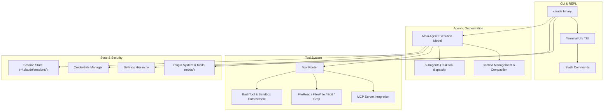
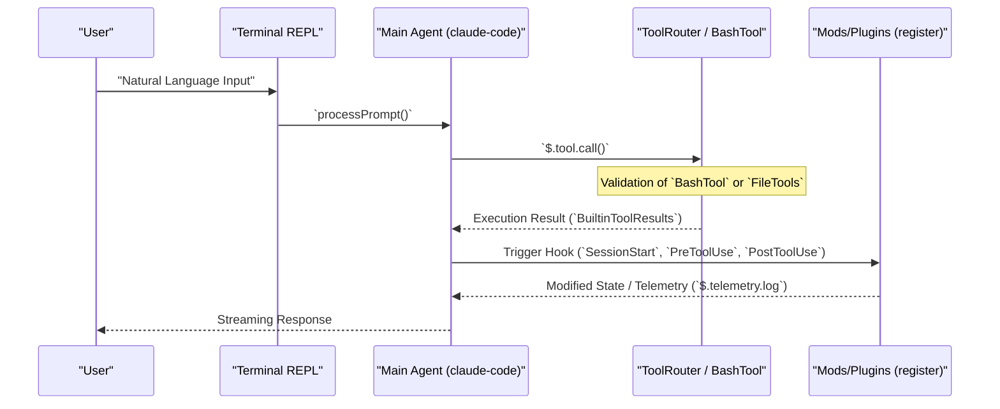
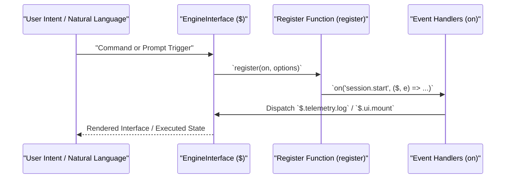

<!-- source: DeepWiki mcp.deepwiki.com · repo anthropics/claude-code · page 1 Claude Code Overview · fetched 2026-10-26 -->

# Claude Code Overview

Relevant source files

The following files were used as context for generating this wiki page:

- [.devcontainer/Dockerfile](.devcontainer/Dockerfile)
- [.devcontainer/devcontainer.json](.devcontainer/devcontainer.json)
- [.devcontainer/init-firewall.sh](.devcontainer/init-firewall.sh)
- [.gitattributes](.gitattributes)
- [.vscode/extensions.json](.vscode/extensions.json)
- [CHANGELOG.md](CHANGELOG.md)
- [LICENSE.md](LICENSE.md)
- [README.md](README.md)
- [SECURITY.md](SECURITY.md)
- [demo.gif](demo.gif)
- [feed.xml](feed.xml)
- [mods/README.md](mods/README.md)
- [mods/types/claude-code.d.ts](mods/types/claude-code.d.ts)

Claude Code is an agentic coding tool that lives in your terminal, understands your codebase, and assists with software development tasks through natural language commands [README.md:1-8](). It combines Large Language Model (LLM) reasoning with direct system access via a tool-based architecture, enabling it to execute routine tasks, explain complex code, and handle git workflows [README.md:1-8]().

This document provides a high-level introduction to the system. For detailed technical information about specific subsystems, see the child pages:
- [System Architecture](#1.1) — Detailed explanation of internal orchestration, session management, tool systems, hook/engine event model (`Register`, `On`, `EngineInterface`), and plugin integration points [mods/types/claude-code.d.ts:1-93]().
- [Feature Evolution & Release History](#1.2) — Comprehensive changelog and version history documenting architectural changes across versions [CHANGELOG.md:1-46](), syndicating via `feed.xml` [feed.xml:1-15]().
- [License & Security Policy](#1.3) — Legal terms (Anthropic Commercial Terms) [LICENSE.md:1]() and security vulnerability reporting procedures via HackerOne [SECURITY.md:1-12]().

Sources: [README.md:1-8](), [CHANGELOG.md:1-46](), [feed.xml:1-15](), [LICENSE.md:1](), [SECURITY.md:1-12](), [mods/types/claude-code.d.ts:1-93]()

## Repository Layout

The codebase is organized into modular directories supporting core runtime engines, first-party plugins, mods, examples, and automation:

- `mods/`: First-party plugins built into the Claude Code binary (such as `diff`, `telemetry`, `agents-md`, `sec-default`) implemented as hook modules with a `register(on, options)` entrypoint [mods/README.md:1-14]().
- `plugins/`: Bundled community and official plugins available in the marketplace (code review, feature development, output styles, frontend design, and the plugin development kit) [README.md:48-50]().
- `examples/`: Configuration templates and settings examples (e.g., `examples/settings/`) [README.md:48-50]().
- `.github/`: GitHub Actions workflows automating issue triage, deduplication, lifecycle management, and `@claude` mentions.
- `.devcontainer/`: Containerized development environment with firewall isolation (`init-firewall.sh`, `Dockerfile`, `devcontainer.json`) [.devcontainer/devcontainer.json:1-57]().

Sources: [README.md:48-50](), [mods/README.md:1-14](), [.devcontainer/devcontainer.json:1-57]()

## Installation and Access

Claude Code is cross-platform and supports multiple installation methods [README.md:13-44](). Platform-specific installers are recommended over the deprecated `npm` method [README.md:13-15]().

| Platform | Recommended Method | Command |
|----------|-------------------|---------|
| **macOS/Linux** | curl script | `curl -fsSL https://claude.ai/install.sh \| bash` [README.md:21-24]() |
| **macOS/Linux** | Homebrew | `brew install --cask claude-code` [README.md:26-29]() |
| **Windows** | PowerShell script | `irm https://claude.ai/install.ps1 \| iex` [README.md:31-34]() |
| **Windows** | WinGet | `winget install Anthropic.ClaudeCode` [README.md:36-39]() |

Sources: [README.md:13-44]()

## System Architecture Overview

For deep architectural details on session management, agent orchestration, and event models, see [System Architecture](#1.1).

### High-Level Component Interaction

Title: High-Level Component Interaction Architecture

Sources: [README.md:1-8](), [.devcontainer/devcontainer.json:1-57]()

### Natural Language Space to Code Entity Space: Execution Flow

Title: Natural Language to Code Entity Space Execution

Sources: [CHANGELOG.md:1-46](), [mods/types/claude-code.d.ts:1-110]()

### Natural Language Space to Code Entity Space: Mod & Event Hook Contract

Title: Natural Language to Code Entity Space Hook Registration

Sources: [mods/README.md:1-14](), [mods/types/claude-code.d.ts:1-93]()

## Key Capabilities

- **Agentic Orchestration and Execution**: Support for subagent spawning via the Task tool (`$.agent.spawn`), worktree isolation, and agent teams [mods/types/claude-code.d.ts:102-148]().
- **Context Management**: Automatic compaction triggers and payload stripping to maintain efficiency within token limits [CHANGELOG.md:16-16]().
- **Tool and Protocol Integration**: Model Context Protocol (MCP) integration with OAuth, server discovery, tool registration (`$.mcp.call`), and sandboxed execution via firewall rules and network restrictions [.devcontainer/init-firewall.sh:1-136]().
- **First-Party Mods & Plugins**: Modular architecture leveraging `mods/` (`diff`, `telemetry`, `agents-md`, `sec-default`) with `register(on, options)` signatures and noun contracts [mods/README.md:1-14]().

Sources: [CHANGELOG.md:16-16](), [mods/README.md:1-14](), [mods/types/claude-code.d.ts:102-148](), [.devcontainer/init-firewall.sh:1-136]()

---

