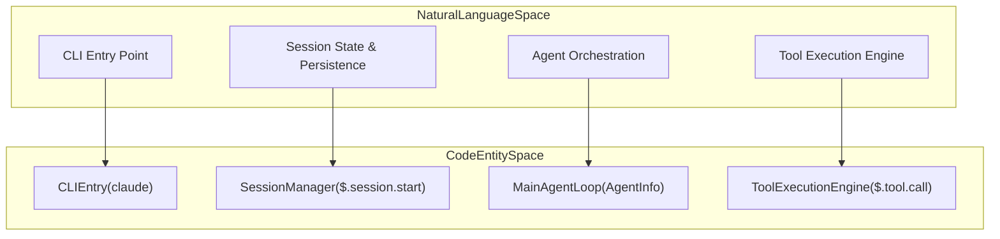
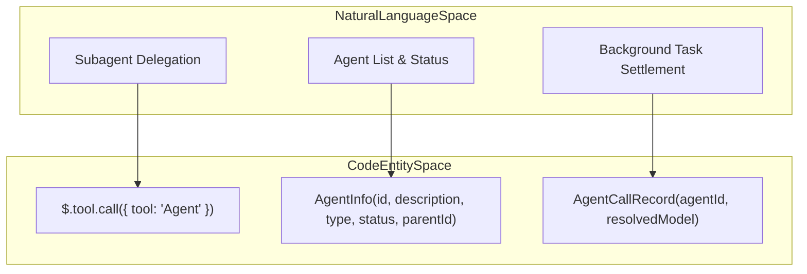
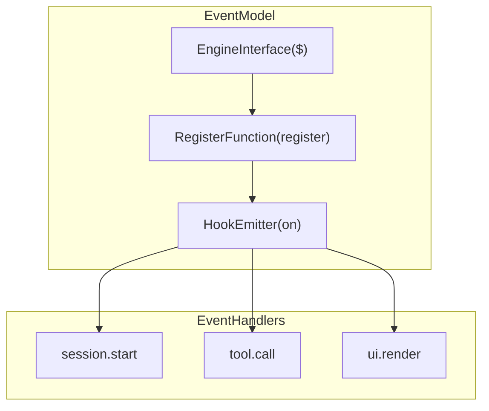

<!-- source: DeepWiki mcp.deepwiki.com · repo anthropics/claude-code · page 1.1 System Architecture · fetched 2026-10-26 -->

# System Architecture

Relevant source files

The following files were used as context for generating this wiki page:

- [.devcontainer/Dockerfile](.devcontainer/Dockerfile)
- [.devcontainer/devcontainer.json](.devcontainer/devcontainer.json)
- [.devcontainer/init-firewall.sh](.devcontainer/init-firewall.sh)
- [.gitattributes](.gitattributes)
- [.vscode/extensions.json](.vscode/extensions.json)
- [CHANGELOG.md](CHANGELOG.md)
- [LICENSE.md](LICENSE.md)
- [README.md](README.md)
- [SECURITY.md](SECURITY.md)
- [demo.gif](demo.gif)
- [feed.xml](feed.xml)
- [mods/README.md](mods/README.md)
- [mods/types/claude-code.d.ts](mods/types/claude-code.d.ts)

## Purpose and Scope

This document details the internal architecture of Claude Code, focusing on session management, agent orchestration, the tool execution system, the hook and engine event model, and the integration points for plugins and first-party mods. It maps high-level engine capabilities to their underlying code entities and type definitions.

Sources: [mods/README.md:1-14](), [mods/types/claude-code.d.ts:1-32]()

## Overview & Core Components

Claude Code runs within a Node.js execution environment [mods/types/claude-code.d.ts:1-17](), exposing a command-line interface (`claude`) [mods/README.md:20-20]() that initializes session contexts, loads configuration hierarchies, mounts built-in and external plugins, and dispatches tool execution requests. 

The following diagram bridges natural language functional concepts to the specific code entities and files that implement them:

Sources: [mods/README.md:1-58](), [mods/types/claude-code.d.ts:93-150]()

## Session Management & Lifecycle

Sessions manage conversation persistence, history, and runtime state. Each interactive or headless session is persisted to disk under session transcripts (`transcript.jsonl`).

- **Initialization & Resumption**: Sessions are initialized via `$.session.start` [mods/README.md:48-58]() or resumed using command flags. Headless runs preserve usage totals and cost accounting upon exit.
- **State Records**: Subagents and active loops are tracked as `AgentInfo` structures containing unique identifiers, status flags (`running`, `completed`, `failed`, `killed`), and origin axes (`spawnedBy`) [mods/types/claude-code.d.ts:117-150]().

Sources: [mods/README.md:48-58](), [mods/types/claude-code.d.ts:117-150]()

## Agent Orchestration & Subagents

Claude Code utilizes a hierarchical agent model where a main execution loop coordinates complex tasks by spawning specialized subagents via the `Task` tool or programmatic APIs.

The mapping between high-level agent delegations and their low-level code representation is structured as follows:

Sources: [mods/README.md:28-32](), [mods/types/claude-code.d.ts:93-150]()

- **Delegation & Background Execution**: Subagent calls (`$.tool.call({ tool: "Agent", ... })`) settle asynchronously, returning an `AgentCallRecord` containing the spawned `agentId` and `resolvedModel` [mods/types/claude-code.d.ts:95-111]().
- **Prompt Prefix Staggering**: Sibling agent dispatches employ prefix staggering to maximize LLM prompt cache efficiency across concurrent loops.

Sources: [mods/types/claude-code.d.ts:93-111](), [mods/types/claude-code.d.ts:117-150]()

## Tool System & Permissions

The tool execution engine evaluates model-requested tool calls against strict permission rules, security policies, and sandbox configurations.

- **Tool Architecture**: Core built-in tools include `Bash`, `FileRead`, `FileWrite`, `FileEdit`, and `Task` [mods/types/claude-code.d.ts:95-111]().
- **Permission Enforcement**: Permission rules check actions against user-defined configurations (`settings.json`) and enterprise guardrails (`managed-settings.json`), prompting interactively (`ask`/`allow`/`deny`) when necessary, or resolving via mod deciders (`decider: "person"`) [CHANGELOG.md:6-6]().

Sources: [CHANGELOG.md:6-6](), [mods/README.md:8-14](), [mods/types/claude-code.d.ts:95-111]()

## Hook & Engine Event Model

The hook system enables synchronous and asynchronous interception of engine events through a function-hook architecture. Plugins and built-in mods register callbacks against lifecycle events using the `register(on, options)` signature [mods/README.md:3-6]().

Sources: [mods/README.md:1-50](), [mods/types/claude-code.d.ts:1-92]()

- **Event Signatures**: Hooks receive `($, e, next)` arguments, where `$` is the `EngineInterface`, `e` is the typed event payload (such as `e.isReadOnly` for tool checks), and `next` propagates the event down the middleware chain [CHANGELOG.md:7-7](), [mods/README.md:3-6]().
- **Testing Kit**: The testing framework (`claude-code/testing`) runs test suites in an isolated harness using `test`, `describe`, and mock providers (`mock.clock`, `mock.env`, `mock.store`) [mods/README.md:24-79]().

Sources: [CHANGELOG.md:7-7](), [mods/README.md:1-79](), [mods/types/claude-code.d.ts:1-92]()

## Plugin & Mod Integration Points

Mods are first-party plugins bundled directly into the Claude Code binary [mods/README.md:1-6](), implemented as modular hook collections (`sec-default`, `diff`, `telemetry`, `agents-md`) [mods/README.md:8-14]().

- **Noun Contracts**: Mods extend the engine interface (`EngineInterface`) by declaring custom nouns (e.g., `$.telemetry`) via TypeScript declaration files (`types/index.d.ts`), enforcing compile-time type safety across plugin boundaries [mods/README.md:84-108]().
- **Validation**: Plugins undergo static analysis via `claude plugin validate <dir>` prior to loading, checking manifests and hook signatures against `claude-code.d.ts` definitions [mods/types/claude-code.d.ts:1-10]().

Sources: [mods/README.md:1-117](), [mods/types/claude-code.d.ts:1-92]()

---

