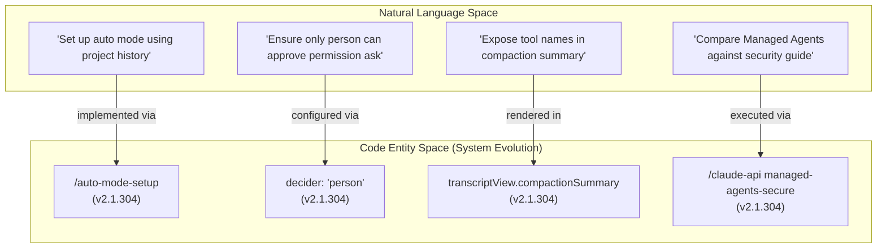
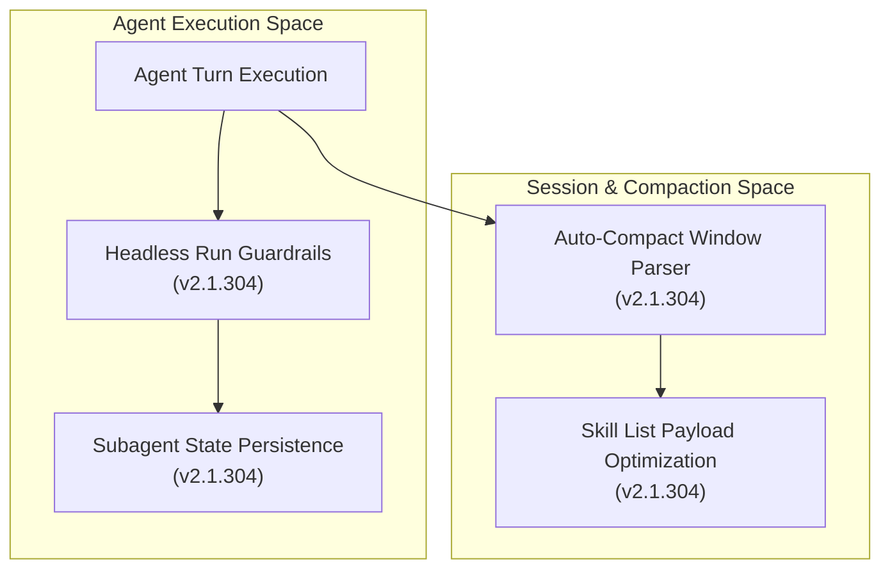
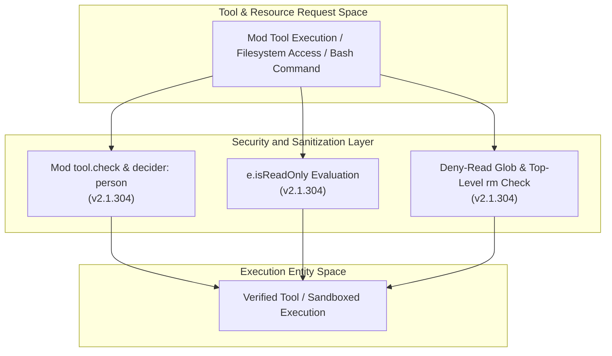

<!-- source: DeepWiki mcp.deepwiki.com · repo anthropics/claude-code · page 1.2 Feature Evolution & Release History · fetched 2026-10-26 -->

# Feature Evolution & Release History

Relevant source files

The following files were used as context for generating this wiki page:

- [.devcontainer/Dockerfile](.devcontainer/Dockerfile)
- [.devcontainer/devcontainer.json](.devcontainer/devcontainer.json)
- [.devcontainer/init-firewall.sh](.devcontainer/init-firewall.sh)
- [.gitattributes](.gitattributes)
- [.vscode/extensions.json](.vscode/extensions.json)
- [CHANGELOG.md](CHANGELOG.md)
- [LICENSE.md](LICENSE.md)
- [README.md](README.md)
- [SECURITY.md](SECURITY.md)
- [demo.gif](demo.gif)
- [feed.xml](feed.xml)

## Purpose and Scope

This document chronicles the development history of Claude Code, documenting major features, enhancements, and architectural changes across releases up to version `2.1.304`. It provides a chronological view of how the system evolved from its initial release to its current state, organized by functional area and version milestone, alongside feed syndication details via `feed.xml`.

For details on the current system architecture, see [System Architecture (1.1)](). For licensing terms, see [License & Security Policy (1.3)](). For GitHub automation workflow history, see [5. GitHub Automation]().

Sources: [CHANGELOG.md:1-57](), [feed.xml:1-54]()

## Version Numbering Scheme & Syndication

Claude Code follows a three-part version numbering scheme: `MAJOR.MINOR.PATCH` (e.g., `2.1.304`). The current release series is `2.1.x`, with patch versions incrementing for bug fixes, features, and improvements [CHANGELOG.md:3-57](). Release channels include:

- **Stable channel**: Production-ready releases recommended for general use.
- **Latest channel**: Bleeding-edge releases with newest features.

Syndication of releases is handled via Atom feed generation (`feed.xml`), which indexes release tags, release notes, and structured HTML entries directly corresponding to `CHANGELOG.md` [feed.xml:1-14](). Recent updates have introduced guided auto-mode configuration via `/auto-mode-setup`, strict mod permission deciders (`decider: "person"`), read-only checks (`e.isReadOnly`), and security evaluation tools (`/claude-api managed-agents-secure`) [CHANGELOG.md:3-10]().

Sources: [CHANGELOG.md:3-10](), [feed.xml:1-14]()

## Major Version Milestones

The following table summarizes significant releases that introduced major capabilities or architectural changes:

| Version | Release | Key Features |
|---------|---------|--------------|
| **2.1.304** | Current | **Auto-Mode Setup & Mod Security**: Added `/auto-mode-setup`, `decider: "person"` for mod permission checks, `e.isReadOnly` event flags, `/claude-api managed-agents-secure`, and enhanced compaction summaries with prior tool names [CHANGELOG.md:3-10](). |
| **2.1.284** | Milestone | **Sonnet 5.5 & Gateway Enhancements**: Added `claude-sonnet-5-5` (1M context), auto-mode "Yes, but ask again next time" permissions, gateway spend limit dollar amounts in `/usage`, and `private_key_jwt` cert authentication. |
| **2.1.277** | Milestone | **AGENTS.md & Gateway**: Added `AGENTS.md` project instruction fallback, gateway proxy egress boundary flags, and static header maps for gateway upstreams. |
| **2.1.229** | Milestone | **Remote & Reliability**: Resumable Remote Control, SSE keepalives, and fixed streaming response duplication. |
| **2.1.197** | Previous | **Claude Sonnet 5**: New default model with native 1M-token context window. |

Sources: [CHANGELOG.md:3-10](), [feed.xml:10-20]()

## Feature Evolution Timeline

The following diagram visualizes the transition from natural language intent to specific code entities across recent system updates:

title "Claude Code: Intent to Code Entity Evolution (Natural Language to Code)"

Sources: [CHANGELOG.md:3-10](), [feed.xml:15-20]()

## Agent System & Subagent Evolution

### Subagent & Team Coordination
The agent system has evolved to support robust error recovery, head-less run safety, and timeout management for distributed tools:
- **Headless Run Guardrails**: Fixed plugins keeping headless runs going past `--max-turns`, `Stop`, or ended input by spawning subagents or re-running finished agents [CHANGELOG.md:16]().
- **Subagent State Persistence**: Fixed subagents occasionally forgetting their most recent work when messaged or resumed immediately after finishing [CHANGELOG.md:32]().
- **Agent Team Shutdowns**: Fixed agent teams exiting the entire CLI when approving a shutdown request from the main session [CHANGELOG.md:42]().

### Session & Context Management
- **Auto-Compactor Units**: Fixed `CLAUDE_CODE_AUTO_COMPACT_WINDOW=200k` silently defaulting to 100K by adding support for `k` and `M` suffixes with validation and range warnings [CHANGELOG.md:45]().
- **Resumed Session Optimization**: Resumed and cloud sessions no longer re-transmit the entire skill list on every plugin reload startup [CHANGELOG.md:35]().
- **Usage Warning Limits**: Added usage limit warnings on Pro and Max plans when resuming inactive conversations that consume notable percentages of the 5-hour limit [CHANGELOG.md:11]().

title "Agent State Transitions and Resiliency Flow"

Sources: [CHANGELOG.md:11-45](), [feed.xml:21-50]()

## Tool System & Permissions

### Security & Sandbox Evolution
- **Mod Permission Deciders**: Added `decider: "person"` to mod `tool.check` answers, ensuring that only interactive permission dialogs or host callbacks can approve an ask, refusing automatically where nobody can be queried [CHANGELOG.md:6]().
- **Read-Only Event Flags**: Added `e.isReadOnly` to mod `tool.check` events, identifying read-only tool calls for granular policy enforcement [CHANGELOG.md:7]().
- **Filesystem Deny-Read Glob Fixes**: Fixed sandboxed commands failing on Linux when `sandbox.filesystem.denyRead` globs contain non-character-class brackets, such as route folders like `[user-id]` [CHANGELOG.md:13]().

### Platform-Specific Path Normalization & Safety Prompts
- **Drive Top-Level Safety Prompts**: Fixed `rm -r` commands on mounted drives or top-level folders (`/Volumes`, `/media`, WSL's `/mnt/c`) missing the standard safety prompt applied to critical paths like `/Applications` [CHANGELOG.md:14]().
- **Environment Variable Scope**: Fixed unsandboxed Bash commands in Claude Desktop Code tab sessions on macOS and Linux missing environment variables exported in shell startup files like `~/.zshrc` [CHANGELOG.md:28]().

title "Tool Safety and Validation Flow"

Sources: [CHANGELOG.md:6-14](), [CHANGELOG.md:28](), [feed.xml:16-25]()

## UI/UX, Gateway & Plugin Marketplace Enhancements

### Gateway & Telemetry Syndication
- **Managed Agents Security Audit**: Introduced `/claude-api managed-agents-secure` to audit Managed Agents settings against published security guidelines without modifying state [CHANGELOG.md:9]().
- **Auto-Mode Setup Guide**: Added `/auto-mode-setup`, a guided workflow analyzing project and session context to tune auto mode across Bedrock, Vertex, Foundry, Claude apps gateway, and telemetry-disabled environments [CHANGELOG.md:8]().

### UI & Configuration Improvements
- **Transcript View Enhancements**: Added prior tool names to compaction summaries in transcript views (`Ctrl+O`) and fixed transcript GC trimming reliability under low-disk conditions [CHANGELOG.md:10](), [CHANGELOG.md:15]().
- **Mod UI State Preservation**: Fixed click loss on mod buttons when identical buttons without unique keys were redrawn unchanged, and improved reload failure messaging [CHANGELOG.md:17](), [CHANGELOG.md:18]().

Sources: [CHANGELOG.md:8-18](), [CHANGELOG.md:52](), [feed.xml:18-28]()

---

