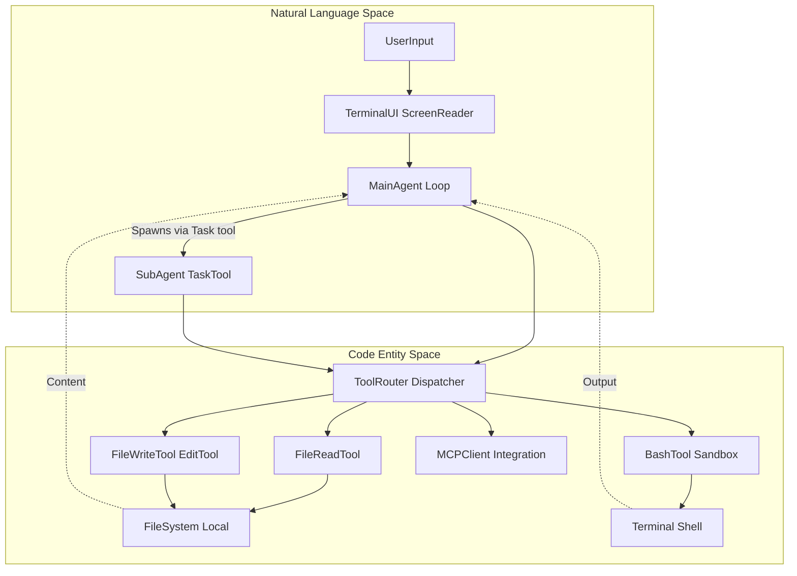
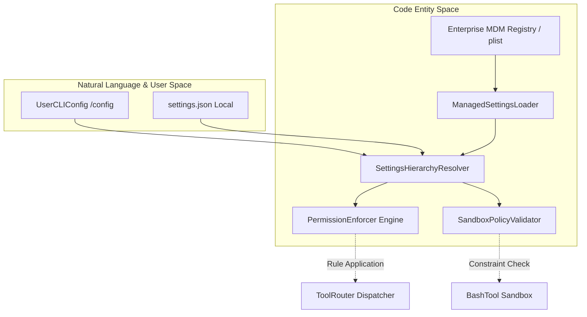

<!-- source: DeepWiki mcp.deepwiki.com · repo anthropics/claude-code · page 2 User Guide · fetched 2026-10-26 -->

# User Guide

Relevant source files

The following files were used as context for generating this wiki page:

- [.devcontainer/Dockerfile](.devcontainer/Dockerfile)
- [.devcontainer/devcontainer.json](.devcontainer/devcontainer.json)
- [.devcontainer/init-firewall.sh](.devcontainer/init-firewall.sh)
- [.gitattributes](.gitattributes)
- [.vscode/extensions.json](.vscode/extensions.json)
- [CHANGELOG.md](CHANGELOG.md)
- [LICENSE.md](LICENSE.md)
- [README.md](README.md)
- [SECURITY.md](SECURITY.md)
- [demo.gif](demo.gif)
- [examples/mdm/README.md](examples/mdm/README.md)
- [examples/settings/README-hipaa.md](examples/settings/README-hipaa.md)
- [examples/settings/README.md](examples/settings/README.md)
- [examples/settings/managed-mcp-hipaa.json](examples/settings/managed-mcp-hipaa.json)
- [examples/settings/settings-bash-sandbox.json](examples/settings/settings-bash-sandbox.json)
- [examples/settings/settings-hipaa.json](examples/settings/settings-hipaa.json)
- [examples/settings/settings-lax.json](examples/settings/settings-lax.json)
- [examples/settings/settings-strict.json](examples/settings/settings-strict.json)
- [feed.xml](feed.xml)

This document provides a practical guide for end users of Claude Code, covering the essential concepts and workflows needed for daily usage [README.md:7-9](). It explains how to interact with Claude Code, manage sessions, configure permissions, and leverage its agentic capabilities to enhance your coding workflow [README.md:7-9]().

As a parent page, this guide offers a high-level overview of user-facing components. For detailed instructions, please refer to the child pages:
- For installation methods across operating systems, see [Installation & Setup](#2.1).
- For settings files and enterprise configuration, see [Configuration Management](#2.2).
- For slash commands and interaction modes, see [CLI Commands & Interaction Modes](#2.3).
- For session lifecycle and transcripts, see [Session Management](#2.4).
- For bug reporting and feedback channels, see [Providing Feedback & Reporting Issues](#2.5).

Sources: [README.md:7-9]()

## Core Concepts

### What is Claude Code?

Claude Code is an agentic coding tool that lives in your terminal, understands your codebase, and helps you code faster by executing routine tasks, explaining complex code, and handling git workflows through natural language commands [README.md:7-9](). It functions as a stateful agent capable of using tools to interact with your local environment.

### Sessions & Authentication

A **session** represents a continuous conversation with Claude Code. Each session maintains full conversation history, working directory context, active configuration settings, and permission rules [README.md:7-9](). Sessions are persisted to disk and can be resumed using the `/resume` command or corresponding flags [CHANGELOG.md:44](). 

Claude Code supports multiple authentication methods including Claude.ai OAuth, Anthropic Console API keys (`ANTHROPIC_API_KEY`), and custom gateways like AWS Bedrock or Google Vertex AI [CHANGELOG.md:7]().

Sources: [README.md:7-9](), [CHANGELOG.md:7](), [CHANGELOG.md:44]()

## User Interaction & Configuration Flows

The following diagrams illustrate how user inputs and configuration parameters bridge natural language and settings spaces to underlying code entities and subsystems.

**Natural Language to Code Entity Space**

Sources: [README.md:7-9](), [CHANGELOG.md:56]()

**Configuration Hierarchy to Enterprise Settings Space**

Sources: [examples/settings/README.md:5-26](), [examples/mdm/README.md:21-25]()

## Child Pages & Detailed Guides

### 2.1 Installation & Setup
Claude Code can be installed on macOS, Linux, and Windows using various distribution channels [README.md:19-44](). The recommended installation methods use automated shell or PowerShell scripts, while Homebrew, WinGet, and legacy npm installations are also available [README.md:21-44](). For step-by-step instructions and troubleshooting, see [Installation & Setup](#2.1).

Sources: [README.md:19-44]()

### 2.2 Configuration Management
Claude Code uses a layered settings hierarchy spanning `managed-settings.json`, user `settings.json`, and project-local `settings.local.json` files [examples/settings/README.md:5-26](). Organizations can enforce strict policies, sandbox restrictions, and tool permissions using templates provided in `examples/settings/` [examples/settings/README.md:3-21](). For configuration schemas and deployment examples, see [Configuration Management](#2.2).

Sources: [examples/settings/README.md:3-26]()

### 2.3 CLI Commands & Interaction Modes
Interactions are driven by natural language and augmented with slash commands such as `/model`, `/resume`, `/compact`, `/diff`, and `/memory` [CHANGELOG.md:29](). These commands allow users to control session parameters, manage context windows, and inspect code diffs. For a full command reference, see [CLI Commands & Interaction Modes](#2.3).

Sources: [CHANGELOG.md:29]()

### 2.4 Session Management
Session state and transcripts are automatically persisted in local configuration directories [CHANGELOG.md:44](). Users can resume interrupted or past workflows using `/resume` or headless flags [CHANGELOG.md:49](). For details on transcript storage and lifecycle management, see [Session Management](#2.4).

Sources: [CHANGELOG.md:44](), [CHANGELOG.md:49]()

### 2.5 Providing Feedback & Reporting Issues
To report bugs, submit feedback, or share telemetry data with the development team, users can invoke the interactive `/bug` command or submit issues through official GitHub issue templates [README.md:54](). For more information on reporting guidelines, see [Providing Feedback & Reporting Issues](#2.5).

Sources: [README.md:54]()

---

