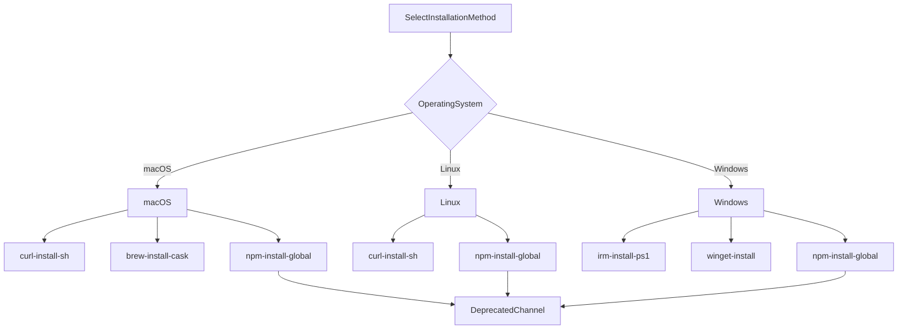
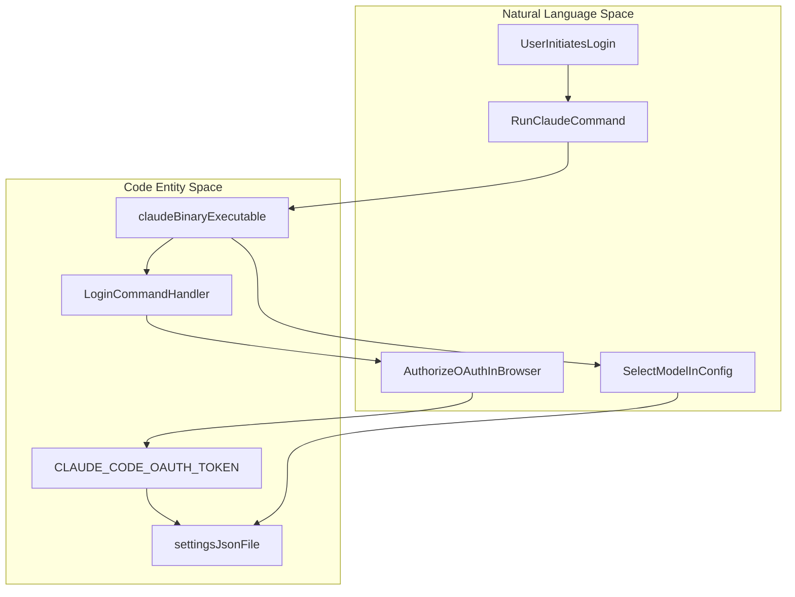
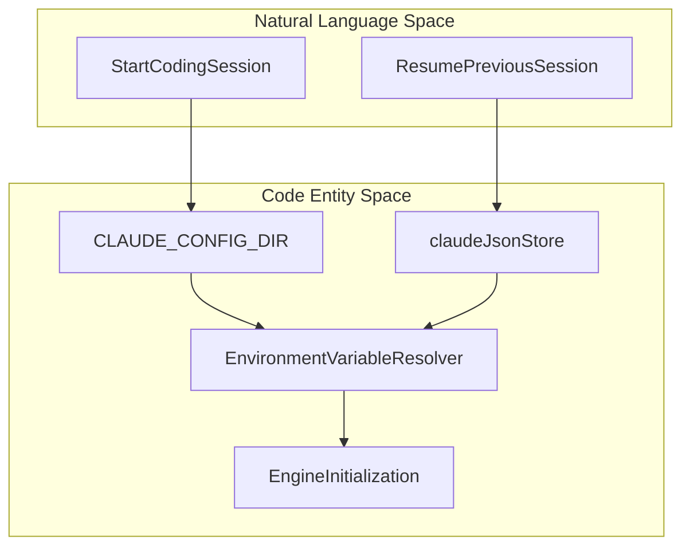

<!-- source: DeepWiki mcp.deepwiki.com · repo anthropics/claude-code · page 2.1 Installation & Setup · fetched 2026-10-26 -->

# Installation & Setup

<details>
<summary>Relevant source files</summary>

The following files were used as context for generating this wiki page:

- [.devcontainer/Dockerfile](.devcontainer/Dockerfile)
- [.devcontainer/devcontainer.json](.devcontainer/devcontainer.json)
- [.devcontainer/init-firewall.sh](.devcontainer/init-firewall.sh)
- [.gitattributes](.gitattributes)
- [.vscode/extensions.json](.vscode/extensions.json)
- [CHANGELOG.md](CHANGELOG.md)
- [LICENSE.md](LICENSE.md)
- [README.md](README.md)
- [SECURITY.md](SECURITY.md)
- [demo.gif](demo.gif)
- [feed.xml](feed.xml)

</details>


This page details the installation procedures, runtime requirements, containerized execution environments, and initial setup workflows for Claude Code across macOS, Linux, and Windows. It covers script-based installers, package managers (Homebrew and WinGet), deprecated npm channels, containerized devcontainers with strict firewall policies, authentication initialization, and configuration directory bindings.

---

## Purpose and Scope

Claude Code is an agentic coding tool designed to operate within terminal environments, integrating directly with project repositories and git workflows [README.md:7-7](). This document provides technical instructions for provisioning the environment, verifying dependencies, executing native installers, configuring container sandboxes, and establishing authenticated user sessions.

Sources: `[README.md:7-7]()`, `[.devcontainer/devcontainer.json:1-57]()`

---

## Prerequisites and System Requirements

Claude Code execution depends on a standard JavaScript runtime environment and platform-specific shell utilities.

| Requirement | Minimum Version | Technical Notes |
|------------|----------------|-----------------|
| Node.js | 18+ | Required runtime for all installation vectors [README.md:3-3]() |
| Operating System | macOS, Linux, Windows | Supported via native distribution scripts and package managers [README.md:21-39]() |
| Shell Environment | `zsh`, `bash`, PowerShell | Execution contexts for interactive and headless CLI operations [README.md:21-34]() |

Sources: `[README.md:3-3]`, `[README.md:21-39]`

---

## Installation Methods by Platform

Claude Code provides platform-specific installation scripts and package manager integrations. Direct npm installation is deprecated in favor of native binary installers [README.md:14-17]().

### Installation Path Selection

Title: Installation Path Selection

Sources: `[README.md:19-44]`

### macOS and Linux Provisioning

For Unix-like environments, shell script execution or Homebrew casks are the primary distribution channels [README.md:21-29]():

- **Shell Script Installer:**
  ```bash
  curl -fsSL https://claude.ai/install.sh | bash
  ```
- **Homebrew Cask:**
  ```bash
  brew install --cask claude-code
  ```
- **Deprecated npm Channel:**
  ```bash
  npm install -g @anthropic-ai/claude-code
  ```

Sources: `[README.md:21-44]`

### Windows Provisioning

For Windows hosts, PowerShell execution or WinGet package manager deployments are recommended [README.md:31-39]():

- **PowerShell Installer:**
  ```powershell
  irm https://claude.ai/install.ps1 | iex
  ```
- **WinGet Package Manager:**
  ```powershell
  winget install Anthropic.ClaudeCode
  ```

Sources: `[README.md:31-39]`

---

## Containerized & Sandbox Setup (DevContainer)

For isolated and reproducible development environments, Claude Code provides a complete DevContainer configuration built on a Node.js 20 base image [.devcontainer/Dockerfile:1-1]() with strict network egress controls [.devcontainer/init-firewall.sh:106-119]().

- **Dockerfile Configuration:** Sets up system dependencies (`iptables`, `ipset`, `gh`, `fzf`), creates the non-root `node` user [.devcontainer/Dockerfile:34-34](), configures global npm prefix paths [.devcontainer/Dockerfile:61-62](), installs git-delta [.devcontainer/Dockerfile:51-55](), and installs the `@anthropic-ai/claude-code` package globally [.devcontainer/Dockerfile:82-82]().
- **Network Firewall Initialization:** The `init-firewall.sh` script flushes existing rules [.devcontainer/init-firewall.sh:9-14](), establishes default drop policies for input, forward, and output traffic [.devcontainer/init-firewall.sh:107-109](), and whitelists approved domains (`registry.npmjs.org`, `api.anthropic.com`, GitHub meta IP ranges) via `ipset` hash tables [.devcontainer/init-firewall.sh:41-90]().
- **Container Orchestration & Mounts:** `devcontainer.json` mounts persistent named volumes for command history and configuration storage (`/home/node/.claude`) [.devcontainer/devcontainer.json:44-47]() and executes `init-firewall.sh` upon startup [.devcontainer/devcontainer.json:55-55]().

Sources: `[.devcontainer/Dockerfile:1-91]()`, `[.devcontainer/devcontainer.json:1-57]()`, `[.devcontainer/init-firewall.sh:1-136]()`

---

## Post-Installation Setup & Authentication

Upon initial execution, the CLI establishes configuration contexts and prompts for authentication credentials, reading and writing state to `~/.claude` and configuration stores [.devcontainer/Dockerfile:46-47]().

### CLI Initialization and Authentication Flow

Title: CLI Initialization and Authentication Flow

Sources: `[README.md:46-46]()`, `[.devcontainer/Dockerfile:46-47]()`

### Session Startup & Settings Resolution Flow

Title: Session Startup and Settings Resolution Flow

Sources: `[README.md:46-46]()`, `[.devcontainer/devcontainer.json:48-52]()`

### Environment Overrides & Configuration

Users may define specific runtime behavior using environment variables:
- `CLAUDE_CODE_OAUTH_TOKEN`: Overrides the default stored OAuth credential.
- `CLAUDE_CONFIG_DIR`: Specifies a non-default path for storing application configuration and history (`~/.claude` by default) [.devcontainer/devcontainer.json:48-52]().
- `ANTHROPIC_BASE_URL`: Directs API requests to custom gateway endpoints.
- `NODE_OPTIONS`: Controls Node.js memory allocations (e.g., `--max-old-space-size=4096` in devcontainers) [.devcontainer/devcontainer.json:49-49]().

Sources: `[.devcontainer/devcontainer.json:48-52]()`

---

## Launching and Verifying Sessions

Navigate to a target workspace directory and invoke the binary to start an interactive session [README.md:46-46]().

### Verification and Diagnostic Commands

- `/model`: Interactively select or inspect the active model.
- `/doctor`: Evaluates local configuration integrity and network domain lists.
- `/bug`: Triggers the embedded telemetry and feedback interface [README.md:52-54]().

Sources: `[README.md:52-54]()`

---

