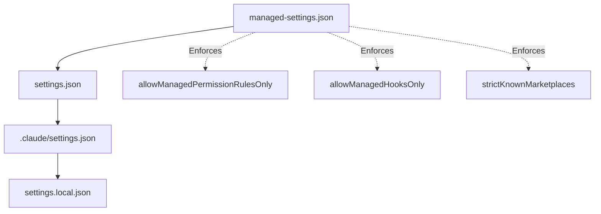
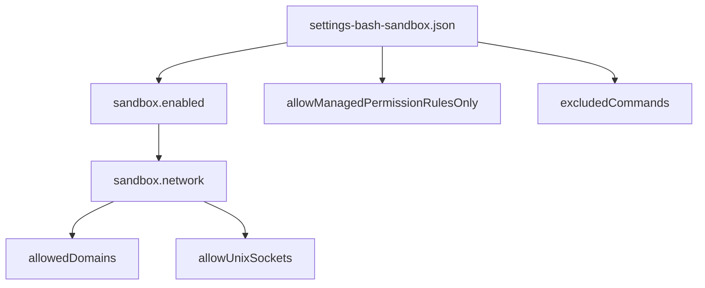

<!-- source: DeepWiki mcp.deepwiki.com · repo anthropics/claude-code · page 2.2 Configuration Management · fetched 2026-10-26 -->

# Configuration Management

Relevant source files

The following files were used as context for generating this wiki page:

- [examples/mdm/README.md](examples/mdm/README.md)
- [examples/settings/README-hipaa.md](examples/settings/README-hipaa.md)
- [examples/settings/README.md](examples/settings/README.md)
- [examples/settings/managed-mcp-hipaa.json](examples/settings/managed-mcp-hipaa.json)
- [examples/settings/settings-bash-sandbox.json](examples/settings/settings-bash-sandbox.json)
- [examples/settings/settings-hipaa.json](examples/settings/settings-hipaa.json)
- [examples/settings/settings-lax.json](examples/settings/settings-lax.json)
- [examples/settings/settings-strict.json](examples/settings/settings-strict.json)

## Purpose and Scope

This page documents the configuration management architecture of Claude Code, detailing the settings hierarchy (`managed-settings.json`, `settings.json`, `settings.local.json`), enterprise policy enforcement mechanisms, permission configurations, and sandboxing rules. It serves as a reference for configuring developer environments and deploying enterprise-wide security profiles using the configurations provided in `examples/settings/`.

Sources: [examples/settings/README.md:1-5]()

## Settings Hierarchy & Data Flow

The configuration system processes settings through a multi-tier cascade, merging options from organization-wide enterprise controls down to local developer overrides [examples/settings/README.md:5-6](). 

Sources: [examples/settings/README.md:5-6](), [examples/settings/settings-strict.json:12-14]()

### File Locations

| Level | Unix/Linux/macOS | Windows | Scope |
|-------|------------------|---------|-------|
| **Enterprise (Managed)** | `~/.config/claude/managed-settings.json` | `%APPDATA%\ClaudeCode\managed-settings.json` | Organization-wide constraints [examples/settings/README.md:3-5]() |
| **User** | `~/.config/claude/settings.json` | `%APPDATA%\ClaudeCode\settings.json` | Per-user preferences [examples/settings/README.md:5-6]() |
| **Project** | `.claude/settings.json` | `.claude\settings.json` | Repository-specific [examples/settings/README.md:5-6]() |
| **Local** | `settings.local.json` | `settings.local.json` | Testing/development overrides [examples/settings/README.md:26-26]() |

Sources: [examples/settings/README.md:3-6](), [examples/settings/README.md:26-26]()

### Policy Enforcement Mechanisms

Enterprise configuration files apply strict overrides to lock down developer environments:

- **`allowManagedPermissionRulesOnly`**: When set to `true` in `[examples/settings/settings-strict.json:12]`, any `allow`, `ask`, or `deny` rules defined in user or project settings are ignored [examples/settings/settings-strict.json:12]().
- **`allowManagedHooksOnly`**: When set to `true` in `[examples/settings/settings-strict.json:13]`, only hooks defined in the managed configuration execute; user and project hooks are blocked [examples/settings/settings-strict.json:13]().
- **`strictKnownMarketplaces`**: Restricts the CLI to only install plugins from an approved list of marketplace URLs (`[examples/settings/settings-strict.json:14]()`, `[examples/settings/settings-lax.json:5]()`).
- **`disableBypassPermissionsMode`**: When set to `"disable"`, prevents users from using flags like `--dangerously-skip-permissions` (`[examples/settings/settings-lax.json:3-4]()`).

Sources: [examples/settings/settings-strict.json:12-14](), [examples/settings/settings-lax.json:3-5]()

## Permission Configuration

Permissions determine the autonomy level granted to the agent during execution [examples/settings/README.md:17-20](). Each tool call evaluates against the merged permission rules.

### Permission Modes

1. **`allow`**: The tool executes automatically without prompting the user (`[examples/settings/README.md:17-17]()`).
2. **`ask`**: The user interface prompts the user to approve or deny the action (`[examples/settings/README.md:17-20]()`).
3. **`deny`**: The tool call is immediately rejected, returning a failure context to the agent (`[examples/settings/README.md:17-19]()`, `[examples/settings/settings-strict.json:7-10]()`).

Sources: [examples/settings/settings-strict.json:2-11](), [examples/settings/README.md:17-20]()

## Sandbox Configuration

The `sandbox` block targets the `Bash` tool exclusively and does not apply to other tools (such as file operations, web tools, or MCP servers) or hooks (`[examples/settings/README.md:27-27]()`, `[examples/settings/settings-bash-sandbox.json:3-17]()`).

### Sandbox Architecture & Code Entities

Sources: [examples/settings/settings-bash-sandbox.json:1-18](), [examples/settings/settings-strict.json:15-27]()

### Configuration Options

- **`autoAllowBashIfSandboxed`**: When `true`, bash commands running inside the sandbox inherit `allow` status (`[examples/settings/settings-bash-sandbox.json:5]`, `[examples/settings/settings-strict.json:16]`).
- **`allowUnsandboxedCommands`**: When `false`, blocks execution of any command that cannot be successfully wrapped inside the sandbox (`[examples/settings/settings-bash-sandbox.json:6]()`).
- **`network.allowedDomains`**: Defines an explicit domain allowlist for sandboxed processes (`[examples/settings/settings-strict.json:22]()`, `[examples/settings/settings-bash-sandbox.json:12]()`).
- **`excludedCommands`**: Lists commands explicitly exempted from sandbox wrapper enforcement (`[examples/settings/settings-strict.json:17]()`, `[examples/settings/settings-bash-sandbox.json:7]()`).

Sources: [examples/settings/settings-bash-sandbox.json:3-17](), [examples/settings/settings-strict.json:15-27]()

## Example Settings Files

The `examples/settings/` directory provides baseline configurations [examples/settings/README.md:1-5]() for various security models.

### Strict Configuration (`settings-strict.json`)
Designed for high-security environments enforcing strict organization-wide control (`[examples/settings/README.md:18-20]()`):
- **Tools**: Denies web fetch and search capabilities (`[examples/settings/settings-strict.json:7-10]()`) and requires approval for the `Bash` tool (`[examples/settings/settings-strict.json:4-6]()`).
- **Lockdown**: Enforces `allowManagedPermissionRulesOnly` and `allowManagedHooksOnly` (`[examples/settings/settings-strict.json:12-13]()`).

Sources: [examples/settings/README.md:18-20](), [examples/settings/settings-strict.json:1-28]()

### Lax Configuration (`settings-lax.json`)
A baseline configuration preventing standard security bypasses while maintaining developer flexibility (`[examples/settings/README.md:15-16]()`):
- **Security**: Disables `--dangerously-skip-permissions` (`[examples/settings/settings-lax.json:3-4]()`).
- **Marketplace**: Restricts known marketplaces (`[examples/settings/settings-lax.json:5]()`).

Sources: [examples/settings/README.md:15-16](), [examples/settings/settings-lax.json:1-6]()

### Bash Sandbox Configuration (`settings-bash-sandbox.json`)
Enforces strict environment isolation for command-line shell execution (`[examples/settings/README.md:21-21]()`):
- **Enforcement**: Enables the sandbox (`[examples/settings/settings-bash-sandbox.json:4]()`) and rejects unsandboxed commands (`[examples/settings/settings-bash-sandbox.json:6]()`).
- **Control**: Restricts permission rules to enterprise-managed definitions (`[examples/settings/settings-bash-sandbox.json:2]()`).

Sources: [examples/settings/README.md:21-21](), [examples/settings/settings-bash-sandbox.json:1-18]()

---

