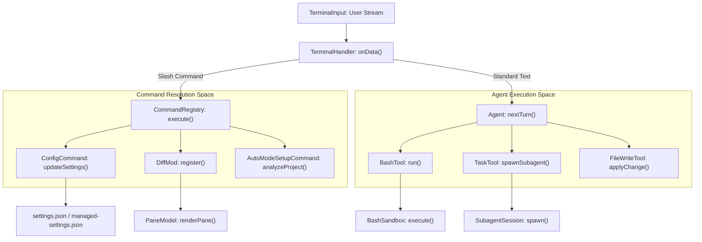
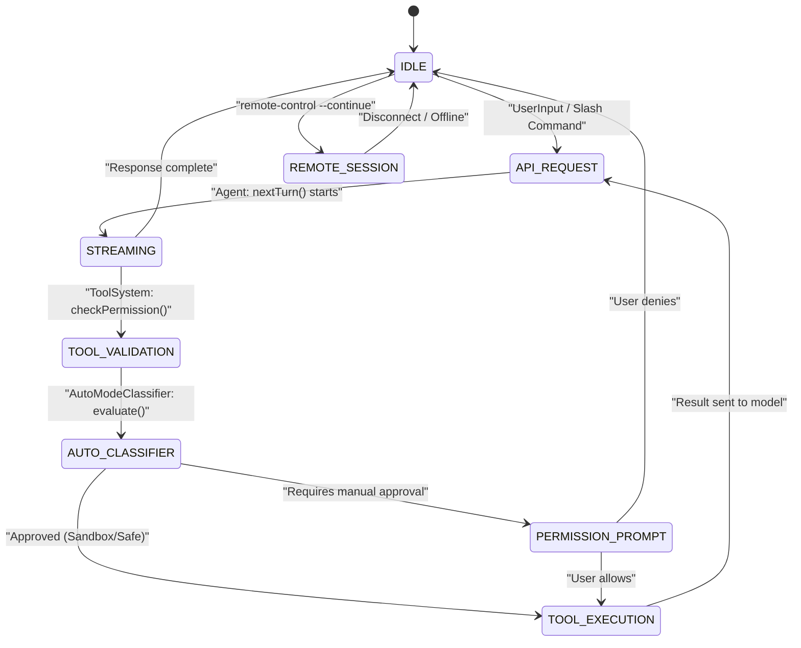

<!-- source: DeepWiki mcp.deepwiki.com · repo anthropics/claude-code · page 2.3 CLI Commands & Interaction Modes · fetched 2026-10-26 -->

# CLI Commands & Interaction Modes

Relevant source files

The following files were used as context for generating this wiki page:

- [.devcontainer/Dockerfile](.devcontainer/Dockerfile)
- [.devcontainer/devcontainer.json](.devcontainer/devcontainer.json)
- [.devcontainer/init-firewall.sh](.devcontainer/init-firewall.sh)
- [.gitattributes](.gitattributes)
- [.vscode/extensions.json](.vscode/extensions.json)
- [CHANGELOG.md](CHANGELOG.md)
- [LICENSE.md](LICENSE.md)
- [README.md](README.md)
- [SECURITY.md](SECURITY.md)
- [demo.gif](demo.gif)
- [feed.xml](feed.xml)

## Purpose & Scope

This document provides a technical reference for the command-line interface (CLI) of Claude Code, detailing interaction patterns, slash commands, execution modes, and underlying system routines. It covers the mechanisms by which users provide instructions—ranging from natural language prompts to structured slash commands—and how the system resolves these into tool calls, configuration changes, or session state transitions.

Sources: [CHANGELOG.md:3-9](), [README.md:7-46]()

---

## Command Invocation Mechanisms

Claude Code operates through primary input vectors: Slash Commands, CLI Startup Flags, Keyboard Shortcuts, and Remote Control integrations.

### Slash Commands

Slash commands are internal CLI directives processed by the terminal input handler before being dispatched to the language model or execution engine. They allow users to control the agent's environment, manage sessions, and interact with plugins.

- **Built-in commands**: Hardcoded core CLI directives (e.g., `/model`, `/compact`, `/config`, `/diff`, `/rate-limit-options`) [CHANGELOG.md:3-9]().
- **Specialized Workflows**: Advanced configuration scripts like `/auto-mode-setup`, `/claude-api managed-agents-secure`, and `/effort` level controls [CHANGELOG.md:8-9](), [CHANGELOG.md:37-37]().
- **Plugin commands**: Dynamically registered by installed plugins or mods via registration hooks [CHANGELOG.md:39-40]().
- **Issue Reporting**: Commands like `/bug` for direct telemetry and issue reporting within the terminal [README.md:52-54]().

### CLI Flags (Startup)

Startup flags modify the behavior and constraints of the `claude` process at launch.

| Flag | Description | Technical Detail |
|------|-------------|------------------|
| `--resume` | Resume session | Restores previous conversation state and handles interrupted or malformed tool calls [CHANGELOG.md:11-19]() |
| `--continue` | Resume recent | Resumes the most recent remote control or terminal session [CHANGELOG.md:5-8]() |
| `--tools` | Tool whitelist/blacklist | Controls available runtime tools at startup [CHANGELOG.md:33-33]() |
| `--debug` | Debug mode | Enables verbose internal logging for diagnostic evaluation [CHANGELOG.md:33-33]() |
| `--disable-slash-commands` | Security lockdown | Disables dynamic command parsing and execution vectors [CHANGELOG.md:33-33]() |

Sources: [CHANGELOG.md:3-33](), [README.md:52-54]()

---

## Core Built-In & Plugin Commands

### Session & Environment Management

| Command | Description | Implementation Details |
|---------|-------------|------------------------|
| `/resume` | Resume session | Restores session state; fixed to prevent history leaks between connected sessions [CHANGELOG.md:11-19]() |
| `/compact` | Manage context | Triggers context compaction to strip excessive payload. Includes secondary compaction fallback if the first pass exceeds token thresholds [CHANGELOG.md:16-16]() |
| `/mcp` | MCP server management | Supports subcommands like `/mcp reconnect all` to retry failed or unauthenticated MCP server connections simultaneously [CHANGELOG.md:10-21]() |
| `/diff` | Uncommitted changes | Opens the session diff pane, rendering file hunks and tracking uncommitted workspace modifications [README.md:7-8]() |
| `/auto-mode-setup` | Guided setup | Reads project files and recent sessions to configure auto-mode parameters for your specific environment [CHANGELOG.md:8-8]() |
| `/effort` | Effort level | Adjusts reasoning depth dynamically (e.g., `/effort status`, `/effort ultracode`) [CHANGELOG.md:37-37]() |
| `/loop` | Automated polling | Schedules recurring task wakeups with built-in prompt caching safeguards [CHANGELOG.md:41-41]() |

Sources: [CHANGELOG.md:8-41](), [README.md:7-8]()

---

## Command Architecture & Data Flow

This diagram bridges the Natural Language/Terminal Input Space to the Code Entity Space, showing how input streams route through terminal handlers and command registries to specific core execution modules.

Sources: [CHANGELOG.md:3-46](), [README.md:7-46]()

---

## Interaction Modes

### 1. Interactive TUI Mode
The primary terminal interface featuring a status line, busy spinners, and real-time streaming output.
- **Visual Feedback**: Real-time status indicators display token spend limits and rate-limit details (e.g., `"$271.40 / $500.00 spent this month"`) [CHANGELOG.md:7-7]().
- **Selection Menus**: Enhanced picker dialogs with responsive tab bars and navigation logic [CHANGELOG.md:30-31]().

### 2. Auto Mode
Claude executes permitted commands automatically based on user configuration and tool policies.
- **Prompt Safeguards**: Includes interactive permission checks (such as `"Yes, but ask again next time"` prompts for reads outside working directories) [CHANGELOG.md:6-6]().
- **Policy Enforcement**: Pre-approves tools only from verified Anthropic sources or explicitly managed settings [CHANGELOG.md:39-39]().

### 3. Remote Control & Integration Runners
Allows Claude Code to be driven from remote environments, IDE extensions, or automated CI/CD pipelines.
- **Input Streams**: Processes structured JSON streams and remote control event hooks [CHANGELOG.md:23-25]().

Sources: [CHANGELOG.md:6-46](), [README.md:7-8]()

---

## Interaction State Machine

This diagram maps operational session states to their underlying code execution components, tracing lifecycle transitions from idle input to model response and tool adjudication.

Sources: [CHANGELOG.md:6-46](), [README.md:7-46]()

---

## Advanced Interaction Patterns

### Context Compaction & Recovery
When conversations exceed token request limits, Claude triggers automated context compaction.
- **Secondary Compaction**: If a compacted request remains too long, Claude Code initiates a secondary compaction pass, aggressively reducing recent conversation history to fit context limits [CHANGELOG.md:16-16]().
- **Error Resilience**: Damaged response streams or parsing errors trigger automatic retries rather than writing raw syntax errors into the session transcript [CHANGELOG.md:14-15]().

Sources: [CHANGELOG.md:14-16](), [README.md:7-8]()

---

