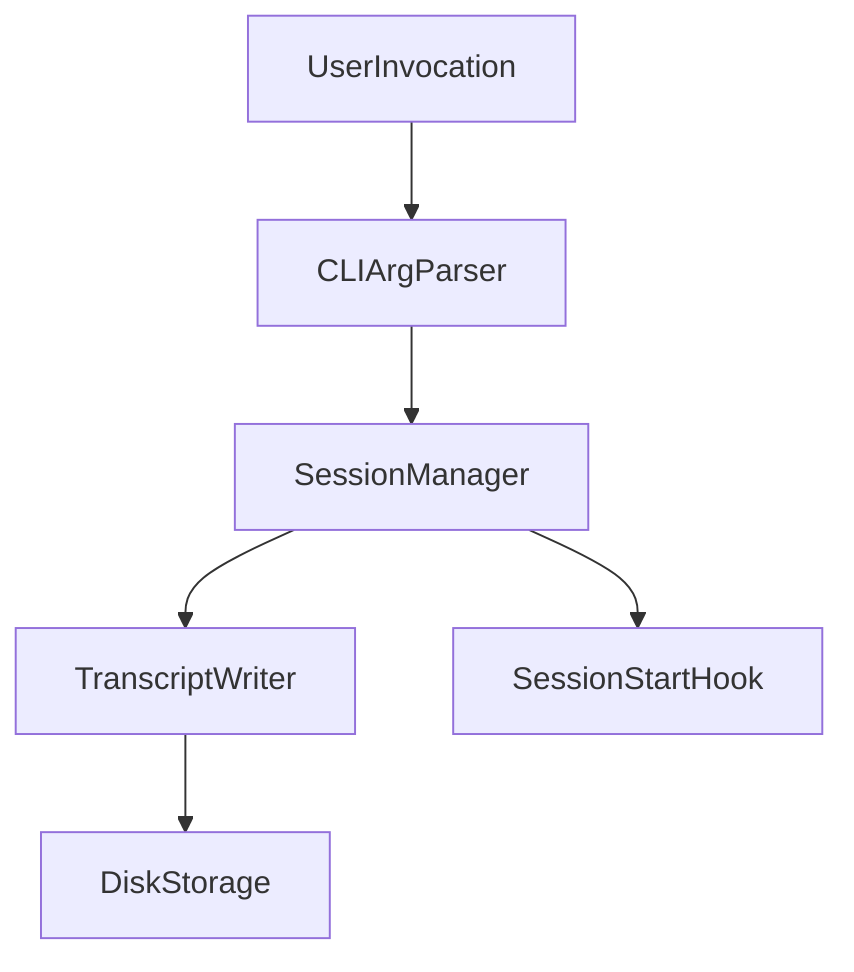
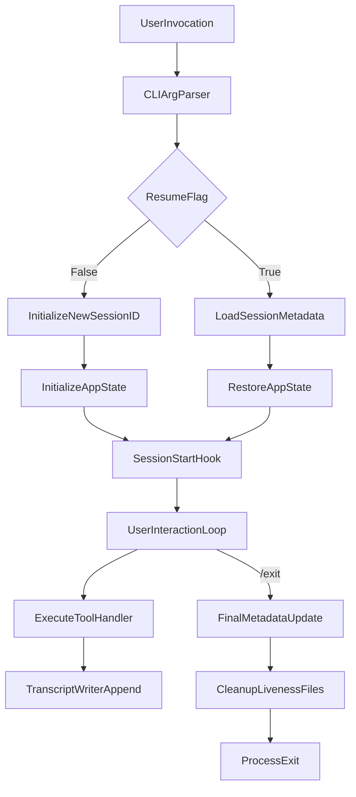
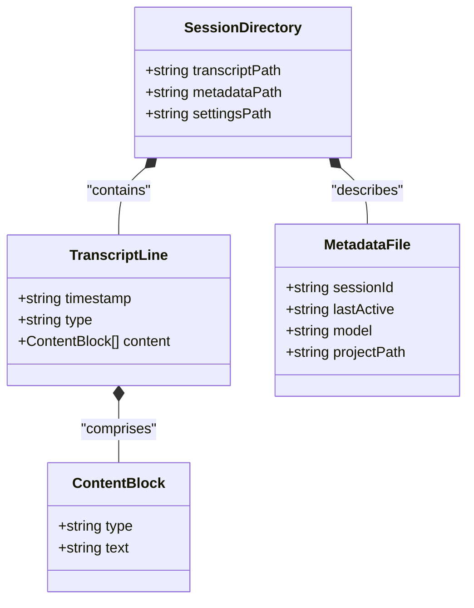

<!-- source: DeepWiki mcp.deepwiki.com · repo anthropics/claude-code · page 2.4 Session Management · fetched 2026-10-26 -->

# Session Management

Relevant source files

The following files were used as context for generating this wiki page:

- [.devcontainer/Dockerfile](.devcontainer/Dockerfile)
- [.devcontainer/devcontainer.json](.devcontainer/devcontainer.json)
- [.devcontainer/init-firewall.sh](.devcontainer/init-firewall.sh)
- [.gitattributes](.gitattributes)
- [.vscode/extensions.json](.vscode/extensions.json)
- [CHANGELOG.md](CHANGELOG.md)
- [LICENSE.md](LICENSE.md)
- [README.md](README.md)
- [SECURITY.md](SECURITY.md)
- [demo.gif](demo.gif)
- [feed.xml](feed.xml)
- [mods/diff/tests/fixtures/edited-transcript.ts](mods/diff/tests/fixtures/edited-transcript.ts)
- [mods/diff/tests/fixtures/resume.ts](mods/diff/tests/fixtures/resume.ts)
- [mods/diff/tests/fixtures/usage-at.ts](mods/diff/tests/fixtures/usage-at.ts)

## Purpose and Scope
This page documents the session management subsystem in Claude Code, which controls conversation lifecycles, state persistence, transcript storage, and resumption mechanisms (`/resume`, `--continue`). It covers how conversation history and runtime environment contexts are preserved across terminal restarts, crashes, and asynchronous updates.

Sources: [CHANGELOG.md:21-25]()

---

## 1. Overview & Architecture

Session management ensures continuity between agentic coding interactions by maintaining structured logs of user prompts, assistant turns, tool executions, and metadata. Sessions operate locally within user configuration directories or via remote connectors.

Key architectural responsibilities include:
- **Lifecycle Management**: Tracking session initialization, active loops, backgrounding, and graceful teardown [CHANGELOG.md:21-21]().
- **Transcript Storage**: Appending conversation turns incrementally to prevent data loss during network interruptions or unexpected terminations [CHANGELOG.md:21-21]().
- **State Resumption**: Restoring model parameters, working directories, and git states via CLI flags (`--resume`, `--continue`) or the interactive TUI (`/resume`) [CHANGELOG.md:5-5]().

**Diagram: Session Architecture and Code Entity Mapping**

Sources: [CHANGELOG.md:5-5](), [CHANGELOG.md:21-21](), [.devcontainer/devcontainer.json:46-50]()

---

## 2. Session Lifecycle & State Transitions

Sessions transition through discrete execution phases, from CLI argument parsing and environment initialization to active user interaction and final metadata persistence.

### Lifecycle Flow

**Diagram: Session Lifecycle State Machine**

Sources: [CHANGELOG.md:5-5](), [CHANGELOG.md:20-21]()

### Lifecycle Safeguards & Handling
- **Crash Recovery**: Startup routines handle exceptions caused by rendering errors in narrow terminal windows, allowing `--resume` to successfully recover corrupted or interrupted sessions [CHANGELOG.md:22-22]().
- **Liveness Tracking**: Short-lived commands utilize liveness tracking files to prevent stale background locks [CHANGELOG.md:20-20]().
- **Remote & Cloud State**: Disconnected remote control sessions are marked as offline, while active cloud sessions are tracked in agent dispatch views [CHANGELOG.md:9-9]().

Sources: [CHANGELOG.md:9-9](), [CHANGELOG.md:20-22]()

---

## 3. Transcript Storage and Persistence

Claude Code records conversation histories using file-based persistence inside designated configuration directories (e.g., `~/.claude`) [.devcontainer/devcontainer.json:46-50]().

### Storage Architecture

**Diagram: Transcript Storage Data Structures**

Sources: [.devcontainer/devcontainer.json:46-50]()

### Persistence Rules
- **Incremental Appends**: Transcripts use JSON Lines format to support safe, append-only writes after every tool execution or assistant turn [.devcontainer/devcontainer.json:46-50]().
- **Compaction Triggers**: When request payloads approach API limits, the system strips redundant blocks or triggers compaction algorithms to keep context sizes manageable [CHANGELOG.md:24-24]().
- **Error Boundaries**: Malformed historical messages (such as plain string assistant entries or corrupted tool structures) are intercepted and sanitized during load operations to prevent unrecoverable interface crashes [CHANGELOG.md:25-25]().

Sources: [CHANGELOG.md:24-25](), [.devcontainer/devcontainer.json:46-50]()

---

## 4. Resumption Mechanics (`/resume`)

Resuming a session reloads both the conversational context and the environment settings present when the session was last active [CHANGELOG.md:5-5]().

### Resumption Options

| Command / Flag | Target Behavior |
|----------------|-----------------|
| `claude --resume` | Resumes the most recent local session history [CHANGELOG.md:5-5](). |
| `claude --continue` | Resumes the most recent Remote Control session [CHANGELOG.md:5-5](). |
| `/resume` | Opens the interactive terminal UI selector for historical sessions [CHANGELOG.md:5-5](). |
| `/tui` | Re-engages the active terminal interface view [CHANGELOG.md:5-5](). |

### Model and State Consistency
- **Model Persistence**: If the active model was modified via `/model` during a session, resumption preserves that model choice rather than reverting to the default startup configuration [CHANGELOG.md:42-42]().
- **Remote Security**: Resuming remote control sessions includes checks to prevent leaking sensitive session parameters across active connections [CHANGELOG.md:44-44]().

Sources: [CHANGELOG.md:5-5](), [CHANGELOG.md:42-42](), [CHANGELOG.md:44-44]()

---

## 5. Integration with Hooks and External Environments

Session management interfaces directly with the hook execution system and external runners to coordinate startup tasks and environment configurations [CHANGELOG.md:9-9]().

- **SessionStart Hooks**: Executed at the start of every session lifecycle to inject custom project instructions or initialize output-style plugins [README.md:1-72]().
- **Headless & SDK Sessions**: Programmatic invocations (`claude -p`) and SDK sessions properly record usage metrics and persist exit statuses upon completion [CHANGELOG.md:9-9]().

Sources: [CHANGELOG.md:9-9](), [README.md:1-72]()

---

