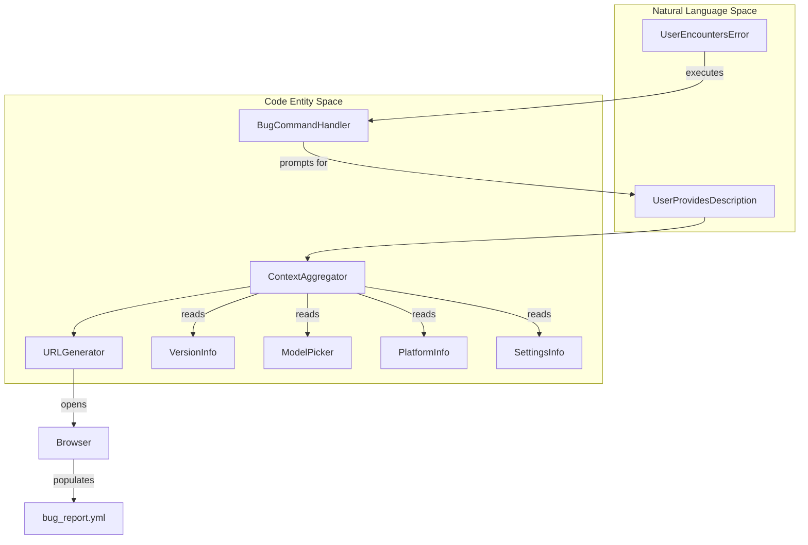
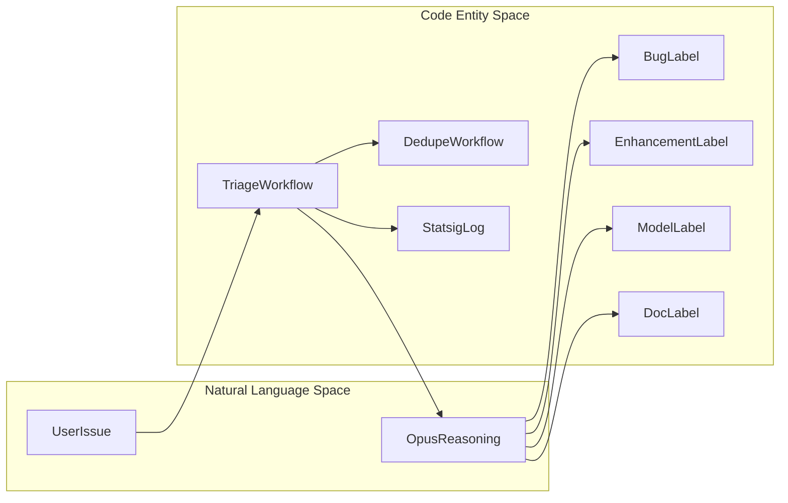

<!-- source: DeepWiki mcp.deepwiki.com · repo anthropics/claude-code · page 2.5 Providing Feedback & Reporting Issues · fetched 2026-10-26 -->

# Providing Feedback & Reporting Issues

Relevant source files

The following files were used as context for generating this wiki page:

- [.github/ISSUE_TEMPLATE/bug_report.yml](.github/ISSUE_TEMPLATE/bug_report.yml)
- [.github/ISSUE_TEMPLATE/config.yml](.github/ISSUE_TEMPLATE/config.yml)
- [.github/ISSUE_TEMPLATE/documentation.yml](.github/ISSUE_TEMPLATE/documentation.yml)
- [.github/ISSUE_TEMPLATE/feature_request.yml](.github/ISSUE_TEMPLATE/feature_request.yml)
- [.github/ISSUE_TEMPLATE/github_connection.yml](.github/ISSUE_TEMPLATE/github_connection.yml)
- [.github/ISSUE_TEMPLATE/model_behavior.yml](.github/ISSUE_TEMPLATE/model_behavior.yml)

## Purpose and Scope

This document details the technical implementation and user workflows for providing feedback, reporting bugs, and requesting features in Claude Code. It covers the `/bug` command mechanics, the structural schema of GitHub issue templates, and the data pipeline bridging user input to internal automation and issue triage systems.

For downstream processing of submitted reports, see **AI-Powered Issue Triage** (6.1) and **Issue Deduplication System** (6.2).

Sources: [.github/ISSUE_TEMPLATE/config.yml:1-14](), [.github/ISSUE_TEMPLATE/bug_report.yml:1-28]()

---

## Feedback Channels Overview

Claude Code maps specific user feedback channels to structured GitHub issue templates and community platforms, configured centrally via the issue settings [.github/ISSUE_TEMPLATE/config.yml:1-14]().

| Channel | Target Mechanism | Code Entity / Reference |
| :--- | :--- | :--- |
| **`/bug` command** | CLI diagnostic collection & URL generation | Built-in CLI Slash Command |
| **Bug Report** | Detailed regression analysis | [.github/ISSUE_TEMPLATE/bug_report.yml:1-188]() |
| **Feature Request** | Workflow enhancements & tooling | [.github/ISSUE_TEMPLATE/feature_request.yml:1-131]() |
| **Model Behavior** | LLM constraint violations & subagent traces | [.github/ISSUE_TEMPLATE/model_behavior.yml:1-208]() |
| **Documentation** | Guide improvements & missing references | [.github/ISSUE_TEMPLATE/documentation.yml:1-116]() |
| **GitHub Connection** | Connector troubleshooting & error capture | [.github/ISSUE_TEMPLATE/github_connection.yml:1-37]() |
| **Discord Community** | Real-time user support | [.github/ISSUE_TEMPLATE/config.yml:3-5]() |

Sources: [.github/ISSUE_TEMPLATE/config.yml:1-14](), [.github/ISSUE_TEMPLATE/bug_report.yml:1-188](), [.github/ISSUE_TEMPLATE/github_connection.yml:1-37]()

---

## Reporting via the `/bug` Command

The `/bug` command is the primary entry point for capturing runtime context during an active session. In integrated environments such as VS Code, it bridges terminal error states with graphical feedback dialogs.

### Implementation Flow

**Diagram: `/bug` Command Data Flow**

Sources: [.github/ISSUE_TEMPLATE/bug_report.yml:1-188]()

### Captured Context and Data Collection
The command automatically injects runtime telemetry into the generated template fields:
- **Claude Code Version**: Extracted via `claude --version` [.github/ISSUE_TEMPLATE/bug_report.yml:120-127]().
- **Platform**: Identifies the inference backend (Anthropic API, AWS Bedrock, Google Vertex AI) [.github/ISSUE_TEMPLATE/bug_report.yml:128-140]().
- **Environment & Terminal**: Detects host OS and active terminal emulator (iTerm2, Warp, Cursor, Windows Terminal, etc.) [.github/ISSUE_TEMPLATE/bug_report.yml:141-175]().
- **Model State**: Records active model metadata checked via `/model` [.github/ISSUE_TEMPLATE/bug_report.yml:85-97]().

Sources: [.github/ISSUE_TEMPLATE/bug_report.yml:85-175]()

---

## GitHub Issue Templates

Claude Code mandates strict YAML schemas for issue reporting to feed downstream automation pipelines.

### 1. Bug Reports (`bug_report.yml`)
Enforces preflight checks and structured regression inputs:
- **Preflight Checklist**: Validates latest version usage and uniqueness [.github/ISSUE_TEMPLATE/bug_report.yml:17-28]().
- **Reproduction**: Step-by-step minimal reproduction blocks [.github/ISSUE_TEMPLATE/bug_report.yml:64-84]().
- **Regression Metadata**: Identifies whether the issue exists in prior versions (`working_version`) [.github/ISSUE_TEMPLATE/bug_report.yml:98-118]().

### 2. Model Behavior (`model_behavior.yml`)
Captures LLM logic errors, scope escapes, and permission bypasses:
- **Behavior Categorization**: Classifies issues such as unauthorized file modification or instruction ignore events [.github/ISSUE_TEMPLATE/model_behavior.yml:28-45]().
- **Permission Mode Tracking**: Records whether `Accept Edits` was active during execution [.github/ISSUE_TEMPLATE/model_behavior.yml:105-116]().
- **Conversation Logs**: Preserves transcript segments containing assistant explanations [.github/ISSUE_TEMPLATE/model_behavior.yml:157-169]().

### 3. Feature Requests (`feature_request.yml`)
Focuses on workflow impact rather than prescription:
- **Problem Statement**: Details the underlying workflow obstacle [.github/ISSUE_TEMPLATE/feature_request.yml:25-39]().
- **Categorization**: Tags requests to specific subsystems (CLI flags, TUI, MCP integration, Performance) [.github/ISSUE_TEMPLATE/feature_request.yml:86-104]().

### 4. Documentation Issues (`documentation.yml`)
Tracks guide accuracy and missing code samples:
- **Doc Location & Section**: Pinpoints exact URLs or guide headings [.github/ISSUE_TEMPLATE/documentation.yml:30-47]().
- **Impact Assessment**: Classifies severity from low inconvenience to feature blockage [.github/ISSUE_TEMPLATE/documentation.yml:95-106]().

### 5. GitHub Connection (`github_connection.yml`)
Captures connector diagnostics on claude.ai:
- **Screenshots & Goal**: Gathers visual error states and intended workflows [.github/ISSUE_TEMPLATE/github_connection.yml:11-29]().
- **Automated Diagnostics**: Injects platform connection logs [.github/ISSUE_TEMPLATE/github_connection.yml:31-37]().

Sources: [.github/ISSUE_TEMPLATE/bug_report.yml:1-188](), [.github/ISSUE_TEMPLATE/model_behavior.yml:1-208](), [.github/ISSUE_TEMPLATE/feature_request.yml:1-131](), [.github/ISSUE_TEMPLATE/documentation.yml:1-116](), [.github/ISSUE_TEMPLATE/github_connection.yml:1-37]()

---

## Automated Triage and Deduplication

Submitted templates immediately enter automated GitHub Actions pipelines for classification and tracking.

**Diagram: Automated Issue Lifecycle**

Sources: [.github/ISSUE_TEMPLATE/bug_report.yml:4-5](), [.github/ISSUE_TEMPLATE/feature_request.yml:4-5](), [.github/ISSUE_TEMPLATE/model_behavior.yml:4-5](), [.github/ISSUE_TEMPLATE/documentation.yml:4-5]()

### Key Automation Components
- **Label Assignment**: Workflows apply taxonomy labels (`bug`, `enhancement`, `model`, `documentation`) based on template provenance.
- **Deduplication Engine**: Background workflows query existing issue databases to link duplicate reports.
- **Analytics & Telemetry**: Event metadata is pushed through Statsig logging integrations to track recurring stability issues.

Sources: [.github/ISSUE_TEMPLATE/bug_report.yml:4-5]()

---

