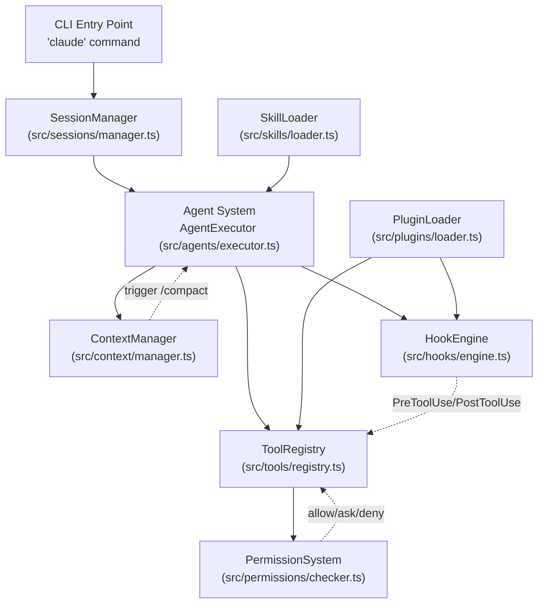
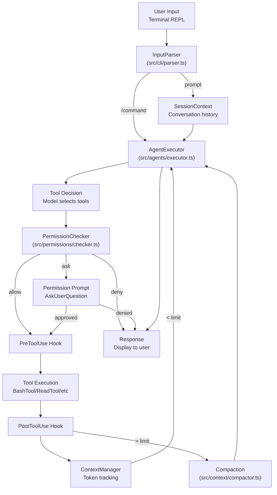

<!-- source: DeepWiki mcp.deepwiki.com · repo anthropics/claude-code · page 3 Core Systems · fetched 2026-10-26 -->

# Core Systems

Relevant source files

The following files were used as context for generating this wiki page:

- [.devcontainer/Dockerfile](.devcontainer/Dockerfile)
- [.devcontainer/devcontainer.json](.devcontainer/devcontainer.json)
- [.devcontainer/init-firewall.sh](.devcontainer/init-firewall.sh)
- [.gitattributes](.gitattributes)
- [.vscode/extensions.json](.vscode/extensions.json)
- [CHANGELOG.md](CHANGELOG.md)
- [LICENSE.md](LICENSE.md)
- [README.md](README.md)
- [SECURITY.md](SECURITY.md)
- [demo.gif](demo.gif)
- [feed.xml](feed.xml)
- [mods/README.md](mods/README.md)
- [mods/types/claude-code.d.ts](mods/types/claude-code.d.ts)

This page provides technical documentation of Claude Code's internal architecture and the subsystems that power its functionality. It covers the fundamental building blocks that enable agentic coding, multi-agent orchestration, permission management, and plugin extensibility.

For user-facing documentation on configuration and usage, see [Configuration Management](#2.2) and [CLI Commands & Interaction Modes](#2.3). For details on specific subsystems, refer to the child pages listed in each section below.

## Architecture Overview

Claude Code's architecture is organized around several core subsystems that work together to provide an agentic coding experience. The system follows a layered approach where the CLI interface routes user input through session management to the agent system, which orchestrates tool execution under permission controls while managing context windows and triggering lifecycle hooks.

### System Architecture Diagram
The following diagram bridges the "Natural Language Space" of user intent to the "Code Entity Space" by showing how core components interact.

Sources: [CHANGELOG.md:1-57](), [.devcontainer/init-firewall.sh:1-136]()

### Core System Responsibilities

| System | Primary Responsibility | Key Configuration |
|--------|----------------------|-------------------|
| Agent System | Execute user requests, spawn subagents, manage task lifecycle | `settings.json` `agent` field |
| Tool System | Provide capabilities (bash, file ops, MCP) | `settings.json` `disallowedTools` |
| Permission System | Control tool execution with allow/ask/deny rules | `settings.json` permission rules |
| Context Manager | Track token usage, trigger auto-compaction | Context window limits |
| Hook System | Inject custom behavior at lifecycle events | `.claude/hooks/*.py`, plugin hooks |
| Plugin System | Discover and load extensions | `marketplace.json`, `plugin.json` |
| Skill System | Load custom slash commands | `.claude/skills/` |
| MCP Integration | Connect to external tool servers | `.mcp.json` |

Sources: [CHANGELOG.md:1-57]()

## Request Processing Flow

This diagram shows how a user message flows through Claude Code's core systems, from input to execution. It maps natural language concepts to the actual execution path.

Sources: [CHANGELOG.md:1-57](), [.devcontainer/init-firewall.sh:1-136]()

## System Component Details

### 3.1. Agent System & Subagents
The agent system orchestrates all AI-powered operations, including spawning subagents for parallel work and managing background tasks.

**Key Features:**
- **Subagents:** Managed through the `Task` tool and `$.agent.spawn`. Subagents can be staggered to optimize prompt caching via `CLAUDE_CODE_WORKFLOW_PREFIX_STAGGER_MS` [CHANGELOG.md:1-57]().
- **Remote Control:** Supports `claude remote-control --continue` for resuming sessions and marks disconnected sessions as `offline` in `ListAgents` [CHANGELOG.md:1-57]().
- **Cloud Sessions:** Distinguishes between local and cloud-hosted sessions in agent listings [CHANGELOG.md:1-57]().

For detailed documentation, see [Agent System & Subagents](#3.1).

Sources: [CHANGELOG.md:1-57]()

### 3.2. Tool System & Permissions
Tools provide Claude with capabilities to interact with the environment. The system includes built-in tools and supports external tools via MCP, governed by strict permission rules (`ask`/`allow`/`deny`).

**Built-in Tools:**
- **Bash:** Hardened to handle network domain lists and execution checks.
- **File Operations:** The `Write` tool allows models to overwrite files subject to permission and validation rules.

For detailed documentation, see [Tool System & Permissions](#3.2).

Sources: [CHANGELOG.md:1-57]()

### 3.3. Context Window & Compaction
The context manager tracks token usage and triggers automatic compaction and payload stripping when limits are approached.

**Context Optimization:**
- **Compaction Retries:** Manages conversation length constraints and handles payload trimming gracefully.
- **Progress Tracking:** Provides stall hints and retry counts during compaction cycles.

For detailed documentation, see [Context Window & Compaction](#3.3).

Sources: [CHANGELOG.md:1-57]()

### 3.4. Hook System
Hooks provide lifecycle event interception points (`SessionStart`, `PreToolUse`, `PostToolUse`, etc.) using the `classic.*` namespace and handler implementations.

**Key Features:**
- **Server-Supplied Hooks:** Supports server-supplied hooks in runner sessions [CHANGELOG.md:1-57]().
- **Execution Lifecycle:** Used by extensions and reference validators to modify agent behavior based on session events.

For detailed documentation, see [Hook System](#3.4).

Sources: [CHANGELOG.md:1-57]()

### 3.5. MCP Server Integration
Claude Code supports the Model Context Protocol (MCP) to connect to external tool servers, complete with OAuth, server discovery, tool registration, and `$.mcp.call`.

**Features:**
- **OAuth & Discovery:** Handles secure redirect URIs and dynamic tool registration from server endpoints.

For detailed documentation, see [MCP Server Integration](#3.5).

Sources: [CHANGELOG.md:1-57]()

### 3.6. Plugin System
The plugin system enables extensibility through packages containing commands, agents, and hooks across user, project, and marketplace scopes.

**Plugin Lifecycle:**
- **Marketplace Sources:** Supports dynamic loading and secure verification of plugin manifests.

For detailed documentation, see [Plugin System](#3.6).

Sources: [CHANGELOG.md:1-57]()

### 3.7. Skill System
Skills provide custom slash commands and guidance for the agent via `SKILL.md` format files, supporting skill loading from plugins and `allowed-tools` declarations.

**Skill Mechanics:**
- **Security:** Hardened to prevent command shadowing and unauthorized execution.

For detailed documentation, see [Skill System](#3.7).

Sources: [CHANGELOG.md:1-57]()

### 3.8. Sandbox Environment
The sandbox provides isolated execution for bash commands, network restrictions, and rule enforcement for excluded commands.

**Configuration:**
- **Network Isolation:** Uses `iptables` and `ipset` rules via `.devcontainer/init-firewall.sh` to restrict outbound network access to allowed domains [root:.devcontainer/init-firewall.sh:1-137]().

For detailed documentation, see [Sandbox Environment](#3.8).

Sources: [.devcontainer/init-firewall.sh:1-136]()

### 3.9. UI/UX & Terminal Integration
Claude Code provides a rich interactive experience across terminal, desktop, mobile, and VS Code surfaces.

**Features:**
- **Terminal UI & Status Line:** Renders dynamic status lines, file suggestions, and progress indicators.
- **Accessibility & Modes:** Includes screen reader support, Vim modes, and VS Code extension integration.

For detailed documentation, see [UI/UX & Terminal Integration](#3.9).

Sources: [CHANGELOG.md:1-57]()

---

