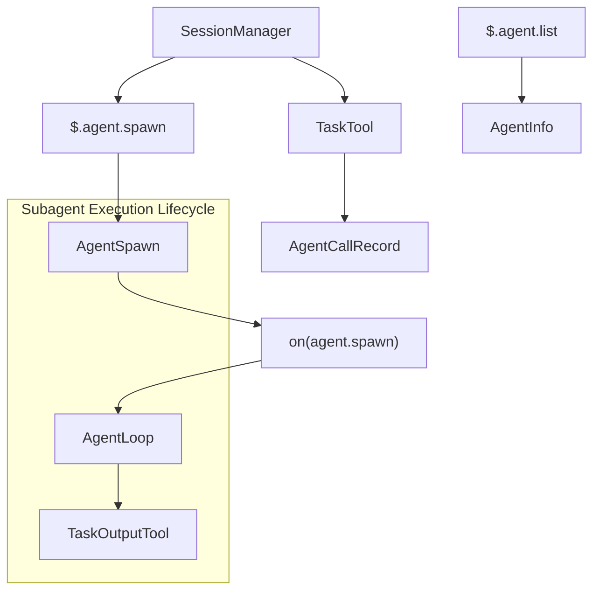
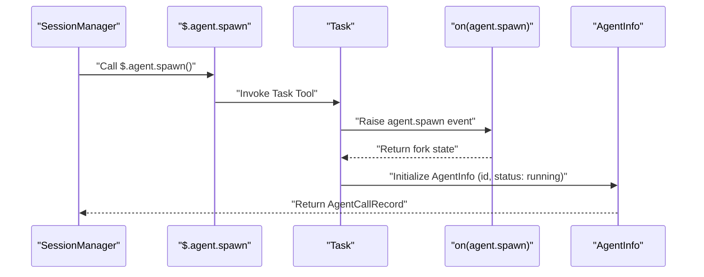

<!-- source: DeepWiki mcp.deepwiki.com · repo anthropics/claude-code · page 3.1 Agent System & Subagents · fetched 2026-10-26 -->

# Agent System & Subagents

Relevant source files

The following files were used as context for generating this wiki page:

- [mods/README.md](mods/README.md)
- [mods/agents-md/README.md](mods/agents-md/README.md)
- [mods/agents-md/hooks/hooks.json](mods/agents-md/hooks/hooks.json)
- [mods/agents-md/hooks/index.ts](mods/agents-md/hooks/index.ts)
- [mods/agents-md/hooks/register.ts](mods/agents-md/hooks/register.ts)
- [mods/agents-md/hooks/switches/index.ts](mods/agents-md/hooks/switches/index.ts)
- [mods/agents-md/hooks/switches/is-switched-on.ts](mods/agents-md/hooks/switches/is-switched-on.ts)
- [mods/agents-md/tests/fixtures/started-of.ts](mods/agents-md/tests/fixtures/started-of.ts)
- [mods/agents-md/tests/fixtures/types/started/started.ts](mods/agents-md/tests/fixtures/types/started/started.ts)
- [mods/agents-md/tests/register.test.ts](mods/agents-md/tests/register.test.ts)
- [mods/diff/hooks/git/argv/diff-leading-args.ts](mods/diff/hooks/git/argv/diff-leading-args.ts)
- [mods/diff/tests/git/fetch-diff.test.ts](mods/diff/tests/git/fetch-diff.test.ts)
- [mods/types/claude-code.d.ts](mods/types/claude-code.d.ts)

This document details Claude Code's hierarchical agent architecture, focusing on the main agent execution model, subagent spawning mechanisms via the `Task` tool and `$.agent.spawn`, worktree isolation, agent teams, and context management.

## Purpose and Scope

The agent system implements hierarchical task decomposition where a main agent or plugin can spawn independent subagent instances to execute subtasks in parallel, either in the shared working directory or within isolated git worktrees. Each subagent maintains its own independent context window and model configuration, preventing token limit exhaustion in the main thread and supporting complex multi-step orchestration.

Key components covered:
- **Main Agent Execution**: Managed via tool dispatch loops and event registration [mods/types/claude-code.d.ts:93-149]().
- **Subagent Spawning**: Instantiation through the built-in `Task` tool or programmatically via `$.agent.spawn` [mods/types/claude-code.d.ts:93-111]().
- **Agent Metadata & Tracking**: Data structures such as `AgentInfo` and `AgentCallRecord` returned by `$.agent.list()` and tool execution [mods/types/claude-code.d.ts:93-149]().
- **Worktree Isolation**: Temporary git worktree isolation for safe parallel edits.
- **Agent Teams**: Multi-agent collaborative workflows and fork propagation [mods/agents-md/hooks/register.ts:169-179]().

Sources: [mods/types/claude-code.d.ts:93-149](), [mods/agents-md/hooks/register.ts:169-179](), [mods/README.md:1-117]()

## Architecture Overview

### Code Entity Architecture

The agent system bridges high-level orchestration concepts with precise code entities within the engine. The `$.agent` namespace provides programmatic control over background subagents, returning structures like `AgentInfo` and `AgentCallRecord`. Hooks can intercept agent lifecycle events such as `agent.spawn` with fork configurations [mods/agents-md/hooks/register.ts:169-179]().

**Diagram: Code Entity Architecture for Agent System**

Sources: [mods/types/claude-code.d.ts:93-149](), [mods/agents-md/hooks/register.ts:169-179](), [mods/README.md:1-117]()

### Execution Modes and State

Subagents can operate in foreground blocking mode or background asynchronous mode (`background: true`). When spawned, each subagent receives a unique `agentId` and an optional `parentId` if spawned from another subagent [mods/types/claude-code.d.ts:117-148]().

| Mode | Working Directory | Lifecycle Behavior |
|------|------------------|-------------------|
| Default | Shared working directory | Parallel execution, reports status via `TaskUpdate` |
| `isolation: worktree` | Temporary git worktree (`.git/worktrees/`) | Isolated file system changes, cleaned up post-execution |
| `background: true` | Inherited or worktree | Non-blocking background loop, persists across restarts |

Sources: [mods/types/claude-code.d.ts:93-149](), [mods/README.md:1-117]()

## Subagent Spawning: Task Tool & $.agent.spawn

### Spawning Data Flow

Subagents can be invoked via model tool use (`Task`) or programmatically through plugin hooks using `$.agent.spawn`. When called, the engine provisions a new subagent loop, assigns a unique `agentId`, and records its state in `AgentInfo` [mods/types/claude-code.d.ts:117-136](). Hooks listening to `agent.spawn` (e.g., with `{ fork: true }`) can propagate parent context or track lineage [mods/agents-md/hooks/register.ts:169-179]().

**Diagram: Subagent Spawning and Data Flow**

Sources: [mods/types/claude-code.d.ts:93-149](), [mods/agents-md/hooks/register.ts:169-179]()

### Type Contracts for Agents

The runtime type definitions establish the contract for agent interaction. `AgentCallRecord` captures the result of an asynchronous plugin agent invocation, while `AgentInfo` tracks ongoing and completed agent loops [mods/types/claude-code.d.ts:93-149]().

- **`AgentCallRecord`**: Contains `agentId` (matching `$.agent.list()`) and `resolvedModel` [mods/types/claude-code.d.ts:102-111]().
- **`AgentInfo`**: Contains `id`, `description`, `type` (e.g. `general-purpose`, `Explore`, or `teammate`), `status` (`running`, `completed`, `failed`, `killed`), `parentId`, and `spawnedBy` [mods/types/claude-code.d.ts:117-148]().

Sources: [mods/types/claude-code.d.ts:93-149]()

## Worktree Isolation

When subagents execute with git worktree isolation enabled, the engine triggers worktree creation hooks to provision an isolated workspace under `.git/worktrees/`. This ensures file modifications do not conflict with the main repository working directory.

- **Lifecycle Hooks**: `WorktreeCreate` and `WorktreeRemove` govern the provisioning and cleanup of temporary directories.
- **Safety Checks**: Validates repository state before removing worktree directories.
- **Persistence**: Worktree background session metadata is maintained across daemon cycles, with automatic cleanup sweeps for stale worktrees.

Sources: [mods/types/claude-code.d.ts:93-149](), [mods/README.md:1-117]()

## Agent Teams & Multi-Agent Workflows

Agent teams leverage the hierarchical spawning model to coordinate specialized subagent roles across distinct phases of execution (e.g., exploration, architecture design, and code review).

- **Specialized Roles**: Subagents utilize restricted toolsets and specialized system instructions defined in `.claude/agents/*.md` files or plugin manifests.
- **Tracing & Telemetry**: API requests dispatched from subagents inject tracking headers (`x-claude-code-agent-id` and `x-claude-code-parent-agent-id`) to maintain context lineage across distributed calls.
- **Prompt Caching Optimization**: Resumed subagents and teammates preserve their loaded tool definitions without redundant re-rendering, optimizing prompt cache hit rates. Forked loops inherit parent prompt prefixes while maintaining discrete execution states [mods/agents-md/hooks/register.ts:169-179]().

Sources: [mods/types/claude-code.d.ts:93-149](), [mods/agents-md/hooks/register.ts:169-179](), [mods/README.md:1-117]()

---

