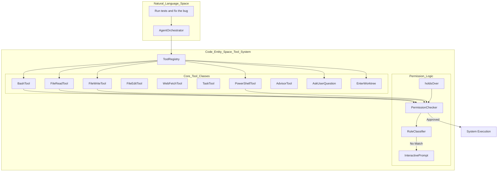
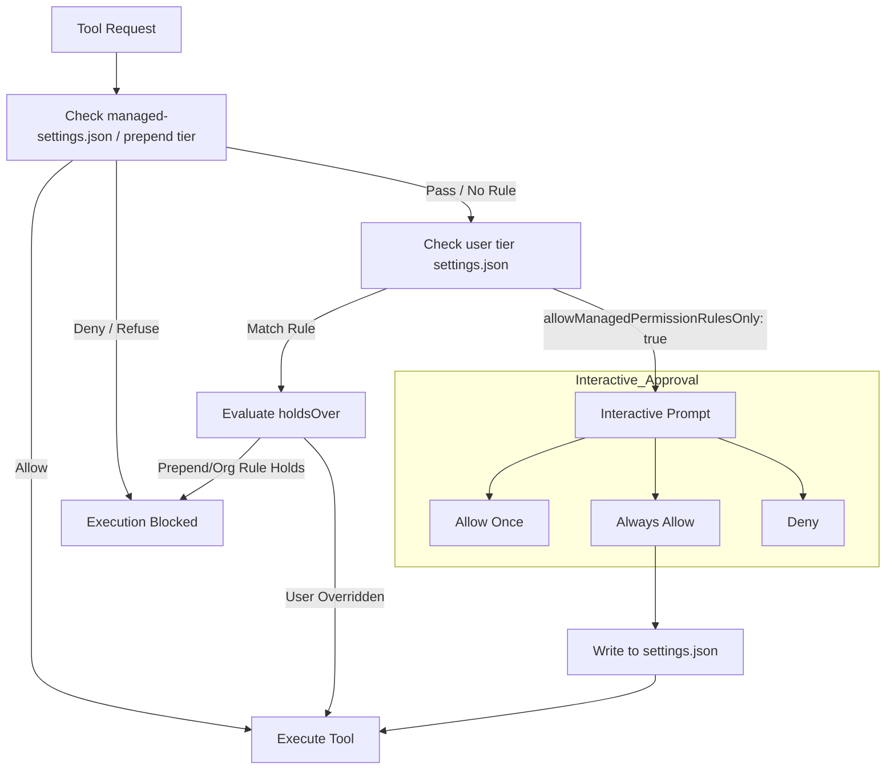

<!-- source: DeepWiki mcp.deepwiki.com · repo anthropics/claude-code · page 3.2 Tool System & Permissions · fetched 2026-10-26 -->

# Tool System & Permissions

Relevant source files

The following files were used as context for generating this wiki page:

- [mods/README.md](mods/README.md)
- [mods/sec-default/README.md](mods/sec-default/README.md)
- [mods/sec-default/hooks/held-verdict/held-kind.ts](mods/sec-default/hooks/held-verdict/held-kind.ts)
- [mods/sec-default/hooks/held-verdict/index.ts](mods/sec-default/hooks/held-verdict/index.ts)
- [mods/sec-default/hooks/held-verdict/verdicts/holds-over.ts](mods/sec-default/hooks/held-verdict/verdicts/holds-over.ts)
- [mods/sec-default/hooks/held-verdict/verdicts/is-person-tightening.ts](mods/sec-default/hooks/held-verdict/verdicts/is-person-tightening.ts)
- [mods/sec-default/hooks/held-verdict/verdicts/is-same-verdict.ts](mods/sec-default/hooks/held-verdict/verdicts/is-same-verdict.ts)
- [mods/sec-default/hooks/hooks.json](mods/sec-default/hooks/hooks.json)
- [mods/sec-default/hooks/policy/index.ts](mods/sec-default/hooks/policy/index.ts)
- [mods/sec-default/hooks/policy/pinned-names.ts](mods/sec-default/hooks/policy/pinned-names.ts)
- [mods/sec-default/tests/fixtures/index.ts](mods/sec-default/tests/fixtures/index.ts)
- [mods/sec-default/tests/fixtures/tool-check/index.ts](mods/sec-default/tests/fixtures/tool-check/index.ts)
- [mods/sec-default/tests/held-verdict.test.ts](mods/sec-default/tests/held-verdict.test.ts)
- [mods/sec-default/tests/register.test.ts](mods/sec-default/tests/register.test.ts)
- [mods/types/claude-code.d.ts](mods/types/claude-code.d.ts)

## Purpose and Scope

This document covers Claude Code's tool execution architecture and permission control system. Tools are the primary mechanism through which the AI agent interacts with the system—reading files, executing bash commands, fetching web content, and spawning subagents. The permission system provides fine-grained control over which tools can execute and under what conditions, supporting both interactive approval workflows, rule-based classification, and multi-tier organizational policy enforcement via hooks.

For information about the hook system that intercepts tool execution, see [Hook System](3.4). For MCP-based external tools, see [MCP Server Integration](3.5). For sandbox network isolation, see [Sandbox Environment](3.8).

Sources: [CHANGELOG.md:17-17](), [CHANGELOG.md:27-27](), [mods/sec-default/README.md:1-12]()

---

## Tool Architecture Overview

Claude Code implements a typed tool system where each tool represents a specific capability exposed to the AI agent. Tools execute through a permission layer and plugin tier system that validates and potentially prompts for user approval before execution.

### Tool Interaction Flow
The following diagram illustrates the flow from a Natural Language request to the execution of specific code entities like `BashTool` or `FileReadTool`.

Sources: [CHANGELOG.md:17-17](), [CHANGELOG.md:27-27](), [CHANGELOG.md:28-28](), [CHANGELOG.md:30-30](), [mods/sec-default/hooks/held-verdict/verdicts/holds-over.ts:21-33]()

---

## Core Tool Types

### File Operation Tools

| Tool | Purpose | Permission Check | Key Features |
|------|---------|------------------|--------------|
| `FileReadTool` | Read file contents | Path safety validation | Returns errors for extremely long single lines [CHANGELOG.md:29-29](). |
| `FileWriteTool` | Create or overwrite files | Path safety + symlink checks | Reports a clear error when the target path is an existing directory [CHANGELOG.md:17-17](). |
| `FileEditTool` | Apply line-based edits | Path safety + symlink checks | Fixed issues with escaped backslashes and large non-ASCII text [CHANGELOG.md:18-19](). |

**File Tool Behavior:**
- **Path Handling:** Fixed issues where a tool call's file path containing `\u0000` written as an escape sequence would end the turn early with "Path contains null bytes"; escaped control characters now stay as literal text [CHANGELOG.md:20-20]().

Sources: [CHANGELOG.md:17-17](), [CHANGELOG.md:18-19](), [CHANGELOG.md:20-20](), [CHANGELOG.md:29-29]()

### Bash & Shell Tools

Claude Code supports cross-platform shell execution with specific tools for different environments.

- **BashTool:** Executes shell commands.
- **PowerShellTool:** Used for Windows environments.
- **Environment Handling:** `$TMPDIR` now expands correctly in Bash commands that run outside the sandbox while sandboxing is enabled [CHANGELOG.md:32-32]().
- **Sandbox Integration:** A `sandbox.excludedCommands` glob now requires every part of a compound Bash command to match for exemption, not just one part [CHANGELOG.md:51-51]().

Sources: [CHANGELOG.md:32-32](), [CHANGELOG.md:51-51]()

### Web and Interactive Tools

| Tool | Behavior | Permission Required |
|------|----------|---------------------|
| `WebFetchTool` | Fetches URL content | Subject to permission rules; often denied in strict mode. |
| `WebSearchTool` | Performs web searches | Denied by default in high-security configurations. |
| `AskUserQuestion` | Prompts user for info | Used when the agent requires clarification or explicit input. |

Sources: [CHANGELOG.md:33-33]()

---

## Permission System Architecture & Policy Enforcement

The permission system evaluates every tool execution request against a hierarchy of rules defined in settings files and plugin tiers (prepend, user, append, builtin) [mods/sec-default/README.md:3-10]().

### Permission Logic Hierarchy
This diagram maps the logical permission states to the internal check flow, incorporating plugin tier evaluations and verdict precedence (`holdsOver`).

Sources: [examples/settings/settings-strict.json:3-10](), [examples/settings/settings-strict.json:12-12](), [mods/sec-default/hooks/held-verdict/verdicts/holds-over.ts:21-33]()

### Permission Rule Types

Claude Code supports primary rule types in the `permissions` object:

| Rule Type | Behavior | Example |
|-----------|----------|---------|
| `deny` | Block tool execution unconditionally | Blocking `WebSearch` and `WebFetch` [examples/settings/settings-strict.json:8-9](). |
| `ask` | Always prompt for approval | Default for high-risk tools like `Bash` [examples/settings/settings-strict.json:5-7](). |
| `allow` | Auto-approve matching patterns | Can be enabled for specific commands or stacks. |

Sources: [examples/settings/settings-strict.json:5-9]()

### Security Safeguards & Prepend Tiers
- **Bypass Prevention:** `disableBypassPermissionsMode` can be set to `"disable"` to prevent users from using `--dangerously-skip-permissions` [examples/settings/settings-strict.json:3-4]().
- **Managed Rules Enforcement:** The `allowManagedPermissionRulesOnly` setting, when `true`, blocks user and project-defined `allow` / `ask` / `deny` rules [examples/settings/settings-strict.json:12-12](), [examples/settings/README.md:17-17]().
- **Sec-Default Mod Integration:** Plugins installed by a user sit in the `user` tier, beneath the organization's `prepend` tier and above its `append` tier [mods/sec-default/README.md:3-6](). The `sec-default` mod ensures organization-level classic hooks, managed settings, tool policies, and MCP allowlists cannot be overridden by user-installed plugins unless explicitly permitted [mods/sec-default/README.md:7-11]().
- **Verdict Precedence (`holdsOver`):** Higher-tier policy decisions (such as deny rules, hook asks, or setting constraints) hold over looser user-tier answers through `holdsOver` validation checks [mods/sec-default/hooks/held-verdict/verdicts/holds-over.ts:21-33]().

Sources: [CHANGELOG.md:45-45](), [examples/settings/settings-strict.json:3-12](), [examples/settings/README.md:17-17](), [mods/sec-default/README.md:3-11](), [mods/sec-default/hooks/held-verdict/verdicts/holds-over.ts:21-33]()

---

## Sandbox System for Bash

The sandbox provides a secure execution layer for the `BashTool`, primarily managed through the `sandbox` configuration object.

### Configuration and Enforcement
- **Enabled State:** The `sandbox.enabled` setting controls whether the sandbox is active [examples/settings/settings-bash-sandbox.json:4-4]().
- **Auto-Allow:** `autoAllowBashIfSandboxed` can be set to `false` to require approval even if the environment is isolated [examples/settings/settings-bash-sandbox.json:5-5](), [examples/settings/settings-strict.json:15-15]().
- **Unsandboxed Commands:** `allowUnsandboxedCommands` can be set to `false` to ensure all Bash commands run inside the sandbox [examples/settings/settings-bash-sandbox.json:6-6]().
- **Command Exclusion:** `excludedCommands` allows blacklisting specific binaries within the sandbox [examples/settings/settings-bash-sandbox.json:7-7](), [examples/settings/settings-strict.json:16-16]().
- **Network Isolation:** The `sandbox.network` object allows granular control over network access, including `allowUnixSockets`, `allowAllUnixSockets`, `allowLocalBinding`, and `allowedDomains` [examples/settings/settings-bash-sandbox.json:8-12](), [examples/settings/settings-strict.json:17-22]().
- **Weaker Nested Sandbox:** `enableWeakerNestedSandbox` can be used for specific scenarios [examples/settings/settings-bash-sandbox.json:17-17](), [examples/settings/settings-strict.json:23-23]().
- **Firewall Integration:** The `.devcontainer/init-firewall.sh` script sets up `iptables` and `ipset` rules to enforce network restrictions within the devcontainer, allowing only specific domains like GitHub, npmjs, Anthropic API, Sentry, and Statsig, while rejecting all other outbound traffic [init-firewall.sh:27-119](). This script is executed as a `postStartCommand` in the devcontainer [devcontainer.json:56-56]().

Sources: [CHANGELOG.md:51-51](), [examples/settings/settings-bash-sandbox.json:4-18](), [examples/settings/settings-strict.json:14-24](), [examples/settings/README.md:21-21](), [init-firewall.sh:27-119](), [devcontainer.json:56-56]()

---

## Interactive Tool Approval

When no automated rule matches or an `ask` rule triggers, Claude Code enters an interactive state requiring user or host intervention.

### Interactive Prompt Features
- **WebFetch/WebSearch Refusal:** `WebFetch` and `WebSearch` in Cowork cloud sessions now tell Claude why a request was refused (e.g., used-up fetch budget or admin policy) [CHANGELOG.md:33-33]().
- **Decider Tracking:** Interactive prompts track whether a decision was resolved by the `host`, `person`, or automated policy tiers, ensuring proper audit trails for tool execution approval [mods/sec-default/hooks/held-verdict/verdicts/is-person-tightening.ts:13-28]().

Sources: [CHANGELOG.md:33-33](), [mods/sec-default/hooks/held-verdict/verdicts/is-person-tightening.ts:13-28]()

---

