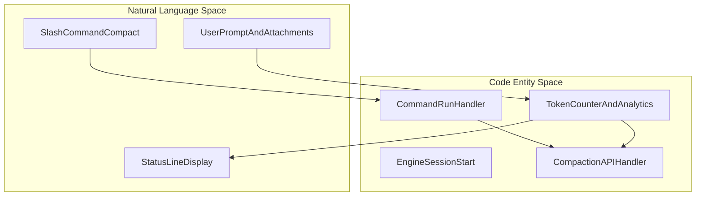
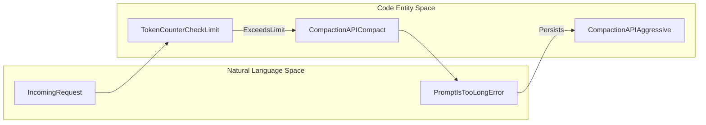

<!-- source: DeepWiki mcp.deepwiki.com · repo anthropics/claude-code · page 3.3 Context Window & Compaction · fetched 2026-10-26 -->

# Context Window & Compaction

Relevant source files

The following files were used as context for generating this wiki page:

- [.devcontainer/Dockerfile](.devcontainer/Dockerfile)
- [.devcontainer/devcontainer.json](.devcontainer/devcontainer.json)
- [.devcontainer/init-firewall.sh](.devcontainer/init-firewall.sh)
- [.gitattributes](.gitattributes)
- [.vscode/extensions.json](.vscode/extensions.json)
- [CHANGELOG.md](CHANGELOG.md)
- [LICENSE.md](LICENSE.md)
- [README.md](README.md)
- [SECURITY.md](SECURITY.md)
- [demo.gif](demo.gif)
- [feed.xml](feed.xml)
- [mods/README.md](mods/README.md)
- [mods/types/claude-code.d.ts](mods/types/claude-code.d.ts)

This page documents Claude Code's context window management system, including token tracking, automatic and manual compaction strategies, multi-stage compaction fallbacks, payload stripping, and state preservation across conversation boundaries [CHANGELOG.md:1-57]().

Sources: [CHANGELOG.md:1-57]()

## Context Window Architecture

Context window management maintains long-running sessions under token constraints. The system monitors consumption in real-time, automatically compacts conversations when approaching model limits, and provides manual controls via CLI commands [CHANGELOG.md:5-5](). Context compaction synthesizes conversation history while retaining crucial session identifiers and execution states.

**Diagram: Context Window Management Architecture**

Sources: [CHANGELOG.md:5-5](), [mods/README.md:1-117]()

## Token Counting and Tracking

### Real-Time Token Usage

The system continuously monitors token consumption and exposes usage percentages and metrics. 

| Context Component | Token Impact | Notes |
|------------------|--------------|-------|
| System Prompt | Fixed overhead | Date parameters are extracted to optimize cache hit rates |
| User Messages | Variable | Includes text, attachments, and image blocks |
| Assistant Messages | Variable | Includes reasoning blocks (`thinking`) and text |
| Tool Results | Variable | Large output streams from file reads or bash executions are managed |
| Images & PDFs | High | Subject to dimension limits and stripped prior to compaction |
| MCP Tool Descriptions | Variable | Contributed by connected Model Context Protocol servers |

Sources: [CHANGELOG.md:5-5](), [CHANGELOG.md:26-26]()

### Prompt Caching and Limits

Prompt caching reduces token costs by reusing previously sent context prefixes. When requests approach model ceilings or exceed transfer thresholds, the system initiates payload reduction or fails gracefully [CHANGELOG.md:26-26]().

Sources: [CHANGELOG.md:26-26](), [CHANGELOG.md:45-45]()

## Automatic Compaction

### Trigger Conditions & Multi-Stage Fallback

Auto-compaction triggers when token usage nears the effective context limit. If a "Prompt is too long" error persists even after initial compaction, Claude Code executes a secondary compaction step, pruning deeper into conversation history to preserve recent context [CHANGELOG.md:26-26]().

**Diagram: Multi-Stage Auto-Compaction Flow**

Sources: [CHANGELOG.md:26-26](), [CHANGELOG.md:31-31]()

### Content Preparation & Payload Stripping

Before dispatching payloads to compaction endpoints:
1. **Image and Document Stripping**: All image and PDF binary blocks are removed.
2. **Parameter Validation**: Tool calls are verified to ensure string parameters (e.g., `file_path`, `glob`, `command`) are fully populated, avoiding resume crashes [CHANGELOG.md:20-20]().

Sources: [CHANGELOG.md:20-20]()

## Manual Compaction

Users can explicitly trigger compaction via the `/compact` slash command or review usage via related commands [CHANGELOG.md:5-5]().

Sources: [CHANGELOG.md:5-5]()

## State Preservation Across Compaction

Critical session metadata is retained across compaction boundaries:
* **Session Lineage**: Session identifiers and forks [CHANGELOG.md:29-29]()
* **Execution Flags**: Plan mode states and active tool permissions
* **Subagent Context**: Bounded task histories and background agent registrations [CHANGELOG.md:29-29]()

Sources: [CHANGELOG.md:29-29]()

## Tool Output Management

To prevent context exhaustion:
* **Argument Sanitization**: Null bytes and malformed inputs are caught before serialization [CHANGELOG.md:20-20]().
* **Output Truncation**: Excessive shell or file outputs are bounded to protect the active context window.

Sources: [CHANGELOG.md:20-20]()

---

