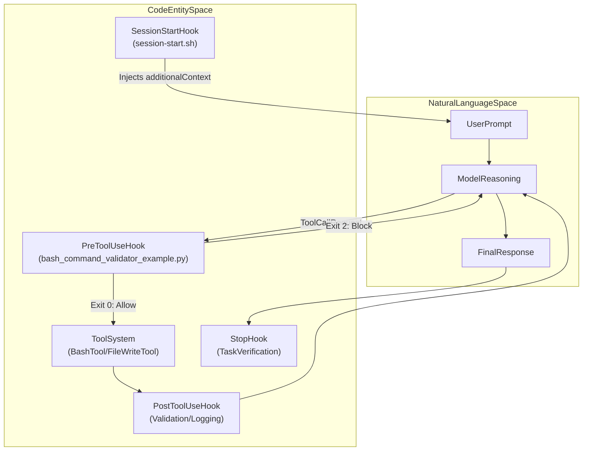
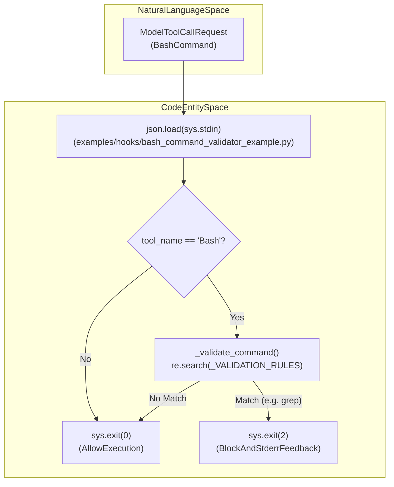

<!-- source: DeepWiki mcp.deepwiki.com · repo anthropics/claude-code · page 3.4 Hook System · fetched 2026-10-26 -->

# Hook System

<details>
<summary>Relevant source files</summary>

The following files were used as context for generating this wiki page:

- [examples/hooks/bash_command_validator_example.py](examples/hooks/bash_command_validator_example.py)
- [mods/README.md](mods/README.md)
- [mods/types/claude-code.d.ts](mods/types/claude-code.d.ts)

</details>


The hook system provides extensibility points throughout Claude Code's execution lifecycle, allowing plugins, mods, and users to inject custom behavior at specific lifecycle events such as session startup, before and after tool execution, and during multi-agent workflows. Hooks can be configured declaratively via JSON configuration files or implemented programmatically via the mod/plugin API.

Sources: [mods/README.md:1-7](), [examples/hooks/bash_command_validator_example.py:1-10]()

## Hook Types and Lifecycle Events

Claude Code supports several distinct hook types that fire at different points in the execution lifecycle. These hooks support both synchronous validation/interception and asynchronous execution or logging.

| Hook Type | When It Fires | Common Use Cases |
|-----------|--------------|------------------|
| `SessionStart` | At the beginning of every session, before any user interaction | Injecting instructions, setting environment variables. |
| `UserPromptSubmit` | When a user submits a prompt to the agent | Validating prompt safety, adding context, or blocking prompts. |
| `PreToolUse` | Before each tool execution (`Bash`, `Read`, `Write`, etc.) | Validation, security checks, command rewriting. [examples/hooks/bash_command_validator_example.py:5-7]() |
| `PostToolUse` | After each tool execution completes | Reacting to results, logging, providing feedback. |
| `Stop` | When the main agent considers stopping | Verifying task completion, running tests before exit. |
| `SubagentStop` | When a subagent considers stopping | Ensuring subagent tasks are complete. |
| `PreCompact` | Before context compaction | Adding critical info to be preserved in the summary. |
| `SessionEnd` | When the session ends | Cleanup, state preservation, logging. |
| `Notification` | When Claude sends a notification | Reacting to user-facing notifications. |
| `WorktreeCreate` | When a new worktree is created for a subagent | Environment setup, specialized initialization. |
| `DirectoryAdded` | After a new working directory is registered mid-session | Context updates for multi-repo sessions. |
| `TeammateIdle` | When a teammate in an Agent Team is idle | Orchestration and task handoff logic. |
| `EnterWorktree` | When switching between Claude-managed worktrees mid-session | Context switching and environment updates. |

Sources: [examples/hooks/bash_command_validator_example.py:5-7]()

## Handler Implementation & The `classic.*` Namespace

Mods and plugins implement hooks programmatically through a `register(on, options)` entry point, where event handlers take the signature `($, e, next)` [mods/README.md:3-5](). The engine uses the `classic.*` namespace to interoperate with traditional command-based and file-backed hook configurations while maintaining a unified event stream for runtime modules.

```ts
export const register: Register = (on, options) => {
  on('session.start', ($, e) => ({ cwd: e.cwd }))
  on('ui.open', ($, e, next) => {
    return next(e)
  })
}
```

Sources: [mods/README.md:3-5](), [mods/types/claude-code.d.ts:58-61]()

## Hook Execution Flow

The hook system integrates directly into the execution loop. Command-based hooks execute as child processes, and programmatic mod hooks evaluate within the engine's event subscription chain.

**Hook System Integration Flow**

Sources: [examples/hooks/bash_command_validator_example.py:78-79]()

## Hook Implementation Protocol

Claude Code supports two primary implementation styles: **Prompt-based** (recommended for LLM reasoning) and **Command-based** (for deterministic scripts).

### 1. Prompt-Based Hooks
These hooks use LLM-driven decision making for context-aware validation. They can inject instructions or modify behavior by returning structured JSON. For example, `SessionStart` hooks can provide `additionalContext` to guide the model's output style.

**Example Hook Specific Output (SessionStart):**
```json
{
  "hookSpecificOutput": {
    "hookEventName": "SessionStart",
    "additionalContext": "You are in 'explanatory' output style mode..."
  }
}
```
Sources: [mods/types/claude-code.d.ts:1-20]()

### 2. Command Hooks
These execute bash commands or scripts via standard I/O and exit codes. The system captures `stdout` for potential context injection and `stderr` for error reporting.

*   **Input**: Hooks receive input via `stdin` as a JSON object containing `tool_name` and `tool_input` [examples/hooks/bash_command_validator_example.py:58-69]().
*   **Exit Code 0**: Success. The operation continues normally [examples/hooks/bash_command_validator_example.py:66-66]().
*   **Exit Code 1**: Error. Stderr is shown to the user but not to Claude [examples/hooks/bash_command_validator_example.py:61-62]().
*   **Exit Code 2**: Block/Deny. The operation is cancelled. For `PreToolUse`, the tool is not run, and `stderr` is fed back to Claude as the tool result [examples/hooks/bash_command_validator_example.py:78-79]().

Sources: [examples/hooks/bash_command_validator_example.py:56-83]()

## Reference Implementation: Bash Command Validator

The `bash_command_validator_example.py` script demonstrates a `PreToolUse` hook that intercepts `Bash` tool calls to enforce best practices (e.g., suggesting `rg` over `grep`).

**Command Validation Logic**

Sources: [examples/hooks/bash_command_validator_example.py:31-83]()

### Configuration Formats
Hooks can be configured in the global `settings.json` or within a plugin's manifest. The configuration defines which event triggers the hook and what command to execute.

```json
{
  "hooks": {
    "PreToolUse": [
      {
        "matcher": "Bash",
        "hooks": [
          {
            "type": "command",
            "command": "python3 /path/to/claude-code/examples/hooks/bash_command_validator_example.py"
          }
        ]
      }
    ]
  }
}
```
Sources: [examples/hooks/bash_command_validator_example.py:13-27]()

---

