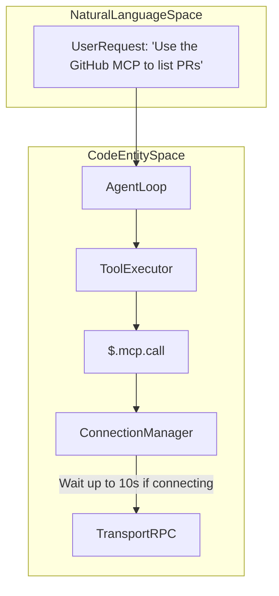
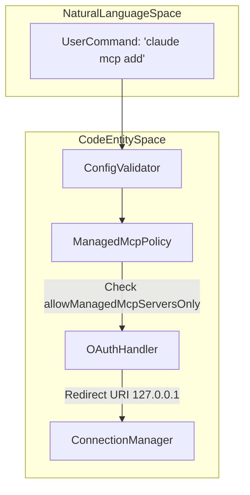

<!-- source: DeepWiki mcp.deepwiki.com · repo anthropics/claude-code · page 3.5 MCP Server Integration · fetched 2026-10-26 -->

# MCP Server Integration

Relevant source files

The following files were used as context for generating this wiki page:

- [examples/mdm/README.md](examples/mdm/README.md)
- [examples/settings/README-hipaa.md](examples/settings/README-hipaa.md)
- [examples/settings/README.md](examples/settings/README.md)
- [examples/settings/managed-mcp-hipaa.json](examples/settings/managed-mcp-hipaa.json)
- [examples/settings/settings-bash-sandbox.json](examples/settings/settings-bash-sandbox.json)
- [examples/settings/settings-hipaa.json](examples/settings/settings-hipaa.json)
- [examples/settings/settings-lax.json](examples/settings/settings-lax.json)
- [examples/settings/settings-strict.json](examples/settings/settings-strict.json)
- [mods/README.md](mods/README.md)
- [mods/types/claude-code.d.ts](mods/types/claude-code.d.ts)

This page documents the Model Context Protocol (MCP) integration within Claude Code, detailing how external tools, prompts, and resources are discovered, authenticated, registered, and invoked via `$.mcp.call`.

For information on the general tool execution pipeline and permissions, see [Tool System & Permissions](3.2). For details on plugin-bundled MCP servers, see [Plugin System](3.6).

## MCP Architecture in Claude Code

The Model Context Protocol establishes a standardized communication layer between Claude Code and external services. This allows the agent system to leverage external tool definitions and resources without requiring hardcoded integrations.

### Data Flow and Entity Mapping

The following diagram maps natural language intents to the underlying code entities responsible for MCP connection handling and tool dispatch.

**Diagram: MCP Request Lifecycle and Entity Mapping**

Sources: [mods/types/claude-code.d.ts:93-101](), [examples/settings/README-hipaa.md:20-20]()

**Configuration Layers**
*   **User-level Configuration**: Stored in `~/.claude/mcp-servers.json`.
*   **Project-level Configuration**: Stored in `.claude/mcp-servers.json`.
*   **Managed Enterprise Configuration**: Enforced via `managed-mcp.json` or organization-wide settings, controlling allowed and denied servers [examples/settings/README-hipaa.md:20-20]().

Sources: [mods/README.md:10-10](), [examples/settings/README-hipaa.md:20-20]()

## Transport Types and Connection Lifecycle

Claude Code supports multiple transport mechanisms for MCP communication:
*   **stdio**: Local process spawned and managed alongside the Claude Code session lifespan.
*   **SSE**: Server-Sent Events for remote cloud services, integrating automated OAuth flows.
*   **HTTP**: REST endpoints for stateless service calls.
*   **WebSocket**: Full-duplex real-time connections (`wss://`).

**Connection Resilience**
When executing tool calls in resumed sessions where an MCP server is still initializing, the engine prevents race conditions by waiting up to 10 seconds for the underlying `ConnectionManager` transport to settle before failing a call.

Sources: [mods/types/claude-code.d.ts:93-101]()

## Tool Discovery, Registration, and `$.mcp.call`

Discovered MCP tools are dynamically registered into the tool registry using a deterministic namespacing convention to prevent collisions.

**Naming Format**: `mcp__plugin_<plugin-name>_<server-name>__<tool-name>`

### Execution Flow
1.  **Server Discovery**: Configuration files (`mcp-servers.json`, `managed-mcp.json`, and plugin manifests) are scanned during session initialization.
2.  **Process Spawning & Handshake**: `ConnectionManager` initializes transport layers for each configured server.
3.  **Tool Registration**: Available tools are parsed and exposed to the agent loop.
4.  **Invocation**: When the model invokes an MCP tool, the execution passes through `$.mcp.call`, verifying connection readiness and dispatching the payload over the active transport channel.

Sources: [mods/types/claude-code.d.ts:93-101](), [examples/settings/README-hipaa.md:20-20]()

## Authentication, OAuth, and Enterprise Security Controls

Claude Code handles authentication flows for secure access to remote MCP services and enforces strict organizational compliance policies.

### Managed Security and Policy Mapping

The following diagram illustrates how natural language configuration commands and policy evaluations interface with the enterprise control layer for MCP servers.

**Diagram: Managed MCP Policy and Authentication Enforcement**

Sources: [examples/settings/settings-hipaa.json:7-13](), [examples/settings/README-hipaa.md:43-46]()

*   **OAuth Management**: Automated OAuth redirection utilizes `127.0.0.1` loopback bindings to satisfy authorization server requirements.
*   **Managed Restrictions**: Enterprise environments can restrict server execution using keys such as `allowManagedMcpServersOnly`, `allowedMcpServers`, and `deniedMcpServers` [examples/settings/settings-hipaa.json:7-13](). For instance, HIPAA-ready deployments explicitly restrict or deny unverified MCP connectors [examples/settings/settings-hipaa.json:9-13]().

Sources: [examples/settings/settings-hipaa.json:7-13](), [examples/settings/README-hipaa.md:43-46]()

---

