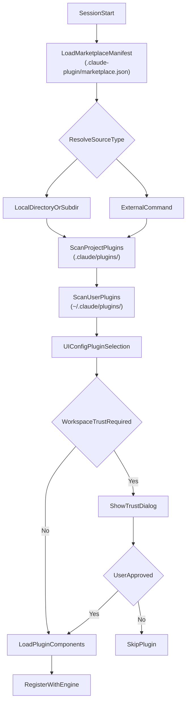
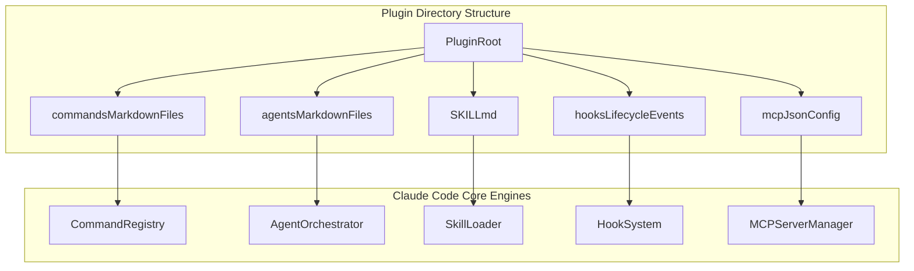

<!-- source: DeepWiki mcp.deepwiki.com · repo anthropics/claude-code · page 3.6 Plugin System · fetched 2026-10-26 -->

# Plugin System

Relevant source files

The following files were used as context for generating this wiki page:

- [.claude-plugin/marketplace.json](.claude-plugin/marketplace.json)
- [mods/README.md](mods/README.md)
- [mods/types/claude-code.d.ts](mods/types/claude-code.d.ts)
- [plugins/frontend-design/.claude-plugin/plugin.json](plugins/frontend-design/.claude-plugin/plugin.json)
- [plugins/frontend-design/README.md](plugins/frontend-design/README.md)
- [plugins/frontend-design/skills/frontend-design/SKILL.md](plugins/frontend-design/skills/frontend-design/SKILL.md)

## Purpose and Scope

The plugin system provides a structured mechanism for extending Claude Code's functionality without modifying core code. Plugins can contribute slash commands, custom agents, lifecycle hooks, Model Context Protocol (MCP) server configurations, and skills (guideline files). This document covers plugin discovery, manifest format, trust dialogs, component types, installation sources, and loading mechanisms.

For information about the Skill system (SKILL.md files), see [Skill System (3.7)](). For MCP server integration, see [3.5 MCP Server Integration](). For hook system details, see [3.4 Hook System]().

Sources: [mods/README.md:1-7](), [mods/types/claude-code.d.ts:1-12]()

## Plugin Discovery and Loading

Plugins are discovered from four hierarchical scopes, loaded in order of precedence:

| Scope | Location | Precedence | Purpose |
|-------|----------|------------|---------|
| **Managed** | `.claude-plugin/marketplace.json` | Highest | Bundled plugins distributed with Claude Code [mods/README.md:6-6](), [/.claude-plugin/marketplace.json:1-5]() |
| **Project** | `.claude/plugins/` | Medium | Project-specific plugins, committed to version control. |
| **User** | `~/.claude/plugins/` | Low | Personal plugins across all projects. |
| **Auto-load**| `.claude/skills/` | Lowest | Automatic loading of local skills without marketplace registration [plugins/frontend-design/skills/frontend-design/SKILL.md:1-5]() |

### Discovery Process

The discovery process scans defined scopes and resolves plugin sources. The marketplace manifest tracks official plugins and their source paths, which can be relative directories within the repository [/.claude-plugin/marketplace.json:10-149]().

Recent updates introduce `command` sources for the marketplace, allowing local commands to print a plugin directory re-resolved each session. Development checkouts using link modes are preserved during background cache cleanups.

**Plugin Discovery and Registration Flow**

Sources: [/.claude-plugin/marketplace.json:1-150](), [mods/README.md:6-6]()

### Trust Dialog and Security

Plugins require explicit user approval before loading if they contain executable components or hooks.
1. **Trust Requirements**: Hooks from untrusted folders are blocked; they require the agent file's own folder to have accepted workspace trust [mods/types/claude-code.d.ts:8-10]().
2. **Naming Context**: Trust dialogs explicitly name the repository root that the grant covers.
3. **Sanitization**: Skills synced from external sources are hardened; descriptions are sanitized, and bodies are restricted from running `!` commands or expanding `@` files to prevent shadowing local commands.

Sources: [mods/types/claude-code.d.ts:8-10]()

## Plugin Manifest Format

### Marketplace Manifest
The `.claude-plugin/marketplace.json` file serves as the registry for bundled plugins, defining metadata including name, version, author, category, and source path relative to the marketplace file [/.claude-plugin/marketplace.json:1-150]().

### Plugin Manifest (`plugin.json`)
Plugins include a `.claude-plugin/plugin.json` to define identity and metadata [plugins/frontend-design/.claude-plugin/plugin.json:1-9]().

| Field | Description | Requirement |
|-------|-------------|-------------|
| `name` | kebab-case unique identifier | Required [plugins/frontend-design/.claude-plugin/plugin.json:2-2]() |
| `version` | Semantic versioning | Required [plugins/frontend-design/.claude-plugin/plugin.json:3-3]() |
| `description` | Short summary of plugin utility | Required [plugins/frontend-design/.claude-plugin/plugin.json:4-4]() |
| `author` | Name and email of creator | Required [plugins/frontend-design/.claude-plugin/plugin.json:5-8]() |

Sources: [/.claude-plugin/marketplace.json:1-150](), [plugins/frontend-design/.claude-plugin/plugin.json:1-9]()

## Loading Mechanisms and Hooks

Plugins implement their runtime behavior via a hooks module entry point `register(on, options)` which hooks engine events using functions `($, e, next)` [mods/README.md:3-5](). TypeScript definitions are provided via `mods/types/claude-code.d.ts`, and validation runs via `claude plugin validate <dir>` [mods/types/claude-code.d.ts:1-10]().

Plugins can be tested using the testing kit `claude plugin test <dir>`, importing from `claude-code/testing` with `test`, `describe`, `tier`, and `mock` functions [mods/types/claude-code.d.ts:25-32](), [mods/README.md:23-40]().

Sources: [mods/README.md:3-40](), [mods/types/claude-code.d.ts:1-32]()

## Plugin Components

Plugins contribute functionality through specialized components that integrate with core engines.

### Component Architecture

**Component Integration Mapping**

Sources: [/.claude-plugin/marketplace.json:12-148](), [plugins/frontend-design/skills/frontend-design/SKILL.md:1-5]()

### 1. Commands (Slash Commands)
Plugins define custom slash commands using markdown files [/.claude-plugin/marketplace.json:40-49](), [/.claude-plugin/marketplace.json:106-137]().
- **commit-commands**: Provides git workflow commands like `/commit-push-pr` [/.claude-plugin/marketplace.json:40-49]().
- **ralph-wiggum**: Adds `/ralph-loop` and `/cancel-ralph` for iterative development [/.claude-plugin/marketplace.json:128-137]().
- **plugin-dev**: Provides the `/create-plugin` command for scaffolded development [/.claude-plugin/marketplace.json:106-115]().

Sources: [/.claude-plugin/marketplace.json:40-49](), [/.claude-plugin/marketplace.json:106-137]()

### 2. Agents
Agents are specialized sub-orchestrators defined within plugins [/.claude-plugin/marketplace.json:29-38](), [/.claude-plugin/marketplace.json:62-71](), [/.claude-plugin/marketplace.json:117-126]().
- **code-review**: Uses multiple specialized agents with confidence-based scoring to filter false positives [/.claude-plugin/marketplace.json:29-38]().
- **feature-dev**: Orchestrates agents for codebase exploration, architecture design, and quality review [/.claude-plugin/marketplace.json:62-71]().
- **pr-review-toolkit**: Includes specialized review agents for comments, tests, and code quality [/.claude-plugin/marketplace.json:117-126]().

Sources: [/.claude-plugin/marketplace.json:29-38](), [/.claude-plugin/marketplace.json:62-71](), [/.claude-plugin/marketplace.json:117-126]()

### 3. Hooks
Lifecycle hooks register automatically to intercept events [mods/README.md:3-5]().
- **SessionStart**: Used by output style plugins to modify agent behavior [/.claude-plugin/marketplace.json:51-60]().
- **Security Hooks**: The `security-guidance` plugin warns about command injection, XSS, and unsafe code patterns [/.claude-plugin/marketplace.json:139-148]().
- **Mod Hooks**: Built-in mods like `diff` and `telemetry` use a `register(on, options)` entry point [mods/README.md:3-5]().

Sources: [/.claude-plugin/marketplace.json:51-60](), [/.claude-plugin/marketplace.json:139-148](), [mods/README.md:3-5]()

### 4. MCP Servers
Plugins can bundle MCP servers or configurations [/.claude-plugin/marketplace.json:106-115]().
- **plugin-dev**: Includes expert skills for MCP integration during plugin development [/.claude-plugin/marketplace.json:106-115]().

Sources: [/.claude-plugin/marketplace.json:106-115]()

### 5. Skills (SKILL.md)
Skills are markdown-based guidelines that the agent retrieves to perform specific tasks [plugins/frontend-design/skills/frontend-design/SKILL.md:1-5]().
- **frontend-design**: Guides the creation of production-grade interfaces by enforcing design principles and opinionated typography [plugins/frontend-design/skills/frontend-design/SKILL.md:7-27]().
- **claude-opus-4-5-migration**: Provides a migration path from previous versions to Opus 4.5 [/.claude-plugin/marketplace.json:18-27]().

Sources: [plugins/frontend-design/skills/frontend-design/SKILL.md:1-27](), [/.claude-plugin/marketplace.json:18-27]()

## Official Bundled Plugins

The following plugins are registered in the core marketplace [/.claude-plugin/marketplace.json:10-149]():

| Plugin | Category | Key Feature |
|--------|----------|-------------|
| `code-review` | Productivity | Multi-agent PR review with confidence scoring [/.claude-plugin/marketplace.json:29-38]() |
| `frontend-design` | Development | Distinctive typography and production-grade UI guidelines [plugins/frontend-design/README.md:7-13]() |
| `feature-dev` | Development | Comprehensive feature development workflow [/.claude-plugin/marketplace.json:62-71]() |
| `hookify` | Productivity | Custom hook creation via markdown rules [/.claude-plugin/marketplace.json:84-93]() |
| `plugin-dev` | Development | Toolkit for AI-assisted plugin creation and validation [/.claude-plugin/marketplace.json:106-115]() |
| `ralph-wiggum` | Development | Interactive self-referential AI loops [/.claude-plugin/marketplace.json:128-137]() |
| `security-guidance` | Security | Diff-level security review and command injection warnings [/.claude-plugin/marketplace.json:139-148]() |

Sources: [/.claude-plugin/marketplace.json:1-150](), [plugins/frontend-design/README.md:1-13]()

---

