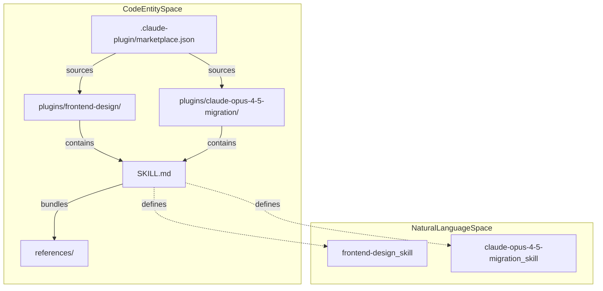
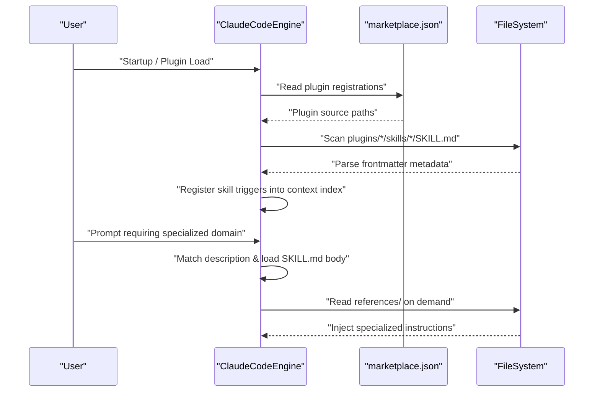
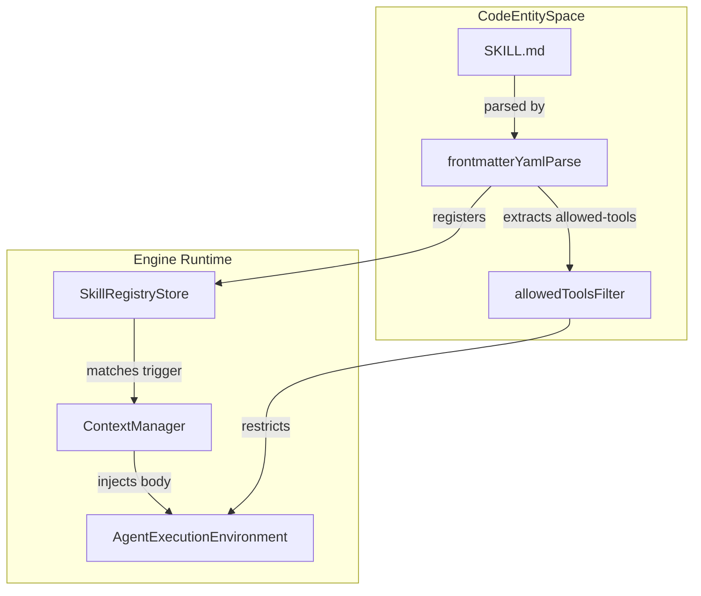

<!-- source: DeepWiki mcp.deepwiki.com · repo anthropics/claude-code · page 3.7 Skill System · fetched 2026-10-26 -->

# Skill System

Relevant source files

The following files were used as context for generating this wiki page:

- [.claude-plugin/marketplace.json](.claude-plugin/marketplace.json)
- [plugins/claude-opus-4-5-migration/.claude-plugin/plugin.json](plugins/claude-opus-4-5-migration/.claude-plugin/plugin.json)
- [plugins/claude-opus-4-5-migration/README.md](plugins/claude-opus-4-5-migration/README.md)
- [plugins/claude-opus-4-5-migration/skills/claude-opus-4-5-migration/SKILL.md](plugins/claude-opus-4-5-migration/skills/claude-opus-4-5-migration/SKILL.md)
- [plugins/claude-opus-4-5-migration/skills/claude-opus-4-5-migration/references/effort.md](plugins/claude-opus-4-5-migration/skills/claude-opus-4-5-migration/references/effort.md)
- [plugins/claude-opus-4-5-migration/skills/claude-opus-4-5-migration/references/prompt-snippets.md](plugins/claude-opus-4-5-migration/skills/claude-opus-4-5-migration/references/prompt-snippets.md)
- [plugins/frontend-design/.claude-plugin/plugin.json](plugins/frontend-design/.claude-plugin/plugin.json)
- [plugins/frontend-design/README.md](plugins/frontend-design/README.md)
- [plugins/frontend-design/skills/frontend-design/SKILL.md](plugins/frontend-design/skills/frontend-design/SKILL.md)

## Purpose and Scope

The Skill System allows Claude Code to be extended with modular, specialized packages that inject domain-specific instructions, behavioral rules, and procedural workflows into the agent's context [plugins/frontend-design/skills/frontend-design/SKILL.md:1-9](), [plugins/claude-opus-4-5-migration/skills/claude-opus-4-5-migration/SKILL.md:1-18](). Skills transform Claude from a general-purpose assistant into an expert agent equipped with procedural knowledge that no base model can fully possess.

This system implements a strategy of progressive disclosure to maintain context efficiency while providing the precise instructions needed for complex tasks like frontend design [plugins/frontend-design/skills/frontend-design/SKILL.md:1-58]() or model code migration [plugins/claude-opus-4-5-migration/skills/claude-opus-4-5-migration/SKILL.md:1-105](). It manages loading behaviors from bundled plugins and enforces execution boundaries via `allowed-tools` declarations.

Sources: [.claude-plugin/marketplace.json:1-150](), [plugins/frontend-design/skills/frontend-design/SKILL.md:1-58](), [plugins/claude-opus-4-5-migration/skills/claude-opus-4-5-migration/SKILL.md:1-105]()

---

## Skills vs. Plugins

While often used together, **Skills** and **Plugins** serve distinct roles in the architecture:

*   **Skills**: The atomic unit of specialized knowledge. A skill consists of a required `SKILL.md` file and optional bundled resources (scripts, references, assets). They act as onboarding guides for specific domains [plugins/frontend-design/skills/frontend-design/SKILL.md:1-5]().
*   **Plugins**: The primary distribution and management vehicle. A plugin is a directory that bundles multiple skills along with custom slash commands, specialized agents, and lifecycle hooks, referenced via marketplace manifests [.claude-plugin/marketplace.json:10-149](), [plugins/frontend-design/.claude-plugin/plugin.json:1-9]().

### Architectural Relationship

Sources: [.claude-plugin/marketplace.json:10-149](), [plugins/frontend-design/.claude-plugin/plugin.json:1-9](), [plugins/frontend-design/skills/frontend-design/SKILL.md:1-5](), [plugins/claude-opus-4-5-migration/skills/claude-opus-4-5-migration/SKILL.md:1-4]()

---

## SKILL.md File Format & Allowed-Tools Declarations

Skills and their associated components are defined using markdown files containing YAML frontmatter for metadata and Markdown for core instructions [plugins/frontend-design/skills/frontend-design/SKILL.md:1-5](), [plugins/claude-opus-4-5-migration/skills/claude-opus-4-5-migration/SKILL.md:1-4](). 

### Frontmatter Specification

| Field | Required | Description |
|-------|----------|-------------|
| `name` | Yes | Unique identifier for the skill (e.g., `frontend-design`, `claude-opus-4-5-migration`). [plugins/frontend-design/skills/frontend-design/SKILL.md:2](), [plugins/claude-opus-4-5-migration/skills/claude-opus-4-5-migration/SKILL.md:2]() |
| `description` | Yes | A concise summary used by Claude to determine when to trigger the skill. [plugins/frontend-design/skills/frontend-design/SKILL.md:3](), [plugins/claude-opus-4-5-migration/skills/claude-opus-4-5-migration/SKILL.md:3]() |
| `allowed-tools` | No | Explicit array of allowed tool identifiers restricting what tools can be invoked during execution. |
| `version` | No | Semantic versioning for the skill content. [plugins/frontend-design/skills/frontend-design/SKILL.md:4]() |
| `license` | No | License information for the skill content. [plugins/frontend-design/skills/frontend-design/SKILL.md:4]() |

### Allowed-Tools Declarations and Security

The `allowed-tools` frontmatter field enforces the principle of least privilege across skills and agents. By declaring an explicit array of permitted tools, authors prevent unintended tool usage during autonomous operations or delegated subagent tasks. An execution pipeline reads this array to configure the active tool filter before parsing the markdown body.

Sources: [.claude-plugin/marketplace.json:1-150](), [plugins/frontend-design/skills/frontend-design/SKILL.md:1-5](), [plugins/claude-opus-4-5-migration/skills/claude-opus-4-5-migration/SKILL.md:1-4]()

---

## Skill Loading from Plugins

Skills are packaged inside plugins and loaded dynamically into the execution engine based on marketplace declarations and workspace structure discovery [.claude-plugin/marketplace.json:10-149]().

### Discovery and Loading Data Flow

Sources: [.claude-plugin/marketplace.json:10-150](), [plugins/frontend-design/skills/frontend-design/SKILL.md:1-58](), [plugins/claude-opus-4-5-migration/skills/claude-opus-4-5-migration/SKILL.md:1-105]()

---

## Progressive Disclosure Loading

To prevent context window saturation, the Skill System uses a tiered loading strategy that ensures only relevant information is present in Claude's active memory.

| Level | Content | Context Footprint | Trigger Mechanism |
|-------|---------|-------------------|-------------------|
| **1. Metadata** | `name` + `description` + `allowed-tools` | Small | Included for discovery via matching [plugins/frontend-design/skills/frontend-design/SKILL.md:2-3](). |
| **2. Instructions** | `SKILL.md` body | Moderate | Injected when the agent identifies a task matching the description [plugins/frontend-design/skills/frontend-design/SKILL.md:7-58](). |
| **3. Resources** | `references/` (e.g. prompts, effort configs) | On-demand | Explicitly read by Claude using tools as needed [plugins/claude-opus-4-5-migration/skills/claude-opus-4-5-migration/SKILL.md:15](). |

### Code-to-Engine Binding Diagram

Sources: [plugins/frontend-design/skills/frontend-design/SKILL.md:1-58](), [plugins/claude-opus-4-5-migration/skills/claude-opus-4-5-migration/SKILL.md:1-105]()

---

## Implementation Examples: Frontend Design & Migration Skills

The skill system powers specialized plugins bundled in the marketplace [.claude-plugin/marketplace.json:10-149](). Two primary examples illustrate the system's flexibility:

*   **Frontend Design Skill (`frontend-design`)**: Instructs Claude to act as a design lead, making deliberate typographic, color, and layout choices while avoiding generic AI-generated aesthetics [plugins/frontend-design/skills/frontend-design/SKILL.md:9-45](). It enforces a two-pass process: brainstorming a design plan with tokens and wireframes, reviewing it against the brief, and then writing code [plugins/frontend-design/skills/frontend-design/SKILL.md:47-53]().
*   **Opus 4.5 Migration Skill (`claude-opus-4-5-migration`)**: Automates code and prompt updates from older models to Opus 4.5, updating model strings, adjusting beta headers, configuring effort levels via `references/effort.md`, and applying prompt snippets for tool overtriggering or over-engineering prevention [plugins/claude-opus-4-5-migration/skills/claude-opus-4-5-migration/SKILL.md:10-105](), [plugins/claude-opus-4-5-migration/skills/claude-opus-4-5-migration/references/effort.md:1-57](), [plugins/claude-opus-4-5-migration/skills/claude-opus-4-5-migration/references/prompt-snippets.md:1-106]().

Sources: [.claude-plugin/marketplace.json:28-82](), [plugins/frontend-design/skills/frontend-design/SKILL.md:1-58](), [plugins/claude-opus-4-5-migration/skills/claude-opus-4-5-migration/SKILL.md:1-105]()

---

