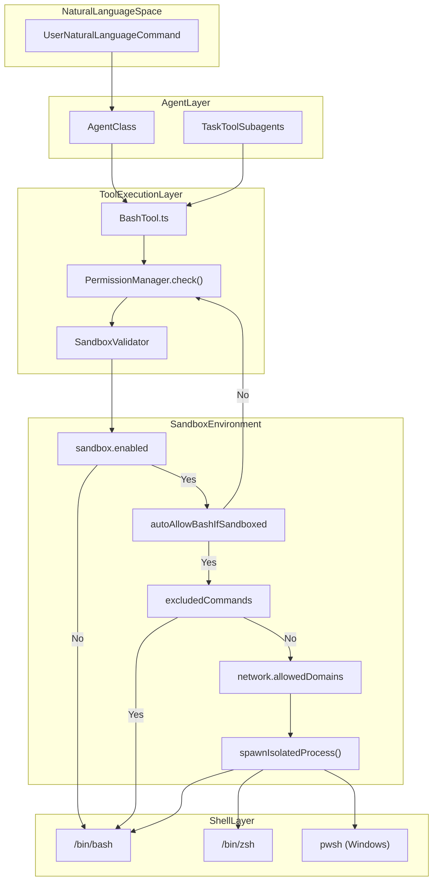
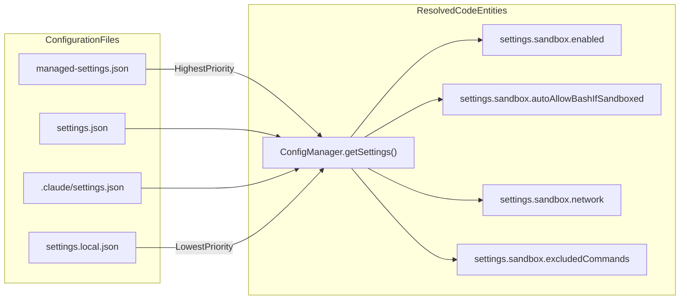
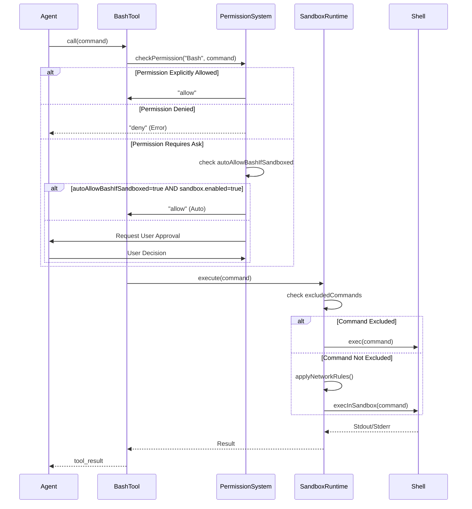

<!-- source: DeepWiki mcp.deepwiki.com · repo anthropics/claude-code · page 3.8 Sandbox Environment · fetched 2026-10-26 -->

# Sandbox Environment

<details>
<summary>Relevant source files</summary>

The following files were used as context for generating this wiki page:

- [.devcontainer/Dockerfile](.devcontainer/Dockerfile)
- [.devcontainer/devcontainer.json](.devcontainer/devcontainer.json)
- [.devcontainer/init-firewall.sh](.devcontainer/init-firewall.sh)
- [.gitattributes](.gitattributes)
- [.vscode/extensions.json](.vscode/extensions.json)
- [CHANGELOG.md](CHANGELOG.md)
- [LICENSE.md](LICENSE.md)
- [README.md](README.md)
- [SECURITY.md](SECURITY.md)
- [demo.gif](demo.gif)
- [examples/mdm/README.md](examples/mdm/README.md)
- [examples/settings/README-hipaa.md](examples/settings/README-hipaa.md)
- [examples/settings/README.md](examples/settings/README.md)
- [examples/settings/managed-mcp-hipaa.json](examples/settings/managed-mcp-hipaa.json)
- [examples/settings/settings-bash-sandbox.json](examples/settings/settings-bash-sandbox.json)
- [examples/settings/settings-hipaa.json](examples/settings/settings-hipaa.json)
- [examples/settings/settings-lax.json](examples/settings/settings-lax.json)
- [examples/settings/settings-strict.json](examples/settings/settings-strict.json)
- [feed.xml](feed.xml)

</details>


## Purpose and Scope

The Sandbox Environment provides isolated execution for the `Bash` tool, restricting its access to the filesystem and network [examples/settings/README.md:27-28](). This system prevents malicious or accidental commands from accessing unauthorized resources, reading sensitive files, or making external network connections. The sandbox operates at the tool level, intercepting Bash command execution before it reaches the shell.

The `sandbox` property in configuration applies specifically to the `Bash` tool; it does not apply to other tools like `Read`, `Write`, `WebSearch`, `WebFetch`, MCP servers, hooks, or internal slash commands [examples/settings/README.md:27-28](). Filesystem restrictions also support glob patterns (such as `sandbox.filesystem.denyRead`), with robust handling on Linux for paths containing brackets like `[user-id]` route folders [CHANGELOG.md:13]().

Sources: [examples/settings/README.md:27-28](), [CHANGELOG.md:13]()

---

## Architecture Overview

The sandbox wraps the tool execution layer, creating an isolated environment with configurable restrictions [examples/settings/README.md:27-28](). When enabled, all Bash commands execute within this boundary unless explicitly excluded [examples/settings/settings-bash-sandbox.json:3-7](). At the container or system level, network egress is controlled via firewall scripts such as `[.devcontainer/init-firewall.sh:106-120]()` using `iptables` and `ipset` [sources: [.devcontainer/Dockerfile:20-22]()].

### Sandbox Execution Data Flow



Sources: [examples/settings/settings-bash-sandbox.json:1-18](), [examples/settings/README.md:27-28](), [.devcontainer/init-firewall.sh:106-120]()

---

## Configuration Hierarchy

Sandbox settings follow the standard Claude Code configuration hierarchy [examples/settings/README.md:5-6](). Security-critical flags like `allowManagedPermissionRulesOnly` and `allowManagedHooksOnly` are typically enforced at the enterprise level via `managed-settings.json` [examples/settings/README.md:5-6](). The hierarchy ensures that organizational policies take precedence over local user or project-level configurations [examples/settings/README.md:3-6]().

### Configuration Resolution



Sources: [examples/settings/README.md:1-32](), [examples/settings/settings-bash-sandbox.json:1-18](), [examples/settings/settings-strict.json:12-13]()

---

## Core Configuration Options

### `sandbox.enabled`

Activates the sandbox for all `Bash` tool invocations [examples/settings/settings-bash-sandbox.json:4-4](). When `true`, commands execute within the isolated environment unless explicitly excluded [examples/settings/settings-bash-sandbox.json:3-7](). 

**Default:** `false`

### `sandbox.autoAllowBashIfSandboxed`

When `true`, automatically approves Bash commands that will execute in the sandbox, bypassing the interactive prompt [examples/settings/settings-bash-sandbox.json:5-5](). 

**Default:** `false`  

### `sandbox.allowUnsandboxedCommands`

Controls whether commands can execute outside the sandbox when the sandbox is enabled [examples/settings/settings-bash-sandbox.json:6-6](). If set to `false`, any command that cannot be sandboxed (or is not excluded) will be blocked [examples/settings/settings-bash-sandbox.json:6-6]().

**Default:** `true`

### `sandbox.excludedCommands`

An array of command patterns that bypass sandbox restrictions [examples/settings/settings-bash-sandbox.json:7-7](). Commands matching these patterns execute with normal filesystem and network access [examples/settings/README.md:27-28]().

```json
{
  "sandbox": {
    "excludedCommands": ["git", "npm", "docker"]
  }
}
```

**Warning:** Excluded commands run with unrestricted access. Only exclude trusted commands.

### `sandbox.enableWeakerNestedSandbox`

A setting that allows for nested sandboxing environments even if they provide weaker isolation than the primary sandbox [examples/settings/settings-bash-sandbox.json:16-16]().

Sources: [examples/settings/settings-bash-sandbox.json:1-18](), [examples/settings/settings-strict.json:15-27]()

---

## Network Isolation

The sandbox implements fine-grained network restrictions, controlling which domains and protocols commands can access [examples/settings/settings-bash-sandbox.json:8-15](). Network enforcement can be complemented by container firewall configurations [sources: [.devcontainer/init-firewall.sh:40-120]()].

### `sandbox.network.allowedDomains`

A whitelist of domains that sandboxed commands can access [examples/settings/settings-bash-sandbox.json:12-12](). Supports exact matches and wildcards [examples/settings/settings-bash-sandbox.json:12-12]().

**Default:** `[]` (no external domains allowed)

### `sandbox.network.allowUnixSockets` and `allowAllUnixSockets`

Controls access to Unix sockets [examples/settings/settings-bash-sandbox.json:9-10](). `allowUnixSockets` takes an array of specific paths, while `allowAllUnixSockets` is a boolean toggle [examples/settings/settings-bash-sandbox.json:9-10]().

### `sandbox.network.allowLocalBinding`

Determines if sandboxed processes are allowed to bind to local ports (e.g., starting a local dev server) [examples/settings/settings-bash-sandbox.json:11-11]().

### `sandbox.network.httpProxyPort` and `sandbox.network.socksProxyPort`

Configure proxy ports for sandboxed network traffic [examples/settings/settings-bash-sandbox.json:13-14](). This enables traffic inspection or routing through corporate filters [examples/settings/README.md:3-3]().

Sources: [examples/settings/settings-bash-sandbox.json:8-15](), [examples/settings/settings-strict.json:18-25](), [.devcontainer/init-firewall.sh:40-120]()

---

## Permission Flow with Sandbox

The sandbox integrates with the permission system [examples/settings/README.md:2-11](). If `autoAllowBashIfSandboxed` is enabled, the permission manager can bypass the interactive prompt for Bash commands [examples/settings/settings-bash-sandbox.json:5-5](). 

### Tool Permission Logic



Sources: [examples/settings/settings-bash-sandbox.json:3-7](), [examples/settings/README.md:27-28]()

---

## Example Configurations

### Strict Sandbox (Enterprise)
Maximum isolation with no auto-approval and blocked web tools [examples/settings/settings-strict.json:1-28]().

```json
{
  "permissions": {
    "ask": ["Bash"],
    "deny": ["WebSearch", "WebFetch"]
  },
  "allowManagedPermissionRulesOnly": true,
  "sandbox": {
    "autoAllowBashIfSandboxed": false,
    "network": {
      "allowedDomains": []
    }
  }
}
```

### Development Sandbox
Allows auto-approval for sandboxed commands to increase velocity while maintaining network isolation [examples/settings/settings-bash-sandbox.json:1-18]().

```json
{
  "sandbox": {
    "enabled": true,
    "autoAllowBashIfSandboxed": true,
    "network": {
      "allowedDomains": ["*.github.com", "*.npmjs.org"]
    }
  }
}
```

Sources: [examples/settings/settings-strict.json:1-28](), [examples/settings/settings-bash-sandbox.json:1-18](), [examples/settings/README.md:13-21]()

---

