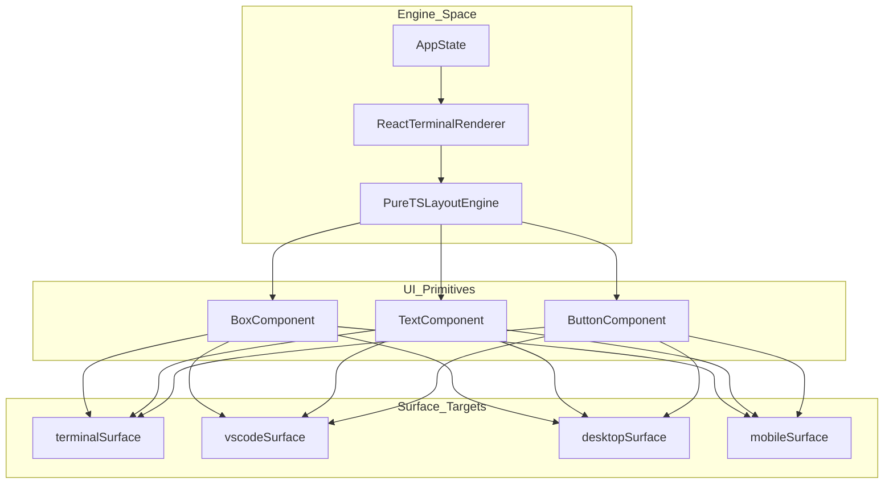
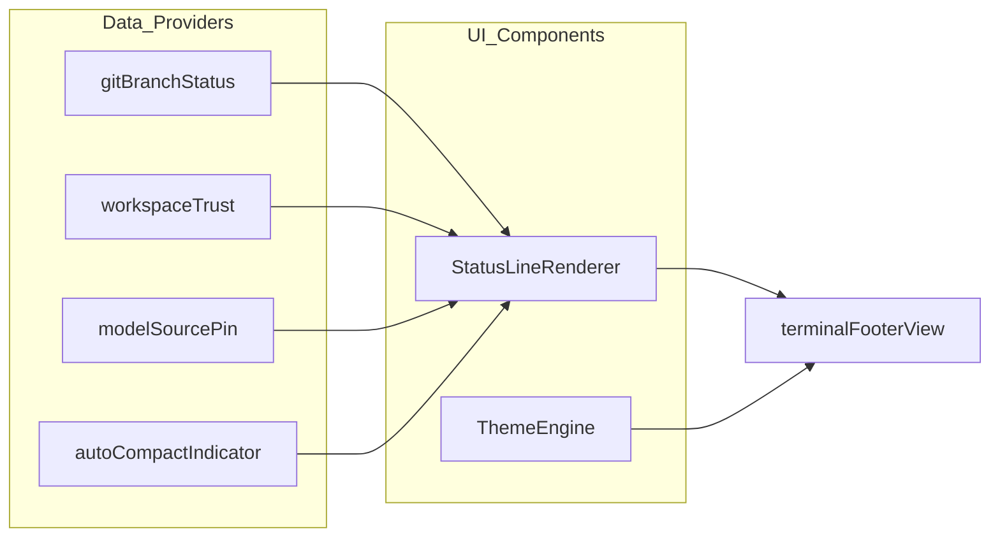
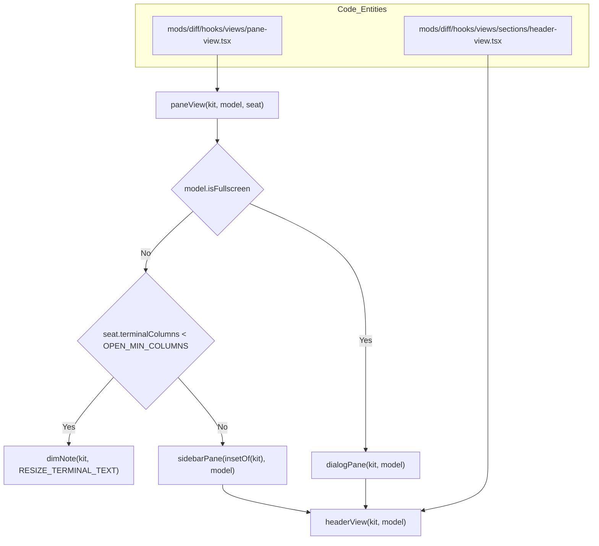

<!-- source: DeepWiki mcp.deepwiki.com · repo anthropics/claude-code · page 3.9 UI/UX & Terminal Integration · fetched 2026-10-26 -->

# UI/UX & Terminal Integration

Relevant source files

The following files were used as context for generating this wiki page:

- [.devcontainer/Dockerfile](.devcontainer/Dockerfile)
- [.devcontainer/devcontainer.json](.devcontainer/devcontainer.json)
- [.devcontainer/init-firewall.sh](.devcontainer/init-firewall.sh)
- [.gitattributes](.gitattributes)
- [.vscode/extensions.json](.vscode/extensions.json)
- [CHANGELOG.md](CHANGELOG.md)
- [LICENSE.md](LICENSE.md)
- [README.md](README.md)
- [SECURITY.md](SECURITY.md)
- [demo.gif](demo.gif)
- [feed.xml](feed.xml)
- [mods/README.md](mods/README.md)
- [mods/types/claude-code.d.ts](mods/types/claude-code.d.ts)

## Purpose and Scope

This document details Claude Code's terminal user interface (TUI) and interactive subsystem, covering the React-based terminal rendering engine, multi-surface rendering (`terminal`, `desktop`, `vscode`, `mobile`), input handling and keybindings, status line mechanics, file suggestion autocomplete, and deep IDE integrations including VS Code and DevContainers.

---

## Terminal UI Architecture & Surfaces

Claude Code renders complex UI hierarchies inside standard terminal emulators using a custom React-based terminal rendering engine paired with a pure TypeScript layout system [CHANGELOG.md:214](). 

### Surfaces and UI Components
The engine abstracts rendering across multiple target surfaces (`terminal`, `desktop`, `vscode`, `mobile`) via the UI mounting and resolution APIs declared in `mods/types/claude-code.d.ts`:
- **`$.ui.mount`**: Mounts a component on a specified surface (`terminal`, `desktop`, `vscode`, `mobile`) for testing and interactive rendering [mods/types/claude-code.d.ts:33-34]().
- **`$.ui.resolve`**: Resolves primitive UI drawing elements (`Box`, `Text`, `Button`, etc.) for active render hooks [mods/types/claude-code.d.ts:22-23]().

**Diagram: UI Surface and Rendering Pipeline**

Sources: [mods/types/claude-code.d.ts:21-44](), [CHANGELOG.md:214-215]()

- **Accessibility Mode:** Screen reader support can be activated via `--ax-screen-reader`, `CLAUDE_AX_SCREEN_READER=1`, or the `axScreenReader` setting, enabling plain-text rendering and word/line deletion announcements [CHANGELOG.md:9](), [CHANGELOG.md:37]().
- **Flicker-Free Rendering:** Alt-screen rendering with virtualized scrollback is toggleable via `CLAUDE_CODE_NO_FLICKER=1` [CHANGELOG.md:68]().

Sources: [CHANGELOG.md:9](), [CHANGELOG.md:37](), [CHANGELOG.md:68](), [mods/types/claude-code.d.ts:21-44]()

---

## Input System & Keybindings

The input handler processes user keystrokes, clipboard pastes, and specialized keyboard modes.

### Keybinding Reference

| Keybinding | Action | Context |
|------------|--------|---------|
| `Enter` | Submit message / Toggle config | Standard input / `/config` [CHANGELOG.md:13]() |
| `Space` | Toggle config setting | `/config` [CHANGELOG.md:13]() |
| `Shift+Enter` | Insert newline | Multi-line input [CHANGELOG.md:209]() |
| `Meta+Enter` | Insert newline | Multi-line input [CHANGELOG.md:209]() |
| `Ctrl+C` | Cancel / Interrupt | Standard interrupt [CHANGELOG.md:211]() |
| `Ctrl+D` | Exit session | End of input [CHANGELOG.md:211]() |
| `Ctrl+E` | Jump to end of line | Prompt editing [CHANGELOG.md:18]() |
| `Ctrl+X` | Delete renamed-branch worktrees | Agent view [CHANGELOG.md:48]() |
| `Ctrl+_` | Undo prompt input | Prompt editing [CHANGELOG.md:60]() |
| `Cmd+Delete` | Delete to start of line | Supported terminals [CHANGELOG.md:34]() |
| `Tab` | Accept autocomplete | Suggestion visible [CHANGELOG.md:163]() |
| `Up/Down` | History navigation | Input prompt [CHANGELOG.md:205]() |
| `v` / `V` | Vim visual / visual-line mode | Advanced selection [CHANGELOG.md:5]() |
| `Esc` | Save & Close / Cancel | `/config` [CHANGELOG.md:13](), Theme editor, session picker [CHANGELOG.md:14-15]() |
| `Esc Esc` | Open rewind menu | Idle prompt [CHANGELOG.md:22]() |
| `←` (Left) | Open Agents view | Foreground session [CHANGELOG.md:35]() |

Sources: [CHANGELOG.md:5](), [CHANGELOG.md:13-15](), [CHANGELOG.md:18](), [CHANGELOG.md:22](), [CHANGELOG.md:34-35](), [CHANGELOG.md:48](), [CHANGELOG.md:53](), [CHANGELOG.md:60](), [CHANGELOG.md:205](), [CHANGELOG.md:209](), [CHANGELOG.md:211]()

- **Kitty Protocol & Vim Mode:** Claude Code supports the Kitty keyboard protocol for precise key modifier tracking and cleanup on exit [CHANGELOG.md:211](). Left arrow (`←`) on empty prompts opens the agent view from `NORMAL` or `INSERT` Vim modes [CHANGELOG.md:22](), [CHANGELOG.md:35]().
- **Mouse & Dictation:** Mouse clicks are supported for multi-select menus (toggleable via `CLAUDE_CODE_DISABLE_MOUSE_CLICKS=1`) [CHANGELOG.md:12](), [CHANGELOG.md:39](). Voice dictation handles space-less languages (Japanese, Chinese, Thai) with optimized auto-submit logic [CHANGELOG.md:41-42]().

Sources: [CHANGELOG.md:12](), [CHANGELOG.md:22](), [CHANGELOG.md:35](), [CHANGELOG.md:39-42](), [CHANGELOG.md:211]()

---

## Status Line and Theming

The status line displays real-time execution telemetry, git branch states, trust flags, and auto-compact context metrics.

Sources: [CHANGELOG.md:7](), [CHANGELOG.md:15-16](), [CHANGELOG.md:26](), [CHANGELOG.md:29]()

- **Custom Themes:** User-defined themes are loaded from `~/.claude/themes/` or configured via `/theme` [CHANGELOG.md:7]().
- **Dynamic Workflow Size:** The status line exposes current workflow scale metrics with links to `/config` adjustments [CHANGELOG.md:29]().

Sources: [CHANGELOG.md:7](), [CHANGELOG.md:16](), [CHANGELOG.md:23](), [CHANGELOG.md:28-29](), [CHANGELOG.md:55]()

---

## Visual Feedback & Diff Pane Rendering

Interactive panels and tool execution output are managed through specialized view controllers.

### Diff Pane Rendering Architecture
The diff mod uses `paneView` located in `mods/diff/hooks/views/pane-view.tsx` to manage side-by-side or dialog-based views depending on terminal width constraints [mods/diff/hooks/views/pane-view.tsx:29-51]().

**Diagram: Diff Pane Controller Flow**

Sources: [mods/diff/hooks/views/pane-view.tsx:29-51](), [mods/diff/hooks/views/sections/header-view.tsx:24-43]()

- **Streaming and Error Alerts:** Tool executions stream output dynamically. MCP connection failures display HTTP error details in `/mcp` [CHANGELOG.md:16](), [CHANGELOG.md:58]().
- **Cursor Focus:** Plugin and settings panels shift terminal cursor focus to active rows to assist screen readers and magnification tools [CHANGELOG.md:49]().

Sources: [CHANGELOG.md:8](), [CHANGELOG.md:10-11](), [CHANGELOG.md:16](), [CHANGELOG.md:29-31](), [CHANGELOG.md:49](), [CHANGELOG.md:58](), [mods/diff/hooks/views/pane-view.tsx:29-51](), [mods/diff/hooks/views/sections/header-view.tsx:24-43]()

---

## IDE Integration & Surfaces

Claude Code interfaces with modern IDEs and container runtimes.

- **VS Code & DevContainers:** The `.devcontainer/devcontainer.json` file configures pre-installed extensions (`anthropic.claude-code`, `dbaeumer.vscode-eslint`, `esbenp.prettier-vscode`, `eamodio.gitlens`) [.devcontainer/devcontainer.json:17-23]() and sets up terminal profiles [.devcontainer/devcontainer.json:31-39](). A `postStartCommand` initializes container network security via `sudo /usr/local/bin/init-firewall.sh` [.devcontainer/devcontainer.json:55]().
- **Deep Linking:** External applications can invoke prompts via the `claude-cli://open?q=…` custom protocol scheme, enforcing safety reviews for long pre-filled inputs [CHANGELOG.md:190](), [CHANGELOG.md:227]().

Sources: [CHANGELOG.md:21](), [CHANGELOG.md:25](), [CHANGELOG.md:29](), [CHANGELOG.md:34-36](), [CHANGELOG.md:38](), [CHANGELOG.md:41](), [CHANGELOG.md:190](), [CHANGELOG.md:227](), [.devcontainer/devcontainer.json:17-55](), [.devcontainer/Dockerfile:26-69]()

---

## File Suggestions & Autocomplete

- **Bash Mode (`!`):** Real-time file path autocomplete operates interactively during bash command composition [CHANGELOG.md:57]().
- **Slash Commands:** `/plugin` autocomplete integrates marketplace plugin listings [CHANGELOG.md:7]().
- **VCS Exclusions:** Metadata directories from alternative version control systems such as Jujutsu (`.jj`) and Sapling (`.sl`) are automatically excluded from autocomplete indexes [CHANGELOG.md:158]().

Sources: [CHANGELOG.md:7](), [CHANGELOG.md:12](), [CHANGELOG.md:57](), [CHANGELOG.md:158]()

---

