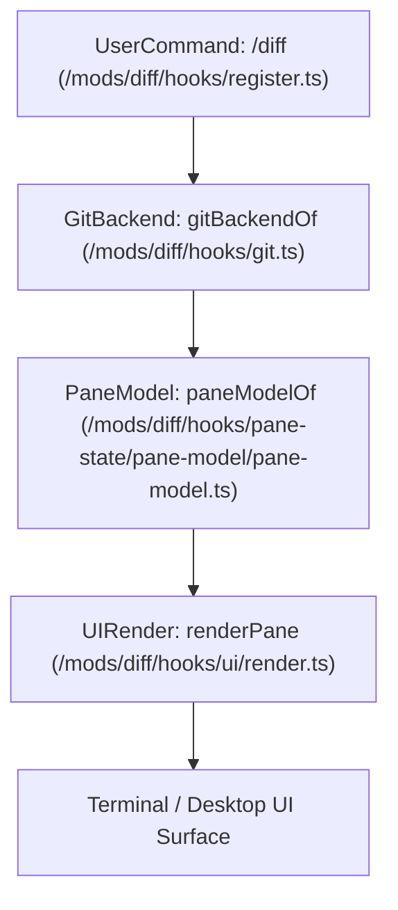
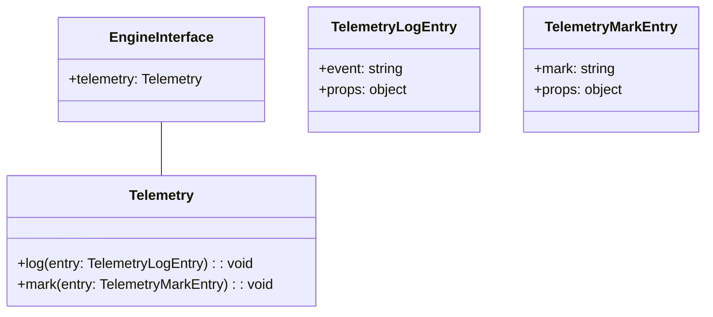

<!-- source: DeepWiki mcp.deepwiki.com · repo anthropics/claude-code · page 4 Built-in Mods · fetched 2026-10-26 -->

# Built-In Mods

<details>
<summary>Relevant source files</summary>

The following files were used as context for generating this wiki page:

- [mods/README.md](mods/README.md)
- [mods/types/claude-code.d.ts](mods/types/claude-code.d.ts)

</details>


This page provides a high-level overview of the built-in modifications (`mods/`) that ship with Claude Code. Mods are first-party plugins implemented as hooks modules, each featuring a `register(on, options)` entrypoint that hooks into engine events using functions `($, e, next)` [mods/README.md:1-6](). They extend Claude Code's functionality and are an integral part of its operation. This section introduces each built-in mod and links to dedicated child pages for detailed technical documentation.

Sources:
* [mods/README.md:1-6]()

## Mod SDK: Engine Interface, Hooks & Noun Contracts

The Mod SDK defines the type declarations and interfaces under `mods/types/claude-code.d.ts` for developing mods and plugins [mods/types/claude-code.d.ts:1-14](). It includes TypeScript declarations for the `Register` signature, the `EngineInterface` (`$`), event hook signatures (`$`, `e`, `next`), and the noun-contract pattern for extending `$` via `engine.create`.

### Mod SDK & Engine Architecture
```mermaid
graph TD
    A["User Plugin or Built-in Mod"] -->| "Exports register: Register" | B["Mods Module Entrypoint"]
    B -->| "Receives EngineInterface ($) & on" | C["claude-code Engine Host"]
    C -->| "Provides Type Declarations" | D["mods/types/claude-code.d.ts"]
    C -->| "Extends via engine.create Noun Contract" | E["EngineInterface ($) Extensions"]
```
Sources:
* [mods/types/claude-code.d.ts:1-91]()
* [mods/README.md:84-112]()

For details, see [Mod SDK: Engine Interface, Hooks & Noun Contracts](#4.1).

Sources:
* [mods/types/claude-code.d.ts:1-91]()
* [mods/README.md:84-112]()

## Diff Mod

The Diff Mod (`mods/diff`) provides the `/diff` pane, which displays the session's uncommitted changes file by file with their hunks [mods/README.md:11](). It refreshes automatically as Claude edits files and runs commands, integrating with the underlying Git repository backend and rendering pane state models.

### Diff Mod Code Entity Architecture

Sources:
* [mods/README.md:11]()

For details, see [Diff Mod](#4.2).

Sources:
* [mods/README.md:11]()

## Telemetry Mod

The Telemetry Mod (`mods/telemetry`) adds the `$.telemetry` noun to the `EngineInterface`, exposing `log` and `mark` methods for recording first-party analytics rows [mods/README.md:12](). It features entry validation, event prefixes, choice tokens, and batch transmission, while respecting analytics-off settings.

### Telemetry Noun Contract

Sources:
* [mods/README.md:12]()
* [mods/README.md:90-91]()

For details, see [Telemetry Mod](#4.3).

Sources:
* [mods/README.md:12]()
* [mods/README.md:90-91]()

## Agents-MD Mod

The Agents-MD Mod (`mods/agents-md`) loads `AGENTS.md` as project instructions according to configured operational modes [mods/README.md:13](). Supported modes include:
*   `claude-md-or-agents-md` (default): Loads `AGENTS.md` when no `CLAUDE.md` is present.
*   `claude-md-and-agents-md`: Loads `AGENTS.md` alongside `CLAUDE.md`.
*   `managed-only`: Discards local instructions, retaining only organization instructions.
*   `claude-md`: Restricts project instructions strictly to `CLAUDE.md`.

For details, see [Agents-MD Mod](#4.4).

Sources:
* [mods/README.md:13]()

## Sec-Default Mod

The Sec-Default Mod (`mods/sec-default`) secures organizational boundaries by ensuring classic hooks, prompt content, managed settings, and tool policies remain isolated from user-installed plugins [mods/README.md:10](). Operating as the outermost layer, it enforces tool-registration refusals and strict policy layers.

For details, see [Sec-Default Mod](#4.5).

Sources:
* [mods/README.md:10]()

## Mod Testing & CI

The Claude Code testing framework (`claude-code/testing`) offers utilities (`test`, `describe`, `tier`, `mock.clock`, `mock.env`, `mock.store`) for verifying mod behavior [mods/README.md:25-40](). Tests execute via `claude plugin test <dir>` [mods/README.md:26](), and typechecking is enforced across hooks and test suites using `mods/tsconfig.json`.

For details, see [Mod Testing & CI](#4.6).

Sources:
* [mods/README.md:25-40]()

---

