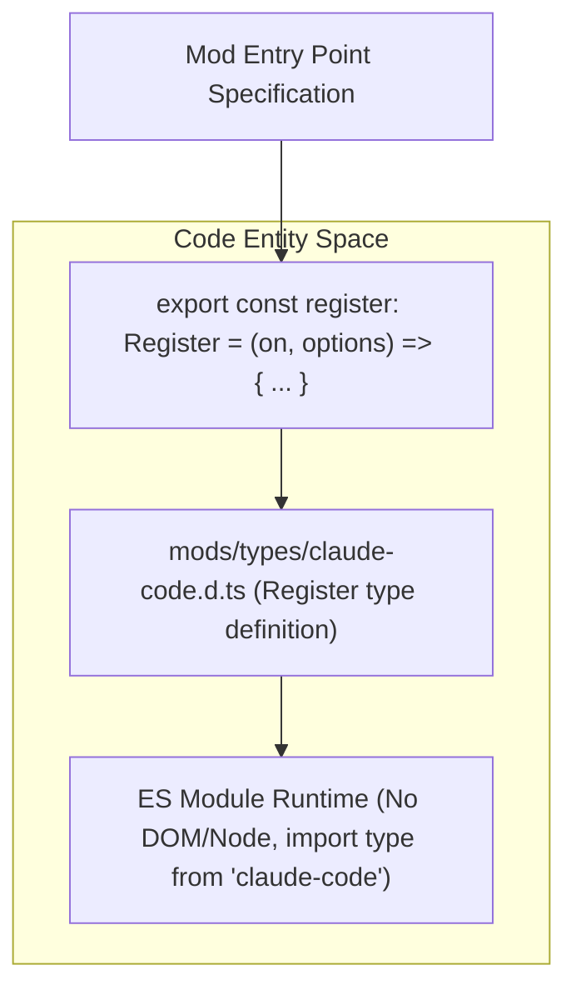
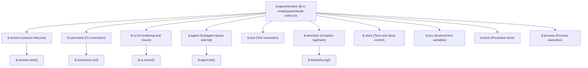
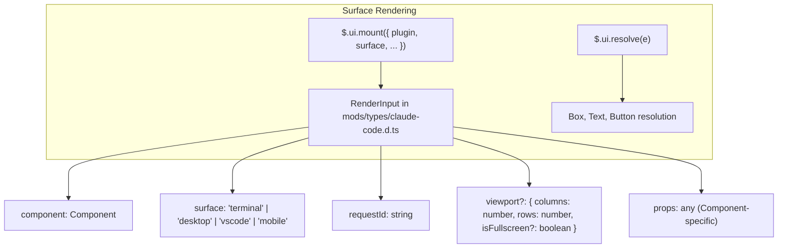
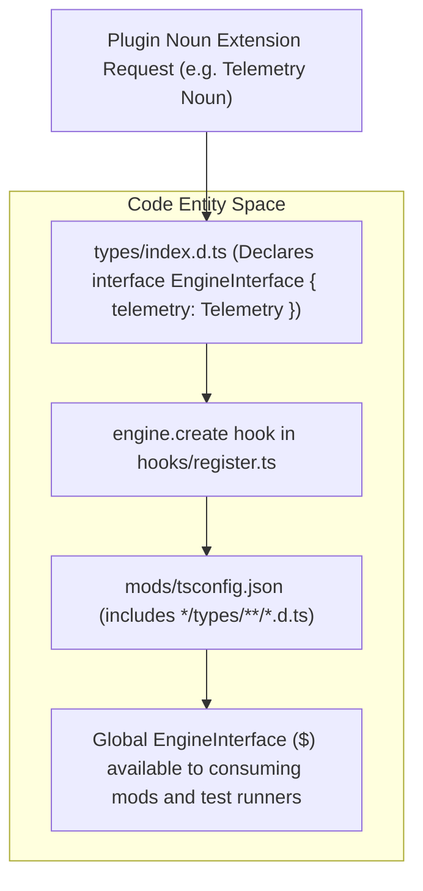

<!-- source: DeepWiki mcp.deepwiki.com · repo anthropics/claude-code · page 4.1 Mod SDK: Engine Interface, Hooks & Noun Contracts · fetched 2026-10-26 -->

# Mod SDK: Engine Interface, Hooks & Noun Contracts

<details>
<summary>Relevant source files</summary>

The following files were used as context for generating this wiki page:

- [mods/README.md](mods/README.md)
- [mods/types/claude-code.d.ts](mods/types/claude-code.d.ts)

</details>


## Purpose & Scope

The Claude Code Mod SDK provides a strongly-typed extension framework for first-party built-in mods (`sec-default`, `diff`, `telemetry`, `agents-md`) and user plugins `[mods/README.md:8-13]()`. Mods execute within a restricted ES module runtime (no DOM, no Node.js built-ins) where all interactions with the core engine are mediated through the `EngineInterface` (`$`) `[mods/types/claude-code.d.ts:16-20]()`. Type safety is enforced via `mods/types/claude-code.d.ts` and checked using `tsc -p mods/tsconfig.json` `[mods/README.md:81-82]()`.

Sources:
* `[mods/types/claude-code.d.ts:1-20]()`
* `[mods/README.md:1-14]()`
* `[mods/README.md:81-82]()`

---

## Register Signature & Hooks Module Structure

The entry point for any Claude Code mod is the `register` function, which adheres to the `Register` type declaration `[mods/types/claude-code.d.ts:57-61]()`. It receives two parameters: `on` (for registering event hooks) and `options` (mod-specific configuration) `[mods/README.md:3-4]()`.

Hooks modules are pure ES modules (`.ts`, `.tsx`, `.jsx`, `.js`, `.mjs`, `.cjs`, `.mts`, `.cts`) and cannot use `require` `[mods/types/claude-code.d.ts:18-20]()`. They import type definitions directly from `'claude-code'`:

```typescript
import type { Register, On, EngineInterface } from 'claude-code'
```
`[mods/types/claude-code.d.ts:12-13]()`


Title: Natural Language to Code Entity Space: Mod Registration Flow
Sources:
* `[mods/types/claude-code.d.ts:12-20]()`
* `[mods/types/claude-code.d.ts:57-61]()`
* `[mods/README.md:3-6]()`

---

## EngineInterface ($) & Nouns

The `EngineInterface`, aliased as `$`, is the primary mechanism through which mods interact with subsystems `[mods/types/claude-code.d.ts:93-94]()`. Nouns organize engine capabilities into distinct namespaces such as `$.session`, `$.command`, `$.ui`, `$.agent`, `$.tool`, `$.telemetry`, `$.clock`, `$.env`, `$.store`, and `$.process` `[mods/types/claude-code.d.ts:93-149]()`, `[mods/README.md:12-12]()`.


Title: EngineInterface Nouns and Code Entity Mapping
Sources:
* `[mods/types/claude-code.d.ts:93-149]()`
* `[mods/README.md:12-12]()`
* `[mods/README.md:58-59]()`

---

## Event Hook Signatures ($, e, next) & StarNext Narrowing

Event handlers registered via `on` receive three arguments: `$` (`EngineInterface`), `e` (event object), and `next` (continuation function) `[mods/README.md:3-5]()`. 

Cooperative event handling allows multiple plugins to intercept events. Calling `next(e)` delegates control to subsequent handlers in the chain `[mods/README.md:53-56]()`. The `StarNext` pattern enforces type safety by narrowing the return type of the handler: if `next` is invoked, the return type aligns with the continuation result; if omitted, the handler must return a value fulfilling the specific event contract.

```typescript
on('session.start', ($, e, next) => {
  return next(e)
})
```
`[mods/README.md:53-56]()`

Sources:
* `[mods/README.md:3-5]()`
* `[mods/README.md:53-56]()`

---

## UI Component Rendering & Props

UI rendering in mods is performed via `$.ui.mount()` `[mods/types/claude-code.d.ts:32-34]()` and element resolution through `$.ui.resolve(e)` `[mods/types/claude-code.d.ts:22-23]()`. Component properties are strongly typed using `RenderInput<Component>` templates `[mods/diff/tests/fixtures/hint.ts:8-8]()`.


Title: UI Component RenderInput Structure and Surface Binding
Sources:
* `[mods/types/claude-code.d.ts:21-24]()`
* `[mods/types/claude-code.d.ts:32-34]()`
* `[mods/diff/tests/fixtures/hint.ts:8-8]()`

---

## Noun-Contract Pattern for Extending $ via engine.create

The noun-contract pattern allows mods to extend `EngineInterface` (`$`) with new custom subsystems `[mods/README.md:84-108]()`. 

### Architecture and Enforcement

1. **Dedicated Contract File**: A mod defining a noun places its type definitions in `types/index.d.ts` without imports, exporting types named after the PascalCase noun and extending `EngineInterface` via module augmentation `[mods/README.md:85-91]()`.
2. **Declaration Merging**: 
   ```typescript
   export type Telemetry = { /* ... */ }
   declare module 'claude-code' {
     interface EngineInterface { telemetry: Telemetry }
   }
   ```
   `[mods/types/claude-code.d.ts:86-89]()`
3. **Implementation via `engine.create`**: The mod's `engine.create` hook returns the runtime implementation, type-checked against `EngineInterface['<nounName>']` `[mods/README.md:93-97]()`.
4. **Cross-Mod Consumption**: Other modules consume the noun via `$` (e.g., `$.telemetry.log(...)`), type-checked globally because `mods/tsconfig.json` includes `*/types/**/*.d.ts` `[mods/README.md:98-101]()`.
5. **Testing Providers**: Test suites seat providers via inline plugins that implement `engine.create` for the target noun `[mods/README.md:102-107]()`.


Title: Natural Language to Code Entity Space: Noun-Contract Pattern
Sources:
* `[mods/types/claude-code.d.ts:83-91]()`
* `[mods/README.md:84-108]()`
* `[mods/tsconfig.json:1-17]()`

---

