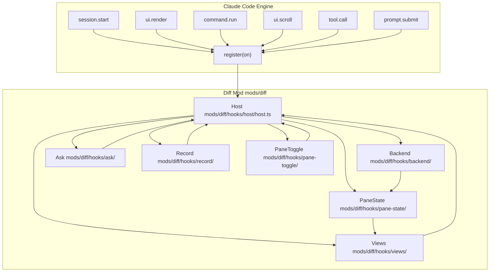

<!-- source: DeepWiki mcp.deepwiki.com · repo anthropics/claude-code · page 4.2 Diff Mod · fetched 2026-10-26 -->

# Diff Mod

Relevant source files

The following files were used as context for generating this wiki page:

- [mods/diff/README.md](mods/diff/README.md)
- [mods/diff/hooks/host/host.ts](mods/diff/hooks/host/host.ts)
- [mods/diff/hooks/index.ts](mods/diff/hooks/index.ts)
- [mods/diff/hooks/is-checkpointing/index.ts](mods/diff/hooks/is-checkpointing/index.ts)
- [mods/diff/hooks/is-checkpointing/is-checkpointing.ts](mods/diff/hooks/is-checkpointing/is-checkpointing.ts)
- [mods/diff/hooks/register.ts](mods/diff/hooks/register.ts)
- [mods/diff/tests/fixtures/beneath/beneath.ts](mods/diff/tests/fixtures/beneath/beneath.ts)
- [mods/diff/tests/fixtures/beneath/left-waiting.ts](mods/diff/tests/fixtures/beneath/left-waiting.ts)
- [mods/diff/tests/fixtures/in-repository.ts](mods/diff/tests/fixtures/in-repository.ts)
- [mods/diff/tests/fixtures/index.ts](mods/diff/tests/fixtures/index.ts)
- [mods/diff/tests/fixtures/wheel-over-list.ts](mods/diff/tests/fixtures/wheel-over-list.ts)
- [mods/diff/tests/git.test.ts](mods/diff/tests/git.test.ts)
- [mods/diff/tests/register.test.ts](mods/diff/tests/register.test.ts)

The Diff Mod (`mods/diff`) provides the `/diff` pane functionality within Claude Code, allowing users to view uncommitted changes in their session [mods/diff/README.md:3-4](). This mod integrates deeply with the system's lifecycle, git backend, and UI rendering to offer a seamless experience for tracking code modifications.

This page provides a high-level overview of the Diff Mod. For detailed technical information, please refer to the child pages:

- [Diff Mod Lifecycle & State](#4.2.1) — Covers the registration of hooks, backend pinning, refresh/poll pipeline, `PaneModel` state management, pane toggling, and armed-ask prompt context injection.
- [Git Backend & Diff Parsing](#4.2.2) — Explains the `backendOf` function, `GitDeps`, pinned git execution, baselines, dirty-path probes, untracked file tiers, `numstat` and file-diff parsing, hunk fetching, and dating context.
- [Diff Pane Rendering & Layout](#4.2.3) — Details the rendering of docked and inline dialog panes, header/detail views, body windowing and scrolling, file rows, the todo bar, legend, layout helpers (`wrappedLines`, `truncateStart`), and column limit constants.

## Overview

The Diff Mod is implemented as a plugin, residing in `mods/diff/`. Its primary function is to display uncommitted changes in a dedicated pane, accessible via the `/diff` command [mods/diff/README.md:3-4](). This pane can be docked alongside the transcript or appear as an inline dialog, adapting to the terminal's layout and user preferences [mods/diff/README.md:16-35]().

The mod dynamically updates the diff view as the user makes edits or runs shell commands. When the pane is open, it continuously polls the Git repository's HEAD to reflect external changes, such as commits or checkouts [mods/diff/README.md:14-15](). A key feature is its ability to automatically open the diff pane upon the first successful edit of a session, provided the terminal layout and width are suitable [mods/diff/README.md:16-21]().

The comparison base for the diff can be configured, allowing users to compare the working tree against HEAD (default), against HEAD plainly, or against the merge-base with the default branch. This choice is persisted per repository [mods/diff/README.md:37-39](). The mod also handles pre-session changes and "noise" files (like lockfiles or generated files) by listing them separately and folding them by default [mods/diff/README.md:42-44]().

Sources:
- [mods/diff/README.md:1-105]()

## Diff Mod Architecture

The Diff Mod's architecture is centered around its `register` function [mods/diff/hooks/register.ts:42-160](), which wires into various engine hooks to manage its lifecycle, interact with the Git backend, and render the UI.

The core components and their interactions are illustrated below:

Title: Diff Mod High-Level Architecture
Sources:
- [mods/diff/hooks/register.ts:42-160]()
- [mods/diff/README.md:72-87]()
- [mods/diff/hooks/host/host.ts:18-130]()

## Diff Mod Lifecycle & State

The `register` function in `mods/diff/hooks/register.ts` serves as the primary entry point for the Diff Mod [mods/diff/hooks/register.ts:42-42](). It configures event listeners and manages the internal runtime state across turns and user interactions.

Key aspects of the lifecycle include:
- **Hook Wiring**: The mod registers handlers for events like `session.start`, `ui.render`, `command.run`, `ui.scroll`, `tool.call`, and `prompt.submit` [mods/diff/README.md:72-87](). These hooks allow the mod to initialize, update its display, respond to user commands, handle scrolling, react to code changes, and inject diff context into prompts.
- **Backend Pinning**: The Git backend is "pinned" to a specific repository when `/diff` is first invoked or when the first edit occurs, ensuring consistent Git operations within that context [mods/diff/hooks/register.ts:110-120](). This pinning persists until `/clear` or `/resume` is used [mods/diff/README.md:83-83]().
- **Refresh and Poll Pipeline**: The pane refreshes automatically after edits and shell commands [mods/diff/README.md:84-85](). When open, it also polls the Git repository's HEAD to detect external changes [mods/diff/README.md:14-15]().
- **PaneModel State**: The mod maintains a `PaneState.PaneModel` structure to represent the current state of the diff pane, including displayed files, selected base, and other UI elements [mods/diff/hooks/register.ts:68-68]().
- **Pane Toggle**: The `/diff` command toggles the visibility of the diff pane, switching between active and inactive states [mods/diff/README.md:79-79]().
- **Armed-Ask Prompt Context Injection**: Users can "arm" a file's diff, which then gets injected into the next prompt as context via `prompt.submit` [mods/diff/README.md:86-86]().

For a detailed breakdown of the lifecycle and state management, see [Diff Mod Lifecycle & State](#4.2.1).

Sources:
- [mods/diff/README.md:14-87]()
- [mods/diff/hooks/register.ts:42-120]()

## Git Backend & Diff Parsing

The Diff Mod relies heavily on Git for its core functionality. It interacts with Git through a specialized backend, which is responsible for executing Git commands and parsing their output.

Key aspects of the Git backend include:
- **`backendOf` and `BackendHost`**: The backend factory initializes repository handlers and inspects working tree characteristics [mods/diff/hooks/register.ts:127-140]().
- **Pinned Git Execution**: Git commands are executed within a restricted context using `DIFF_LEADING_ARGS` and isolated environment properties [mods/diff/tests/git.test.ts:32-41]().
- **Baselines and Dirty-Path Probes**: The backend determines the comparison baseline (e.g., HEAD, merge-base) and probes for dirty paths to identify changed files [mods/diff/README.md:48-52]().
- **Untracked File Tiers**: Untracked files are categorized and handled, with options to show or hide noise files such as lockfiles and generated artifacts [mods/diff/README.md:53-57]().
- **`numstat` and File-Diff Parsing**: The mod uses `git diff --numstat` to obtain summary statistics and `git diff` for detailed file differences [mods/diff/tests/register.test.ts:110-118]().
- **Hunk Fetching**: Individual diff hunks are retrieved and processed to present changes in a readable structure [mods/diff/tests/git.test.ts:75-95]().
- **Dating Context**: The mod considers the session's start time and file modification times (`mtimeOf`) to differentiate between pre-session changes and changes made during the current session [mods/diff/hooks/host/host.ts:82-83]().

For a detailed explanation of the Git backend and diff parsing, see [Git Backend & Diff Parsing](#4.2.2).

Sources:
- [mods/diff/README.md:48-68]()
- [mods/diff/hooks/register.ts:127-140]()
- [mods/diff/hooks/host/host.ts:82-83]()
- [mods/diff/tests/git.test.ts:32-95]()
- [mods/diff/tests/register.test.ts:110-118]()

## Diff Pane Rendering & Layout

The Diff Mod provides a flexible and responsive UI for displaying changes, adapting to different terminal dimensions and layout constraints.

Key aspects of rendering and layout include:
- **Docked vs. Inline Dialog Panes**: The diff pane can render as a docked sidebar beside the transcript or as an inline dialog overlay depending on terminal dimensions and environment flags [mods/diff/README.md:16-38]().
- **Pane, Header, and Detail Views**: The UI is composed of a main pane structure, a header displaying summary information, and views for individual file details [mods/diff/README.md:6-10]().
- **Body Windowing and Scrolling**: For docked panes, the hunk body can be scrolled independently via `ui.scroll` while headers and file lists remain fixed [mods/diff/README.md:7-9]().
- **File Rows and Legends**: Changes are presented as a list of file rows accompanied by a todo bar and legend for navigation guidance [mods/diff/README.md:6-12]().
- **Layout Helpers**: Utility functions such as `wrappedLines` and `truncateStart` assist in text formatting and column boundary enforcement [mods/diff/tests/fixtures/index.ts:55-68]().
- **Column Limit Constants**: The mod enforces terminal column restrictions, showing guidance messages if the viewport is too narrow for docked views [mods/diff/README.md:34-36]().

For a detailed look at how the diff pane is rendered and laid out, see [Diff Pane Rendering & Layout](#4.2.3).

Sources:
- [mods/diff/README.md:6-38]()
- [mods/diff/tests/fixtures/index.ts:55-68]()

---

