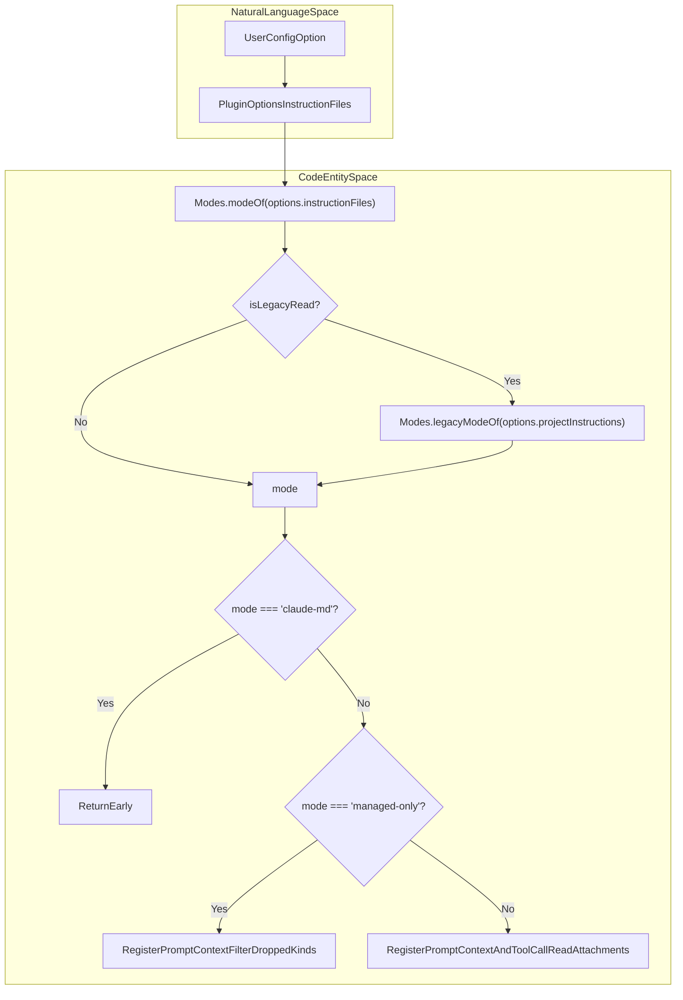
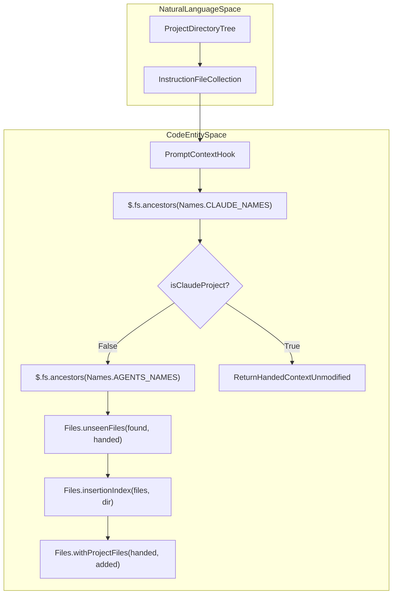

<!-- source: DeepWiki mcp.deepwiki.com · repo anthropics/claude-code · page 4.4 Agents-MD Mod · fetched 2026-10-26 -->

# Agents-MD Mod

Relevant source files

The following files were used as context for generating this wiki page:

- [mods/agents-md/.claude-plugin/plugin.json](mods/agents-md/.claude-plugin/plugin.json)
- [mods/agents-md/README.md](mods/agents-md/README.md)
- [mods/agents-md/hooks/files/chain-root-of.ts](mods/agents-md/hooks/files/chain-root-of.ts)
- [mods/agents-md/hooks/files/dropped-kinds.ts](mods/agents-md/hooks/files/dropped-kinds.ts)
- [mods/agents-md/hooks/files/files-of.ts](mods/agents-md/hooks/files/files-of.ts)
- [mods/agents-md/hooks/files/index.ts](mods/agents-md/hooks/files/index.ts)
- [mods/agents-md/hooks/files/insertion-index.ts](mods/agents-md/hooks/files/insertion-index.ts)
- [mods/agents-md/hooks/files/is-claude-file-on-walk.ts](mods/agents-md/hooks/files/is-claude-file-on-walk.ts)
- [mods/agents-md/hooks/files/is-kept-without-instructions.ts](mods/agents-md/hooks/files/is-kept-without-instructions.ts)
- [mods/agents-md/hooks/files/is-project-own.ts](mods/agents-md/hooks/files/is-project-own.ts)
- [mods/agents-md/hooks/hooks.json](mods/agents-md/hooks/hooks.json)
- [mods/agents-md/hooks/index.ts](mods/agents-md/hooks/index.ts)
- [mods/agents-md/hooks/register.ts](mods/agents-md/hooks/register.ts)
- [mods/agents-md/hooks/switches/index.ts](mods/agents-md/hooks/switches/index.ts)
- [mods/agents-md/hooks/switches/is-switched-on.ts](mods/agents-md/hooks/switches/is-switched-on.ts)
- [mods/agents-md/tests/fixtures/started-of.ts](mods/agents-md/tests/fixtures/started-of.ts)
- [mods/agents-md/tests/fixtures/types/started/started.ts](mods/agents-md/tests/fixtures/types/started/started.ts)
- [mods/agents-md/tests/register.test.ts](mods/agents-md/tests/register.test.ts)
- [mods/diff/hooks/git/argv/diff-leading-args.ts](mods/diff/hooks/git/argv/diff-leading-args.ts)
- [mods/diff/tests/git/fetch-diff.test.ts](mods/diff/tests/git/fetch-diff.test.ts)

The `agents-md` mod, located at `mods/agents-md/` [mods/agents-md/hooks/index.ts:1-9](), extends Claude Code's instruction file loading mechanism. Its primary purpose is to enable the system to recognize and utilize `AGENTS.md` files as project instructions in a manner identical to `CLAUDE.md`. This mod implements four operating modes, handles file discovery via ancestor walks and path framing, supports read-time directory attachments, and emits telemetry for load counts and mode selections [mods/agents-md/hooks/hooks.json:1-4]().

## Instruction File Loading Modes

The `agents-md` mod supports four distinct modes for handling instruction files, configured via the `instructionFiles` plugin option [mods/agents-md/README.md:5-29]().

### Mode Configuration and Backward Compatibility

The active mode is resolved in `register` [mods/agents-md/hooks/register.ts:40]() using `Modes.modeOf(options.instructionFiles)` [mods/agents-md/hooks/register.ts:41](). For backward compatibility, legacy `projectInstructions` settings are mapped via `Modes.legacyModeOf(options.projectInstructions)` [mods/agents-md/hooks/register.ts:45-47](). If a legacy option is present while using the default, a warning log is emitted via `$.ui.log` [mods/agents-md/hooks/register.ts:55-65]().

### The Four Modes

*   **`claude-md`**: Only `CLAUDE.md` files are loaded by the engine; the mod adds no additional files [mods/agents-md/README.md:6-7]().
*   **`claude-md-or-agents-md` (Default)**: If a project lacks its own `CLAUDE.md` file on the directory walk from root to working directory, `AGENTS.md` files are loaded instead [mods/agents-md/README.md:8-19](). Otherwise, the mod remains inactive [mods/agents-md/README.md:12-13]().
*   **`claude-md-and-agents-md`**: Every `AGENTS.md` file is loaded alongside `CLAUDE.md` across the tree, with duplicate checks based on path and content [mods/agents-md/README.md:20-22]().
*   **`managed-only`**: Drops project, local, and user-defined instruction files via `Files.isKeptWithoutInstructions` [mods/agents-md/hooks/register.ts:81-83]() filtering against `DROPPED_KINDS` [mods/agents-md/hooks/files/dropped-kinds.ts:8-12](), keeping only organization managed files and memory [mods/agents-md/README.md:23-26]().

### Diagram: Mode Routing and Resolution (`register.ts`)

Sources:
- [mods/agents-md/README.md:5-29]()
- [mods/agents-md/hooks/register.ts:40-88]()
- [mods/agents-md/hooks/files/dropped-kinds.ts:8-12]()

---

## File Discovery and Frames

When active in fallback or simultaneous modes, the mod executes file system queries via `$.fs.ancestors` [mods/agents-md/hooks/register.ts:116]() looking up `Names.AGENTS_NAMES` [mods/agents-md/hooks/register.ts:126]() and `Names.CLAUDE_NAMES` [mods/agents-md/hooks/register.ts:115]().

### Discovery and Insertion Pipeline

1. **Ancestor Walk**: The hook inspects whether the project has its own `CLAUDE.md` using `Files.isClaudeFileOnWalk` [mods/agents-md/hooks/files/is-claude-file-on-walk.ts:20-39]().
2. **File Collection**: Discovered file results are mapped using `Files.filesOf` and filtered for uniqueness via `Files.unseenFiles` [mods/agents-md/hooks/register.ts:131]().
3. **Positioning**: The `insertionIndex` function calculates the correct array index to insert `AGENTS.md` files among existing engine instruction files (root first, before deeper project files, or before memory) [mods/agents-md/README.md:94]().

### Diagram: Discovery and Path Framing (`prompt.context` / `$.fs.ancestors`)

Sources:
- [mods/agents-md/README.md:90-95]()
- [mods/agents-md/hooks/register.ts:99-167]()
- [mods/agents-md/hooks/files/is-claude-file-on-walk.ts:20-39]()

---

## Read-Time Attachment and Agent Spawning

To support dynamic instruction loading during file reads, the mod hooks into `tool.call` for the `Read` tool [mods/agents-md/hooks/register.ts:181]().

### Read-Time Logic

When a `Read` tool call succeeds and environment flags permit attachment (checked via `attachesOnRead` [mods/agents-md/hooks/register.ts:190]() and `isSwitchedOn` [mods/agents-md/hooks/switches/is-switched-on.ts:13-14]()):
* Absolute paths are resolved using `Frames.absoluteOf` [mods/agents-md/hooks/register.ts:196]().
* The mod verifies whether the path is within reach using `Frames.isBelow` [mods/agents-md/hooks/register.ts:207]().
* Ancestor `AGENTS.md` files between the session root and the target file are discovered and prepended or loaded into the active session context.

### Agent Fork Propagation

On `agent.spawn` with `{ fork: true }` [mods/agents-md/hooks/register.ts:169](), nested prompt files delivered to the parent loop are copied to the spawned agent's loop state to prevent redundant attachment walks [mods/agents-md/README.md:95]().

Sources:
- [mods/agents-md/README.md:90-95]()
- [mods/agents-md/hooks/register.ts:169-212]()
- [mods/agents-md/hooks/switches/is-switched-on.ts:13-14]()

---

## Load and Mode Telemetry

The mod reports operational telemetry through the `$.telemetry` noun interface [mods/agents-md/README.md:69-74]().

### Telemetry Hooks

*   **`session.start`**: Emits a mode event row via `Telemetry.modeRowOf` containing the active mode and interactivity status [mods/agents-md/hooks/register.ts:50-53](). It runs within `Telemetry.quietly` to avoid delaying session startup [mods/agents-md/hooks/register.ts:51]().
*   **`prompt.context`**: On the initial context build of a load, file addition counts and detection metrics are computed via `Telemetry.loadCountsOf` and logged via `$.telemetry.log` and `$.telemetry.mark` [mods/agents-md/hooks/register.ts:133-144]().

Sources:
- [mods/agents-md/README.md:69-74]()
- [mods/agents-md/hooks/register.ts:50-68]()
- [mods/agents-md/hooks/register.ts:133-144]()

---

