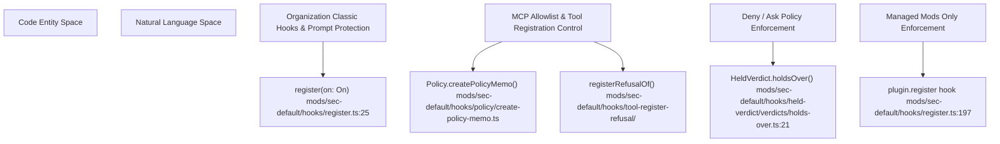
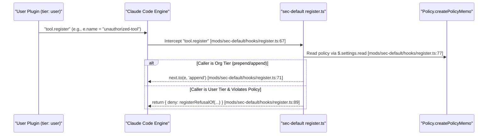
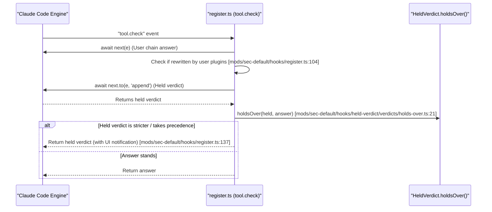

<!-- source: DeepWiki mcp.deepwiki.com · repo anthropics/claude-code · page 4.5 Sec-Default Mod · fetched 2026-10-26 -->

# Sec-Default Mod

Relevant source files

The following files were used as context for generating this wiki page:

- [mods/sec-default/README.md](mods/sec-default/README.md)
- [mods/sec-default/hooks/admission-failure/admission-failure.ts](mods/sec-default/hooks/admission-failure/admission-failure.ts)
- [mods/sec-default/hooks/admission-failure/index.ts](mods/sec-default/hooks/admission-failure/index.ts)
- [mods/sec-default/hooks/held-verdict/caught-answer.ts](mods/sec-default/hooks/held-verdict/caught-answer.ts)
- [mods/sec-default/hooks/held-verdict/held-kind.ts](mods/sec-default/hooks/held-verdict/held-kind.ts)
- [mods/sec-default/hooks/held-verdict/held-notice.ts](mods/sec-default/hooks/held-verdict/held-notice.ts)
- [mods/sec-default/hooks/held-verdict/index.ts](mods/sec-default/hooks/held-verdict/index.ts)
- [mods/sec-default/hooks/held-verdict/verdicts/holds-over.ts](mods/sec-default/hooks/held-verdict/verdicts/holds-over.ts)
- [mods/sec-default/hooks/held-verdict/verdicts/index.ts](mods/sec-default/hooks/held-verdict/verdicts/index.ts)
- [mods/sec-default/hooks/held-verdict/verdicts/is-person-tightening.ts](mods/sec-default/hooks/held-verdict/verdicts/is-person-tightening.ts)
- [mods/sec-default/hooks/held-verdict/verdicts/is-same-verdict.ts](mods/sec-default/hooks/held-verdict/verdicts/is-same-verdict.ts)
- [mods/sec-default/hooks/held-verdict/verdicts/unchecked-deny.ts](mods/sec-default/hooks/held-verdict/verdicts/unchecked-deny.ts)
- [mods/sec-default/hooks/hooks.json](mods/sec-default/hooks/hooks.json)
- [mods/sec-default/hooks/index.ts](mods/sec-default/hooks/index.ts)
- [mods/sec-default/hooks/managed-mods-only-refusal/index.ts](mods/sec-default/hooks/managed-mods-only-refusal/index.ts)
- [mods/sec-default/hooks/managed-mods-only-refusal/managed-mods-only-refusal.ts](mods/sec-default/hooks/managed-mods-only-refusal/managed-mods-only-refusal.ts)
- [mods/sec-default/hooks/policy/deny-rules-hold.ts](mods/sec-default/hooks/policy/deny-rules-hold.ts)
- [mods/sec-default/hooks/policy/index.ts](mods/sec-default/hooks/policy/index.ts)
- [mods/sec-default/hooks/policy/is-managed-mods-only.ts](mods/sec-default/hooks/policy/is-managed-mods-only.ts)
- [mods/sec-default/hooks/policy/own-option/index.ts](mods/sec-default/hooks/policy/own-option/index.ts)
- [mods/sec-default/hooks/policy/pinned-names.ts](mods/sec-default/hooks/policy/pinned-names.ts)
- [mods/sec-default/hooks/register.ts](mods/sec-default/hooks/register.ts)
- [mods/sec-default/tests/fixtures/composed.ts](mods/sec-default/tests/fixtures/composed.ts)
- [mods/sec-default/tests/fixtures/emptying.ts](mods/sec-default/tests/fixtures/emptying.ts)
- [mods/sec-default/tests/fixtures/heading.ts](mods/sec-default/tests/fixtures/heading.ts)
- [mods/sec-default/tests/fixtures/index.ts](mods/sec-default/tests/fixtures/index.ts)
- [mods/sec-default/tests/fixtures/rewording.ts](mods/sec-default/tests/fixtures/rewording.ts)
- [mods/sec-default/tests/fixtures/tool-check/index.ts](mods/sec-default/tests/fixtures/tool-check/index.ts)
- [mods/sec-default/tests/held-verdict.test.ts](mods/sec-default/tests/held-verdict.test.ts)
- [mods/sec-default/tests/register.test.ts](mods/sec-default/tests/register.test.ts)

The `sec-default` mod (`mods/sec-default`) is a built-in module seated outermost in the hook chain, designed to enforce organizational security policies within Claude Code [mods/sec-default/README.md:1-12](). Its primary purpose is to safeguard critical system components—such as classic hooks, prompt content, managed settings, tool policies, and environment variables—out of reach of user-installed plugins [mods/sec-default/README.md:3-11](). It achieves this via three core operations: continuing past the user tier (`next.to(e, "append")`), refusing unauthorized user-tier callers or modules, or passing execution (`next(e)`) [mods/sec-default/README.md:13-16]().

## Implementation Details

The core logic of the `sec-default` mod resides in `mods/sec-default/hooks/register.ts`, which exports a `register(on)` function [mods/sec-default/hooks/register.ts:25-208](). This module intercepts engine events and enforces policy checks by reading managed settings through `$.settings.read({ source: "policy" })` [mods/sec-default/README.md:17-19]().

### Key Functions and Classes

- **`register(on: On)`**: The main entry point defined in [mods/sec-default/hooks/register.ts:25]() that wires event handlers across the engine lifecycle.
- **`Policy`**: A helper module (`mods/sec-default/hooks/policy/`) that manages memoized policy reads, allowlists, deny rules, and managed tool restoration [mods/sec-default/hooks/register.ts:26]().
- **`HeldVerdict`**: Handles verdict precedence in `tool.check`, determining whether an organizational or policy-enforced deny/ask overrides a user-tier modification [mods/sec-default/hooks/register.ts:102-147]().
- **`holdsOver()`**: Evaluates whether a verdict reached past the user tier holds whole over the chain's final answer [mods/sec-default/hooks/held-verdict/verdicts/holds-over.ts:21-33]().

### Natural Language to Code Entity Mapping

The following diagram bridges the high-level security concepts of the Sec-Default mod to their concrete code entities in the repository.

Sources:
* [mods/sec-default/hooks/register.ts:25-208]()
* [mods/sec-default/hooks/held-verdict/verdicts/holds-over.ts:21-33]()

---

## Data Flow and Policy Enforcement

The `sec-default` mod intercepts a wide array of events to protect organizational assets.

### Tool Registration and Allowlist Filtering

When a plugin attempts to register a tool via `tool.register`, the mod checks if the caller is in the user tier [mods/sec-default/hooks/register.ts:67-90](). If an MCP allowlist or server policy is active in managed settings, unauthorized tool registrations are refused [mods/sec-default/tests/register.test.ts:10-27]().

Sources:
* [mods/sec-default/hooks/register.ts:67-90]()
* [mods/sec-default/tests/register.test.ts:10-27]()

### Tool Check & Held Verdicts

During `tool.check`, `sec-default` evaluates whether user plugins have loosened or bypassed security constraints [mods/sec-default/hooks/register.ts:102-137](). If policy rules dictate that deny rules hold, a stricter organizational verdict takes precedence over a user-tier override [mods/sec-default/hooks/register.ts:106-121]().

Sources:
* [mods/sec-default/hooks/register.ts:102-137]()
* [mods/sec-default/hooks/held-verdict/verdicts/holds-over.ts:21-33]()

---

## Protected Event Categories

As detailed in `mods/sec-default/README.md`, the mod ensures the following event streams bypass the user tier or enforce strict validation:

1. **`classic.*` & Prompts**: Classic hooks, `prompt.section`, `prompt.context`, `prompt.attachment`, `prompt.compose`, `skill.prompt`, and `attribution.text` continue past the user tier (`next.to(e, 'append')`), preventing user plugins from mutating managed instructions or CLAUDE.md content [mods/sec-default/README.md:28-32]().
2. **Session Append & Compaction**: Specific doors in `session.append` (`attachment`, `hook-context`, `compaction`, organization notes) and `session.compact` bypass user-tier tampering [mods/sec-default/README.md:30-31]().
3. **Environment and Variables**: `env.get` and `env.set` restrict user-tier modifications to pinned variables or launcher settings, failing closed if policy is unreadable [mods/sec-default/hooks/register.ts:156-195]().
4. **Plugin Admission**: `plugin.register` checks `allowManagedModsOnly` settings to refuse unauthorized third-party user plugins [mods/sec-default/hooks/register.ts:197-207]().

Sources:
* [mods/sec-default/README.md:28-34]()
* [mods/sec-default/hooks/register.ts:156-208]()

---

## Testing & Validation

The mod includes comprehensive test suites under `mods/sec-default/tests/`:
- `mods/sec-default/tests/register.test.ts`: Validates tool registration refusals under MCP allowlists, unreadable policy fail-closed behavior, and tool listing restoration [mods/sec-default/tests/register.test.ts:1-100]().
- `mods/sec-default/tests/held-verdict.test.ts`: Verifies decision ranking, overrides, and notice generation when user plugins attempt to loosen or reword security checks [mods/sec-default/tests/held-verdict.test.ts:1-135]().

Sources:
* [mods/sec-default/tests/register.test.ts:1-231]()
* [mods/sec-default/tests/held-verdict.test.ts:1-135]()

---

