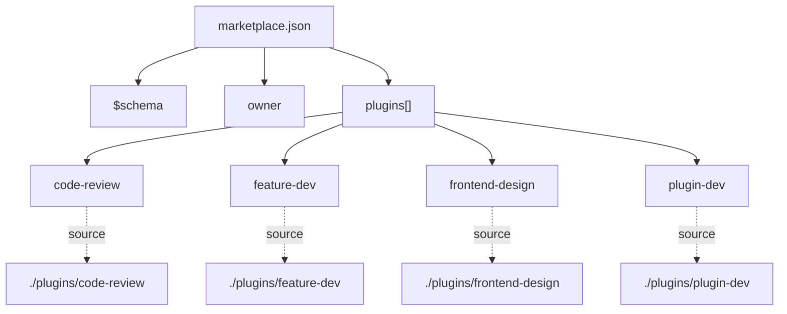
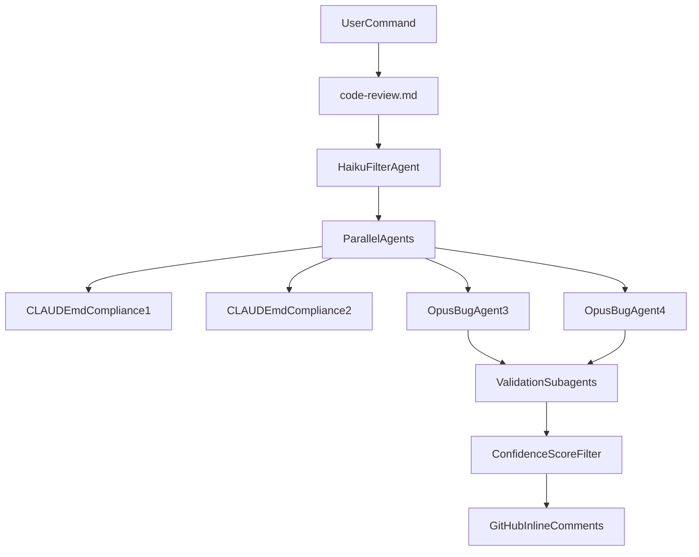
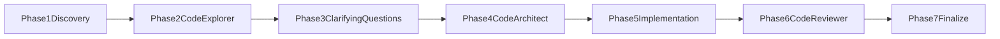
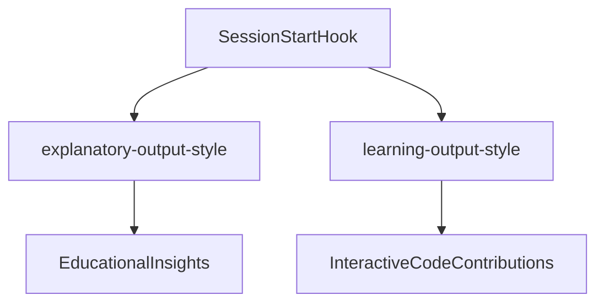
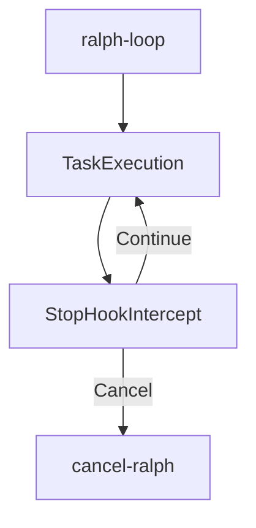
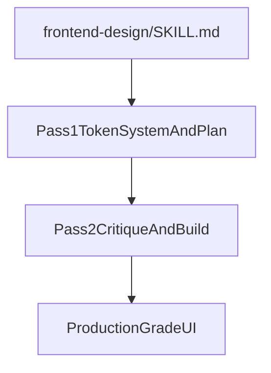
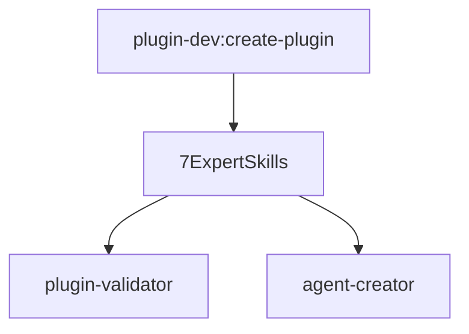
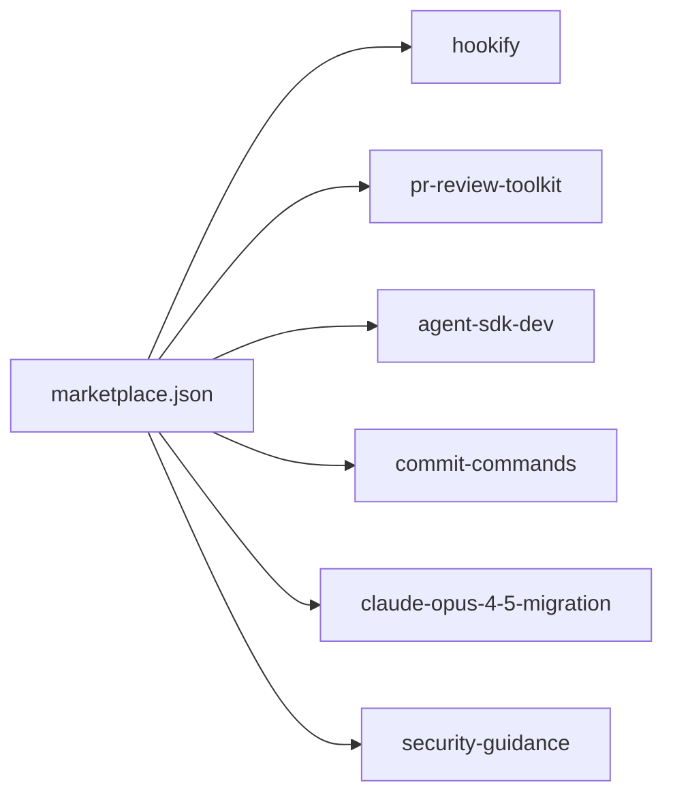

<!-- source: DeepWiki mcp.deepwiki.com · repo anthropics/claude-code · page 5 Official Plugins · fetched 2026-10-26 -->

# Official Plugins

Relevant source files

The following files were used as context for generating this wiki page:

- [.claude-plugin/marketplace.json](.claude-plugin/marketplace.json)
- [plugins/README.md](plugins/README.md)
- [plugins/agent-sdk-dev/README.md](plugins/agent-sdk-dev/README.md)
- [plugins/code-review/README.md](plugins/code-review/README.md)
- [plugins/code-review/commands/code-review.md](plugins/code-review/commands/code-review.md)
- [plugins/commit-commands/README.md](plugins/commit-commands/README.md)
- [plugins/feature-dev/README.md](plugins/feature-dev/README.md)
- [plugins/frontend-design/.claude-plugin/plugin.json](plugins/frontend-design/.claude-plugin/plugin.json)
- [plugins/frontend-design/README.md](plugins/frontend-design/README.md)
- [plugins/frontend-design/skills/frontend-design/SKILL.md](plugins/frontend-design/skills/frontend-design/SKILL.md)

This document provides a high-level overview of the plugins bundled with Claude Code and available in the marketplace via [.claude-plugin/marketplace.json:1-150](). Official plugins extend Claude's capabilities through custom commands, specialized agents, lifecycle hooks, and skill files [plugins/README.md:1-7](). 

As a PARENT page, this document summarizes the available official plugins and their functional categories. For detailed technical specifications, workflows, and implementation details, please refer to the respective child pages.

Sources: [.claude-plugin/marketplace.json:1-150](), [plugins/README.md:1-7]()

## Plugin Marketplace & Discovery

The official plugin marketplace is defined in [.claude-plugin/marketplace.json:1-150](), providing metadata for all bundled plugins including names, descriptions, version numbers, authors, and source paths.

**Diagram: Marketplace Discovery and Source Binding**

For details on marketplace schema structure, categories, and installation sources, see [Plugin Marketplace & Discovery](#5.1).

Sources: [.claude-plugin/marketplace.json:1-150]()

## Code Review Plugin

The `code-review` plugin automates pull request reviews by launching multiple specialized agents in parallel and applying confidence-based scoring to filter out false positives [plugins/code-review/README.md:1-7]().

**Diagram: Code Review Natural Language Workflow to Code Entities**

For details on the multi-agent architecture, confidence scoring, and inline comment posting, see [Code Review Plugin](#5.2).

Sources: [plugins/code-review/commands/code-review.md:1-109](), [plugins/code-review/README.md:1-215]()

## Feature Development Plugin

The `feature-dev` plugin provides a structured 7-phase approach to building new features, guiding users from codebase discovery and architectural design to implementation and quality review [plugins/feature-dev/README.md:1-15]().

**Diagram: Feature Development 7-Phase Lifecycle**

For details on the guided workflow and specialized subagents (`code-explorer`, `code-architect`, `code-reviewer`), see [Feature Development Plugin](#5.3).

Sources: [plugins/feature-dev/README.md:1-205]()

## Output Style Plugins

Output style plugins modify agent behavior by injecting educational insights and interactive prompts at session initialization. The marketplace bundles `explanatory-output-style` and `learning-output-style` [.claude-plugin/marketplace.json:51-104]().

**Diagram: Output Style Session Initialization**

For details on SessionStart hooks and behavior modification, see [Output Style Plugins](#5.4).

Sources: [.claude-plugin/marketplace.json:51-104](), [plugins/README.md:19-23]()

## Ralph Wiggum Plugin

The `ralph-wiggum` plugin implements self-referential AI development loops, allowing Claude to iterate on the same task repeatedly until completion by intercepting exit attempts via the stop hook [plugins/README.md:26-26]().

**Diagram: Ralph Wiggum Iteration Loop**

For details on `/ralph-loop`, `/cancel-ralph`, and stop hook handling, see [Ralph Wiggum Plugin](#5.5).

Sources: [.claude-plugin/marketplace.json:128-137](), [plugins/README.md:26-26]()

## Frontend Design Plugin

The `frontend-design` plugin provides a specialized skill that instructs Claude to generate distinctive, production-grade frontend interfaces with opinionated aesthetic choices and robust token systems [plugins/frontend-design/skills/frontend-design/SKILL.md:1-53]().

**Diagram: Frontend Design Two-Pass Workflow**

For details on aesthetic guidelines, token systems, and the multi-pass workflow, see [Frontend Design Plugin](#5.6).

Sources: [plugins/frontend-design/skills/frontend-design/SKILL.md:1-53](), [plugins/frontend-design/README.md:1-13]()

## Plugin Development Kit

The `plugin-dev` plugin is a comprehensive toolkit for creating plugins, offering expert skills covering hooks, MCP integration, commands, agents, and AI-assisted creation [plugins/README.md:24-24]().

**Diagram: Plugin Development Kit Architecture**

For details on `/create-plugin`, validation agents, and reference documentation, see [Plugin Development Kit](#5.7).

Sources: [.claude-plugin/marketplace.json:106-115](), [plugins/README.md:24-24]()

## Other Marketplace Plugins

Other bundled plugins include `hookify`, `pr-review-toolkit`, `agent-sdk-dev`, `commit-commands`, `claude-opus-4-5-migration`, and `security-guidance` [.claude-plugin/marketplace.json:1-150]().

**Diagram: Additional Marketplace Plugins**

For details on these plugins, their commands, and hooks, see [Other Marketplace Plugins](#5.8).

Sources: [.claude-plugin/marketplace.json:1-150](), [plugins/README.md:1-27]()

---

