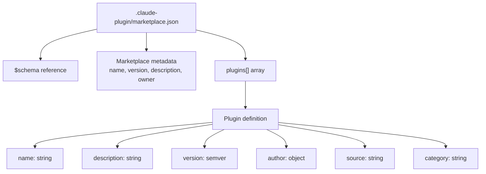
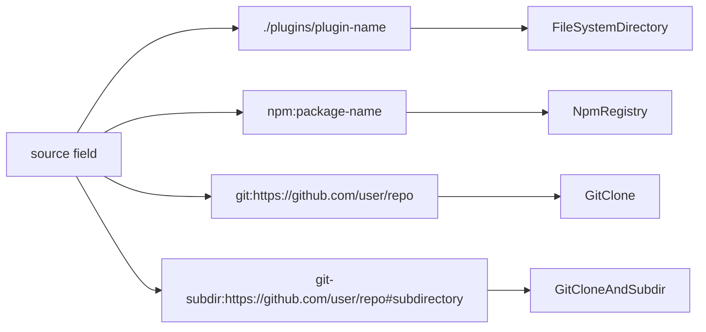
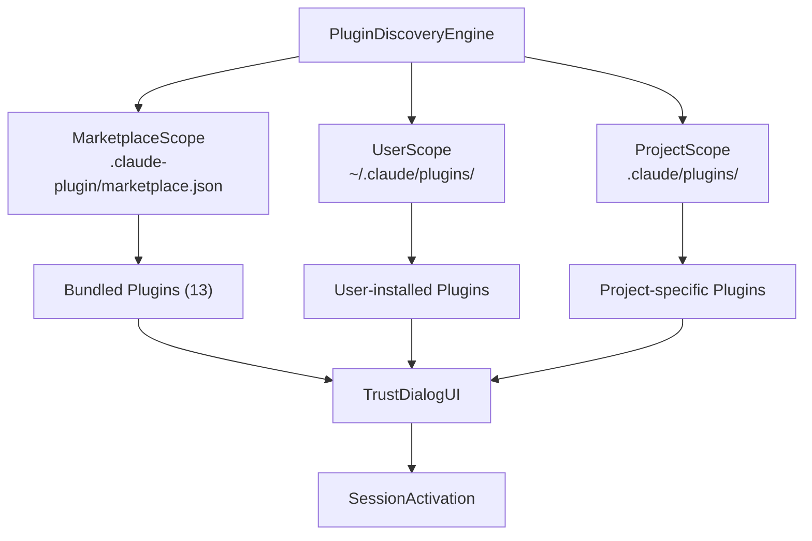
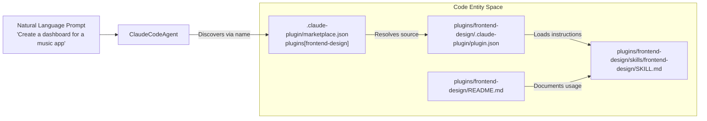

<!-- source: DeepWiki mcp.deepwiki.com · repo anthropics/claude-code · page 5.1 Plugin Marketplace & Discovery · fetched 2026-10-26 -->

# Plugin Marketplace & Discovery

<details>
<summary>Relevant source files</summary>

The following files were used as context for generating this wiki page:

- [.claude-plugin/marketplace.json](.claude-plugin/marketplace.json)
- [plugins/frontend-design/.claude-plugin/plugin.json](plugins/frontend-design/.claude-plugin/plugin.json)
- [plugins/frontend-design/README.md](plugins/frontend-design/README.md)
- [plugins/frontend-design/skills/frontend-design/SKILL.md](plugins/frontend-design/skills/frontend-design/SKILL.md)

</details>


This document details the plugin marketplace system in Claude Code, covering `.claude-plugin/marketplace.json` structure, plugin categories, installation sources, marketplace configuration, and discovery scopes. The marketplace distributes bundled plugins with Claude Code and supports custom plugins at user or project scopes.

For plugin internals such as manifest formats, trust dialogs, and loading mechanisms, see [Plugin System (3.6)](3.6). For documentation on specific bundled plugins, see sections [4.2](4.2) through [4.8](4.8).

Sources: [[.claude-plugin/marketplace.json:1-150]]()

## Overview

Claude Code discovers plugins across three hierarchical scopes:

1.  **Marketplace scope**: Bundled plugins shipped with Claude Code via `.claude-plugin/marketplace.json` [[.claude-plugin/marketplace.json:1-150]]()
2.  **User scope**: Custom plugins installed in `~/.claude/plugins/`
3.  **Project scope**: Project-specific plugins defined in `.claude/plugins/`

Each scope resolves installation sources including relative filesystem paths, npm packages, git repositories, and git subdirectories.

Sources: [[.claude-plugin/marketplace.json:1-150]]()

## Marketplace Configuration File

The marketplace is defined by `.claude-plugin/marketplace.json`, which contains metadata about the collection and an array of plugin definitions.

### Marketplace Structure

Title: "Marketplace Configuration Schema"


Sources: [[.claude-plugin/marketplace.json:1-150]]()

The marketplace file contains:
*   **`$schema`**: References `https://json.schemastore.org/claude-code-marketplace.json` [[.claude-plugin/marketplace.json:2-2]]()
*   **`name`**: Marketplace collection identifier (`claude-code-plugins`) [[.claude-plugin/marketplace.json:3-3]]()
*   **`version`**: Semantic versioning string (`1.0.0`) [[.claude-plugin/marketplace.json:4-4]]()
*   **`description`**: Human-readable overview of the collection [[.claude-plugin/marketplace.json:5-5]]()
*   **`owner`**: Organization metadata containing `name` and `email` [[.claude-plugin/marketplace.json:6-9]]()
*   **`plugins`**: Array of registered plugin objects [[.claude-plugin/marketplace.json:10-149]]()

Sources: [[.claude-plugin/marketplace.json:1-150]]()

### Plugin Definition Fields

| Field        | Required | Type     | Description                                                       |
| ------------ | -------- | -------- | ----------------------------------------------------------------- |
| `name`       | Yes      | string   | Unique plugin identifier (`name` in `.claude-plugin/marketplace.json`) |
| `description`| Yes      | string   | User-facing text describing plugin functionality                  |
| `source`     | Yes      | string   | Installation source (`./plugins/...`, npm, git, or git-subdir)     |
| `category`   | Yes      | string   | Plugin category (`development`, `productivity`, `learning`, `security`) |
| `version`    | No       | string   | Semantic version string                                          |
| `author`     | No       | object   | Author metadata containing `name` and `email` fields             |

Sources: [[.claude-plugin/marketplace.json:10-149]]()

### Example Plugin Definition

```json
{
  "name": "code-review",
  "description": "Automated code review for pull requests using multiple specialized agents with confidence-based scoring to filter false positives",
  "version": "1.0.0",
  "author": {
    "name": "Boris Cherny",
    "email": "boris@anthropic.com"
  },
  "source": "./plugins/code-review",
  "category": "productivity"
}
```

Sources: [[.claude-plugin/marketplace.json:29-38]]()

## Plugin Installation Sources

Claude Code supports four installation source protocols specified in the `source` field of marketplace definitions.

### Plugin Source Types

Title: "Plugin Source Resolution"


Sources: [[.claude-plugin/marketplace.json:1-150]]()

*   **Local Path**: Relative or absolute paths resolving to a local directory containing a `plugin.json` manifest (`./plugins/agent-sdk-dev`) [[.claude-plugin/marketplace.json:14-14]]()
*   **npm Package**: Packages prefixed with `npm:` installed directly from the npm registry [[.claude-plugin/marketplace.json:1-150]]()
*   **Git Repository**: Repositories prefixed with `git:` cloned entirely from remote URLs [[.claude-plugin/marketplace.json:1-150]]()
*   **Git Subdirectory**: Repositories prefixed with `git-subdir:` pointing to specific subdirectories within monorepos [[.claude-plugin/marketplace.json:1-150]]()

Sources: [[.claude-plugin/marketplace.json:1-150]]()

## Plugin Discovery Scopes

Title: "Discovery Hierarchy and Trust Flow"


Sources: [[.claude-plugin/marketplace.json:1-150]]()

- Plugins are discovered in priority order: marketplace scope, user scope, and project scope.
- All discovered plugins pass through an interactive trust confirmation dialog before activation to ensure secure execution.

Sources: [[.claude-plugin/marketplace.json:1-150]]()

## Plugin Categories

The marketplace organizes bundled plugins into four operational categories:

| Category      | Purpose                                       | Example Plugins                                  |
| ------------- | --------------------------------------------- | ------------------------------------------------|
| `development` | Build, test, migration, and design workflows  | `agent-sdk-dev`, `feature-dev`, `frontend-design`, `plugin-dev`, `ralph-wiggum`, `claude-opus-4-5-migration` |
| `productivity`| Automation and developer workflow assistance   | `code-review`, `commit-commands`, `hookify`, `pr-review-toolkit` |
| `learning`    | Educational insights and interactive styles   | `explanatory-output-style`, `learning-output-style` |
| `security`    | Security reminders and best practice checks   | `security-guidance`                               |

Sources: [[.claude-plugin/marketplace.json:10-149]]()

## Bundled Plugin Inventory

Claude Code bundles 13 official plugins across the four categories:

Title: "Plugin Category Hierarchy"

```mermaid
graph TB
    Marketplace["marketplace.json"]
    
    DevCategory["development (6)"]
    ProdCategory["productivity (4)"]
    LearnCategory["learning (2)"]
    SecCategory["security (1)"]
    
    Marketplace --> DevCategory
    Marketplace --> ProdCategory
    Marketplace --> LearnCategory
    Marketplace --> SecCategory
    
    DevCategory --> agentSDK["agent-sdk-dev"]
    DevCategory --> migration["claude-opus-4-5-migration"]
    DevCategory --> featureDev["feature-dev"]
    DevCategory --> frontendDesign["frontend-design"]
    DevCategory --> ralphWiggum["ralph-wiggum"]
    DevCategory --> pluginDev["plugin-dev"]
    
    ProdCategory --> codeReview["code-review"]
    ProdCategory --> commitCmds["commit-commands"]
    ProdCategory --> hookify["hookify"]
    ProdCategory --> prReview["pr-review-toolkit"]
    
    LearnCategory --> explanatory["explanatory-output-style"]
    LearnCategory --> learning["learning-output-style"]
    
    SecCategory --> secGuidance["security-guidance"]
```


Sources: [[.claude-plugin/marketplace.json:10-149]]()

## Plugin Example: Frontend Design

The `frontend-design` plugin illustrates metadata configuration, README instructions, and skill definitions.

### Natural Language to Code Entity Mapping

Title: "Frontend Design Skill Execution Bridge"


Sources: [[.claude-plugin/marketplace.json:73-82]](), [[plugins/frontend-design/.claude-plugin/plugin.json:1-10]](), [[plugins/frontend-design/skills/frontend-design/SKILL.md:1-58]](), [[plugins/frontend-design/README.md:1-32]]()

### Plugin Files and Configuration

*   **Marketplace Entry**: Declared in `.claude-plugin/marketplace.json` with source `./plugins/frontend-design` and category `development` [[.claude-plugin/marketplace.json:73-82]]().
*   **Manifest File**: Defined at `plugins/frontend-design/.claude-plugin/plugin.json` containing version `1.1.0` and authors Prithvi Rajasekaran and Alexander Bricken [[plugins/frontend-design/.claude-plugin/plugin.json:1-10]]().
*   **Documentation**: Described in `plugins/frontend-design/README.md` with usage examples and cookbook links [[plugins/frontend-design/README.md:1-32]]().
*   **Skill Instructions**: Implemented in `plugins/frontend-design/skills/frontend-design/SKILL.md` with YAML frontmatter and strict aesthetic guidelines, typography rules, and a two-pass planning process [[plugins/frontend-design/skills/frontend-design/SKILL.md:1-58]]().

Sources: [[.claude-plugin/marketplace.json:73-82]](), [[plugins/frontend-design/.claude-plugin/plugin.json:1-10]](), [[plugins/frontend-design/skills/frontend-design/SKILL.md:1-58]](), [[plugins/frontend-design/README.md:1-32]]()

## Security and Trust

Regardless of source scope, all plugins require explicit user verification through a trust dialog before loading into an active Claude Code session. This prevents arbitrary execution of unverified plugin code.

Sources: [[.claude-plugin/marketplace.json:1-150]]()

---

