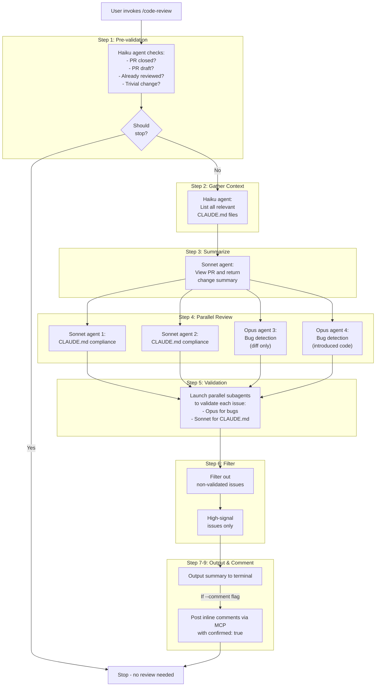
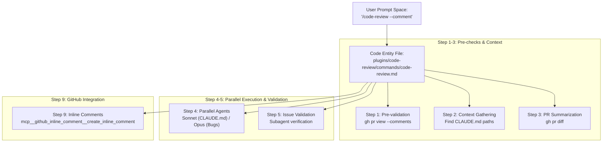

<!-- source: DeepWiki mcp.deepwiki.com · repo anthropics/claude-code · page 5.2 Code Review Plugin · fetched 2026-10-26 -->

# Code Review Plugin

<details>
<summary>Relevant source files</summary>

The following files were used as context for generating this wiki page:

- [plugins/README.md](plugins/README.md)
- [plugins/agent-sdk-dev/README.md](plugins/agent-sdk-dev/README.md)
- [plugins/code-review/.claude-plugin/plugin.json](plugins/code-review/.claude-plugin/plugin.json)
- [plugins/code-review/README.md](plugins/code-review/README.md)
- [plugins/code-review/commands/code-review.md](plugins/code-review/commands/code-review.md)
- [plugins/commit-commands/.claude-plugin/plugin.json](plugins/commit-commands/.claude-plugin/plugin.json)
- [plugins/commit-commands/README.md](plugins/commit-commands/README.md)
- [plugins/feature-dev/README.md](plugins/feature-dev/README.md)

</details>


The `code-review` plugin provides automated pull request review using a multi-agent workflow with validation-based filtering to ensure high-signal feedback. The plugin launches multiple specialized agents in parallel to audit changes for `CLAUDE.md` compliance and bugs, then validates each issue independently to eliminate false positives.

For information about the general plugin system architecture, see [3.6 Plugin System](). For other plugins in the marketplace, see [4.1 Plugin Marketplace & Discovery]().

Sources: [plugins/code-review/commands/code-review.md:1-109](), [plugins/code-review/README.md:1-215](), [plugins/README.md:1-77]()

## Overview & Scope

The plugin consists of a single slash command `/code-review` that orchestrates a complex multi-agent workflow. The command is defined at [plugins/code-review/commands/code-review.md:1-109]() and implements a 9-step review process with parallel agent execution and validation.

**Key characteristics:**
- **Multi-agent architecture**: 4 parallel review agents + validation agents per issue [plugins/code-review/commands/code-review.md:30-55]().
- **Model diversity**: Uses Haiku for pre-checks, Sonnet for `CLAUDE.md` compliance, and Opus for bug detection [plugins/code-review/commands/code-review.md:14-55]().
- **High-signal filtering**: Two-stage validation (detection → verification) and confidence scoring (threshold 80) eliminates false positives [plugins/code-review/commands/code-review.md:55-57](), [plugins/code-review/README.md:52-52]().
- **GitHub integration**: Uses `gh` CLI and MCP GitHub tools for all operations [plugins/code-review/commands/code-review.md:2,90]().
- **Inline Comments**: Supports posting committable suggestion blocks for small fixes [plugins/code-review/commands/code-review.md:71-75]().

Sources: [plugins/code-review/commands/code-review.md:1-109](), [plugins/code-review/README.md:1-215]()

## Plugin Structure & Metadata

The plugin follows the standard Claude Code plugin structure, located under `plugins/code-review/`. It is defined by its metadata manifest and command markdown file.

```
plugins/code-review/
├── .claude-plugin/
│   └── plugin.json          # Plugin metadata [plugins/code-review/.claude-plugin/plugin.json:1-9]()
├── commands/
│   └── code-review.md       # Main command definition [plugins/code-review/commands/code-review.md:1-109]()
└── README.md                # Documentation [plugins/code-review/README.md:1-215]()
```

The plugin metadata manifest located at [plugins/code-review/.claude-plugin/plugin.json:1-9]() specifies the plugin name (`code-review`), description, version (`1.0.0`), and author details (Boris Cherny). It leverages the `commands/` extension point and the `mcp__github_inline_comment__create_inline_comment` tool for posting feedback [plugins/code-review/commands/code-review.md:2]().

Sources: [plugins/README.md:49-61](), [plugins/code-review/.claude-plugin/plugin.json:1-9](), [plugins/code-review/commands/code-review.md:1-2]()

## Multi-Agent Review Workflow

### Workflow Architecture

This diagram illustrates the logical flow of the `/code-review` command from invocation to final comment posting.

Title: Workflow Architecture of /code-review



Sources: [plugins/code-review/commands/code-review.md:12-77]()

### Natural Language to Code Entity Mapping

This diagram bridges Natural Language Space to Code Entity Space, associating prompt execution steps with specific file definitions and tool execution contracts defined in [plugins/code-review/commands/code-review.md:1-109]().

Title: Natural Language to Code Entity Mapping for Code Review



Sources: [plugins/code-review/commands/code-review.md:1-109](), [plugins/code-review/commands/code-review.md:2]()

## Command Specification & Execution Flow

### Command Metadata & Tool Restrictions

The command is defined at [plugins/code-review/commands/code-review.md:1-4]() with strict frontmatter restrictions:

```markdown
---
allowed-tools: Bash(gh issue view:*), Bash(gh search:*), Bash(gh issue list:*), 
               Bash(gh pr comment:*), Bash(gh pr diff:*), Bash(gh pr view:*), 
               Bash(gh pr list:*), mcp__github_inline_comment__create_inline_comment
description: Code review a pull request
---
```

**Tool restrictions and permissions:**
- `Bash` tool usage is strictly whitelisted to `gh` CLI operations [plugins/code-review/commands/code-review.md:2]().
- `mcp__github_inline_comment__create_inline_comment` is authorized for posting precise inline code feedback [plugins/code-review/commands/code-review.md:2,71]().
- Review agents are prohibited from making exploratory tool calls or testing tools; all tools are assumed functional [plugins/code-review/commands/code-review.md:8-10]().

Sources: [plugins/code-review/commands/code-review.md:1-4](), [plugins/code-review/commands/code-review.md:8-10]()

### Step-by-Step Execution Details

1. **Pre-validation (Step 1)**: A Haiku agent inspects PR metadata via `gh pr view` and checks if the PR is closed, a draft, trivial/automated, or already reviewed by Claude [plugins/code-review/commands/code-review.md:14-20](). Claude-generated PRs are explicitly exempted and still reviewed [plugins/code-review/commands/code-review.md:22]().
2. **Context Gathering (Step 2)**: A Haiku agent identifies the root `CLAUDE.md` and any directory-specific `CLAUDE.md` files corresponding to modified paths [plugins/code-review/commands/code-review.md:24-27]().
3. **Summarization (Step 3)**: A Sonnet agent views the PR diff and compiles a change summary [plugins/code-review/commands/code-review.md:28]().
4. **Parallel Review (Step 4)**: Four agents run concurrently [plugins/code-review/commands/code-review.md:30-40]():
   - Agents 1 & 2 (Sonnet): Audit changes for `CLAUDE.md` compliance [plugins/code-review/commands/code-review.md:32-33]().
   - Agent 3 (Opus): Scans diff for obvious bugs without extra context [plugins/code-review/commands/code-review.md:35-36]().
   - Agent 4 (Opus): Analyzes introduced code for security issues and logic errors [plugins/code-review/commands/code-review.md:38-39]().
5. **Issue Validation (Step 5)**: Parallel subagents (Opus for bugs, Sonnet for `CLAUDE.md` violations) validate each flagged issue with high confidence requirements [plugins/code-review/commands/code-review.md:55]().
6. **Filtering & Output (Steps 6-9)**: Unvalidated issues are filtered out [plugins/code-review/commands/code-review.md:57](). If `--comment` is passed, verified issues are posted via `mcp__github_inline_comment__create_inline_comment` [plugins/code-review/commands/code-review.md:63-71]().

Sources: [plugins/code-review/commands/code-review.md:14-71]()

## Validation, Confidence Scoring & False Positive Filtering

### Confidence Scoring Scale

The plugin relies on strict confidence scoring to ensure high-signal output [plugins/code-review/README.md:78-84]():
- **Threshold**: Only issues scoring **80** or higher are surfaced [plugins/code-review/README.md:52-52]().
- **Scoring breakdown**:
  - **100**: Absolutely certain, definitely real [plugins/code-review/README.md:83]().
  - **75**: Highly confident, real and important [plugins/code-review/README.md:82]().
  - **50**: Moderately confident, real but minor [plugins/code-review/README.md:81]().
  - **25**: Somewhat confident, might be real [plugins/code-review/README.md:80]().
  - **0**: Not confident, false positive [plugins/code-review/README.md:79]().

### Excluded False Positives

Agents are explicitly instructed to ignore categories prone to noise [plugins/code-review/commands/code-review.md:79-86]():
- Pre-existing issues [plugins/code-review/commands/code-review.md:81]().
- Pedantic nitpicks [plugins/code-review/commands/code-review.md:83]().
- Issues caught by linters [plugins/code-review/commands/code-review.md:84]().
- Code quality concerns not explicitly mandated by `CLAUDE.md` [plugins/code-review/commands/code-review.md:85]().
- Issues silenced via lint ignore comments [plugins/code-review/commands/code-review.md:86]().

Sources: [plugins/code-review/commands/code-review.md:79-86](), [plugins/code-review/README.md:78-84]()

## Comment Generation & GitHub Integration

### Inline Comment Formatting & Code Links

When posting comments, the plugin enforces precise Markdown link formatting [plugins/code-review/commands/code-review.md:103-109]():
- Must use full git commit SHAs (abbreviated hashes fail rendering) [plugins/code-review/commands/code-review.md:104-105]().
- Repository name must match the target repository [plugins/code-review/commands/code-review.md:106]().
- Line ranges must follow the `#L[start]-L[end]` syntax [plugins/code-review/commands/code-review.md:108]().

Committable suggestion blocks are restricted to small, self-contained fixes where committing the suggestion fully resolves the issue [plugins/code-review/commands/code-review.md:73-75]().

Sources: [plugins/code-review/commands/code-review.md:71-75](), [plugins/code-review/commands/code-review.md:103-109]()

---

