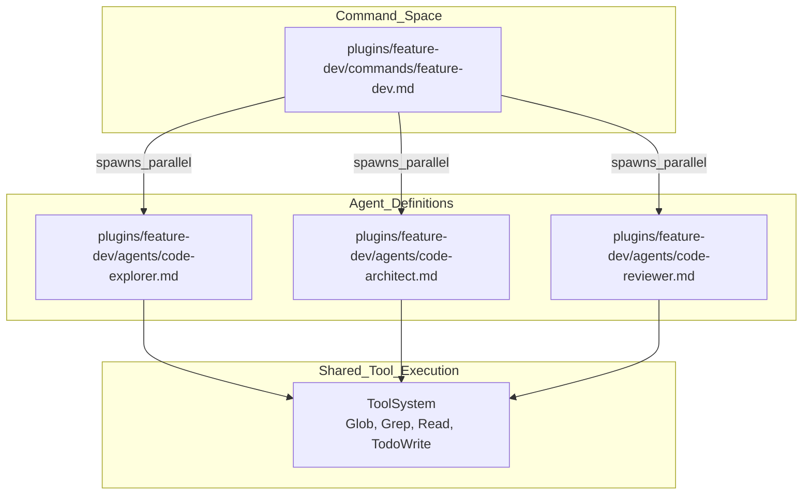
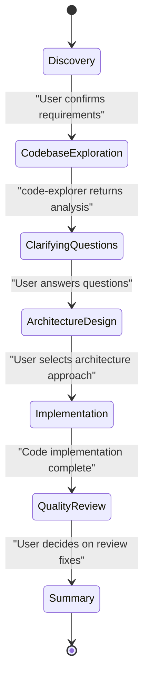
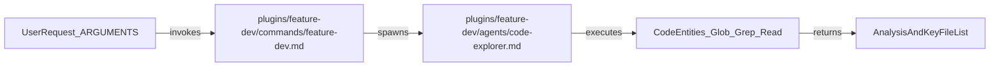
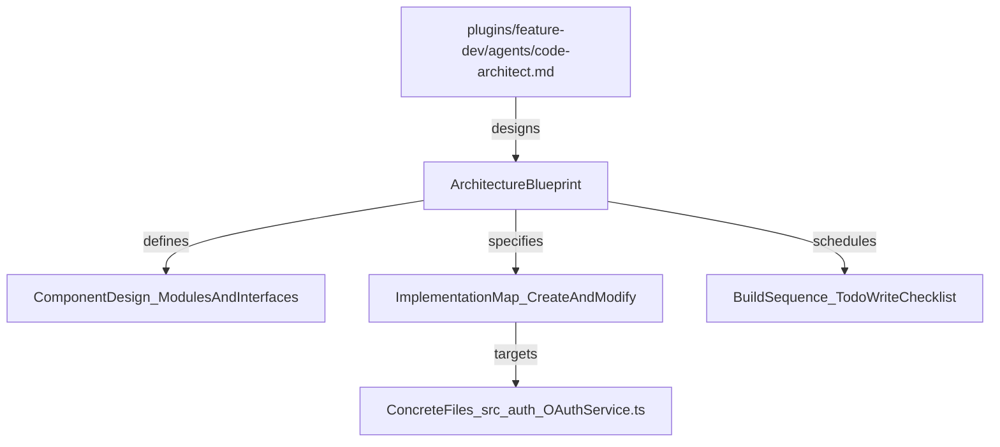

<!-- source: DeepWiki mcp.deepwiki.com · repo anthropics/claude-code · page 5.3 Feature Development Plugin · fetched 2026-10-26 -->

# Feature Development Plugin

Relevant source files

The following files were used as context for generating this wiki page:

- [plugins/README.md](plugins/README.md)
- [plugins/agent-sdk-dev/README.md](plugins/agent-sdk-dev/README.md)
- [plugins/code-review/README.md](plugins/code-review/README.md)
- [plugins/code-review/commands/code-review.md](plugins/code-review/commands/code-review.md)
- [plugins/commit-commands/README.md](plugins/commit-commands/README.md)
- [plugins/feature-dev/.claude-plugin/plugin.json](plugins/feature-dev/.claude-plugin/plugin.json)
- [plugins/feature-dev/README.md](plugins/feature-dev/README.md)
- [plugins/feature-dev/agents/code-architect.md](plugins/feature-dev/agents/code-architect.md)
- [plugins/feature-dev/agents/code-explorer.md](plugins/feature-dev/agents/code-explorer.md)
- [plugins/feature-dev/agents/code-reviewer.md](plugins/feature-dev/agents/code-reviewer.md)
- [plugins/feature-dev/commands/feature-dev.md](plugins/feature-dev/commands/feature-dev.md)

## Purpose and Scope

The Feature Development Plugin (`plugins/feature-dev`) provides a guided, multi-phase workflow for implementing new features in a codebase [plugins/feature-dev/commands/feature-dev.md:8-12](). It orchestrates three specialized subagents (`code-explorer`, `code-architect`, and `code-reviewer`) to systematically understand existing code patterns, design robust architectures, and ensure code quality. The plugin is invoked via the `/feature-dev` command and emphasizes interactive clarification before writing any implementation code [plugins/feature-dev/commands/feature-dev.md:8-12]().

The plugin governs seven distinct phases of feature development: Discovery, Codebase Exploration, Clarifying Questions, Architecture Design, Implementation, Quality Review, and Summary [plugins/feature-dev/commands/feature-dev.md:20-125]().

Sources:
[plugins/feature-dev/commands/feature-dev.md:1-125](),
[plugins/feature-dev/.claude-plugin/plugin.json:1-9]()

---

## Architecture Overview

The plugin coordinates specialized agent definitions housed within `plugins/feature-dev/agents/` and a command entrypoint at `plugins/feature-dev/commands/feature-dev.md`. 

### Component Breakdown

- **Command Handler** (`plugins/feature-dev/commands/feature-dev.md`): Orchestrates the multi-phase workflow, spawns agents, manages user interactions, and tracks tasks using `TodoWrite` [plugins/feature-dev/commands/feature-dev.md:1-16]().
- **Code Explorer Agent** (`plugins/feature-dev/agents/code-explorer.md`): Traces execution paths, maps architecture layers, and identifies essential files [plugins/feature-dev/agents/code-explorer.md:2-12]().
- **Code Architect Agent** (`plugins/feature-dev/agents/code-architect.md`): Designs implementation blueprints, selects architecture approaches, and maps components [plugins/feature-dev/agents/code-architect.md:2-9]().
- **Code Reviewer Agent** (`plugins/feature-dev/agents/code-reviewer.md`): Evaluates code for bugs, logic errors, and project conventions using a confidence-scoring threshold ($\ge 80$) [plugins/feature-dev/agents/code-reviewer.md:2-33]().

### Shared Agent Toolsets

All agents are provisioned with file reading, search, and execution tracking tools [plugins/feature-dev/agents/code-explorer.md:4](), [plugins/feature-dev/agents/code-architect.md:4](), [plugins/feature-dev/agents/code-reviewer.md:4]():
- **Read/Search:** `Glob`, `Grep`, `LS`, `Read`, `NotebookRead`, `WebFetch`, `WebSearch`
- **Management:** `TodoWrite`
- **Execution:** `KillShell`, `BashOutput`

### System Architecture Diagram

Sources:
[plugins/feature-dev/commands/feature-dev.md:41-106](),
[plugins/feature-dev/agents/code-explorer.md:1-7](),
[plugins/feature-dev/agents/code-architect.md:1-7](),
[plugins/feature-dev/agents/code-reviewer.md:1-7]()

---

## Seven-Phase Workflow

The `/feature-dev` command executes sequentially across seven phases, pausing for user approval at critical junctures.

### Workflow State Diagram

Sources:
[plugins/feature-dev/commands/feature-dev.md:20-125]()

---

## Phase Details

### Phase 1: Discovery
- **Goal:** Understand what needs to be built [plugins/feature-dev/commands/feature-dev.md:22]().
- **Actions:** Parses `$ARGUMENTS`, instantiates a task list via `TodoWrite`, resolves ambiguities by asking clarifying questions, and summarizes understanding [plugins/feature-dev/commands/feature-dev.md:24-32]().

### Phase 2: Codebase Exploration
- **Goal:** Understand relevant existing code and patterns [plugins/feature-dev/commands/feature-dev.md:38]().
- **Actions:** Launches 2–3 `code-explorer` agents in parallel targeting similar features, architecture, and UI patterns. Reads all files returned by the agents [plugins/feature-dev/commands/feature-dev.md:41-53]().

### Phase 3: Clarifying Questions
- **Goal:** Fill in gaps and resolve ambiguities before design [plugins/feature-dev/commands/feature-dev.md:59]().
- **Actions:** Identifies edge cases, error handling, scope boundaries, and backward compatibility. **Crucial step:** Presents questions and waits for user input [plugins/feature-dev/commands/feature-dev.md:64-67]().

### Phase 4: Architecture Design
- **Goal:** Design multiple implementation approaches [plugins/feature-dev/commands/feature-dev.md:75]().
- **Actions:** Launches 2–3 `code-architect` agents focusing on minimal changes, clean architecture, or pragmatic balance. Presents trade-offs and requests user selection [plugins/feature-dev/commands/feature-dev.md:78-81]().

### Phase 5: Implementation
- **Goal:** Build the feature [plugins/feature-dev/commands/feature-dev.md:87]().
- **Actions:** Requires explicit user approval before writing code. Implements following the chosen architecture while updating `TodoWrite` state [plugins/feature-dev/commands/feature-dev.md:89-97]().

### Phase 6: Quality Review
- **Goal:** Ensure code correctness and adherence to standards [plugins/feature-dev/commands/feature-dev.md:103]().
- **Actions:** Launches 3 `code-reviewer` agents focusing on simplicity/DRY, bugs/correctness, and conventions. Consolidates findings and prompts user for remediation choices [plugins/feature-dev/commands/feature-dev.md:106-109]().

### Phase 7: Summary
- **Goal:** Document what was accomplished [plugins/feature-dev/commands/feature-dev.md:114]().
- **Actions:** Marks todos complete, summarizes built components, key decisions, modified files, and next steps [plugins/feature-dev/commands/feature-dev.md:118-123]().

Sources:
[plugins/feature-dev/commands/feature-dev.md:20-125]()

---

## Detailed Agent Specifications

### Code Explorer Agent
- **Definition:** `plugins/feature-dev/agents/code-explorer.md` [plugins/feature-dev/agents/code-explorer.md:2-7]()
- **Role:** Traces execution paths from entry points (APIs, UI components, CLI commands) through abstraction layers to data storage [plugins/feature-dev/agents/code-explorer.md:11-17]().

### Code Architect Agent
- **Definition:** `plugins/feature-dev/agents/code-architect.md` [plugins/feature-dev/agents/code-architect.md:2-7]()
- **Role:** Extracts existing codebase patterns, formulates complete implementation blueprints, and defines integration points and data flows [plugins/feature-dev/agents/code-architect.md:13-30]().

### Code Reviewer Agent
- **Definition:** `plugins/feature-dev/agents/code-reviewer.md` [plugins/feature-dev/agents/code-reviewer.md:2-7]()
- **Role:** Audits diffs against project guidelines (e.g., `CLAUDE.md`) and bug vectors using a strict confidence scoring system ($0-100$), filtering out anything below $\ge 80$ confidence [plugins/feature-dev/agents/code-reviewer.md:9-33]().

Sources:
[plugins/feature-dev/agents/code-explorer.md:1-51](),
[plugins/feature-dev/agents/code-architect.md:1-34](),
[plugins/feature-dev/agents/code-reviewer.md:1-46]()

---

## Bridging Natural Language to Code Entities

### Diagram 1: Natural Language Discovery to Code Entity Exploration

Sources:
[plugins/feature-dev/agents/code-explorer.md:16-37](),
[plugins/feature-dev/commands/feature-dev.md:20-53]()

### Diagram 2: Architecture Design to Concrete Implementation Map

Sources:
[plugins/feature-dev/agents/code-architect.md:19-32](),
[plugins/feature-dev/commands/feature-dev.md:73-83]()

---

