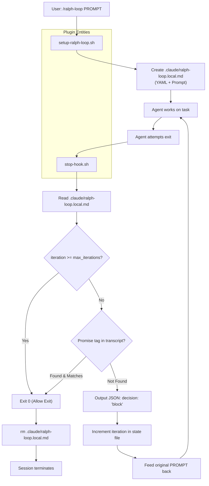
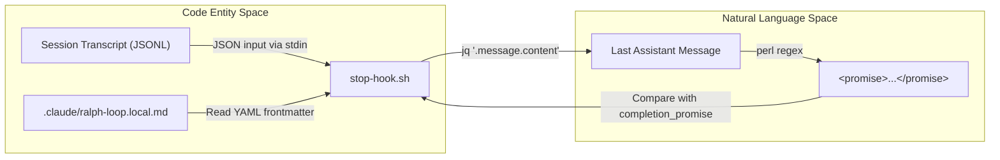

<!-- source: DeepWiki mcp.deepwiki.com · repo anthropics/claude-code · page 5.5 Ralph Wiggum Plugin · fetched 2026-10-26 -->

# Ralph Wiggum Plugin

Relevant source files

The following files were used as context for generating this wiki page:

- [plugins/ralph-wiggum/.claude-plugin/plugin.json](plugins/ralph-wiggum/.claude-plugin/plugin.json)
- [plugins/ralph-wiggum/README.md](plugins/ralph-wiggum/README.md)
- [plugins/ralph-wiggum/commands/cancel-ralph.md](plugins/ralph-wiggum/commands/cancel-ralph.md)
- [plugins/ralph-wiggum/commands/help.md](plugins/ralph-wiggum/commands/help.md)
- [plugins/ralph-wiggum/commands/ralph-loop.md](plugins/ralph-wiggum/commands/ralph-loop.md)
- [plugins/ralph-wiggum/hooks/hooks.json](plugins/ralph-wiggum/hooks/hooks.json)
- [plugins/ralph-wiggum/hooks/stop-hook.sh](plugins/ralph-wiggum/hooks/stop-hook.sh)
- [plugins/ralph-wiggum/scripts/setup-ralph-loop.sh](plugins/ralph-wiggum/scripts/setup-ralph-loop.sh)

## Purpose and Scope

The Ralph Wiggum plugin implements an iterative self-referential development loop within a Claude Code session. Based on the technique pioneered by Geoffrey Huntley, it uses a "while-true" logic where the same prompt is fed to the agent repeatedly [plugins/ralph-wiggum/README.md:7-11](). The plugin intercepts session termination via a `Stop` hook and re-injects the original prompt, allowing Claude to see its previous work in the file system and git history to continuously iterate until completion [plugins/ralph-wiggum/commands/help.md:13-30]().

This plugin is designed for well-defined tasks requiring iterative refinement, TDD (Test Driven Development) cycles, and autonomous self-correction [plugins/ralph-wiggum/README.md:103-116]().

Sources: [plugins/ralph-wiggum/README.md:7-11](), [plugins/ralph-wiggum/commands/help.md:13-30](), [plugins/ralph-wiggum/README.md:103-116]()

---

## System Architecture

The Ralph Wiggum plugin operates by installing a `Stop` hook that executes a script to determine if a session should exit or block and loop.

### Loop Execution Flow

The following diagram illustrates the lifecycle of a Ralph loop, from initialization via `/ralph-loop` to the intercept logic in `stop-hook.sh`.

**Ralph Loop Lifecycle**

Sources: [plugins/ralph-wiggum/hooks/hooks.json:1-15](), [plugins/ralph-wiggum/hooks/stop-hook.sh:1-177](), [plugins/ralph-wiggum/scripts/setup-ralph-loop.sh:140-150]()

### Data Flow: Transcript to Hook

The `stop-hook.sh` script utilizes the advanced stop hook API to inspect the session's history before deciding whether to continue the loop. It bridges the natural language output of the agent to the programmatic control of the session.

**Transcript Analysis and State Bridge**

Sources: [plugins/ralph-wiggum/hooks/stop-hook.sh:9-128](), [plugins/ralph-wiggum/hooks/stop-hook.sh:167-174]()

---

## Command Interface

### `/ralph-loop` Command
Initializes the Ralph loop state and begins the first iteration.

**Syntax:**
`/ralph-loop PROMPT [--max-iterations N] [--completion-promise TEXT]` [plugins/ralph-wiggum/commands/ralph-loop.md:3]()

**Options:**
| Option | Description |
| :--- | :--- |
| `--max-iterations` | Maximum iterations before auto-stop (default: 0/unlimited) [plugins/ralph-wiggum/scripts/setup-ralph-loop.sh:10](), [plugins/ralph-wiggum/scripts/setup-ralph-loop.sh:27]() |
| `--completion-promise` | A specific string the agent must output inside `<promise>` tags to break the loop [plugins/ralph-wiggum/scripts/setup-ralph-loop.sh:28](), [plugins/ralph-wiggum/scripts/setup-ralph-loop.sh:35]() |

**Implementation:**
The command calls `setup-ralph-loop.sh`, which validates inputs and creates the state file [plugins/ralph-wiggum/commands/ralph-loop.md:10-14](). It outputs a critical warning that the loop cannot be stopped manually once active, except by reaching the iteration limit or providing the promise [plugins/ralph-wiggum/scripts/setup-ralph-loop.sh:166-167]().

Sources: [plugins/ralph-wiggum/commands/ralph-loop.md:3](), [plugins/ralph-wiggum/scripts/setup-ralph-loop.sh:10](), [plugins/ralph-wiggum/scripts/setup-ralph-loop.sh:27-28](), [plugins/ralph-wiggum/scripts/setup-ralph-loop.sh:35](), [plugins/ralph-wiggum/commands/ralph-loop.md:10-14](), [plugins/ralph-wiggum/scripts/setup-ralph-loop.sh:166-167]()

### `/cancel-ralph` Command
Manually breaks an active loop by deleting the state file.

**Implementation:**
1. Checks for existence of `.claude/ralph-loop.local.md` using `test -f` [plugins/ralph-wiggum/commands/cancel-ralph.md:11]().
2. Reads the file to report the final iteration count from the `iteration:` field [plugins/ralph-wiggum/commands/cancel-ralph.md:16-18]().
3. Deletes the file using `rm` [plugins/ralph-wiggum/commands/cancel-ralph.md:17]().

Sources: [plugins/ralph-wiggum/commands/cancel-ralph.md:11](), [plugins/ralph-wiggum/commands/cancel-ralph.md:16-18](), [plugins/ralph-wiggum/commands/cancel-ralph.md:17]()

---

## Technical Details

### State Management
The plugin stores loop state in `.claude/ralph-loop.local.md` [plugins/ralph-wiggum/hooks/stop-hook.sh:13](). This file uses a hybrid format:
*   **YAML Frontmatter:** Tracks `active`, `iteration`, `max_iterations`, `completion_promise`, and `started_at` [plugins/ralph-wiggum/scripts/setup-ralph-loop.sh:141-147]().
*   **Markdown Body:** Stores the original `PROMPT` text to be re-injected [plugins/ralph-wiggum/scripts/setup-ralph-loop.sh:149-150]().

Sources: [plugins/ralph-wiggum/hooks/stop-hook.sh:13](), [plugins/ralph-wiggum/scripts/setup-ralph-loop.sh:141-147](), [plugins/ralph-wiggum/scripts/setup-ralph-loop.sh:149-150]()

### The Stop Hook (`stop-hook.sh`)
The hook is registered in `hooks.json` under the `Stop` event [plugins/ralph-wiggum/hooks/hooks.json:4-14]().
1. **Input Parsing:** Reads hook input (JSON) from `stdin` to get the `transcript_path` [plugins/ralph-wiggum/hooks/stop-hook.sh:10](), [plugins/ralph-wiggum/hooks/stop-hook.sh:58]().
2. **Transcript Analysis:** Uses `jq` to extract the text content of the last assistant message by mapping over content blocks of type `text` [plugins/ralph-wiggum/hooks/stop-hook.sh:90-95]().
3. **Promise Detection:** Uses `perl` to extract text from `<promise>` tags and compares it to the stored `completion_promise` [plugins/ralph-wiggum/hooks/stop-hook.sh:115-128]().
4. **Loop Decision:** If the loop should continue, it outputs a JSON object with `"decision": "block"`, the original prompt in `"reason"`, and an iteration status in `"systemMessage"` [plugins/ralph-wiggum/hooks/stop-hook.sh:167-174]().

Sources: [plugins/ralph-wiggum/hooks/hooks.json:4-14](), [plugins/ralph-wiggum/hooks/stop-hook.sh:10](), [plugins/ralph-wiggum/hooks/stop-hook.sh:58](), [plugins/ralph-wiggum/hooks/stop-hook.sh:90-95](), [plugins/ralph-wiggum/hooks/stop-hook.sh:115-128](), [plugins/ralph-wiggum/hooks/stop-hook.sh:167-174]()

### Completion Promises
A completion promise is a strict requirement. The agent is instructed that it may **only** output the promise when the statement is "completely and unequivocally TRUE" [plugins/ralph-wiggum/commands/ralph-loop.md:18](). This prevents the model from "lying" to escape the loop when it gets stuck [plugins/ralph-wiggum/scripts/setup-ralph-loop.sh:190-202]().

Sources: [plugins/ralph-wiggum/hooks/stop-hook.sh:1-177](), [plugins/ralph-wiggum/scripts/setup-ralph-loop.sh:1-203](), [plugins/ralph-wiggum/commands/ralph-loop.md:18](), [plugins/ralph-wiggum/scripts/setup-ralph-loop.sh:190-202](), [plugins/ralph-wiggum/commands/help.md:73-84]()

---

## Use Cases and Best Practices

### When to Use
*   **Greenfield Projects:** Building an entire API or service from scratch [plugins/ralph-wiggum/README.md:154-159]().
*   **Test-Driven Development:** Iterating until all tests pass [plugins/ralph-wiggum/README.md:103-116]().
*   **Refactoring:** Complex multi-step code migrations [plugins/ralph-wiggum/commands/help.md:112]().

Sources: [plugins/ralph-wiggum/README.md:103-116](), [plugins/ralph-wiggum/README.md:154-159](), [plugins/ralph-wiggum/commands/help.md:112]()

### Best Practices
*   **Always set `--max-iterations`:** Acts as a safety net for impossible tasks [plugins/ralph-wiggum/README.md:121-125]().
*   **Clear Completion Criteria:** Define exactly what the agent should verify before issuing a promise [plugins/ralph-wiggum/README.md:78-88]().
*   **Incremental Goals:** Break large tasks into phases within the prompt [plugins/ralph-wiggum/README.md:94-101]().

Sources: [plugins/ralph-wiggum/README.md:72-165](), [plugins/ralph-wiggum/README.md:78-88](), [plugins/ralph-wiggum/README.md:94-101](), [plugins/ralph-wiggum/README.md:121-125](), [plugins/ralph-wiggum/commands/help.md:109-122]()

---

