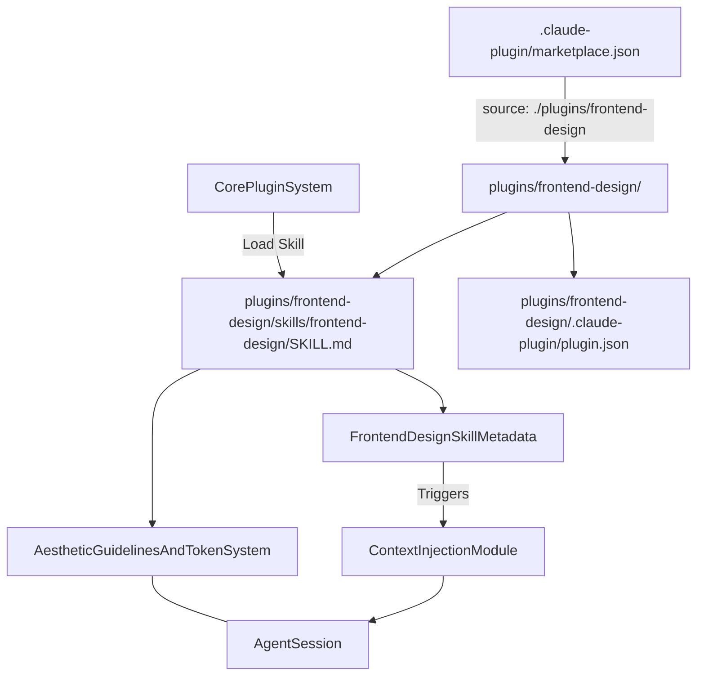
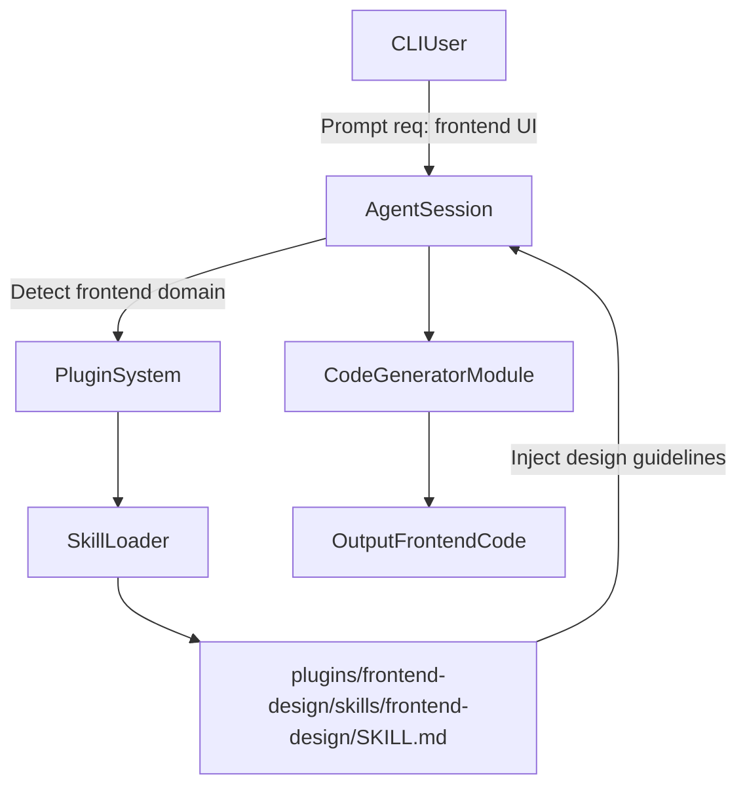

<!-- source: DeepWiki mcp.deepwiki.com · repo anthropics/claude-code · page 5.6 Frontend Design Plugin · fetched 2026-10-26 -->

# Frontend Design Plugin

Relevant source files

The following files were used as context for generating this wiki page:

- [.claude-plugin/marketplace.json](.claude-plugin/marketplace.json)
- [plugins/frontend-design/.claude-plugin/plugin.json](plugins/frontend-design/.claude-plugin/plugin.json)
- [plugins/frontend-design/README.md](plugins/frontend-design/README.md)
- [plugins/frontend-design/skills/frontend-design/SKILL.md](plugins/frontend-design/skills/frontend-design/SKILL.md)

The Frontend Design Plugin is a skill-based plugin dedicated to generating distinctive, production-grade frontend interfaces with an emphasis on avoiding generic "AI slop" aesthetics [plugins/frontend-design/README.md:1-3](). It empowers Claude to create creative, polished, and contextually tailored frontend code that exhibits bold aesthetic guidelines, distinctive typography, and high-impact visual details [plugins/frontend-design/README.md:7-12](). This skill automatically activates when frontend development tasks are detected, injecting precise design principles and aesthetic directives directly into the agent’s operational context [.claude-plugin/marketplace.json:73-82](), [plugins/frontend-design/skills/frontend-design/SKILL.md:1-3]().

The plugin adopts the persona of a design lead at a boutique studio known for giving every client a distinct visual identity, emphasizing deliberate, opinionated choices over templated defaults [plugins/frontend-design/skills/frontend-design/SKILL.md:7-9]().

Sources:
- [.claude-plugin/marketplace.json:73-82]()
- [plugins/frontend-design/README.md:1-12]()
- [plugins/frontend-design/skills/frontend-design/SKILL.md:1-9]()

---

## Plugin Architecture

This plugin adheres to the skill-based pattern within the Claude Code architecture. It comprises a single skill definition without custom commands, agents, or hook handlers [plugins/frontend-design/skills/frontend-design/SKILL.md:1-5](). The skill manifests as a `SKILL.md` file containing detailed proactive instructions and guidelines for frontend interface construction [plugins/frontend-design/skills/frontend-design/SKILL.md:1-5]().

### Component Relationships and Data Flow

Title: "Frontend Design Plugin Component Architecture"

- The plugin is registered in the marketplace manifest (`.claude-plugin/marketplace.json`) with metadata including name, version, author, and source path [.claude-plugin/marketplace.json:73-82]().
- The design guidance and activation logic reside within `plugins/frontend-design/skills/frontend-design/SKILL.md` [plugins/frontend-design/skills/frontend-design/SKILL.md:1-6]().
- Upon detection of frontend-related user prompts, the skill’s directives are injected into the agent’s workspace context [plugins/frontend-design/README.md:7-12]().

Sources:
- [.claude-plugin/marketplace.json:73-82]()
- [plugins/frontend-design/.claude-plugin/plugin.json:1-9]()
- [plugins/frontend-design/skills/frontend-design/SKILL.md:1-6]()
- [plugins/frontend-design/README.md:7-12]()

---

## Skill Definition Structure

The `SKILL.md` file defines the `frontend-design` skill using YAML frontmatter followed by detailed instructions on design philosophy and process [plugins/frontend-design/skills/frontend-design/SKILL.md:1-58]().

| Section | Purpose | Location |
| :--- | :--- | :--- |
| Frontmatter | Metadata: name, description, license | [plugins/frontend-design/skills/frontend-design/SKILL.md:1-5]() |
| Grounding | Contextualizing the design in the subject's world | [plugins/frontend-design/skills/frontend-design/SKILL.md:11-13]() |
| Design Principles | Core tenets for Typography, Structure, and Motion | [plugins/frontend-design/skills/frontend-design/SKILL.md:15-35]() |
| Process | The "Brainstorm, Explore, Plan, Critique, Build" loop | [plugins/frontend-design/skills/frontend-design/SKILL.md:36-57]() |
| Restraint and self-critique | Guidance on avoiding generic AI aesthetics | [plugins/frontend-design/skills/frontend-design/SKILL.md:58-71]() |

The `description` field in the frontmatter triggers automatic skill activation when frontend interface requests are detected [plugins/frontend-design/skills/frontend-design/SKILL.md:2-3]().

Sources:
- [plugins/frontend-design/skills/frontend-design/SKILL.md:1-71]()

---

## The Two-Pass Workflow: Brainstorm to Build

The plugin enforces a strict two-pass workflow to ensure originality and technical soundness [plugins/frontend-design/skills/frontend-design/SKILL.md:47-57]().

1.  **Phase 1: Brainstorm & Plan**: Create a compact token system covering color, type, layout, and principles. This includes describing the core base palette as 4–6 named hex values, defining typefaces and their roles, outlining a layout concept with one-sentence prose descriptions and ASCII wireframes, and stating high-level guidance for what makes the page unique [plugins/frontend-design/skills/frontend-design/SKILL.md:47-52]().
2.  **Phase 2: Review & Revise**: Review the plan against the brief before building. If any part of it reads like a generic default, it must be revised. Only after confirming the relative uniqueness of the design plan should code be written, following the revised plan [plugins/frontend-design/skills/frontend-design/SKILL.md:53-57]().

### Design Thinking Flow Diagram

Title: "Design Planning and Execution Workflow"

Sources:
- [plugins/frontend-design/skills/frontend-design/SKILL.md:11-13]()
- [plugins/frontend-design/skills/frontend-design/SKILL.md:47-57]()

---

## Aesthetic Principles and Anti-Slop Guidelines

The skill specifies detailed guidance on core aesthetic domains to ensure polished frontend implementation [plugins/frontend-design/skills/frontend-design/SKILL.md:15-35](). 

### Grounding in Subject Matter
Before designing, the agent must establish a concrete subject, audience, and primary job, drawing inspiration from the industry, materials, and vernacular of the subject matter [plugins/frontend-design/skills/frontend-design/SKILL.md:11-14]().

### Typography as Personality
Typography carries the personality of the page. The skill requires deliberate typeface choices (limiting to one or two families), setting a clear type scale following *The Elements of Typographic Style*, and treating typography as an active visual element [plugins/frontend-design/skills/frontend-design/SKILL.md:19-22](). It warns against common default AI treatments such as accenting a single word in a headline, using all-caps for labels, or adding unnecessary eyebrows [plugins/frontend-design/skills/frontend-design/SKILL.md:25-29]().

### Structure and Motion
Structural devices like borders and numbering should encode real information rather than decorate [plugins/frontend-design/skills/frontend-design/SKILL.md:30-31](). Non-user-triggered motion should be used sparingly and deliberately, favoring a single orchestrated moment over scattered fade-in effects [plugins/frontend-design/skills/frontend-design/SKILL.md:32-34]().

### Avoiding Generic AI Aesthetic Clusters
The skill explicitly identifies common AI-generated design clichés to avoid unless specifically requested by the brief [plugins/frontend-design/skills/frontend-design/SKILL.md:38-45]():
1. Warm cream background (`#F4F1EA`) with high-contrast serif display and terracotta/warm-clay accent (`#D97757`).
2. Near-black background with a single bright acid-green or vermilion accent.
3. Broad-sheet style layouts with hairline rules and zero border-radius.
4. SaaS-card kits with identical rounded cards, soft grey shadows, and gradient washes.
5. Template chrome like tracked-out all-caps eyebrows, middle-dot metadata separators (`A · B · C`), and appended arrows (`→`).

Sources:
- [plugins/frontend-design/skills/frontend-design/SKILL.md:11-45]()

---

## CSS Implementation and Selector Specificity

When writing code, the skill cautions against structuring CSS selector specificities in ways that cause classes to cancel each other out (especially type-based selectors like `.section` versus element-based selectors like `.cta`) [plugins/frontend-design/skills/frontend-design/SKILL.md:55-56](). Careful attention must be paid to margin and padding management between sections.

Sources:
- [plugins/frontend-design/skills/frontend-design/SKILL.md:55-56]()

---

## Usage Patterns

The Frontend Design Plugin is automatically invoked when Claude processes user prompts related to UI/UX or frontend interface generation [plugins/frontend-design/README.md:7-12]().

### Examples of User Prompts
*   `"Create a dashboard for a music streaming app"` [plugins/frontend-design/README.md:17]()
*   `"Build a landing page for an AI security startup"` [plugins/frontend-design/README.md:18]()
*   `"Design a settings panel with dark mode"` [plugins/frontend-design/README.md:19]()

Sources:
- [plugins/frontend-design/README.md:7-20]()

---

## Plugin Metadata Summary

| Field | Value | Source File |
| :--- | :--- | :--- |
| Name | `frontend-design` | [.claude-plugin/marketplace.json:73-82]() |
| Version | `1.1.0` | [.claude-plugin/marketplace.json:75]() |
| Category | `development` | [.claude-plugin/marketplace.json:81]() |
| Authors | Prithvi Rajasekaran & Alexander Bricken | [.claude-plugin/marketplace.json:77-78]() |
| Source Path | `./plugins/frontend-design` | [.claude-plugin/marketplace.json:80]() |
| Components | Single skill file (`SKILL.md`) | [plugins/frontend-design/skills/frontend-design/SKILL.md:1-5]() |

Sources:
- [.claude-plugin/marketplace.json:73-82]()
- [plugins/frontend-design/.claude-plugin/plugin.json:1-9]()
- [plugins/frontend-design/README.md:28-31]()

---

## Mapping Diagram: Natural Language Space to Code Entity Space

Title: "Mapping Natural Language to Frontend Skill Entities"

Description: This diagram illustrates how a natural language frontend design request triggers the `frontend-design` skill registration in `.claude-plugin/marketplace.json`, which loads the specialized `plugins/frontend-design/skills/frontend-design/SKILL.md` file containing aesthetic guidance that shapes the generated production-ready frontend code.

Sources:
- [.claude-plugin/marketplace.json:73-82]()
- [plugins/frontend-design/skills/frontend-design/SKILL.md:1-57]()
- [plugins/frontend-design/README.md:7-12]()

---

## Integration Diagram: Frontend Design Plugin in Claude Code System

Title: "System Integration of Frontend Design Skill"

Description: This illustrates the flow from a user prompt requesting frontend UI through the agent session, plugin system, skill loader, and `SKILL.md` execution, culminating in production-grade frontend code respecting the `frontend-design` plugin’s bold aesthetic guidelines.

Sources:
- [.claude-plugin/marketplace.json:73-82]()
- [plugins/frontend-design/skills/frontend-design/SKILL.md:1-57]()
- [plugins/frontend-design/README.md:7-12]()

---

