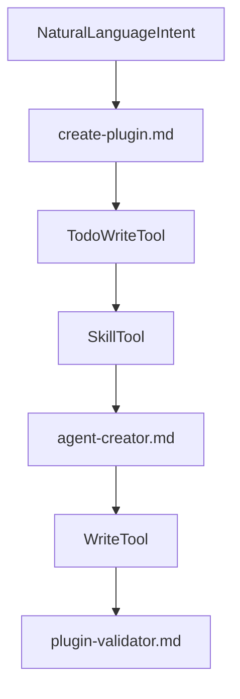
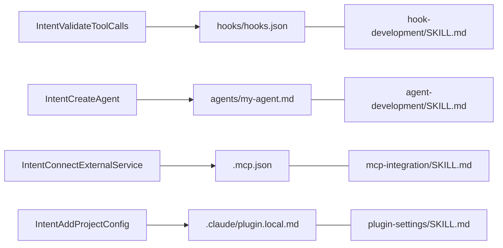
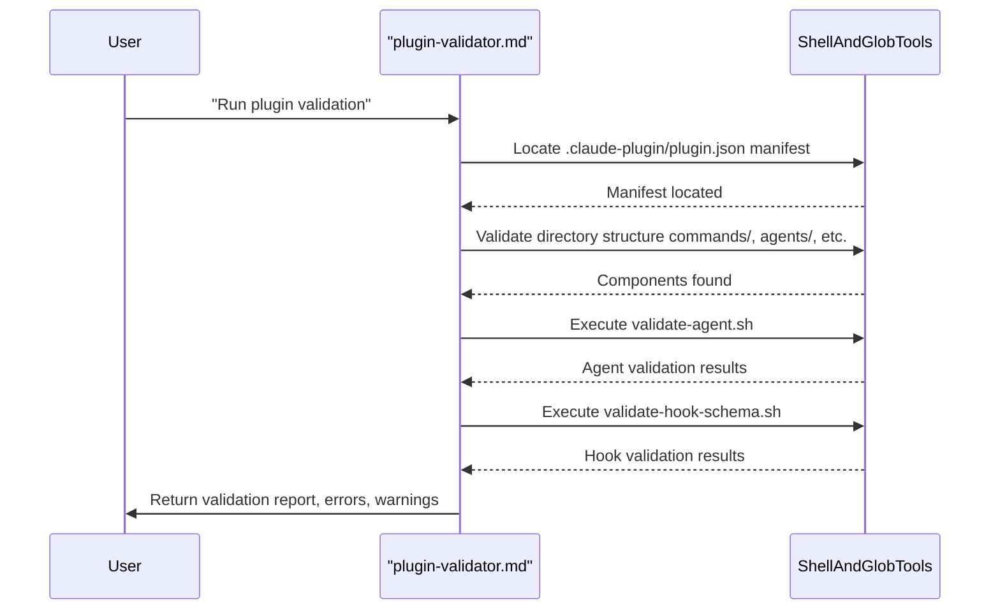

<!-- source: DeepWiki mcp.deepwiki.com · repo anthropics/claude-code · page 5.7 Plugin Development Kit · fetched 2026-10-26 -->

# Plugin Development Kit

<details>
<summary>Relevant source files</summary>

The following files were used as context for generating this wiki page:

- [.claude-plugin/marketplace.json](.claude-plugin/marketplace.json)
- [plugins/agent-sdk-dev/.claude-plugin/plugin.json](plugins/agent-sdk-dev/.claude-plugin/plugin.json)
- [plugins/agent-sdk-dev/agents/agent-sdk-verifier-py.md](plugins/agent-sdk-dev/agents/agent-sdk-verifier-py.md)
- [plugins/agent-sdk-dev/agents/agent-sdk-verifier-ts.md](plugins/agent-sdk-dev/agents/agent-sdk-verifier-ts.md)
- [plugins/agent-sdk-dev/commands/new-sdk-app.md](plugins/agent-sdk-dev/commands/new-sdk-app.md)
- [plugins/commit-commands/commands/clean_gone.md](plugins/commit-commands/commands/clean_gone.md)
- [plugins/commit-commands/commands/commit-push-pr.md](plugins/commit-commands/commands/commit-push-pr.md)
- [plugins/commit-commands/commands/commit.md](plugins/commit-commands/commands/commit.md)
- [plugins/frontend-design/.claude-plugin/plugin.json](plugins/frontend-design/.claude-plugin/plugin.json)
- [plugins/frontend-design/README.md](plugins/frontend-design/README.md)
- [plugins/frontend-design/skills/frontend-design/SKILL.md](plugins/frontend-design/skills/frontend-design/SKILL.md)
- [plugins/pr-review-toolkit/.claude-plugin/plugin.json](plugins/pr-review-toolkit/.claude-plugin/plugin.json)
- [plugins/pr-review-toolkit/README.md](plugins/pr-review-toolkit/README.md)
- [plugins/pr-review-toolkit/agents/code-reviewer.md](plugins/pr-review-toolkit/agents/code-reviewer.md)

</details>


The **Plugin Development Kit** (offered by the `plugin-dev` plugin) provides a comprehensive set of expert skills and tools designed to help developers create, structure, and validate high-quality plugins for Claude Code [.claude-plugin/marketplace.json:106-115](). It addresses seven core areas critical for plugin development, including plugin structure, agent creation, command and hook development, skill integration, MCP server connectivity, and plugin settings management. The toolkit also features AI-assisted workflows, such as the `/plugin-dev:create-plugin` command, alongside validation agents and rich documentation to ensure best practices and correctness.

---

## Purpose and Scope

The `plugin-dev` toolkit streamlines the plugin development lifecycle by facilitating:

- **Modular plugin design**: Defining and organizing commands, agents, hooks, skills, MCP servers, and project-level settings.
- **Autonomous agent development**: Employing the `agent-creator` to auto-generate agents with expert-crafted personas and system prompts.
- **Event-driven automation**: Writing proactive or reactive hooks triggered on Claude Code lifecycle events.
- **External service integration**: Using the Model Context Protocol (MCP) to embed external servers as plugins’ tools.
- **Standardized structure and manifests**: Following directory layouts and `plugin.json` specifications for auto-discovery.
- **Comprehensive validation**: Running the `plugin-validator` agent and shell validation scripts ensuring correctness and adherence to guidelines.

Sources: [.claude-plugin/marketplace.json:106-115]()

---

## Core Components of Plugin Development Kit

The toolkit is segmented into seven specialized skills, each documented with detailed usage guidance, examples, and references. This segmentation enables developers to progressively master plugin development subdomains.

| Skill Name          | Description                                                                                  |
|---------------------|----------------------------------------------------------------------------------------------|
| **Plugin Structure**    | Defines standardized plugin directory layout, component naming, and manifest formats. |
| **Agent Development**   | Guidelines for building autonomous agents using Markdown frontmatter and system prompts, including example-driven triggers. |
| **Command Development** | Creating slash commands via Markdown with YAML frontmatter defining arguments and usage. |
| **Hook Development**    | Crafting event-driven automation hooks triggered pre/post tool use or at lifecycle events. |
| **Skill Development**   | Building modular reusable skill packages comprising documentation, scripts, references, and assets. |
| **MCP Integration**     | Configuring and managing external MCP servers with support for stdio, SSE, HTTP, and WebSocket protocols. |
| **Plugin Settings**     | Managing project or user settings using YAML-frontmatter-markdown files for plugin configuration and state. |

Sources: [.claude-plugin/marketplace.json:106-115]()

---

## Guided Workflow: The `/create-plugin` Command

The `/plugin-dev:create-plugin` slash command delivers an AI-guided, multi-phase process for building plugins. It relies on internal task tracking tools to manage phase progression and dynamically loads relevant plugin-dev skills for each step. The AI assistance agent helps generate autonomous agents aligned with user intent, while validation ensures component correctness. [.claude-plugin/marketplace.json:106-115]()

### Workflow Phases

1. **Discovery**  
   Extract plugin goals, target audience, and problem definition from user input.

2. **Component Planning**  
   Determine which components are needed: skills, commands, agents, hooks, MCP, and settings.

3. **Detailed Design**  
   Clarify design ambiguities via developer queries for each planned component.

4. **Structure Creation**  
   Generate a standardized directory layout and the `plugin.json` manifest file.

5. **Component Implementation**  
   Create detailed implementation files leveraging specialized skills (e.g., for command or agent development).

6. **Validation**  
   Invoke validation agents and specific shell scripts to check components’ correctness and style conformity.

7. **Testing**  
   Conduct interactive testing of the plugin’s behavior inside the Claude Code environment.

8. **Documentation**  
   Produce a README and publish metadata to prepare the plugin for distribution.

Sources: [.claude-plugin/marketplace.json:106-115]()

---

## Plugin Structure and Manifest

Plugin components are structured with prescribed conventions to enable auto-discovery and seamless integration.

### Directory Layout

```
plugin-name/
├── .claude-plugin/
│   └── plugin.json          # Mandatory manifest file declaring metadata and paths
├── commands/                # Slash command Markdown files
├── agents/                  # Autonomous agent Markdown definitions
├── skills/                  # Agent skill packages (subdirectories with SKILL.md)
│   └── skill-name/
│       └── SKILL.md         # Skill core documentation and metadata
├── hooks/
│   └── hooks.json          # Event handler configuration for hook scripts
├── .mcp.json               # MCP server declarations (optional)
└── scripts/                # Utilities and helper scripts (optional)
```

This layout ensures that the Claude Code runtime and plugin tooling can efficiently locate and load components.

### Manifest Configuration (`plugin.json`)

The JSON manifest located at `.claude-plugin/plugin.json` defines plugin metadata and can override or supplement component discovery paths.

Example minimal manifest:

```json
{
  "name": "plugin-name"
}
```

Recommended fields include version, description, author info, license, and keywords for marketplace indexing. Component paths for commands, agents, hooks, and MCP servers may be overridden using relative paths or arrays:

```json
{
  "name": "plugin-name",
  "commands": "./custom-commands",
  "agents": ["./agents", "./extra-agents"],
  "hooks": "./config/hooks.json",
  "mcpServers": "./.mcp.json"
}
```

Rules for paths:
- Must be relative and start with `./`.
- Paths supplement (do not replace) default directories.
- Use kebab-case for file and directory naming consistency.

Sources: [.claude-plugin/marketplace.json:106-115]()

---

## Agent and Skill Development

### Agent Configuration

Agents are defined as Markdown documents with YAML frontmatter specifying:
- `name`: Unique identifier.
- `description`: Detailed purpose accompanied by `<example>` blocks illustrating use cases and triggers.
- `model`: LLM model to use (`inherit`, `sonnet`, `haiku`, `opus`).
- `color`: Visual label color to communicate role.
- Optional fields for restricted tools, prompts, and settings.

The Markdown body forms the system prompt, defining the agent's behavior explicitly and precisely. Agents typically restrict tool access to only what they need (least privilege), enhancing security and predictability.

### Agent Creator

The agent creator subsystem is a dedicated AI subagent that translates developer input into production-ready agent definitions. It extracts intent from user messages, designs expert personas, constructs robust system prompts, and validates names and descriptions for clarity.

### Skill Anatomy

Skills extend Claude Code’s capabilities with reusable, documented workflows. They consist of:
- `SKILL.md`: Metadata (`name`, `description`) and detailed instructions.
- `scripts/`: Executable scripts for automated tasks.
- `references/`: Documentation and data resources scoped for on-demand loading.
- `assets/`: Output resources such as templates or images.

Skills utilize progressive disclosure to manage context efficiently by loading metadata first, then SKILL.md content on invocation, and large assets only as needed.

Sources: [.claude-plugin/marketplace.json:106-115]()

---

## Hook, MCP, and Settings Integration

### Hooks API

Hooks are declarative or programmatic event handlers executed at key lifecycle points. They are configured via `hooks/hooks.json` or inline in plugin manifests.

**Hook types:**
- **Prompt-based hooks**: Use LLM evaluations to approve or deny actions dynamically on events like `PreToolUse`, `PostToolUse`, `Stop`, `SubagentStop`, and `UserPromptSubmit`. They return structured JSON with permission flags (`allow`, `deny`, `ask`).
- **Command hooks**: Shell scripts or binaries that deterministically validate or modify behavior before/after events.

### Model Context Protocol (MCP)

MCP allows plugins to embed external services as tools, enhancing capabilities through subprocesses or external APIs.

**Configurations:**
- Declared in `.mcp.json` or inline in `plugin.json`.
- Supported server types:
  - **stdio**: Local subprocess using stdin/stdout.
  - **sse**: Server-Sent Events with OAuth support.
  - **http**: REST APIs with token authentication.
  - **ws**: WebSocket for real-time bidirectional communication.

Environment variable substitutions support `${CLAUDE_PLUGIN_ROOT}` and shell environment variables, enhancing flexibility. MCP automates tool naming using the format `mcp__plugin_<plugin-name>_<server-name>__<tool-name>`.

### Plugin Settings Pattern

Plugin-specific, user- or project-scoped configuration uses `.claude/plugin-name.local.md` files in root directories. These are Markdown files with YAML frontmatter describing configuration keys and values, plus optional descriptive bodies.

Sources: [.claude-plugin/marketplace.json:106-115]()

---

## Data Flow and Code Entity Mapping

### Plugin Creation Data Flow

This diagram illustrates the data flow from a user’s natural language intent to the final plugin files, through the creation command and its supporting tools.



Sources: [.claude-plugin/marketplace.json:106-115]()

---

### Mapping Developer Intent to Code Entities (Natural Language Space to Code Entity Space)

Below is a diagram mapping natural language developer intentions to concrete plugin file entities and associated skill documentation for developer reference, bridging natural language spaces to concrete code entities.



Sources: [.claude-plugin/marketplace.json:106-115]()

---

### Plugin Validation Process

The plugin validation agent orchestrates multi-step validation to ensure plugin integrity and adherence to quality standards.



Sources: [.claude-plugin/marketplace.json:106-115]()

---

# Summary

The **Plugin Development Kit** encapsulates a full-featured environment to create robust plugins for Claude Code. It defines clear structures, facilitates expert agent and hook creation, supports external integrations, and automates quality verification. The creation workflow accelerates development by AI-assisted steps, enabling developers to easily build maintainable and extensible plugins.

Sources:
- [.claude-plugin/marketplace.json:106-115]()

---

