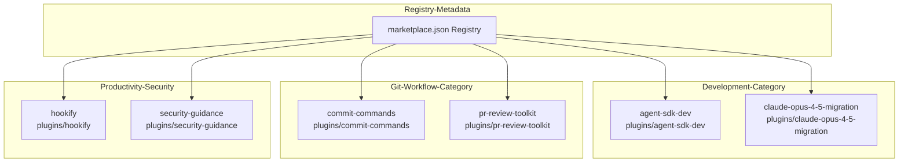
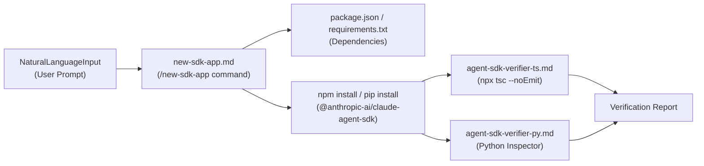

<!-- source: DeepWiki mcp.deepwiki.com · repo anthropics/claude-code · page 5.8 Other Marketplace Plugins · fetched 2026-10-26 -->

# Other Marketplace Plugins

Relevant source files

The following files were used as context for generating this wiki page:

- [plugins/agent-sdk-dev/.claude-plugin/plugin.json](plugins/agent-sdk-dev/.claude-plugin/plugin.json)
- [plugins/agent-sdk-dev/agents/agent-sdk-verifier-py.md](plugins/agent-sdk-dev/agents/agent-sdk-verifier-py.md)
- [plugins/agent-sdk-dev/agents/agent-sdk-verifier-ts.md](plugins/agent-sdk-dev/agents/agent-sdk-verifier-ts.md)
- [plugins/agent-sdk-dev/commands/new-sdk-app.md](plugins/agent-sdk-dev/commands/new-sdk-app.md)
- [plugins/claude-opus-4-5-migration/.claude-plugin/plugin.json](plugins/claude-opus-4-5-migration/.claude-plugin/plugin.json)
- [plugins/claude-opus-4-5-migration/README.md](plugins/claude-opus-4-5-migration/README.md)
- [plugins/claude-opus-4-5-migration/skills/claude-opus-4-5-migration/SKILL.md](plugins/claude-opus-4-5-migration/skills/claude-opus-4-5-migration/SKILL.md)
- [plugins/claude-opus-4-5-migration/skills/claude-opus-4-5-migration/references/effort.md](plugins/claude-opus-4-5-migration/skills/claude-opus-4-5-migration/references/effort.md)
- [plugins/claude-opus-4-5-migration/skills/claude-opus-4-5-migration/references/prompt-snippets.md](plugins/claude-opus-4-5-migration/skills/claude-opus-4-5-migration/references/prompt-snippets.md)
- [plugins/code-review/.claude-plugin/plugin.json](plugins/code-review/.claude-plugin/plugin.json)
- [plugins/commit-commands/.claude-plugin/plugin.json](plugins/commit-commands/.claude-plugin/plugin.json)
- [plugins/commit-commands/commands/clean_gone.md](plugins/commit-commands/commands/clean_gone.md)
- [plugins/commit-commands/commands/commit-push-pr.md](plugins/commit-commands/commands/commit-push-pr.md)
- [plugins/commit-commands/commands/commit.md](plugins/commit-commands/commands/commit.md)
- [plugins/pr-review-toolkit/.claude-plugin/plugin.json](plugins/pr-review-toolkit/.claude-plugin/plugin.json)
- [plugins/pr-review-toolkit/README.md](plugins/pr-review-toolkit/README.md)
- [plugins/pr-review-toolkit/agents/code-reviewer.md](plugins/pr-review-toolkit/agents/code-reviewer.md)
- [plugins/security-guidance/.claude-plugin/plugin.json](plugins/security-guidance/.claude-plugin/plugin.json)
- [plugins/security-guidance/README.md](plugins/security-guidance/README.md)
- [plugins/security-guidance/hooks/_base.py](plugins/security-guidance/hooks/_base.py)
- [plugins/security-guidance/hooks/diffstate.py](plugins/security-guidance/hooks/diffstate.py)
- [plugins/security-guidance/hooks/ensure_agent_sdk.py](plugins/security-guidance/hooks/ensure_agent_sdk.py)
- [plugins/security-guidance/hooks/extensibility.py](plugins/security-guidance/hooks/extensibility.py)
- [plugins/security-guidance/hooks/gitutil.py](plugins/security-guidance/hooks/gitutil.py)
- [plugins/security-guidance/hooks/hooks.json](plugins/security-guidance/hooks/hooks.json)
- [plugins/security-guidance/hooks/llm.py](plugins/security-guidance/hooks/llm.py)
- [plugins/security-guidance/hooks/patterns.py](plugins/security-guidance/hooks/patterns.py)
- [plugins/security-guidance/hooks/review_api.py](plugins/security-guidance/hooks/review_api.py)
- [plugins/security-guidance/hooks/security_reminder_hook.py](plugins/security-guidance/hooks/security_reminder_hook.py)

This document covers additional bundled plugins available in the Claude Code marketplace. These plugins provide specialized workflows for Agent SDK application development, model migration, git automation, pull request reviews, custom hook creation, and multi-layered security enforcement.

## Plugin Registry Overview

The marketplace registry defines the metadata and source locations for these official plugins, categorizing them into development, git workflow, productivity, and security scopes [plugins/agent-sdk-dev/.claude-plugin/plugin.json:1-9]().

Title: "Plugin Architecture and Registry Mapping"

Sources: [plugins/agent-sdk-dev/.claude-plugin/plugin.json:1-9](), [plugins/claude-opus-4-5-migration/.claude-plugin/plugin.json:1-9](), [plugins/security-guidance/.claude-plugin/plugin.json:1-10](), [plugins/pr-review-toolkit/.claude-plugin/plugin.json:1-9](), [plugins/commit-commands/.claude-plugin/plugin.json:1-9]()

---

## Development & Migration Tools

### agent-sdk-dev

The **agent-sdk-dev** plugin facilitates interactive scaffolding, setup, and verification of Claude Agent SDK applications for both TypeScript and Python environments [plugins/agent-sdk-dev/.claude-plugin/plugin.json:1-9]().

- **Command `/new-sdk-app`** guides users through a structured questionnaire to collect project requirements: language selection, project name, agent type, and starter templates [plugins/agent-sdk-dev/commands/new-sdk-app.md:27-58]().
- It checks for the latest SDK package versions (`@anthropic-ai/claude-agent-sdk` for TypeScript or `claude-agent-sdk` for Python) via web tools and installs them [plugins/agent-sdk-dev/commands/new-sdk-app.md:74-88]().
- Post-creation, users can invoke specialized verifier agents:
  - `agent-sdk-verifier-ts` [plugins/agent-sdk-dev/agents/agent-sdk-verifier-ts.md:2-5]() validates TypeScript SDK projects for correct ES module configuration (`"type": "module"` in `package.json`), proper `tsconfig.json` settings, and type safety via `npx tsc --noEmit` [plugins/agent-sdk-dev/agents/agent-sdk-verifier-ts.md:13-43]().
  - `agent-sdk-verifier-py` [plugins/agent-sdk-dev/agents/agent-sdk-verifier-py.md:2-5]() performs thorough inspection for Python projects, ensuring `claude-agent-sdk` is installed, verifying dependency declarations (`requirements.txt` or `pyproject.toml`), and checking for hardcoded credentials [plugins/agent-sdk-dev/agents/agent-sdk-verifier-py.md:13-55]().

Title: "Agent SDK Scaffolding and Code Entity Verification Flow"

Sources: [plugins/agent-sdk-dev/.claude-plugin/plugin.json:1-9](), [plugins/agent-sdk-dev/commands/new-sdk-app.md:27-160](), [plugins/agent-sdk-dev/agents/agent-sdk-verifier-ts.md:1-140](), [plugins/agent-sdk-dev/agents/agent-sdk-verifier-py.md:1-140]()

---

### claude-opus-4-5-migration

This plugin automates the migration of codebases and system prompts from earlier models (such as Claude Sonnet 4.x or Opus 4.1) to **Opus 4.5** [plugins/claude-opus-4-5-migration/skills/claude-opus-4-5-migration/SKILL.md:2-4]().

- **Model String Updates:** Scans and replaces model identifiers across platforms (Anthropic API, AWS Bedrock, Google Vertex AI) with Opus 4.5 target strings, e.g., `claude-opus-4-5-20251101` [plugins/claude-opus-4-5-migration/skills/claude-opus-4-5-migration/SKILL.md:31-38]().
- **Prompt Adjustments:** Softens aggressive tool-triggering phrasing (e.g., replacing "CRITICAL: You MUST" with "Use this tool when") to prevent over-triggering on the more capable Opus 4.5 architecture [plugins/claude-opus-4-5-migration/skills/claude-opus-4-5-migration/references/prompt-snippets.md:5-18]().
- **Over-Engineering Prevention:** Discourages unnecessary file creation or abstractions [plugins/claude-opus-4-5-migration/skills/claude-opus-4-5-migration/references/prompt-snippets.md:20-34]().
- **Frontend Design Quality:** Injects a `<frontend_aesthetics>` XML block to avoid generic UI styling and prioritize distinctive typography, motion, and layout token systems [plugins/claude-opus-4-5-migration/skills/claude-opus-4-5-migration/references/prompt-snippets.md:48-74]().

**Model String Mapping Table:**

| Source Model | Anthropic API (1P)                   | AWS Bedrock                             | Google Vertex AI           |
|--------------|------------------------------------|----------------------------------------|---------------------------|
| Sonnet 4.0   | `claude-sonnet-4-20250514`         | `anthropic.claude-sonnet-4-20250514-v1:0` | `claude-sonnet-4@20250514` |
| Sonnet 4.5   | `claude-sonnet-4-5-20250929`       | `anthropic.claude-sonnet-4-5-20250929-v1:0` | `claude-sonnet-4-5@20250929` |
| Opus 4.1     | `claude-opus-4-1-20250422`         | `anthropic.claude-opus-4-1-20250422-v1:0`  | `claude-opus-4-1@20250422`  |
| **Target**   | `claude-opus-4-5-20251101` (Opus 4.5) | `anthropic.claude-opus-4-5-20251101-v1:0`   | `claude-opus-4-5@20251101`  |

Sources: [plugins/claude-opus-4-5-migration/skills/claude-opus-4-5-migration/SKILL.md:1-105](), [plugins/claude-opus-4-5-migration/skills/claude-opus-4-5-migration/references/prompt-snippets.md:1-106]()

---

## Git & Workflow Automation

### commit-commands

This plugin streamlines common git and GitHub operations by wrapping multiple CLI interactions into convenient slash commands [plugins/commit-commands/.claude-plugin/plugin.json:1-9]().

| Command            | Description                                                                                                  |
|--------------------|--------------------------------------------------------------------------------------------------------------|
| `/commit`          | Analyzes staged and unstaged changes, then drafts and creates a commit with a message matching repository conventions [plugins/commit-commands/commands/commit.md:1-17](). |
| `/commit-push-pr`  | Automates creating a topic branch, staging changes, pushing to origin, and opening a pull request via `gh pr create` [plugins/commit-commands/commands/commit-push-pr.md:1-20](). |
| `/clean_gone`      | Detects local branches tracking remote branches marked `[gone]`, deletes them, and prunes associated git worktrees [plugins/commit-commands/commands/clean_gone.md:1-28](). |

Sources: [plugins/commit-commands/.claude-plugin/plugin.json:1-9](), [plugins/commit-commands/commands/commit.md:1-17](), [plugins/commit-commands/commands/commit-push-pr.md:1-20](), [plugins/commit-commands/commands/clean_gone.md:1-28]()

---

### pr-review-toolkit

A collection of specialized review agents designed to assist with automated pull request analysis and code quality checks [plugins/pr-review-toolkit/.claude-plugin/plugin.json:1-9]().

| Agent                  | Purpose                                                                                         |
|------------------------|-------------------------------------------------------------------------------------------------|
| `comment-analyzer`     | Identifies discrepancies and inaccuracies in documentation relative to actual codebase behavior [plugins/pr-review-toolkit/README.md:1-15]().     |
| `pr-test-analyzer`    | Scores test coverage gaps on a scale from 1 to 10, flagging critical missing test cases [plugins/pr-review-toolkit/README.md:1-15]().   |
| `silent-failure-hunter`| Detects silent failure scenarios such as empty catch blocks or swallowed exceptions [plugins/pr-review-toolkit/README.md:1-15]().      |
| `type-design-analyzer` | Evaluates type encapsulation and enforces strict type invariants [plugins/pr-review-toolkit/README.md:1-15]().              |
| `code-reviewer`        | Performs general PR audits for `CLAUDE.md` compliance and bug detection [plugins/pr-review-toolkit/agents/code-reviewer.md:1-47]().    |
| `code-simplifier`      | Suggests refactoring to reduce unnecessary complexity, excessive nesting, or indirection [plugins/pr-review-toolkit/README.md:1-15]().         |

Sources: [plugins/pr-review-toolkit/.claude-plugin/plugin.json:1-9](), [plugins/pr-review-toolkit/README.md:1-15](), [plugins/pr-review-toolkit/agents/code-reviewer.md:1-47]()

---

## Security & Hooks

### security-guidance

The `security-guidance` plugin provides automated security reviews for Claude-generated code through three distinct enforcement layers [plugins/security-guidance/README.md:1-10]().

#### 1. Pattern-based Warnings (Layer 1)
Fast regex checks run on every file write via `PostToolUse` hooks matching `Edit|Write|MultiEdit|NotebookEdit` [plugins/security-guidance/hooks/hooks.json:25-34]().
- **Vulnerabilities detected**: Hardcoded secrets, SQL injection, command injection, path traversal, and insecure deserialization [plugins/security-guidance/hooks/security_reminder_hook.py:12-15]().
- **Reminders**: Injects brief warnings (e.g., `_UNSAFE_YAML_LOAD_REMINDER`) via `additionalContext` if patterns like `yaml.load()` or `pickle.loads()` are detected [plugins/security-guidance/hooks/patterns.py:15-28]().

#### 2. LLM Diff Review (Layer 2)
When Claude finishes a turn, the `Stop` hook triggers an LLM-powered review of the diff [plugins/security-guidance/hooks/hooks.json:57-70]().
- **Baseline mechanism**: On `UserPromptSubmit`, the plugin executes `capture_git_baseline` (using `git stash create`) to capture a baseline SHA representing the state before Claude's turn [plugins/security-guidance/hooks/security_reminder_hook.py:24-30](), [plugins/security-guidance/hooks/diffstate.py:163-171]().
- **Analysis**: Uses a fast LLM (defaulting to `claude-opus-4-7`) to perform a concrete vulnerability scan [plugins/security-guidance/README.md:33](), [plugins/security-guidance/hooks/security_reminder_hook.py:17-22]().
- **Correction**: If high-severity findings are found, the plugin uses `asyncRewake` with a rewake message to force Claude to address the issues [plugins/security-guidance/hooks/hooks.json:63-66]().

#### 3. Agentic Commit Review (Layer 3)
Triggered on `git commit` or `git push` via `PostToolUse[Bash]` hooks [plugins/security-guidance/hooks/hooks.json:35-55]().
- **Data Flow Tracing**: Unlike static diff reviews, this agentic reviewer uses `Read`, `Grep`, and `Glob` tools to trace data flow across the codebase [plugins/security-guidance/README.md:7]().
- **Investigation**: Follows the `_AGENTIC_INVESTIGATE_SYSTEM` methodology to map entry points to sinks [plugins/security-guidance/hooks/llm.py:127](), [plugins/security-guidance/hooks/review_api.py:71-85]().
- **Agent SDK Bootstrap**: The plugin ensures the `claude_agent_sdk` is importable. If not available in the system Python environment, `ensure_agent_sdk.py` provisions a virtual environment at `~/.claude/security/agent-sdk-venv` and installs the required SDK package [plugins/security-guidance/hooks/ensure_agent_sdk.py:1-15]().

Title: "Security Guidance Code Entity Enforcement Architecture"

```mermaid
graph TD
    subgraph "Layer-1-Patterns"
        PostToolHook["PostToolUse Hook<br/>(security_reminder_hook.py)"] --> RegexPatterns["patterns.py<br/>(SECURITY_PATTERNS)"]
    end
    
    subgraph "Layer-2-DiffReview"
        UPS["UserPromptSubmit Hook<br/>(diffstate.py: capture_git_baseline)"] --> StopHook["Stop Hook<br/>(git diff + llm.py analyze_code_security)"]
        StopHook --> AsyncRewake["asyncRewake Response<br/>(hooks.json)"]
    end
    
    subgraph "Layer-3-AgenticReview"
        SessionStart["SessionStart Hook<br/>(ensure_agent_sdk.py)"] --> BashCommit["PostToolUse[Bash]<br/>(git commit / git push)"]
        BashCommit --> AgenticReview["review_api.py<br/>(agentic_review)"]
        AgenticReview --> ToolsFS["Read / Grep / Glob Tools"]
    end
```

Sources: [plugins/security-guidance/README.md:1-60](), [plugins/security-guidance/hooks/hooks.json:1-71](), [plugins/security-guidance/hooks/security_reminder_hook.py:1-53](), [plugins/security-guidance/hooks/patterns.py:1-128](), [plugins/security-guidance/hooks/ensure_agent_sdk.py:1-163](), [plugins/security-guidance/hooks/diffstate.py:163-171]()

---

### hookify

The **hookify** plugin provides a framework for creating custom hook handlers using markdown rules and a Python-based pattern matching engine [plugins/hookify/README.md:1-10]().

- **Config Loading**: The `config_loader.py` module manages the ingestion and validation of markdown-based rule definitions [plugins/hookify/core/config_loader.py:1-35]().
- **Rule Management**: Enables teams to define project-specific event handlers that trigger on events like `SessionStart` or `PreToolUse`.
- **Discovery Commands**: Includes CLI commands such as `/hookify list` and `/hookify configure` to inspect and manage active custom rules [plugins/hookify/commands/list.md:1-5](), [plugins/hookify/commands/configure.md:1-10]().

Sources: [plugins/hookify/README.md:1-20](), [plugins/hookify/core/config_loader.py:1-35](), [plugins/hookify/commands/list.md:1-5](), [plugins/hookify/commands/configure.md:1-10]()

---

