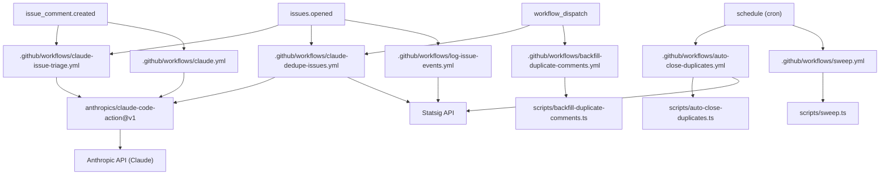
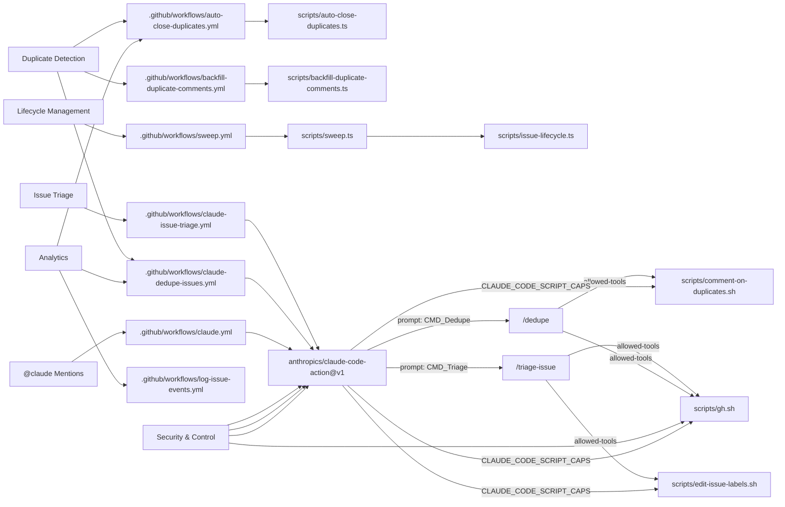

<!-- source: DeepWiki mcp.deepwiki.com · repo anthropics/claude-code · page 6 GitHub Automation · fetched 2026-10-26 -->

# GitHub Automation

Relevant source files

The following files were used as context for generating this wiki page:

- [.claude/commands/commit-push-pr.md](.claude/commands/commit-push-pr.md)
- [.claude/commands/dedupe.md](.claude/commands/dedupe.md)
- [.claude/commands/triage-issue.md](.claude/commands/triage-issue.md)
- [.github/workflows/auto-close-duplicates.yml](.github/workflows/auto-close-duplicates.yml)
- [.github/workflows/backfill-duplicate-comments.yml](.github/workflows/backfill-duplicate-comments.yml)
- [.github/workflows/claude-dedupe-issues.yml](.github/workflows/claude-dedupe-issues.yml)
- [.github/workflows/claude-issue-triage.yml](.github/workflows/claude-issue-triage.yml)
- [.github/workflows/claude.yml](.github/workflows/claude.yml)
- [.github/workflows/issue-lifecycle-comment.yml](.github/workflows/issue-lifecycle-comment.yml)
- [.github/workflows/log-issue-events.yml](.github/workflows/log-issue-events.yml)
- [.github/workflows/sweep.yml](.github/workflows/sweep.yml)
- [scripts/auto-close-duplicates.ts](scripts/auto-close-duplicates.ts)
- [scripts/backfill-duplicate-comments.ts](scripts/backfill-duplicate-comments.ts)
- [scripts/comment-on-duplicates.sh](scripts/comment-on-duplicates.sh)
- [scripts/edit-issue-labels.sh](scripts/edit-issue-labels.sh)
- [scripts/gh.sh](scripts/gh.sh)
- [scripts/issue-lifecycle.ts](scripts/issue-lifecycle.ts)
- [scripts/lifecycle-comment.ts](scripts/lifecycle-comment.ts)
- [scripts/sweep.ts](scripts/sweep.ts)

This document provides a high-level overview of the suite of GitHub Actions workflows employed by Claude Code to automate issue and pull request management. These workflows leverage Claude as an AI engine to triage issues, identify duplicates, manage their lifecycle, respond to direct mentions, coordinate cross-repository notifications, and collect analytics. Each capability is implemented as a distinct workflow or script, working in concert to maintain repository health and reduce human manual effort.

For deeper technical details, refer to the child pages:
- **[AI-Powered Issue Triage](#6.1)** — Implements the `claude-issue-triage.yml` workflow which uses Claude for automatic label classification, responding to the `/triage-issue` command, and integrates with a security-hardened `gh.sh` wrapper. For details, see [AI-Powered Issue Triage](#6.1).
- **[Issue Deduplication System](#6.2)** — Covers the `claude-dedupe-issues.yml` workflow, the `/dedupe` slash command performing parallel searches for duplicate issues, the `auto-close-duplicates.ts` script that waits 3 days before closing duplicates automatically, and a backfill workflow for legacy issues. For details, see [Issue Deduplication System](#6.2).
- **[Issue Lifecycle Management](#6.3)** — Details scheduled workflows (`sweep.yml`, `remove-autoclose-label`, `lock-closed-issues`, `lifecycle comments`) that mark issues stale, close expired ones, and provide lifecycle comment notifications. The single source of truth for label timeouts resides in `issue-lifecycle.ts`. For details, see [Issue Lifecycle Management](#6.3).
- **[@Claude Mentions Workflow](#6.4)** — Describes the general-purpose `claude.yml` workflow triggered by `@claude` mentions in comments across issues and PRs. For details, see [@Claude Mentions Workflow](#6.4).
- **[Cross-Repository Event Notifications](#6.5)** — Explains how the `issue-opened-dispatch` workflow sends `repository_dispatch` events to external repositories for coordinated multi-repo workflows. For details, see [Cross-Repository Event Notifications](#6.5).
- **[Event Logging & Analytics](#6.6)** — Shows integration with Statsig for comprehensive event logging and analysis of issue creation, deduplication comments, and issue closure events. For details, see [Event Logging & Analytics](#6.6).

---

## System Overview: Components and Event Flows

The GitHub automation system is composed of multiple workflows triggered by GitHub events or scheduled timers [.github/workflows/claude-issue-triage.yml:1-7](). Interaction with Claude is encapsulated in the `anthropics/claude-code-action@v1` GitHub Action [.github/workflows/claude-issue-triage.yml:30-30](), which manages sending prompts and scripts to the Claude API. Additionally, custom TypeScript scripts run on Bun provide logic-intensive tasks for issue lifecycle transitions [.github/workflows/auto-close-duplicates.ts:25-26]().

The following diagram illustrates the event source → workflow → execution → external API flow, bridging high-level concepts to underlying code entities:

Title: "GitHub Automation Event and Logic Flow"

**Sources:**   
- [.github/workflows/claude-issue-triage.yml:1-47]()  
- [.github/workflows/claude-dedupe-issues.yml:1-44]()  
- [.github/workflows/auto-close-duplicates.yml:1-31]()  
- [scripts/auto-close-duplicates.ts:1-100]()  
- [.github/workflows/claude.yml:1-43]()  
- [scripts/backfill-duplicate-comments.ts:1-213]()  
- [.github/workflows/log-issue-events.yml:1-40]()
- [.github/workflows/sweep.yml:1-31]()
- [scripts/sweep.ts:1-168]()

---

## Workflow Trigger Matrix and Concurrency

Workflows are activated by repository hooks, schedules, or manual dispatches. Concurrency rules prevent race conditions on shared issue states:

| Workflow                       | Trigger Event(s)                         | Scheduled  | Manual Dispatch | Concurrency Handling             |
|-------------------------------|---------------------------------------|------------|-----------------|---------------------------------|
| `claude-issue-triage.yml`      | Issue opened, issue comment created   | No         | No              | One concurrent job per issue # [.github/workflows/claude-issue-triage.yml:15-17]() |
| `claude-dedupe-issues.yml`     | Issue opened                         | No         | Yes             | Default                         |
| `auto-close-duplicates.yml`    | -                                   | Daily 09:00 [.github/workflows/auto-close-duplicates.yml:5-5]() | Yes             | Default                         |
| `claude.yml` (@claude mentions) | Issue/PR comment mention             | No         | No              | Default                         |
| `log-issue-events.yml`         | Issue opened or closed               | No         | No              | Default                         |
| `sweep.yml`                    | -                                   | 10:00/22:00 [.github/workflows/sweep.yml:5-5]() | Yes             | `daily-issue-sweep` group [.github/workflows/sweep.yml:12-12]() |
| `backfill-duplicate-comments.yml` | -                                   | No         | Yes             | Default                         |

**Sources:**   
- [.github/workflows/claude-issue-triage.yml:2-17]()  
- [.github/workflows/claude-dedupe-issues.yml:3-11]()  
- [.github/workflows/auto-close-duplicates.yml:3-6]()  
- [.github/workflows/claude.yml:3-20]()  
- [.github/workflows/log-issue-events.yml:3-5]()
- [.github/workflows/sweep.yml:3-12]()
- [.github/workflows/backfill-duplicate-comments.yml:3-29]()

---

## Execution Model and Safeguards

AI-driven workflows interface with Claude Code via `anthropics/claude-code-action@v1` [.github/workflows/claude-issue-triage.yml:30-30](), authenticated securely through Workload Identity Federation OIDC tokens [.github/workflows/claude-issue-triage.yml:39-45](). 

To ensure safety and restrict Claude's privileges when modifying repository assets, script execution is strictly bounded using the `CLAUDE_CODE_SCRIPT_CAPS` environment variable and security wrappers like `scripts/gh.sh` [.github/workflows/claude-issue-triage.yml:34-34](). For details on individual triage operations, see [AI-Powered Issue Triage](#6.1).

**Sources:**   
- [.github/workflows/claude-issue-triage.yml:28-47]()  
- [.github/workflows/claude-dedupe-issues.yml:27-43]()  
- [scripts/gh.sh:1-96]()

---

# Summary Diagram: Natural Language Concepts to Code Entities

Title: "Mapping High-Level Automation to Implementation"

**Sources:** 
- [.github/workflows/claude-issue-triage.yml:34-34]()
- [.github/workflows/claude-dedupe-issues.yml:31-31]()
- [.claude/commands/triage-issue.md:2-2]()
- [.claude/commands/dedupe.md:2-2]()
- [scripts/gh.sh:1-96]()
- [scripts/edit-issue-labels.sh:1-30]()
- [scripts/comment-on-duplicates.sh:1-94]()
- [scripts/auto-close-duplicates.ts:1-277]()
- [scripts/backfill-duplicate-comments.ts:1-213]()
- [scripts/sweep.ts:1-168]()
- [scripts/issue-lifecycle.ts:1-38]()

---

